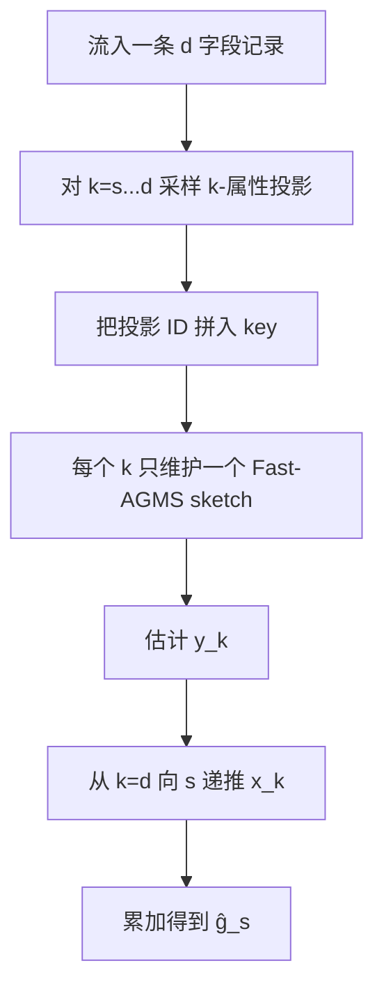
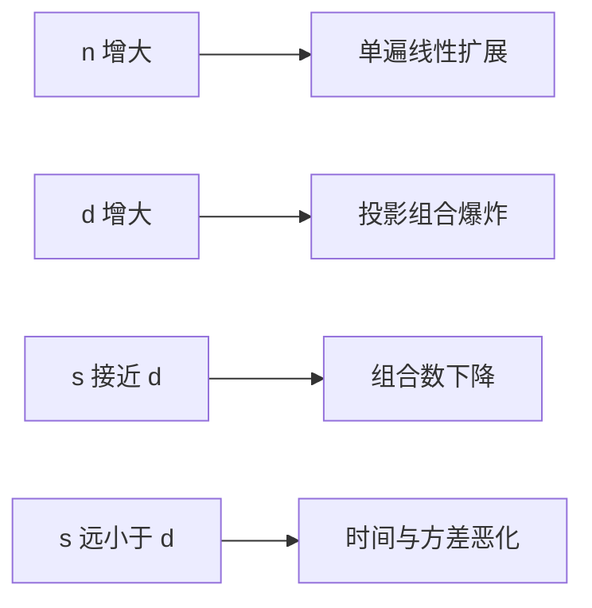

# Similarity Join and Similarity Self-Join Size Estimation in a Streaming Environment：批判性分析

## 1. Executive Summary + Visual Abstract

SJPC 研究的不是“执行 vector join”，而是在只扫描数据一次、不能保存全部输入时估计结果规模。作者的出发点是：对低维多字段记录，至少匹配 $s$ 个字段可改写成许多属性投影上的 equality self-join；后者就是二阶频率矩，可由 Fast-AGMS sketch 流式估计。困难在于同一对记录会在多个投影重复出现，于是论文再用组合计数递推消除重复 [Sections 1, 3–4]。


图 1：SJPC 的思想来源。解读：它把难以直接 sketch 的“近似匹配”还原为一组可以 sketch 的精确匹配统计。

论文证明估计无偏并给出概率误差、空间与时间界；实验中，在相同 48KB 空间下，SJPC 的标准差比随机采样低近一个数量级 [Sections 4, 7.3]。但复杂度对维度呈组合爆炸，作者明确将适用区间限定为低维或高阈值。它适合关系记录/离散字段，不是 768 维连续 embedding 的直接基数估计器。

**tl;dr：** SJPC 的核心洞察是“projection equality moments + inclusion–exclusion correction”。它把对 $n$ 的二次成本换成线性扫描，却把代价转移到 $d$ 与 $d-s$；这是论文最重要、也最容易被包装掩盖的边界。

## 2. Problem Definition

### 2.1 Essence

每条记录有 $d$ 个属性。若两条记录恰有 $k$ 个属性相等，记入 $x_k$；阈值 $s$ 的 self-join 规模为所有 $k\ge s$ 的 pair 加 self-pair。任务是在一遍数据流、次线性内存中估计它。

### 2.2 Formal Definition

$$
g_s=n+\sum_{k=s}^{d}x_k,
\qquad
\widehat\theta_s=\widehat g_s/n^2.
$$

对每个大小为 $k$ 的属性子集 $P$，令 $F_2(P)$ 是投影值频率的二阶矩。汇总所有 $k$-投影得到观测量 $y_k$，则高相似度 pair 会被组合次数重复计入：

$$
x_k=y_k-\binom{d}{k}n-\sum_{j=k+1}^{d}\binom{j}{k}x_j.
$$

这条自顶向下递推是算法正确性的核心；其中 $\binom{d}{k}n$ 去掉各投影中的 self-pair。

## 3. Method + Experimental Credibility

### 3.1 Method Mechanism



图 2：实现机制。解读：投影 ID 避免不同投影值误合并；每个 $k$ 合为一条流，把原本指数个 sketch 压为 $d-s+1$ 个。

```text
Algorithm: SJPC
Input: record stream R, dimension d, threshold s, projection sample rate r
Output: estimated self-join size ĝ_s

1: create one Fast-AGMS sketch A_k for each k=s,...,d
2: for each incoming record t do
3:     for k=s,...,d do
4:         sample k-attribute projections P of t with probability/rate r
5:         update A_k with key (projection-id(P), value(t[P]))
6: estimate y_k from A_k and undo projection sampling
7: for k=d,...,s do
8:     x̂_k ← ŷ_k - C(d,k)n - Σ_{j=k+1}^d C(j,k)x̂_j
9: return ĝ_s ← n + Σ_{k=s}^d x̂_k
```

空间为 $O(\log(1/\lambda)(d-s+1)w)$ 个 counters，每个 counter 需 $O(\log n)$ bits。每记录摘要成本为

$$
O\!\left(rt\sum_{k=s}^{d}\binom{d}{k}\right),
$$

总时间可粗略上界为 $O(nd^{d-s})$；论文 Theorem 3 的精细概率界还含 sketch width、$\epsilon$ 与组合项 [Sections 4–5]。因此“对输入线性”不等于“总体便宜”。

### 3.2 Experimental Credibility

论文使用 DBLP5、DBLP6、DBLPtitles、YFCC 与不同偏斜的合成数据，对比随机采样及离线 LSH-SS；报告均值/标准差，部分实验 30 次运行，且系统性改变维度、规模、sampling ratio、sketch width/depth [Section 7]。在线实验将双方内存对齐到 48KB，是较可信的 apples-to-apples 比较。

不过，真实数据核心维度仅约 5–6，恰是算法甜点区；更大规模实验主要验证随 $n$ 线性，而非现代高维向量。作者指出 signature-pattern baseline 的公式可能出错并与原作者沟通后不报告该结果，这提升了谨慎性，但也使 baseline 覆盖不完整 [Section 7.2]。

## 4. Results, Boundaries, Anti-Packaging

### 4.1 Claim Verification

| 声称 | 判断 | 锚点 |
|---|---|---|
| 一遍扫描、空间不随记录数线性增长 | Supported | Theorem 3；counter 位宽仍为 $O(\log n)$ |
| 给出无偏估计与高概率误差界 | Supported under sketch/sampling assumptions | Sections 4.1–4.2 |
| 同空间下比随机采样低近一个数量级误差 | Supported for tested low-dimensional data | Figures 4–9 |
| 随输入规模线性扩展 | Supported | Section 7.5；固定 $d,s,r,t$ |
| 适用于高维 vector join | Not supported | 作者明确承认维度组合爆炸 |



图 3：两个尺度轴。解读：SJPC 解决的是“大 $n$、小 $d-s$”，不是一般意义上的“大规模高维”。

### 4.2 Boundary and Failure Profile

| 条件 | 行为 | 影响 | 可能缓解 |
|---|---|---|---|
| $d$ 大或 $s$ 低 | 投影数 $\sum\binom dk$ 爆炸 | 更新延迟不可接受 | 属性分组、学习选投影 |
| 连续 dense embedding | 字段 equality 几乎无意义 | 问题定义不匹配 | 量化/随机投影后重新推导 |
| 递推中多个大数相减 | sketch 误差被放大 | 可能出现负估计/高方差 | constrained estimator |
| 数据分布极偏 | sketch collision 与高频项主导 | 需更宽 sketch | heavy-hitter 单独建模 |
| 优化器需要分区级估计 | 只给全局规模 | 无法预测 load skew | 输出局部/桶级 synopsis |

作者明确的展望有三项：研究高维条件；把表拆成较小属性组再合并估计；在简化分布假设下得到更紧界。作者还提出把估计结构嵌入 join 算法以直接加速执行 [Section 9]。这些是研究问题，不是已实现能力。

### 4.3 Anti-Packaging

“维度”在本文是少量离散字段，而不是神经 embedding 坐标。“logarithmic space”指 counter 位宽随 $n$ 对数增长；counter 数依赖 $d,s,w,\lambda$，并非整体与维度无关。“线性时间”也把组合维度项视作常数。去包装后，它是一个优秀的低维 streaming cardinality estimator，而不是通用 vector database join estimator。

## 5. Cross-Paper Impact + Inspiration + Action

### 5.1 Cross-Paper Relation

| 工作 | 关系 | 启示 |
|---|---|---|
| LSH-SS | 直接 baseline | LSH-SS 通过近邻富集分层；SJPC 通过字段投影矩估计 |
| SimJoin / Fast AVJ | planner 前置模块 | 若能估准输出规模，可选共享深度、batch 与 fallback |
| DiskJoin | 资源规划 | 估计结果/候选规模可决定 SSD bucket 与 buffer 配置 |
| IPS complexity | 问题边界不同 | SJPC 的 equality-field 假设绕开了 dense IPS 难性 |

### 5.2 Impacted Existing Reports

后续 benchmark 不能只测执行时间：应增加 join cardinality、局部密度与 I/O 预测误差，并验证估计是否真的改善执行计划，而不只是统计上更准。

### 5.3 科研启发与跨领域类比

| 结构 | 类比 | 可迁移设计 |
|---|---|---|
| 难谓词拆为简单投影矩 | 数据立方体/marginal moments | 对 embedding 建多分辨率随机投影 synopsis |
| 自顶向下组合消重 | Möbius inversion | 纠正多索引/多 probe 的重复候选 |
| synopsis 与执行结合 | learned query optimizer | 以输出估计驱动 join 策略 |

### 5.4 Actionable Next Steps

- 复现作者的 DBLPtitles 48KB 对齐实验，验证 MinerU 公式对应实现。
- 做“估计准确率 → 计划质量”实验：让估计器在 SimJoin、Fast AVJ、DiskJoin 间选计划。
- 尝试把 embedding 按 product quantization 子空间分组，再估计局部 collision moments；必须重新证明偏差。
- 对递推结果加入非负和单调约束，测量是否降低误差传播。

### 5.5 推荐阅读

同题：LSH-SS；基础：Alon–Matias–Szegedy frequency moments、Fast-AGMS join sketch；改进对象：sketches over samples、constrained cardinality estimation；局限相关：高维随机投影与 learned cardinality estimation。

## Appendix: Evidence & Metadata

### A. 参考文献

- [Ref-01] Davood Rafiei, Fan Deng. Similarity Join and Similarity Self-Join Size Estimation in a Streaming Environment. IEEE TKDE, 2018/2020.
- [Ref-02] Hongrae Lee, Raymond T. Ng, Kyuseok Shim. Similarity Join Size Estimation using Locality Sensitive Hashing. PVLDB 2011.
- [Ref-03] Alon, Matias, Szegedy. The Space Complexity of Approximating the Frequency Moments.

### B. 证据锚点速查

| 结论 | 锚点 |
|---|---|
| 问题与贡献 | Sections 1–1.1 |
| 投影消重算法 | Section 3, Algorithm 1 |
| 理论界 | Section 4, Theorem 3 |
| 与随机采样复杂度比较 | Section 5 |
| 实验与局限 | Sections 7.2–7.6 |
| 作者展望 | Section 9 |

### C. 资产清单

三张 Mermaid 图为自绘。

### D. 论文元数据

- arXiv：1806.03313
- 作者：Davood Rafiei, Fan Deng
- 年份：2018/2020
- 分析日期：2026-10-10
