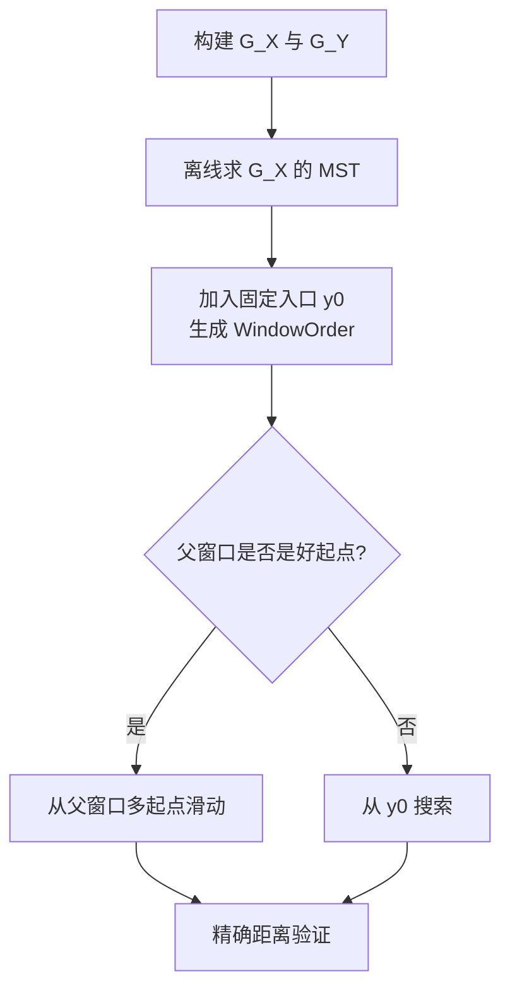
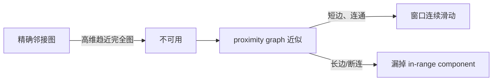

# Fast Approximate Similarity Join in Vector Databases：批判性分析

> 分析立场：把 SimJoin 视为图式 vector join 的主基线，而不是把论文中的“最优”直接外推到任意图、任意成本模型。事实锚点来自论文节号、算法、表和图；“分析判断”表示论文没有直接声称的推论。

## 1. Executive Summary + Visual Abstract

SimJoin 的关键转向是把一批 range query 看成一个 join：相邻 query 的结果窗口通常重叠，因此后一个 query 不必从固定入口重新搜索。作者把“复用哪个旧窗口、以什么顺序处理 query”转成图上的窗口滑动与 MST 顺序问题。相对 VBASE，论文报告 self-join 最高 17.8×、cross-join 最高 14.7×；相对精确 FGF-Hilbert，速度最高超过 100×，平均漏失低于 1% [Section 8, Table 3]。

这篇论文值得复现，因为 2026 年的 offline–online co-design 直接把它定义为 hard work sharing 基线。它的脆弱处同样构成后续工作的研究动机：只缓存最终 in-range window，proximity graph 只是高维邻接图的近似，断开的 in-range region 会漏召回。


图 1：SimJoin 的推理链。解读：真正的新意不是 graph search，而是把 query 间的结果相关性纳入 join 执行计划。

**tl;dr：** SimJoin 把已处理 query 的结果集变成后续 query 的多起点，并用 MST 安排处理顺序。机制在小输出、高局部性、图连通时最有效。所谓“最优顺序”只对论文定义的距离代理成本和连通 εNG 成立；索引构建被摊销，公开实现未找到，复现需要自己补齐工程细节。

## 2. Problem Definition

### 2.1 Essence

传统方法为 $X$ 中每个向量独立在 $Y$ 的 ANN 图上做阈值搜索。批量中相似 query 会重复走过同一片图，但独立查询接口无法复用。作者用一维滑动窗口作类比：若两个 query 很近，它们的 ε-ball 结果也可能重叠，已知一个窗口后可以沿邻接关系移动到另一个窗口 [Sections 2–4]。

### 2.2 Formal Definition

$$J_i=\{y\in Y\mid \delta(x_i,y)\le \epsilon\},\qquad X\bowtie_\epsilon Y=\bigcup_i\{x_i\}\times J_i.$$

给定顺序 $\aleph=\langle(\kappa_i,x_i)\rangle$，优化目标是

$$\min_\aleph C(X\bowtie_\epsilon Y)=\sum_i c(\kappa_i,x_i),$$

其中 $\kappa_i$ 是复用的父窗口或空入口，$c$ 用 query 间距离近似滑动代价 [Section 2, Eq. 1]。

| 符号 | 含义 | 边界 |
|---|---|---|
| $X,Y$ | query/base 向量集合 | 默认同一度量空间 |
| $J_i$ | $x_i$ 的精确 join window | 实际算法返回近似窗口 |
| $G_X,G_Y$ | query/base proximity graph | 不是精确 Delaunay 图 |
| $w$ | beam/候选窗口上限 | 控制时间—召回折中 |

## 3. Method + Experimental Credibility

### 3.1 Method Mechanism



图 2：执行流程。解读：$G_X$ 解决顺序，$G_Y$ 承载实际搜索；维护两张图是换取批量复用的隐性成本。

真正的新组件是 join-window reuse 与全局 order selection。NSG/HNSW/Vamana、Kruskal/DFS、精确距离验证都是已有模块。关键近似发生在两处：用 proximity graph 代替高维 Delaunay adjacency graph；用 query 距离代替真实窗口滑动成本 [Sections 4–6]。

```text
Algorithm: SimJoin（对应 Algorithms 2, 3, 5）
Input: X, Y, threshold ε, beam w, graphs G_X and G_Y
Output: approximate threshold-join pairs

1: T ← offline_MST(G_X)
2: order,parent ← WindowOrder(T, entry y0)
3: for x in DFS(order) do
4:     seeds ← J[parent[x]] if reuse_cost looks lower else {y0}
5:     J[x] ← graph_slide(G_Y, seeds, x, ε, w)   # 核心：复用最终窗口
6:     verify every candidate with exact distance
7: return union({x} × J[x])
```

若图度上限为 $m$，MST 离线处理约为 $O(m|X|\log(m|X|))$；论文的在线更新在图假设下接近 $O(|X|)$ [Section 6.2]。搜索成本数据相关，最坏情形仍可退化到大量图遍历乃至输出规模。空间包括两张 proximity graph、已缓存窗口与结果，论文没有给出统一的最坏空间式。

### 3.2 Experimental Credibility

| 数据 | 规模/维度 | 作用 | 风险 |
|---|---:|---|---|
| SIFT | 10M / 128 | 大规模图 join | 经典视觉描述子，不代表现代语义 embedding |
| GIST | 1M / 960 | 高维图行为 | 维度高但分布较旧 |
| GloVe/Crawl | 1.18M/100，1.99M/300 | 文本向量 | 随机等分不等于真实跨域 join |
| Higgs | 11M / 29 | 规模与低维对照 | 与 embedding 应用差异大 |

基线包含 XJoin、VBASE 和 exact FGF-Hilbert，覆盖 learned filtering、独立图 range search 和精确 join [Section 8]。比较仍有口径风险：SimJoin/VBASE/XJoin 的可复用索引构建时间被排除，FGF-Hilbert 的阈值相关预处理被计入；这适合重复 join，却不代表一次性 cold-start。实验运行 5 次但没有方差、置信区间或显著性检验。单线程 C++11 避免并行度混淆，是可信度加分项。

## 4. Results, Boundaries, Anti-Packaging

### 4.1 Claim Verification

| 声称 | 判断 | 证据 |
|---|---|---|
| 比 VBASE 快一个数量级 | Partial | 部分数据达 11.7–17.8×，SIFT self-join 仅 1.5× [Table 3] |
| MST order 几乎免费 | Supported（摊销语境） | pre-ratio 很小，优化版比 BaseMST 快 2–3 个数量级 [Table 3, Figure 12] |
| “最优”窗口顺序 | Partial | 只在连接 εNG 与论文成本模型下成立 [Theorem 6.2] |
| 图维护优于重建 | Supported on tested NSG | 时间/峰值内存下降，索引质量较好 [Table 4, Figure 14] |



图 3：正确性到工程实现的断点。解读：理论连续性属于精确邻接图，实验性能属于近似图；二者不能无条件等同。

### 4.2 Boundary and Failure Profile

| 失败条件 | 行为 | 影响 | 缓解 |
|---|---|---|---|
| 阈值内区域在 $G_Y$ 上断开 | 从父窗口只覆盖一个 component | recall 降低 | hybrid/out-of-range bridge |
| HNSW 长边较多 | adjacency 近似差 | 比 NSG/Vamana 弱 [Figure 11] | 图选择或重建 |
| query 不具局部性 | 父窗口帮助小 | 退化为独立搜索 | 自适应禁用复用 |
| 输出很密 | 枚举/物化主导 | 顺序优化收益消失 | 反转 join 方向或扫描 |
| 一次性任务 | 两张图构建无法摊销 | 总成本可能不占优 | 报告 cold-start |

作者明确把 distributed algorithm 留给未来 [Section 10]。论文没有给出真实更新流中的持续吞吐、并发查询隔离、结果物化成本或 OOD 专门评测。

### 4.3 Anti-Packaging

“optimal solution”应改写为“对距离代理目标的条件最优”；“less than 1% loss”是平均值，不能保证每个 query；“超过两个数量级”主要来自与 exact baseline 的近似—精确差异。去包装后仍成立的结论是：在预建图、稀疏输出和局部 query 批次上，复用最终窗口并按短边树顺序处理，显著减少重复图遍历。

## 5. Cross-Paper Impact + Inspiration + Action

### 5.1 Cross-Paper Relation

| 工作 | 关系 | 认知变化 |
|---|---|---|
| Kim et al., *Fast Approximate Vector Joins via Offline-Online Co-Design*, arXiv:2603.16360, 2026 | superseded in parts | 把 final-window hard reuse 扩成中间状态 soft reuse，并处理 OOD 断连 |
| Wang et al., *Xling*, arXiv:2402.13397, 2024 | orthogonal | Xling 跳过低产出 query；SimJoin 减少保留 query 的搜索成本 |
| Chen et al., *DiskJoin*, arXiv:2508.18494, 2025 | orthogonal | 两者都调度批任务，但一个优化图遍历，一个优化 SSD bucket reuse |

### 5.2 Impacted Existing Reports

| 报告 | 修改 | 原因 |
|---|---|---|
| `researches/vector-join/survey.md` | major revision | SimJoin 应位于 Fast AVJ 之前，作为 hard-sharing 主基线 |

### 5.3 科研启发与跨领域类比

| 问题结构 | 类比 | 可迁移解法 | 可行性 |
|---|---|---|---|
| 安排相似任务以复用状态 | 旅行商/MST 批处理 | 以真实缓存/距离计算代价学习边权 | 高 |
| 用旧结果热启动新任务 | continuation method | 监测热启动失效并回退全局入口 | 高 |
| 图断连导致漏解 | 冗余控制系统 | 局部路径 + 少量全局探针 | 中 |

改进优先级：先把 MST 边权从 query 距离换成可学习的滑动成本；再加入断连风险估计，只对高风险 query 做多入口或 hybrid search。

### 5.4 Actionable Next Steps

- 必做基线：independent range search、window reuse、window reuse+MST 三档消融。
- 同时报 per-query average recall 与 global pair recall。
- 分开报告 index build、MST offline、online traversal、verification、materialization。
- 在 ID/OOD、稀疏/稠密阈值下测量复用命中率，而不只汇总平均速度。

### 5.5 推荐阅读

| 类别 | 论文 | 理由 |
|---|---|---|
| 近 2 年同题 | Kim et al., 2026, arXiv:2603.16360 | 直接改进 SimJoin |
| 近 2 年同题 | Chen et al., 2025, arXiv:2508.18494 | 外存批量 join |
| 本文基线 | Wang et al., 2024, arXiv:2402.13397 | XJoin learned filter |
| 本文基线 | Zhang et al., 2023, *VBASE*, OSDI | selection-based range query |
| 改进对象 | Fu et al., 2017, *NSG*, arXiv:1707.00143 | proximity graph substrate |
| 改进对象 | Malkov & Yashunin, 2020, *HNSW*, TPAMI | 常用图索引 |
| 局限相关 | Ahle et al., 2016, arXiv:1510.02824 | 高维 join 复杂性边界 |
| 局限相关 | Gowanlock & Karsin, 2019, arXiv:1809.09930 | exact GPU self-join 对照 |

## Appendix: Evidence & Metadata

### A. 参考文献

- [Ref-01] Jiadong Xie, Jeffrey Xu Yu, Yingfan Liu. Fast Approximate Similarity Join in Vector Databases. PACMMOD 3(3), 2025. DOI: 10.1145/3725403.
- [Ref-02] Kyoungmin Kim et al. Fast Approximate Vector Joins via Offline-Online Co-Design. arXiv:2603.16360, 2026.
- [Ref-03] Yifan Wang et al. Xling: A Learned Filter Framework for Accelerating High-Dimensional Approximate Similarity Join. arXiv:2402.13397, 2024.
- [Ref-04] Yanqi Chen et al. DiskJoin: Large-scale Vector Similarity Join with SSD. arXiv:2508.18494, 2025.

### B. 证据锚点速查

| 结论 | 锚点 |
|---|---|
| join window 与成本定义 | Sections 2, 4 |
| 条件最优顺序 | Lemma 6.1, Theorem 6.2 |
| 主结果 | Section 8, Table 3 |
| 图维护 | Section 7.2, Table 4 |

### C. 资产清单

三张 Mermaid 图为自绘，分别支持动机链、执行流和失败边界。

### D. 论文元数据

- 标题：Fast Approximate Similarity Join in Vector Databases
- 作者：Jiadong Xie, Jeffrey Xu Yu, Yingfan Liu
- 发表：PACMMOD / SIGMOD 2025
- DOI：10.1145/3725403
- 分析日期：2026-10-10
