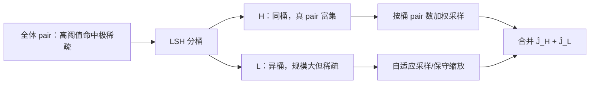
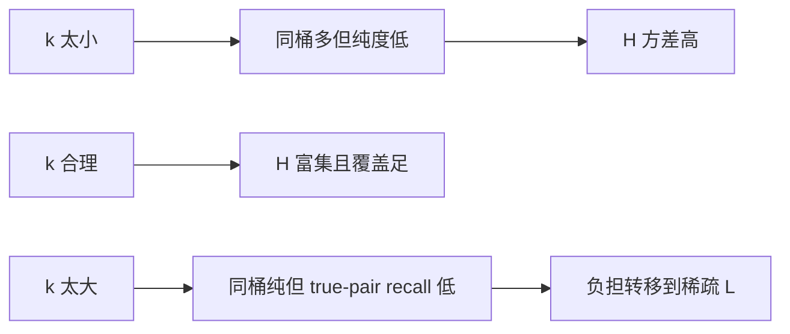

# Similarity Join Size Estimation using Locality Sensitive Hashing：批判性分析

## 1. Executive Summary + Visual Abstract

LSH-SS 解决一个典型的稀有事件估计问题：高相似度阈值下，真实 pair 在全体 $O(n^2)$ pair 中极少，均匀采样几乎抽不到。作者观察到已有 LSH index 已经把相似 pair 富集到同桶，于是按“同桶 $H$ / 异桶 $L$”把 pair 空间分层：在富集层直接均匀采样，在巨大稀疏层使用自适应采样与保守 scale-up，再合并两个估计 [Sections 4–5]。



图 1：LSH-SS 的思想来源。解读：LSH 在这里不是用来执行 join，而是构造低方差 sampling strata。

论文在 DBLP、NYT、PUBMED 上显示 LSH-SS 跨阈值比随机采样稳定，并给出高/低阈值两类概率保证 [Sections 5.2, 6]。但保证依赖同桶/异桶 true-pair 密度 $\alpha,\beta$ 的条件，LSH index build 被视为已有成本；现代 HNSW 系统和 dense embedding 分布并未验证。

**tl;dr：** 真正可复用的贡献不是某个 LSH 公式，而是“用近邻索引诱导分层采样”。它是 query optimizer 的统计模块，不生成 join 结果；把它当现代 join baseline 时必须补上索引成本和新分布实验。

## 2. Problem Definition

### 2.1 Essence

给定 $n$ 个向量和阈值 $\tau$，只估计满足 cosine threshold 的 pair 数 $J$。难点是 $J$ 可随 $\tau$ 从接近 $n^2$ 变成极稀疏事件，单一均匀采样预算无法覆盖整个阈值区间。

### 2.2 Formal Definition

$$
J=\left|\{(u,v):u,v\in V,\ u\ne v,\ \operatorname{sim}(u,v)\ge\tau\}\right|.
$$

令 $S_H$ 为同一 LSH bucket 的 pair，$S_L$ 为不同 bucket 的 pair；$N_H=|S_H|,N_L=|S_L|$，$J_H,J_L$ 为各层 true pair 数：

$$
J=J_H+J_L,\qquad
\alpha=J_H/N_H,\quad \beta=J_L/N_L.
$$

若 $m_H$ 个同桶样本中有 $X_H$ 个命中，基本估计为 $\widehat J_H=X_HN_H/m_H$。异桶层在取得至少 $\delta$ 个命中时 scale up；预算耗尽则返回样本命中数作为保守下界，或使用 dampening factor $c_s$ 在偏差与方差间折中。

## 3. Method + Experimental Credibility

### 3.1 Method Mechanism

```mermaid
flowchart TD
  I[已有 LSH table + bucket counts] --> NH[计算 N_H=Σ C(|B|,2)]
  NH --> H[SampleH]
  H --> W[按 C(|B|,2) 加权选桶，再均匀选 pair]
  I --> L[SampleL]
  L --> R[全局抽 pair，拒绝同桶 pair]
  R --> A[命中 δ 或达到 m_L]
  W --> C[合并两层估计]
  A --> C
```

图 2：采样机制。解读：按桶内 pair 数加权保证 $S_H$ 上的 pair 等概率；拒绝采样保证 $S_L$ 上等概率。

```text
Algorithm: LSH-SS
Input: vectors V, threshold τ, one LSH table, m_H, m_L, δ
Output: estimated join size Ĵ

1: compute N_H = Σ_B C(|B|,2), N_L = C(n,2)-N_H
2: repeat m_H times:
3:     choose bucket B proportional to C(|B|,2)
4:     choose a uniform pair in B; count if sim(u,v) ≥ τ
5: Ĵ_H ← hits_H · N_H / m_H
6: repeatedly sample uniform cross-bucket pairs
7:     stop when hits_L ≥ δ or trials = m_L
8: if hits_L ≥ δ: Ĵ_L ← hits_L · N_L / trials
9: else: Ĵ_L ← hits_L              // safe lower bound
10:return Ĵ_H + Ĵ_L
```

采样预算通常为 $m_H,m_L=\Theta(n)$，存储是在已有 LSH index 上增加 bucket counts 与采样结构。Theorems 1–3 分别覆盖高阈值 $\alpha\ge\log n/n,\beta<1/n$ 和低阈值 $\alpha,\beta\ge\log n/n$；中间区间由算法自适应处理，但理论并没有覆盖所有任意 $\alpha,\beta$。

### 3.2 Experimental Credibility

实验包含 794K DBLP 稀疏二值向量、149K NYT TF-IDF 和 PUBMED，阈值范围宽，并报告 over/under-estimation、方差、运行时间以及 LSH concatenation 长度 $k$ 的敏感性 [Section 6, Appendix C]。DBLP 从 $\tau=0.1$ 的超 1000 亿 true pairs 到 $\tau=0.9$ 的约 42K pairs，确实覆盖输出密度的多个数量级。

比较对象包括 population/cross random sampling、Lattice Counting、LSH-S。结果表明随机采样在高阈值剧烈波动，LSH-SS 在合理 $k$ 上较稳。但 index build 与维护时间未进入“minimal addition”比较；数据是词袋稀疏向量，年代、硬件、向量分布与现代 embedding 差距大；实验主要评价 estimate error，没有展示更准估计是否改变并改善实际 query plan。

## 4. Results, Boundaries, Anti-Packaging

### 4.1 Claim Verification

| 声称 | 判断 | 锚点 |
|---|---|---|
| 跨阈值得到稳定估计 | Supported on three tested text datasets | Section 6 |
| 高/低阈值有概率保证 | Supported under $\alpha,\beta$ assumptions | Theorems 1–3 |
| 对合理 $k$ 不敏感 | Empirically supported, not universal | Section 6.3 |
| 只需对已有 LSH index 小改动 | Conditional | index 已存在时成立 |
| 适合现代任意 ANN index | Not shown | 方法依赖可采样的 LSH buckets |



图 3：$k$ 的 precision–recall 权衡。解读：作者把 optimal-$k$ 留作依赖数据分布的问题；LSH-SS 只是比 LSH-S 更耐受，并非无参数。

### 4.2 Boundary and Failure Profile

| 条件 | 行为 | 影响 | 可能缓解 |
|---|---|---|---|
| 没有 LSH index | “minimal addition”不成立 | build/maintenance 成本大 | 从现有 ANN graph 构造 strata |
| $H$ 不富集真 pair | $\alpha$ 太低 | SampleH 退化 | 多表/调小 $k$ |
| 真 pair 大量落在 $L$ 且仍稀疏 | SampleL 命中不足 | 系统性低估 | dampening/增大样本 |
| 分布漂移或更新 | 桶统计失效 | 估计偏移 | 在线重采样与漂移检测 |
| optimizer 需局部成本 | 只有总 cardinality | 无法估 I/O/热点 | 分桶条件估计 |

正文结论没有提出长列表式 future work；附录明确扩展到多 LSH tables（取各表估计中位数或构造 virtual buckets）以及两集合 non-self join，并把 optimal-$k$ 形式化为依赖 $P(T\mid H)$ 的选择问题 [Appendix B]。因此这些应标作作者讨论的扩展，而非完成的主实验贡献。

### 4.3 Anti-Packaging

标题里的“vector”主要指高维稀疏 cosine/TF-IDF 向量，不等于当前 dense embedding workload。“可靠”受 $\alpha,\beta$ 条件与保守低估策略约束；SampleL 在预算耗尽时直接返回未放大的命中数，可靠性来自不冒险高估，却可能明显低估。运行时间优势也建立在预先存在 LSH index 的前提上。

## 5. Cross-Paper Impact + Inspiration + Action

### 5.1 Cross-Paper Relation

| 工作 | 关系 | 启示 |
|---|---|---|
| SJPC | 后续直接 baseline | SJPC 面向低维字段 equality；LSH-SS 面向 cosine 稀疏向量 |
| Xling | 同类“先估/滤再执行” | Xling 学习 query-level lower bound；LSH-SS 估全局 pair cardinality |
| SimJoin / Fast AVJ | planner 输入 | $\widehat J$ 可决定 query batching 与共享策略 |
| DiskJoin | I/O cost 前置估计 | 总结果数不足，还需 bucket-local candidate 密度 |

### 5.2 Impacted Existing Reports

应把 LSH-SS 纳入“cardinality baseline”而非“join execution baseline”。评价它时需同时报告 estimate error、index amortization 与最终计划加速，否则只证明统计量更准。

### 5.3 科研启发与跨领域类比

| 结构 | 类比 | 可迁移设计 |
|---|---|---|
| 索引诱导分层采样 | importance sampling | 用 HNSW 层级/IVF list 构造 strata |
| 稀有层保守估计 | 风险受限统计 | 为内存/I/O provisioning 给上下置信界 |
| 多表中位数 | median-of-means | 抵抗单个 hash partition 异常 |

### 5.4 Actionable Next Steps

- 在现代 embedding 上比较 LSH-SS、uniform、IVF-stratified、HNSW-stratified estimators。
- 将 index build、更新和采样辅助结构纳入总成本，并区分一次性与摊销场景。
- 输出置信区间而非单点值，让 planner 做风险敏感决策。
- 直接测量估计对 Fast AVJ/SimJoin/DiskJoin 策略选择和端到端延迟的改善。

### 5.5 推荐阅读

同题：SJPC；基础：LSH、adaptive sampling、bifocal sampling；改进对象：learned cardinality estimation、ANN graph sampling；局限相关：distribution shift、uncertainty-aware query optimization。

## Appendix: Evidence & Metadata

### A. 参考文献

- [Ref-01] Hongrae Lee, Raymond T. Ng, Kyuseok Shim. Similarity Join Size Estimation using Locality Sensitive Hashing. PVLDB, 2011.
- [Ref-02] Davood Rafiei, Fan Deng. Similarity Join and Similarity Self-Join Size Estimation in a Streaming Environment.
- [Ref-03] Piotr Indyk, Rajeev Motwani. Approximate Nearest Neighbors: Towards Removing the Curse of Dimensionality.

### B. 证据锚点速查

| 结论 | 锚点 |
|---|---|
| 问题与动机 | Section 1 |
| LSH 扩展与 LSH-S | Section 4 |
| 分层采样算法 | Section 5.1, Algorithm 1 |
| 概率保证 | Section 5.2, Theorems 1–3 |
| 实验 | Sections 6.2–6.3 |
| 多表、non-self join、optimal-$k$ | Appendix B |

### C. 资产清单

三张 Mermaid 图为自绘。

### D. 论文元数据

- arXiv：1104.3212
- 作者：Hongrae Lee, Raymond T. Ng, Kyuseok Shim
- 年份：2011
- 分析日期：2026-10-10
