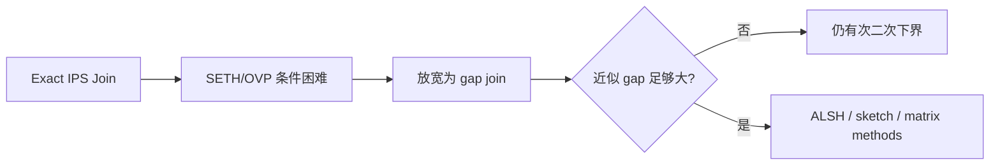
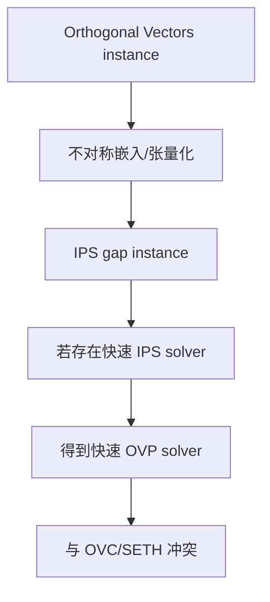
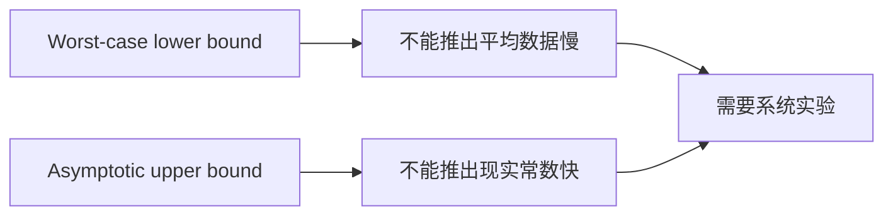

# On the Complexity of Inner Product Similarity Join：批判性分析

## 1. Executive Summary + Visual Abstract

这篇论文回答的不是“某个系统能跑多快”，而是“在哪些近似区间里，不应期待普适的强次二次算法”。内积不同于 L2：大内积不对应原空间某个普通 metric 下的近邻，经典对称 LSH 不能直接适用。作者从 Orthogonal Vectors Problem 构造条件下界，又分析 asymmetric LSH 的指数下界，并给出 signed/unsigned IPS join 的上界 [Sections 1.1–4]。

它对工程研究最重要的提醒是：任何声称“通用快速 inner-product join”的方法都必须支付至少一种代价——放宽 gap、依赖数据分布、使用重预处理、接受高维/大常数，或改变问题语义。论文结论基于最坏情况与复杂性猜想，不能用来否定现实 embedding 上的系统优化。



图 1：理论问题的核心取舍。解读：近似不是二元开关；阈值、gap、维度共同决定可实现的指数。

**tl;dr：** 论文建立了 IPS join 的条件下界与若干上界，解释了为何小内积、近正交区域最难。它是算法声明的 sanity check，不是系统 baseline。局限是最坏情况、条件假设和渐近分析；缓存、GPU、输出规模与真实向量分布都不在模型内。

## 2. Problem Definition

### 2.1 Essence

给定两组向量，要找出内积至少为阈值的 pair。困难集中在区分“几乎正交”和“稍微不正交”：两类 pair 的几何差异很小，却要求算法可靠分离 [Section 1, Theorem 1 discussion]。

### 2.2 Formal Definition

$(cs,s)$-IPS join 要在存在 $\langle p,q\rangle\ge s$ 时返回一个候选，并允许只保证排除 $\langle p,q\rangle<cs$ 的 pair；signed 与 unsigned 版本分别允许/不允许负内积。

$$\exists(p,q)\in P\times Q:\langle p,q\rangle\ge s,\qquad |P|=|Q|=n.$$

目标是时间 $O(n^{2-\delta})$，同时控制维度 $d$ 与 approximation factor $c$。

| 变量 | 含义 | 备注 |
|---|---|---|
| $s$ | 高相似阈值 | 可随 $n,d$ 变化 |
| $c$ | gap factor | 越接近 1，问题越精确 |
| $d$ | 维度 | 下界对其增长率敏感 |
| $\delta$ | 次二次改进指数 | 理论效率指标 |

## 3. Method + Experimental Credibility

### 3.1 Method Mechanism



图 2：下界证明套路。解读：贡献在 reduction 参数控制，而非提出一个可部署系统。

```text
Proof/Algorithm Skeleton（Sections 2–4）
Input: OVP or IPS gap instance
Output: hardness transfer or subquadratic candidate pair

1: map original vectors with asymmetric embeddings
2: preserve a controlled high/low inner-product gap
3: amplify or normalize the gap when needed
4: for lower bound, compose a hypothetical IPS solver with reduction
5: for upper bound, hash/sketch transformed vectors into collision candidates
6: verify candidate inner products
```

复杂度由 reduction 后维度、hash exponent $\rho$ 与候选验证主导。论文的上界是渐近 $n^{1+\rho}$ 类表达，空间通常至少线性加 hash tables；不同定理参数范围不同，不能抽成一个统一“IPS 复杂度”。

### 3.2 Experimental Credibility

本论文是理论工作，没有真实数据、硬件或统计实验；Experimental Credibility 对应 proof credibility。优点是同时给 hardness、LSH limitation 和 upper bound，避免单边叙事。风险是结果依赖 OVC/SETH、维度/阈值区间和 worst-case 构造；fast matrix multiplication 上界在现实规模可能不具竞争力，作者自己明确承认 [Introduction]。

## 4. Results, Boundaries, Anti-Packaging

### 4.1 Claim Verification

| 声称 | 判断 | 锚点 |
|---|---|---|
| exact IPS 难以真正次二次 | Conditional | 依赖 OVP/SETH reduction [Theorem 1, Section 2] |
| 近似 IPS 也有困难区间 | Supported conditionally | hardness parameter range [Section 1.1] |
| ALSH 在小相对内积时保证弱 | Supported theoretically | LSH lower-bound analysis [Section 3] |
| 存在次二次上界 | Supported asymptotically | asymmetric LSH/sketch constructions [Section 4] |



图 3：理论到系统的解释边界。

### 4.2 Boundary and Failure Profile

| 边界 | 影响 | 解释 |
|---|---|---|
| OVC/SETH 未证明 | 下界是条件性的 | 仍是细粒度复杂性常用假设 |
| worst-case 向量 | 真实 embedding 可能更易 | 分布、cluster、低内在维度不在模型中 |
| decision/找到一对 | 不等于枚举全 join | output-sensitive 成本需另算 |
| 渐近算法 | 大常数/高维变换 | 可能输给 blocked matrix multiply |
| 固定阈值语义 | 不覆盖动态/带过滤 join | 系统功能更复杂 |

作者展望集中在继续确定 ALSH 的可能性/限制，以及收紧不同 $c,s,d$ 区间的上下界 [Sections 1, 5]。论文没有讨论增量索引、存储层次或 pair materialization。

### 4.3 Anti-Packaging

“hardness”不能写成“inner product join 无法加速”；准确说法是特定参数和猜想下不存在某类 worst-case 真正次二次算法。上界同样不能包装成实用方案。去包装后结论是：近正交区间缺乏强几何信号，想获得通用、高精度、强次二次性能非常困难。

## 5. Cross-Paper Impact + Inspiration + Action

### 5.1 Cross-Paper Relation

| 工作 | 关系 | 启示 |
|---|---|---|
| SimJoin / Fast AVJ | orthogonal | 依赖数据局部性和近似图，绕开 worst-case 普适保证 |
| Xling | orthogonal | 接受分布学习与 false negative，换取实际剪枝 |
| GPU-Join | contrast | 硬件并行改善常数，不改变二次 worst-case |

### 5.2 Impacted Existing Reports

综述中的“质量保证”应按 metric、gap 与输出语义分类，不能把 L2 range recall 与 inner-product gap guarantee 混为一谈。

### 5.3 科研启发与跨领域类比

| 结构 | 类比 | 可迁移想法 |
|---|---|---|
| 近正交信号微弱 | 统计假设检验 | 用置信区间决定是否值得精确验证 |
| worst-case 困难 | smoothed analysis | 给真实 embedding 加分布/扰动假设 |
| gap 控制复杂度 | rate-distortion | 将质量预算显式进入 optimizer |

### 5.4 Actionable Next Steps

- 实验必须明确 cosine/IP 是否归一化，以及 threshold/gap。
- 为现实数据测 intrinsic dimension、角度分布和 output size，说明为何不触发 worst-case。
- 不把 top-$k$ MIPS 结果直接当 threshold join 保证。

### 5.5 推荐阅读

同题：Fast AVJ、SimJoin；基线：OVP/SETH 与经典 LSH；改进对象：asymmetric LSH for MIPS、fast matrix multiplication IPS；局限相关：输出敏感 join、数据依赖 hashing。

## Appendix: Evidence & Metadata

### A. 参考文献

- [Ref-01] Thomas D. Ahle, Rasmus Pagh, Ilya Razenshteyn, Francesco Silvestri. On the Complexity of Inner Product Similarity Join. PODS 2016 / arXiv:1510.02824.
- [Ref-02] Ryan Williams. Orthogonal Vectors and SETH-based lower bounds, cited in the paper.
- [Ref-03] Shrivastava & Li. Asymmetric LSH for sublinear maximum inner product search.

### B. 证据锚点速查

| 结论 | 锚点 |
|---|---|
| 问题与挑战 | Section 1 |
| 条件下界 | Section 2, Theorem 1 |
| LSH 限制 | Section 3 |
| 上界 | Section 4 |

### C. 资产清单

三张 Mermaid 图为自绘。

### D. 论文元数据

- arXiv：1510.02824
- 作者：Thomas D. Ahle, Rasmus Pagh, Ilya Razenshteyn, Francesco Silvestri
- 年份：2015/2016
- 分析日期：2026-10-10
