# GPU Accelerated Similarity Self-Join for Multi-Dimensional Data

MICHAEL GOWANLOCK<sub>,</sub> S<sub>c</sub>h<sub>oo</sub>l <sub>o</sub>f I<sub>n</sub>f<sub>orma</sub>ti<sub>cs,</sub> C<sub>ompu</sub>ti<sub>ng,</sub> & C<sub>y</sub>b<sub>er</sub> S<sub>ys</sub>t<sub>ems</sub>

Northern Arizona Universit<sub>y</sub>

BEN KARSIN<sub>,</sub> U<sub>n</sub>i<sub>vers</sub>it<sub>y</sub> <sub>o</sub>f H<sub>awa</sub>i‘i <sub>a</sub>t M<sub>anoa</sub>¯

De<sub>p</sub>artment of Information and Com<sub>p</sub>uter Sciences

<sup>Œ</sup>e se<sup>lf</sup>-join <sup>€</sup>n<sup>d</sup>s a<sup>ll</sup> o<sup>b</sup>jects in a <sup>d</sup>ataset t<sup>h</sup>at are wit<sup>h</sup>in a searc<sup>h d</sup>istance, ϵ, o<sup>f</sup> eac<sup>h</sup> ot<sup>h</sup>er; t<sup>h</sup>ere<sup>f</sup>ore, t<sup>h</sup>e se<sup>lf</sup>-join is a <sup>b</sup>ui<sup>ld</sup>ing <sup>bl</sup>oc<sup>k</sup> o<sup>f</sup> many a<sup>l</sup>gorit<sup>h</sup>ms. We a<sup>d</sup>vance a GPU-acce<sup>l</sup>erate<sup>d</sup> se<sup>lf</sup>-join a<sup>l</sup>gorit<sup>h</sup>m targete<sup>d</sup> towar<sup>d</sup>s <sup>h</sup>ig<sup>h d</sup>imensiona<sup>l d</sup>ata. <sup>Œ</sup>e massive para<sup>ll</sup>e<sup>l</sup>ism <sub>a</sub>‚<sub>or</sub>d<sub>e</sub>d b<sub>y</sub> th<sub>e</sub> GPU <sub>an</sub>d hi<sub>g</sub>h <sub>aggrega</sub>t<sub>e memory</sub> b<sub>an</sub>d<sub>w</sub>idth <sub>ma</sub>k<sub>es</sub> th<sub>e arc</sub>hit<sub>ec</sub>t<sub>ure we</sub>ll<sub>-su</sub>it<sub>e</sub>d f<sub>or</sub> d<sub>a</sub>t<sub>a-</sub>i<sub>n</sub>t<sub>ens</sub>i<sub>ve wor</sub>kl<sub>oa</sub>d<sub>s.</sub> W<sub>e</sub> levera<sub>g</sub>e a <sub>g</sub>rid-based, GPU-tailored index to <sub>p</sub>erform ran<sub>g</sub>e <sub>q</sub>ueries. We <sub>p</sub>ro<sub>p</sub>ose the followin<sub>g</sub> o<sub>p</sub>timizations: (i) a trade-o‚ between candidate set €ltering and index search overhead by exploiting properties of the index; (ii) reordering the data based on variance in each dimension to improve the €ltering power of the index; and (i i i) a pruning method for reducing the number of expensive distance <sub>ca</sub>l<sub>cu</sub>l<sub>a</sub>ti<sub>ons.</sub> A<sub>cross mos</sub>t <sub>scenar</sub>i<sub>os on rea</sub>l<sub>-wor</sub>ld <sub>an</sub>d <sub>syn</sub>th<sub>e</sub>ti<sub>c</sub> d<sub>a</sub>t<sub>ase</sub>t<sub>s, our a</sub>l<sub>gor</sub>ith<sub>m ou</sub>t<sub>per</sub>f<sub>orms</sub> th<sub>e para</sub>ll<sub>e</sub>l <sub>s</sub>t<sub>a</sub>t<sub>e-o</sub>f<sub>-</sub>th<sub>e-ar</sub>t a<sub>pp</sub>roach. Exascale s<sub>y</sub>stems are conver<sub>g</sub>in<sub>g</sub> on hetero<sub>g</sub>eneous distributed-memor<sub>y</sub> architectures. We show that an entit<sub>y</sub> <sub>p</sub>artitionin<sub>g</sub> met<sup>h</sup>o<sup>d</sup> can <sup>b</sup>e uti<sup>l</sup>ize<sup>d</sup> to ac<sup>h</sup>ieve a <sup>b</sup>a<sup>l</sup>ance<sup>d</sup> wor<sup>kl</sup>oa<sup>d</sup>, an<sup>d</sup> t<sup>h</sup>us goo<sup>d</sup> sca<sup>l</sup>a<sup>b</sup>i<sup>l</sup>ity <sup>f</sup>or mu<sup>l</sup>ti-GPU or <sup>d</sup>istri<sup>b</sup>ute<sup>d</sup>-memory se<sup>lf</sup>-joins.

## 1 INTRODUCTION

A <sup>f</sup>un<sup>d</sup>amenta<sup>l d</sup>ata<sup>b</sup>ase operation an<sup>d</sup> an intense<sup>l</sup>y stu<sup>d</sup>ie<sup>d</sup> pro<sup>bl</sup>em in <sup>d</sup>ata<sup>b</sup>ase researc<sup>h</sup> is t<sup>h</sup>e simi<sup>l</sup>arity se<sup>lf</sup>-join Self-similarit<sub>y</sub> joins are o‰en <sub>p</sub>art of existin<sub>g</sub> al<sub>g</sub>orithms [1, 3, 6, 17, 30] and are fundamental to man<sub>y</sub> established methods [9, 12]. Since the self-join is commonly employed, improving self-join performance has implications for many <sup>d</sup>omains. <sup>Œ</sup>e pro<sup>bl</sup>em is as <sup>f</sup>o<sup>ll</sup>ows: given a <sup>d</sup>ataset o<sup>f</sup> o<sup>b</sup>jects, <sup>€</sup>n<sup>d</sup> a<sup>ll</sup> o<sup>b</sup>jects t<sup>h</sup>at <sup>h</sup>ave common aŠri<sup>b</sup>utes <sup>b</sup>ase<sup>d</sup> on a simi<sup>l</sup>arity metric. <sup>Œ</sup>is paper <sup>f</sup>ocuses on t<sup>h</sup>e <sup>d</sup>istance simi<sup>l</sup>arity se<sup>lf</sup>-join t<sup>h</sup>at <sup>€</sup>n<sup>d</sup>s a<sup>ll</sup> points t<sup>h</sup>at are wit<sup>h</sup>in t<sup>h</sup>e Euclidean distance ϵ of each other.

Research on the self-join t<sub>yp</sub>icall<sub>y</sub> addresses either low [13] or hi<sub>g</sub>h [2, 15, 32] dimensionalit<sub>y</sub>. In low dimensionalit<sub>y</sub>, the data points (or feature vectors) are o‰en more frequently co-located; therefore, there are typically more nei<sub>g</sub>hbors on avera<sub>g</sub>e in com<sub>p</sub>arison to hi<sub>g</sub>h dimensionalit<sub>y</sub> [26]. Œerefore, in low dimensionalit<sub>y</sub>, €lterin<sub>g</sub> the candidate set of <sub>po</sub>i<sub>n</sub>t<sub>s</sub> b<sub>ecomes a per</sub>f<sub>ormance</sub> b<sub>o</sub>Šl<sub>enec</sub>k<sub>.</sub> T<sub>o re</sub>d<sub>uce</sub> th<sub>e num</sub>b<sub>er o</sub>f <sub>compar</sub>i<sub>sons</sub> b<sub>e</sub>t<sub>ween</sub> d<sub>a</sub>t<sub>a po</sub>i<sub>n</sub>t<sub>s w</sub>h<sub>en</sub> €lt<sub>er</sub>i<sub>ng</sub> the candidate set<sub>,</sub> indexes are used. However<sub>,</sub> in hi<sub>g</sub>h dimensionalit<sub>y,</sub> index searches become increasin<sub>g</sub>l<sub>y</sub> exhaustive due to the well-known curse of dimensionalit<sub>y</sub> [7, 16, 28, 37], where the index needs to search a lar<sub>g</sub>e fraction of the d<sub>a</sub>t<sub>a</sub>b<sub>ase, po</sub>t<sub>en</sub>ti<sub>a</sub>ll<sub>y</sub> d<sub>egra</sub>di<sub>ng</sub> th<sub>e searc</sub>h t<sub>o</sub> th<sub>e per</sub>f<sub>ormance</sub> l<sub>eve</sub>l <sub>o</sub>bt<sub>a</sub>i<sub>ne</sub>d b<sub>y a</sub> b<sub>ru</sub>t<sub>e</sub> f<sub>orce searc</sub>h<sub>.</sub> Œ<sub>us, searc</sub>h<sub>es</sub> i<sub>n</sub> <sup>h</sup>ig<sup>h</sup> <sup>d</sup>imensiona<sup>l</sup>ity can <sup>b</sup>e pro<sup>h</sup>i<sup>b</sup>itive. In t<sup>h</sup>is wor<sup>k</sup>, we <sup>f</sup>ocus on optimizing t<sup>h</sup>e <sup>h</sup>ig<sup>h</sup> <sup>d</sup>imensiona<sup>l</sup>ity se<sup>lf</sup>-join.

Œ<sub>ere</sub> h<sub>ave</sub> b<sub>een</sub> t<sub>wo</sub> <sub>recen</sub>t t<sub>ren</sub>d<sub>s</sub> i<sub>n</sub> <sub>compu</sub>t<sub>er</sub> <sub>arc</sub>hit<sub>ec</sub>t<sub>ure</sub> th<sub>a</sub>t h<sub>ave</sub> b<sub>een</sub> h<sub>e</sub>l<sub>p</sub>i<sub>ng</sub> t<sub>o</sub> <sub>gu</sub>id<sub>e</sub> th<sub>e</sub> di<sub>rec</sub>ti<sub>on</sub> <sub>o</sub>f <sub>many</sub> research communities. First, modern <sub>g</sub>raphics processin<sub>g</sub> units (GPUs) are frequently used to aŠain hi<sub>g</sub>h computationa th<sub>roug</sub>h<sub>pu</sub>t th<sub>roug</sub>h <sub>mass</sub>i<sub>ve</sub> <sub>para</sub>ll<sub>e</sub>li<sub>sm</sub> <sub>an</sub>d hi<sub>g</sub>h <sub>memory</sub> b<sub>an</sub>d<sub>w</sub>idth <sub>on</sub> <sub>a</sub> <sub>range</sub> <sub>o</sub>f <sub>pro</sub>bl<sub>ems</sub> i<sub>n</sub> th<sub>e</sub> <sub>cons</sub>tit<sub>uen</sub>t €<sub>e</sub>ld<sub>s o</sub>f <sub>compu</sub>t<sub>er sc</sub>i<sub>ence.</sub> S<sub>econ</sub>d<sub>,</sub> di<sub>s</sub>t<sub>r</sub>ib<sub>u</sub>t<sub>e</sub>d<sub>-memory sys</sub>t<sub>ems</sub> th<sub>a</sub>t <sub>are compose</sub>d <sub>o</sub>f h<sub>un</sub>d<sub>re</sub>d<sub>s or</sub> th<sub>ousan</sub>d<sub>s o</sub>f h<sub>e</sub>t<sub>erogeneous no</sub>d<sub>es are</sub> b<sub>ecom</sub>i<sub>ng more commonp</sub>l<sub>ace, w</sub>h<sub>ere no</sub>d<sub>es are compr</sub>i<sub>se</sub>d <sub>o</sub>f <sub>one or more acce</sub>l<sub>era</sub>t<sub>ors.</sub> Œi<sub>s</sub> recent develo<sub>p</sub>ment has been motivated b<sub>y</sub> the hi<sub>g</sub>h <sub>p</sub>erformance com<sub>p</sub>utin<sub>g</sub> communit<sub>y</sub> strivin<sub>g</sub> to reach exascale. In this context<sub>,</sub> GPU-ecient al<sub>g</sub>orithms are essential to achievin<sub>g</sub> <sub>p</sub>eak <sub>p</sub>erformance on GPUs and hetero<sub>g</sub>eneous s<sub>y</sub>stems.

Œus<sub>,</sub> man<sub>y</sub> lar<sub>g</sub>e-scale data anal<sub>y</sub>tics a<sub>pp</sub>lications will rel<sub>y</sub> on GPU-ecient al<sub>g</sub>orithms<sub>,</sub> includin<sub>g</sub> the distance similarit<sub>y</sub> se<sup>lf</sup>-join <sup>f</sup>or <sup>h</sup>ig<sup>h</sup> <sup>d</sup>imensiona<sup>l</sup> <sup>d</sup>ata — t<sup>h</sup>e su<sup>b</sup>ject o<sup>f</sup> t<sup>h</sup>is wor<sup>k</sup>. <sup>Œ</sup>is paper ma<sup>k</sup>es t<sup>h</sup>e <sup>f</sup>o<sup>ll</sup>owing nove<sup>l</sup> contri<sup>b</sup>utions:

• Levera<sub>g</sub>in<sub>g</sub> an ecient indexin<sub>g</sub> scheme for the GPU, we ex<sub>p</sub>loit the trade-o‚ between index €lterin<sub>g</sub> <sub>p</sub>ower and <sub>searc</sub>h <sub>cos</sub>t t<sub>o</sub> i<sub>mprove</sub> th<sub>e overa</sub>ll <sub>per</sub>f<sub>ormance o</sub>f <sub>searc</sub>hi<sub>ng</sub> hi<sub>g</sub>h di<sub>mens</sub>i<sub>ona</sub>l f<sub>ea</sub>t<sub>ure spaces.</sub>

• We im<sub>p</sub>rove the €lterin<sub>g</sub> <sub>p</sub>ower of the index b<sub>y</sub> reorderin<sub>g</sub> the data in each dimension usin<sub>g</sub> statistical <sub>p</sub>ro<sub>p</sub>erties of th<sub>e</sub> d<sub>a</sub>t<sub>a</sub> di<sub>s</sub>t<sub>r</sub>ib<sub>u</sub>ti<sub>on.</sub> W<sub>e</sub> <sub>s</sub>h<sub>ow</sub> th<sub>a</sub>t thi<sub>s</sub> i<sub>s</sub> <sub>par</sub>ti<sub>cu</sub>l<sub>ar</sub>l<sub>y</sub> i<sub>mpor</sub>t<sub>an</sub>t <sub>w</sub>h<sub>en</sub> <sub>exp</sub>l<sub>o</sub>iti<sub>ng</sub> th<sub>e</sub> t<sub>ra</sub>d<sub>e-o</sub>‚ <sub>ou</sub>tli<sub>ne</sub>d <sub>a</sub>b<sub>ove.</sub>

• We miti<sub>g</sub>ate the <sub>p</sub>erformance cost of reducin<sub>g</sub> index €lterin<sub>g</sub> <sub>p</sub>ower b<sub>y</sub> <sub>p</sub>ro<sub>p</sub>osin<sub>g</sub> a techni<sub>q</sub>ue that <sub>p</sub>runes the candidate set b<sub>y</sub> com<sub>p</sub>arin<sub>g p</sub>oints based on an un-indexed dimension.

• We show that on the worst-case data distribution for our a<sub>pp</sub>roach, we achieve si<sub>g</sub>ni€cantl<sub>y</sub> beŠer <sub>p</sub>erformance than t<sup>h</sup>e state-o<sup>f</sup>-t<sup>h</sup>e-art on t<sup>h</sup>e same scenario. <sup>Œ</sup>is suggests t<sup>h</sup>at t<sup>h</sup>e per<sup>f</sup>ormance o<sup>f</sup> t<sup>h</sup>e GPU-acce<sup>l</sup>erate<sup>d</sup> se<sup>lf</sup>-join is resilient to the data distribution<sub>,</sub> makin<sub>g</sub> the a<sub>pp</sub>roach well-suited for man<sub>y</sub> a<sub>pp</sub>lication scenarios.

• We evaluate our approach on 5 real-world and 3 synthetic datasets and show that our GPU accelerated self-join <sub>ou</sub>t<sub>per</sub>f<sub>orms</sub> th<sub>e</sub> <sub>s</sub>t<sub>a</sub>t<sub>e-o</sub>f<sub>-</sub>th<sub>e-ar</sub>t <sub>para</sub>ll<sub>e</sub>l <sub>a</sub>l<sub>gor</sub>ith<sub>m</sub> i<sub>n</sub> th<sub>e</sub> lit<sub>era</sub>t<sub>ure.</sub>

• <sup>Œ</sup>e se<sup>lf</sup>-join is an expensive operation. We s<sup>h</sup>ow initia<sup>l</sup> insig<sup>h</sup>ts into t<sup>h</sup>e sca<sup>l</sup>a<sup>b</sup>i<sup>l</sup>ity o<sup>f</sup> t<sup>h</sup>e se<sup>lf</sup>-join on mu<sup>l</sup>ti-GPU and distributed-memor<sub>y</sub> s<sub>y</sub>stems<sub>,</sub> and demonstrate that an entit<sub>y</sub> <sub>p</sub>artitionin<sub>g</sub> strate<sub>gy</sub> can be used to achieve <sub>g</sub>ood l<sub>oa</sub>d b<sub>a</sub>l<sub>anc</sub>i<sub>ng.</sub>

Œ<sub>e</sub> <sub>paper</sub> i<sub>s</sub> <sub>ou</sub>tli<sub>ne</sub>d <sub>as</sub> f<sub>o</sub>ll<sub>ows:</sub> S<sub>ec</sub>ti<sub>on</sub> 2 <sub>prov</sub>id<sub>es</sub> b<sub>ac</sub>k<sub>groun</sub>d <sub>ma</sub>t<sub>er</sub>i<sub>a</sub>l<sub>,</sub> S<sub>ec</sub>ti<sub>on</sub> 3 f<sub>orma</sub>li<sub>zes</sub> th<sub>e</sub> <sub>pro</sub>bl<sub>em</sub> <sub>an</sub>d discusses <sub>p</sub>revious work that we em<sub>p</sub>lo<sub>y,</sub> Section 4 <sub>p</sub>resents the novel methods we use to im<sub>p</sub>rove hi<sub>g</sub>h dimensiona se<sup>lf</sup>-join per<sup>f</sup>ormance, Section 5 i<sup>ll</sup>ustrates our per<sup>f</sup>ormance resu<sup>l</sup>ts, Section 6 <sup>d</sup>iscusses t<sup>h</sup>e sca<sup>l</sup>a<sup>b</sup>i<sup>l</sup>ity o<sup>f</sup> t<sup>h</sup>e se<sup>lf</sup>-join, <sub>an</sub>d <sub>we</sub> <sub>conc</sub>l<sub>u</sub>d<sub>e</sub> th<sub>e</sub> <sub>wor</sub>k i<sub>n</sub> S<sub>ec</sub>ti<sub>on</sub> 7<sub>.</sub>

## 2 BACKGROUND

<sup>Œ</sup>e se<sup>lf</sup>-join is conceptua<sup>l</sup>ize<sup>d</sup> as a join re<sup>l</sup>ations<sup>h</sup>ip <sup>b</sup>etween a <sup>d</sup>ata<sup>b</sup>ase ta<sup>bl</sup>e an<sup>d</sup> itse<sup>lf</sup>. Wor<sup>k</sup>s t<sup>h</sup>at optimize joining two <sup>d</sup>i<sup>‚</sup>erent ta<sup>bl</sup>es are re<sup>l</sup>evant to t<sup>h</sup>e se<sup>lf</sup>-join. A<sup>l</sup>so, e<sup></sup>cient in<sup>d</sup>exing structures <sup>f</sup>or per<sup>f</sup>orming neig<sup>hb</sup>or<sup>h</sup>oo<sup>d</sup> range <sub>q</sub>ueries are relevant<sub>,</sub> as indexes reduce the number of <sub>p</sub>oint com<sub>p</sub>arisons. We also review the distributed-memor<sub>y</sub> se<sup>lf</sup>-join.

## 2.1 Similarity-Joins and the State-of-the-art

Œe similarit<sub>y</sub>-join is a well-studied al<sub>g</sub>orithm [4, 6, 9, 11, 15, 27]. Here, we discuss those works that address hi<sub>g</sub>hdimensional data. GESS [15] assi<sub>g</sub>ns feature vectors to h<sub>yp</sub>ercubes, and then <sub>p</sub>erforms an intersection <sub>q</sub>uer<sub>y</sub> on these <sup>h</sup>ypercu<sup>b</sup>es to compute t<sup>h</sup>e simi<sup>l</sup>arity join. <sup>Œ</sup>e met<sup>h</sup>o<sup>d</sup> re<sup>l</sup>ies on <sup>d</sup>ata rep<sup>l</sup>ication an<sup>d d</sup>up<sup>l</sup>ication remova<sup>l f</sup>rom t<sup>h</sup>e result set. LSS [32] utilizes the GPU, and transforms the similarit<sub>y</sub> join into a sort-and-search <sub>p</sub>roblem. Interval searches <sub>are nee</sub>d<sub>e</sub>d<sub>, an</sub>d th<sub>e au</sub>th<sub>ors use space</sub> €lli<sub>ng curves</sub> t<sub>o re</sub>d<sub>uce</sub> i<sub>n</sub>t<sub>erva</sub>l <sub>s</sub>i<sub>ze an</sub>d <sub>searc</sub>h <sub>over</sub>h<sub>ea</sub>d<sub>.</sub> Œ<sub>e</sub> S<sub>uper-</sub>EGO al<sub>g</sub>orithm [27] has been shown to be e‚ective for similarit<sub>y</sub>-joins on both low and hi<sub>g</sub>h-dimensional data. Œe al<sub>g</sub>orithm uses the “e<sub>p</sub>silon <sub>g</sub>rid order” [10] method. It uses a non-materialized <sub>g</sub>rid to €nd nearb<sub>y p</sub>oints that ma<sub>y</sub> be within th<sub>e searc</sub>h di<sub>s</sub>t<sub>ance.</sub> Œ<sub>en,</sub> b<sub>ase</sub>d <sub>on a query po</sub>i<sub>n</sub>t’<sub>s ce</sub>ll <sub>an</sub>d <sub>near</sub>b<sub>y ce</sub>ll<sub>s,</sub> th<sub>e a</sub>l<sub>gor</sub>ith<sub>m prunes</sub> th<sub>e searc</sub>h f<sub>or near</sub>b<sub>y</sub> <sub>p</sub>oints b<sub>y</sub> €lterin<sub>g</sub> cells b<sub>y</sub> their n-dimensional coordinates. However, unlike <sub>p</sub>revious work [10], Su<sub>p</sub>er-EGO ex<sub>p</sub>loits the <sub>p</sub>ro<sub>p</sub>erties of the data to im<sub>p</sub>rove <sub>p</sub>erformance. Œe authors €nd that Su<sub>p</sub>er-EGO [27] out<sub>p</sub>erforms both GESS [15], and LSS [32], so we com<sub>p</sub>are our work to Su<sub>p</sub>er-EGO.

## 2.2 GPU Self-Join on Low-Dimensional Data

Gowanlock and Karsin [22] studied the self-join on the GPU for low-dimensional data usin<sub>g</sub> a <sub>g</sub>rid-based index, an<sup>d</sup> s<sup>h</sup>ow t<sup>h</sup>at <sup>b</sup>etween 2 an<sup>d</sup> 6 <sup>d</sup>imensions, t<sup>h</sup>e se<sup>lf</sup>-join outper<sup>f</sup>orms <sup>b</sup>ot<sup>h</sup> canonica<sup>l</sup> searc<sup>h</sup>-an<sup>d</sup>-re<sup>€</sup>ne an<sup>d</sup> state-o<sup>f</sup>- the-art approaches (i.e., Super-EGO). However, they show that index search overhead increases exponentially with di<sub>mens</sub>i<sub>ona</sub>lit <sub>, an</sub>d th<sub>e</sub> li<sub>m</sub>it th<sub>e</sub>i<sub>r wor</sub>k t<sub>o</sub> l<sub>ow</sub> di<sub>mens</sub>i<sub>ona</sub>l d<sub>a</sub>t<sub>a.</sub> I<sub>n</sub> thi<sub>s wor</sub>k<sub>, we</sub> i<sub>m</sub> l<sub>emen</sub>t <sub>me</sub>th<sub>o</sub>d<sub>s</sub> th<sub>a</sub>t <sub>u</sub>tili<sub>ze a</sub> simi<sup>l</sup>ar in<sup>d</sup>exing structure, <sup>b</sup>ut we uti<sup>l</sup>ize optimizations <sup>f</sup>or <sup>h</sup>ig<sup>h</sup>-<sup>d</sup>imensiona<sup>l</sup> se<sup>lf</sup>-joins.

## 2.3 Indexin<sub>g</sub> on the GPU

We uti<sup>l</sup>ize t<sup>h</sup>e GPU <sup>d</sup>ue to its <sup>h</sup>ig<sup>h</sup> memory <sup>b</sup>an<sup>d</sup>wi<sup>d</sup>t<sup>h</sup> an<sup>d</sup> computationa<sup>l</sup> t<sup>h</sup>roug<sup>h</sup>put. <sup>Œ</sup>ere are two major in<sup>d</sup>exing strate<sub>g</sub>ies for the GPU: (i) index-trees, similar to those that have been shown to <sub>p</sub>rovide <sub>g</sub>ood <sub>p</sub>erformance on the CPU, such as the R-tree [24]; or (ii) non-hierarchical indexes, such as <sub>g</sub>rids or binnin<sub>g</sub>. Several works <sub>p</sub>ro<sub>p</sub>ose ecient indexes for <sub>p</sub>oints or other objects on the GPU [12, 20, 21, 28, 29, 38].

Kim et al. [28] desi<sub>g</sub>ned an R-tree for the GPU to o<sub>p</sub>timize index searches that avoids man<sub>y</sub> of the drawbacks of executin<sub>g</sub> tree traversals on the GPU. Later, the same research <sub>g</sub>rou<sub>p p</sub>resented a h<sub>y</sub>brid a<sub>pp</sub>roach [29] that s<sub>p</sub>lits the R-tree between the CPU and GPU b<sub>y</sub> assi<sub>g</sub>nin<sub>g p</sub>arts of the al<sub>g</sub>orithm with more re<sub>g</sub>ular and irre<sub>g</sub>ular instruction ƒows to the GPU and CPU<sub>,</sub> res<sub>p</sub>ectivel<sub>y</sub>. Œe a<sub>pp</sub>roach is e‚ective because irre<sub>g</sub>ular instruction ƒows reduce <sub>p</sub>arallel ecienc<sub>y</sub> on the GPU. Œis work su<sub>gg</sub>ests that<sub>,</sub> while an indexin<sub>g</sub> scheme with less €lterin<sub>g</sub> <sub>p</sub>ower results in more distance com<sub>p</sub>arisons<sub>,</sub> a more re<sub>g</sub>ularized instruction ƒow ma<sub>y</sub> lead to beŠer <sub>p</sub>erformance on the GPU. Œus<sub>,</sub> it ma<sub>y</sub> be more e‚ective to have an indexin<sub>g</sub> scheme that is less work-ecient (i.e., on avera<sub>g</sub>e there is a lar<sub>g</sub>er candidate set of points to €lter), instead of a more work-ecient index that has a smaller candidate set.

## 2<sub>.</sub>4 Di<sub>s</sub>t<sub>r</sub>ib<sub>u</sub>t<sub>e</sub>d<sub>-</sub>M<sub>emory</sub> I<sub>mp</sub>l<sub>emen</sub>t<sub>a</sub>ti<sub>ons</sub>

Hi <sup>h</sup>-<sup>d</sup>imensiona<sup>l</sup> se<sup>lf</sup>-joins are ex ensive <sup>f</sup>or even mo<sup>d</sup>erate <sup>d</sup>ataset sizes. W<sup>h</sup>i<sup>l</sup>e t<sup>h</sup>is wor<sup>k</sup> an<sup>d</sup> t<sup>h</sup>e most c<sup>l</sup>ose<sup>l</sup> re<sup>l</sup>ate<sup>d</sup> works described above focus on scaling up the self-join, there are several works that consider scaling out by using multi le com ute nodes in a cluster. A Ma Reduce [14] im lementation is resented b Fries et al. [19]. Œe bene€t of <sub>u</sub>sin<sub>g</sub> Ma<sub>p</sub>Red<sub>u</sub>ce is that the <sub>u</sub>ser does not need to im<sub>p</sub>lement man<sub>y</sub> of the technical details related to conc<sub>u</sub>rrenc<sub>y</sub>. Fries et al. [19] <sub>p</sub>ro<sub>p</sub>ose a self-join for hi<sub>g</sub>h-dimensional data usin<sub>g</sub> Ma<sub>p</sub>Reduce, where the<sub>y</sub> show that the<sub>y</sub> can si<sub>g</sub>ni€cantl<sub>y</sub> re<sup>d</sup>uce <sup>d</sup>ata <sup>d</sup>up<sup>l</sup>ication <sup>b</sup>y using a met<sup>h</sup>o<sup>d</sup> t<sup>h</sup>ey term <sup>“d</sup>imension groups<sup>”</sup>, w<sup>h</sup>ere t<sup>h</sup>ey per<sup>f</sup>orm t<sup>h</sup>e se<sup>lf</sup>-join on su<sup>b</sup>sets <sub>o</sub>f th<sub>e</sub> d<sub>a</sub>t<sub>a</sub> di<sub>mens</sub>i<sub>ons</sub> €<sub>rs</sub>t<sub>, an</sub>d th<sub>en un</sub>i<sub>on</sub> th<sub>ese su</sub>b<sub>se</sub>t<sub>s</sub> t<sub>o o</sub>bt<sub>a</sub>i<sub>n</sub> th<sub>e</sub> €<sub>na</sub>l <sub>resu</sub>lt<sub>.</sub> Œ<sub>ey s</sub>h<sub>ow</sub> th<sub>a</sub>t th<sub>e</sub>i<sub>r approac</sub>h <sub>y</sub>ields much lower data du<sub>p</sub>lication than <sub>p</sub>revious work [35].

A major issue in any distributed-memory implementation (MapReduce or otherwise) is that the data needs to be di<sub>s</sub>t<sub>r</sub>ib<sub>u</sub>t<sub>e</sub>d t<sub>o</sub> th<sub>e compu</sub>t<sub>e no</sub>d<sub>es, an</sub>d thi<sub>s may requ</sub>i<sub>re</sub> d<sub>up</sub>li<sub>ca</sub>ti<sub>ng a</sub> f<sub>rac</sub>ti<sub>on o</sub>f th<sub>e</sub> d<sub>a</sub>t<sub>a po</sub>i<sub>n</sub>t<sub>s on</sub> th<sub>e no</sub>d<sub>es.</sub> Whil<sub>e</sub> t<sup>h</sup>e <sup>f</sup>ocus o<sup>f</sup> t<sup>h</sup>is wor<sup>k</sup> is a sing<sup>l</sup>e-GPU se<sup>lf</sup>-join <sup>f</sup>or <sup>h</sup>ig<sup>h</sup>-<sup>d</sup>imensiona<sup>l d</sup>ata, we <sup>d</sup>emonstrate t<sup>h</sup>at we can o<sup>b</sup>tain no data du<sub>p</sub>lication usin<sub>g</sub> an entit<sub>y</sub>-based <sub>p</sub>artitionin<sub>g</sub> strate<sub>gy</sub> usin<sub>g</sub> an MPI im<sub>p</sub>lementation<sub>,</sub> and that the additional communication over<sup>h</sup>ea<sup>d</sup> associate<sup>d</sup> wit<sup>h</sup> our approac<sup>h</sup> is neg<sup>l</sup>igi<sup>bl</sup>e in comparison to t<sup>h</sup>e computation o<sup>f</sup> t<sup>h</sup>e se<sup>lf</sup>-join <sub>as</sub> <sub>per</sub>f<sub>orme</sub>d <sub>a</sub>t <sub>eac</sub>h <sub>no</sub>d<sub>e.</sub>

## 3 PROBLEM STATEMENT AND PREVIOUS INSIGHTS

## 3<sub>.</sub>1 P<sub>ro</sub>bl<sub>em</sub> St<sub>a</sub>t<sub>emen</sub>t

Let D be a database of points (or feature vectors). Each point in the database is denoted as $\mathscr { P } i ;$ <sub>, w</sub>h<sub>ere</sub> $i = 1 , \ldots , | D |$ E<sub>ac</sub>h $p _ { i } \in D$ has coordinates in n-dimensions, where each coordinate is denoted as $x _ { j }$ <sub>w</sub>h<sub>ere</sub> $j = 1 , \ldots , n ,$ , and n is the <sub>num</sub>b<sub>er o</sub>f di<sub>mens</sub>i<sub>ons o</sub>f th<sub>e po</sub>i<sub>n</sub>t/f<sub>ea</sub>t<sub>ure vec</sub>t<sub>or.</sub> Œ<sub>us,</sub> th<sub>e coor</sub>di<sub>na</sub>t<sub>es o</sub>f <sub>po</sub>i<sub>n</sub>t $\mathcal { P } i$ <sub>are</sub> d<sub>eno</sub>t<sub>e</sub>d <sub>as:</sub> $p _ { i } = ( x _ { 1 } , x _ { 2 } , . . . , x _ { n } )$ W<sub>e re</sub>f<sub>er</sub> t<sub>o</sub> th<sub>e</sub> $x _ { j } \cdot$ -coordinate <sub>v</sub>al<sub>u</sub>e of <sub>p</sub>oint $p _ { i } \ : \mathrm { a s } \ : p _ { i } ( x _ { j } )$ . As with prior related work (Section 2), we use the Euclidean distance (the $L ^ { 2 }$ norm). We €nd all pairs of points that are within ϵ distance of each other. We say that points $a \in D$ <sub>an</sub>d $b \in D$ are within ϵ distance when dis $t ( a , b ) \leq \epsilon ,$ where dist $\begin{array} { r } { ( a , b ) = \sqrt { \textstyle \sum _ { j = 1 } ^ { n } ( a ( x _ { j } ) - b ( x _ { j } ) ) ^ { 2 } } } \end{array}$ <sub>.</sub> Œ<sub>us,</sub> th<sub>e resu</sub>lt <sub>o</sub>f th<sub>e</sub> self-join are tuples (a $\in D , b \in D )$ , where a and b are within ϵ distance of each other.

Œe self-join is a special case of the similarity-join. If we let E be a set of entry points in an index (de€ned similarly to the de€nition above) and $Q$ <sup>b</sup>e a set o<sup>f</sup> query points, t<sup>h</sup>e simi<sup>l</sup>arity join <sup>€</sup>n<sup>d</sup>s a<sup>ll</sup> points in $Q$ within ϵ distance of $E , \mathrm { i . e . } ,$ $Q \bowtie _ { \epsilon }$ E. In contrast, the self-join is simply $E \bowtie _ { \epsilon }$ E. <sup>Œ</sup>us, t<sup>h</sup>e se<sup>lf</sup>-join is re<sup>l</sup>evant to t<sup>h</sup>e simi<sup>l</sup>arity-join pro<sup>bl</sup>em as we<sup>ll</sup>.

B<sub>y</sub> com<sub>p</sub>arin<sub>g</sub> all <sub>p</sub>oints to each other<sub>,</sub> the worst-case com<sub>p</sub>lexit<sub>y</sub> is $O ( | D | ^ { 2 } )$ <sub>,</sub> <sub>w</sub>hich can be sim<sub>p</sub>l<sub>y</sub> im<sub>p</sub>lemented as a nested loo join [25]. However, as mentioned above, indexes can be used to reduce the number of com arisons between <sub>p</sub>o<sup>i</sup>nts.

We per<sup>f</sup>orm t<sup>h</sup>e se<sup>lf</sup>-join entire<sup>l</sup>y in-memory. <sup>Œ</sup>e <sup>d</sup>ataset, resu<sup>l</sup>t set, an<sup>d</sup> wor<sup>k</sup>ing memory <sup>d</sup>o not excee<sup>d</sup> main memory on t<sup>h</sup>e <sup>h</sup>ost. However, t<sup>h</sup>e g<sup>l</sup>o<sup>b</sup>a<sup>l</sup> memory o<sup>f</sup> t<sup>h</sup>e GPU is <sup>l</sup>imite<sup>d</sup>, an<sup>d</sup> ensuring t<sup>h</sup>at t<sup>h</sup>e se<sup>lf</sup>-join <sup>d</sup>oes not excee<sup>d</sup> global memory capacity would make it intractable for many self-join scenarios. Œerefore, while D does not exceed <sub>g</sub>l<sub>o</sub>b<sub>a</sub>l <sub>memory</sub> <sub>capac</sub>it<sub>y,</sub> <sub>we</sub> <sub>a</sub>ll<sub>ow</sub> th<sub>e</sub> <sub>resu</sub>lt <sub>se</sub>t t<sub>o</sub> <sub>excee</sub>d <sub>g</sub>l<sub>o</sub>b<sub>a</sub>l <sub>memory</sub> <sub>capac</sub>it<sub>y.</sub> Œ<sub>e</sub> <sub>resu</sub>lt <sub>se</sub>t i<sub>s</sub> t<sub>yp</sub>i<sub>ca</sub>ll<sub>y</sub> <sub>muc</sub>h l<sub>arger</sub> th<sub>an</sub> $D ,$ and this enables a lar<sub>g</sub>er number of self-join scenarios (lar<sub>g</sub>er result sets, or databases).

## 3.2 Levera<sub>g</sub>in<sub>g</sub> Previous Insi<sub>g</sub>hts

In Section 4 we out<sup>l</sup>ine our nove<sup>l</sup> met<sup>h</sup>o<sup>d</sup>s <sup>f</sup>or per<sup>f</sup>orming t<sup>h</sup>e se<sup>lf</sup>-join in <sup>h</sup>ig<sup>h d</sup>imensions. However, we <sup>l</sup>everage severa<sup>l</sup> o timizations <sup>f</sup>rom t<sup>h</sup>e <sup>l</sup>iterature t<sup>h</sup>at are re<sup>l</sup>evant to t<sup>h</sup>e se<sup>lf</sup>-join. In articu<sup>l</sup>ar, we use t<sup>h</sup>e ri<sup>d</sup>-<sup>b</sup>ase<sup>d</sup> GPU index <sub>p</sub>resented b<sub>y</sub> Gowanlock & Karsin [22], that builds on <sub>p</sub>rior work [23]. Œese <sub>p</sub>a<sub>p</sub>ers also advanced a batchin<sub>g</sub> sc<sup>h</sup>eme, w<sup>h</sup>ic<sup>h</sup> we use to process se<sup>lf</sup>-join resu<sup>l</sup>t sets t<sup>h</sup>at may excee<sup>d</sup> t<sup>h</sup>e GPU<sup>’</sup>s g<sup>l</sup>o<sup>b</sup>a<sup>l</sup> memory capacity. We <sup>b</sup>rie<sup>ƒ</sup>y d<sub>escr</sub>ib<sub>e</sub> th<sub>e</sub> b<sub>a</sub>t<sub>c</sub>hi<sub>ng an</sub>d i<sub>n</sub>d<sub>ex</sub>i<sub>ng</sub> t<sub>ec</sub>h<sub>n</sub>i<sub>ques</sub> th<sub>a</sub>t <sub>we reuse</sub> f<sub>rom</sub> th<sub>e</sub> lit<sub>era</sub>t<sub>ure, an</sub>d <sub>no</sub>t<sub>e</sub> th<sub>a</sub>t <sub>we canno</sub>t di<sub>rec</sub>tl<sub>y use</sub> the low-dimensional methods [22] for hi<sub>g</sub>h-dimensional self-joins.

3.2.1 Grid-Based Indexing on the GPU. We utilize an n-dimensional grid index for computing the self-join. As mentioned in Section 2, the state-of-the-art join al<sub>g</sub>orithm for hi<sub>g</sub>h dimensional data, Su<sub>p</sub>er-EGO [27], also uses a <sub>g</sub>rid-based techni<sub>q</sub>ue for ecientl<sub>y</sub> com<sub>p</sub>utin<sub>g</sub> the self-join. We refer the reader to the work of Gowanlock et al. [23] for an in-de<sub>p</sub>th descri<sub>p</sub>tion of the index, which the authors used in 2-D for clusterin<sub>g</sub> with DBSCAN [17]. A majo di‚erence between the indexin<sub>g</sub> scheme used in this work and that of Gowanlock et al. [23] is that we do not index empty cells, as the space complexity would be intractable for hi<sub>g</sub>h dimensions (as also discussed by Gowanlock and Karsin [22]).

Œe GPU <sub>g</sub>rid index from Gowanlock et al. [23] is constructed as follows. On the host, the data <sub>p</sub>oints, D, are sorted into unit-length bins in each dimension. Œis ensures that data points nearby each other in the n-dimensional space are nearby each other in memory. Each grid cell is of length ϵ, which ensures that for a given point, only the adjacen cells need to be searched to €nd points that are within the ϵ distance. Œis bounds the search on the GPU to regularize the instruction ƒow. For demonstrative <sub>p</sub>ur<sub>p</sub>oses and without loss of <sub>g</sub>eneralit<sub>y,</sub> we assume a <sub>g</sub>rid with ed<sub>g</sub>es startin<sub>g</sub> at 0 in each dimension, and assign points to cells by simply computing the cell’s n-dimensional coordinates from the point’s (p ) coordinates as follows: $( x _ { 1 } / \epsilon , x _ { 2 } / \epsilon , \dots , x _ { n } / \epsilon )$ <sub>.</sub> Œ<sub>e o</sub>i<sub>n</sub>t<sub>s are no</sub>t <sub>s</sub>t<sub>ore</sub>d <sub>w</sub>ithi<sub>n</sub> th<sub>e r</sub>id <sub>s</sub>t<sub>ruc</sub>t<sub>ure, ra</sub>th<sub>er,</sub> th<sub>e po</sub>i<sub>n</sub>t<sub>s</sub> b<sub>e</sub>l<sub>ong</sub>i<sub>ng</sub> t<sub>o a gr</sub>id <sub>ce</sub>ll <sub>are s</sub>t<sub>ore</sub>d i<sub>n a</sub> l<sub>oo</sub>k<sub>up array</sub> th<sub>a</sub>t <sub>eac</sub>h <sub>gr</sub>id <sub>ce</sub>ll <sub>re</sub>f<sub>erences w</sub>h<sub>en</sub> €<sub>n</sub>di<sub>ng</sub> th<sub>e po</sub>i<sub>n</sub>t<sub>s</sub> contained within. Œis minimizes the memor<sub>y</sub> needed to store the <sub>p</sub>oints within a <sub>g</sub>rid cell. Lastl<sub>y,</sub> since we onl<sub>y</sub> store <sub>non-emp</sub>t<sub>y ce</sub>ll<sub>s, we crea</sub>t<sub>e a</sub> l<sub>oo</sub>k<sub>up array</sub> th<sub>a</sub>t <sub>s</sub>t<sub>ores</sub> th<sub>e</sub> li<sub>near</sub>i<sub>ze</sub>d id<sub>s o</sub>f th<sub>e non-emp</sub>t<sub>y gr</sub>id <sub>ce</sub>ll<sub>s.</sub> A<sub>s s</sub>h<sub>own</sub> b<sub>y</sub> Gowanlock and Karsin [22], the stora<sub>g</sub>e re<sub>q</sub>uirements sim<sub>p</sub>lif<sub>y</sub> to the size of the dataset, O(|D|). Œis com<sub>p</sub>act index <sub>s</sub>t<sub>ruc</sub>t<sub>ure a</sub>ll<sub>ows more space on</sub> th<sub>e</sub> GPU t<sub>o</sub> b<sub>e a</sub>ll<sub>oca</sub>t<sub>e</sub>d f<sub>or</sub> l<sub>arger</sub> i<sub>npu</sub>t <sub>an</sub>d <sub>resu</sub>lt <sub>se</sub>t<sub>s.</sub>

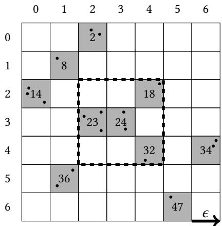  
Fi<sub>g</sub>. 1. Exam<sub>p</sub>le of searchin<sub>g</sub> the <sub>g</sub>rid index in 2-D. The non-em<sub>p</sub>t<sub>y</sub> cells are shaded. Numbers refer to linearized cell ids.

Fi<sub>g</sub>ure 1 shows an exam<sub>p</sub>le <sub>g</sub>rid in 2-D. Œe non-em<sub>p</sub>t<sub>y</sub> <sub>g</sub>ra<sub>y</sub> cells with linearized cell ids are shown. Consider a <sub>po</sub>i<sub>n</sub>t i<sub>n</sub> <sub>ce</sub>ll 24<sub>.</sub> T<sub>o</sub> €<sub>n</sub>d <sub>a</sub>ll <sub>o</sub>f it<sub>s</sub> <sub>ne</sub>i<sub>g</sub>hb<sub>ors</sub> <sub>w</sub>ithi<sub>n</sub> $\epsilon ,$ it needs to search the adjacent cells (and its ori<sub>g</sub>in cell), which are encompassed by the black dashed line. In n dimensions, there are $3 ^ { n }$ <sub>ce</sub>ll<sub>s</sub> t<sub>o searc</sub>h<sub>.</sub> H<sub>owever,</sub> th<sub>e po</sub>i<sub>n</sub>t<sub>s</sub> i<sub>n</sub> th<sub>e ce</sub>ll<sub>s are</sub> not guaranteed to be within ϵ; therefore, distance calculations between the query point and all of the points in the cells bounded by the dashed outline (cells 18, 23, 24, 32 in the €<sub>g</sub>ure) are needed to determine which ones are within the search distance ϵ.

Œe self-join is executed on the GPU with a kernel that uses |D| threads. Each thread is assigned a point and €nds all neighbors within the ϵ distance. Œe threads write the result to a bu‚er as key/value pairs, where the key is a point and the value if a point within ϵ of the key. A‰er all threads have completed €nding their respective neighbors within $\epsilon ,$ th<sub>e</sub> k<sub>ey</sub>/<sub>va</sub>l<sub>ue</sub> <sub>pa</sub>i<sub>rs</sub> <sub>are</sub> <sub>sor</sub>t<sub>e</sub>d <sub>on</sub> th<sub>e</sub> GPU<sub>,</sub> <sub>an</sub>d <sub>re</sub>t<sub>urne</sub>d t<sub>o</sub> th<sub>e</sub> h<sub>os</sub>t<sub>.</sub>

Boundin<sub>g</sub> the search to nei<sub>g</sub>hborin<sub>g</sub> cells usin<sub>g</sub> the <sub>g</sub>rid reduces thread diver<sub>g</sub>ence<sub>,</sub> which is known to de<sub>g</sub>rade GPU performance [34]. Also, the grid structure improves data locality among threads within a warp, increasing coalesced <sub>memory</sub> <sub>accesses</sub> <sub>an</sub>d <sub>un</sub>i€<sub>e</sub>d <sub>cac</sub>h<sub>e</sub> <sub>usage</sub> <sub>as</sub> <sub>g</sub>l<sub>o</sub>b<sub>a</sub>l <sub>memory</sub> l<sub>oa</sub>d<sub>s</sub> <sub>are</sub> <sub>s</sub>t<sub>ore</sub>d i<sub>n</sub> th<sub>e</sub> L1 <sub>cac</sub>h<sub>e</sub> <sub>on</sub> NVIDIA M<sub>axwe</sub>ll <sub>an</sub>d Pascal architectures [34].

3.2.2 Batching: Enabling Large Result Sets. A drawback of the GPU is that it has limited global memory. Œe self-join result sets can be much larger than the input dataset size |D|. Œus, an ecient batching scheme is needed to incrementa<sup>ll</sup>y compute t<sup>h</sup>e entire se<sup>lf</sup>-join resu<sup>l</sup>t. However, t<sup>h</sup>is is typica<sup>ll</sup>y a <sup>b</sup>igger pro<sup>bl</sup>em in <sup>l</sup>ow-<sup>d</sup>imensiona<sup>l</sup>ity, as more points are co-located, due to smaller (hyper)volumes.

To ensure t<sup>h</sup>at t<sup>h</sup>e se<sup>lf</sup>-join resu<sup>l</sup>t set <sup>d</sup>oes not excee<sup>d</sup> g<sup>l</sup>o<sup>b</sup>a<sup>l</sup> memory capacity, we emp<sup>l</sup>oy t<sup>h</sup>e met<sup>h</sup>o<sup>d f</sup>rom Gowan<sup>l</sup>oc<sup>k</sup> et al. [23], and <sub>p</sub>rovide a summar<sub>y</sub> of their work as follows. First, a kernel is executed that €nds all of the nei<sub>g</sub>hbors within ϵ for a fraction of the points in the dataset, which is used to estimate the size of the total result set. Œis kerne invocation ta<sup>k</sup>es neg<sup>l</sup>igi<sup>bl</sup>e time in comparison to t<sup>h</sup>e tota<sup>l</sup> time nee<sup>d</sup>e<sup>d</sup> to execute t<sup>h</sup>e se<sup>lf</sup>-join, as on<sup>l</sup>y a <sup>f</sup>raction of oints are searched, and the kernel onl returns an inte er (the number of oints within $\epsilon ,$ <sub>no</sub>t th<sub>e ac</sub>t<sub>ua</sub>l <sub>resu</sub>l as key/value pairs). Œe number of batches, denoted as $n _ { b }$ <sub>,</sub> i<sub>s compu</sub>t<sub>e</sub>d b<sub>ase</sub>d <sub>on a</sub> b<sub>a</sub>t<sub>c</sub>h <sub>s</sub>i<sub>ze,</sub> d<sub>eno</sub>t<sub>e</sub>d $b _ { s } ,$ <sub>an</sub>d th<sub>e</sub> estimated total result set size. Even if the result set for a given ϵ would not overƒow the global memory capacity of the GPU<sub>,</sub> th<sub>e</sub> b<sub>a</sub>t<sub>c</sub>hi<sub>ng sc</sub>h<sub>eme</sub> i<sub>s s</sub>till <sub>use</sub>d <sub>as</sub> it <sub>a</sub>ll<sub>ows</sub> f<sub>or over</sub>l<sub>ap o</sub>f d<sub>a</sub>t<sub>a</sub> t<sub>rans</sub>f<sub>ers</sub> t<sub>o an</sub>d f<sub>rom</sub> th<sub>e</sub> GPU<sub>, compu</sub>t<sub>a</sub>ti<sub>on on</sub> the GPU itself<sub>,</sub> and host-side o<sub>p</sub>erations. It is <sub>p</sub>referable to overla<sub>p</sub> these com<sub>p</sub>onents of the al<sub>g</sub>orithm to maximize <sub>co</sub>n<sub>cu</sub>rr<sub>e</sub>nt <sub>use o</sub>f r<sub>esou</sub>r<sub>ces.</sub> In <sub>a</sub>ll <sub>o</sub>f <sub>ou</sub>r <sub>e</sub>x<sub>pe</sub>rim<sub>e</sub>nt<sub>s, we use a</sub> minim<sub>u</sub>m <sub>o</sub>f 3 CUDA <sub>s</sub>tr<sub>ea</sub>m<sub>s, a</sub>nd h<sub>e</sub>n<sub>ce</sub> b<sub>a</sub>t<sub>c</sub>h<sub>es,</sub> $\mathrm { i . e . }$ $n _ { b } \geq 3 .$ . We allocate 3 pinned memory bu‚ers on the host, as it is needed for overlapping data transfers to and from the GPU, and has a hi<sub>g</sub>her data transfer rate [34]. For result set sizes that exceed $3 \times 1 0 ^ { 8 }$ <sub>, we se</sub>t <sub>a</sub> b<sub>a</sub>t<sub>c</sub>h <sub>s</sub>i<sub>ze o</sub>f $b _ { s } = 1 0 ^ { 8 }$ (the total nei<sub>g</sub>hbors found within ϵ of each point). Œus, each stream is assi<sub>g</sub>ned a bu‚er of size $b _ { s } = 1 0 ^ { 8 }$

## 4 HIGH-DIMENSIONAL SELF-JOIN OPTIMIZATIONS

As <sup>d</sup>escri<sup>b</sup>e<sup>d</sup> in Section 1 t<sup>h</sup>e per<sup>f</sup>ormance o<sup>f</sup>a<sup>l</sup>gorit<sup>h</sup>ms t<sup>h</sup>at compute t<sup>h</sup>e <sup>d</sup>istance simi<sup>l</sup>arity se<sup>lf</sup>-join is <sup>l</sup>arge<sup>l</sup>y <sup>d</sup>epen<sup>d</sup>en on t<sup>h</sup>e <sup>d</sup>imensiona<sup>l</sup>ity o<sup>f</sup> t<sup>h</sup>e input <sup>d</sup>ataset. <sup>Œ</sup>is section out<sup>l</sup>ines se<sup>lf</sup>-join optimizations tai<sup>l</sup>ore<sup>d f</sup>or <sup>h</sup>ig<sup>h</sup>-<sup>d</sup>imensiona<sup>l</sup> datasets<sub>, p</sub>articularl<sub>y</sub> in the context of the <sub>g</sub>rid-based indexin<sub>g</sub> scheme <sub>p</sub>resented in Section 3.2.1.

## 4<sub>.</sub>1 I<sub>n</sub>d<sub>ex</sub> S<sub>e</sub>l<sub>ec</sub>ti<sub>v</sub>it<sub>y</sub> t<sub>o</sub> T<sub>arge</sub>t Hi<sub>g</sub>h Di<sub>mens</sub>i<sub>ona</sub>lit<sub>y</sub>

I<sub>n</sub> hi<sub>g</sub>h di<sub>mens</sub>i<sub>ona</sub>lit<sub>y,</sub> th<sub>ere</sub> <sub>are</sub> f<sub>ewer</sub> <sub>co-</sub>l<sub>oca</sub>t<sub>e</sub>d <sub>ne</sub>i<sub>g</sub>hb<sub>ors</sub> b<sub>ecause,</sub> <sub>as</sub> th<sub>e</sub> h<sub>ypervo</sub>l<sub>ume</sub> i<sub>ncreases,</sub> th<sub>e</sub> di<sub>s</sub>t<sub>ance</sub> between objects increases [26]. However, with increasin<sub>g</sub> dimension, index €lterin<sub>g</sub> <sub>p</sub>ower decreases and search <sub>per</sub>f<sub>ormance</sub> d<sub>egra</sub>d<sub>es.</sub> Œ<sub>ere</sub> i<sub>s a</sub> t<sub>ra</sub>d<sub>e-o</sub>‚ b<sub>e</sub>t<sub>ween</sub> i<sub>n</sub>d<sub>ex</sub> €lt<sub>er</sub>i<sub>ng power an</sub>d <sub>searc</sub>h <sub>over</sub>h<sub>ea</sub>d<sub>.</sub> Œ<sub>e</sub> d<sub>raw</sub>b<sub>ac</sub>k i<sub>s</sub> th<sub>a</sub>t <sub>an</sub> i<sub>n</sub>d<sub>ex w</sub>ith l<sub>ess</sub> €lt<sub>er</sub>i<sub>ng power w</sub>ill <sub>y</sub>i<sub>e</sub>ld l<sub>arger can</sub>did<sub>a</sub>t<sub>e se</sub>t <sub>s</sub>i<sub>zes</sub> th<sub>a</sub>t <sub>nee</sub>d t<sub>o</sub> b<sub>e eva</sub>l<sub>ua</sub>t<sub>e</sub>d b<sub>y compu</sub>ti<sub>ng</sub> th<sub>e</sub> E<sub>uc</sub>lid<sub>ean</sub> di<sub>s</sub>t<sub>ance</sub> b<sub>e</sub>t<sub>ween a query po</sub>i<sub>n</sub>t <sub>an</sub>d <sub>a</sub>ll <sub>can</sub>did<sub>a</sub>t<sub>e po</sub>i<sub>n</sub>t<sub>s.</sub> Œ<sub>e</sub> b<sub>ene</sub>€t<sub>,</sub> h<sub>owever,</sub> i<sub>s</sub> th<sub>a</sub>t th<sub>e searc</sub>h <sub>requ</sub>i<sub>re</sub>d t<sub>o</sub> €<sub>n</sub>d th<sub>e</sub> <sub>can</sub>did<sub>a</sub>t<sub>e se</sub>t <sub>w</sub>ill i<sub>ncur</sub> l<sub>ess over</sub>h<sub>ea</sub>d

Œ<sub>e</sub> GPU i<sub>s a su</sub>it<sub>a</sub>bl<sub>e arc</sub>hit<sub>ec</sub>t<sub>ure</sub> f<sub>or ma</sub>ki<sub>n a</sub> t<sub>ra</sub>d<sub>e-o</sub>‚ b<sub>e</sub>t<sub>ween</sub> l<sub>ess</sub> €lt<sub>er</sub>i<sub>n ower an</sub>d <sub>more searc</sub>h <sub>over</sub>h<sub>ea</sub>d<sub>.</sub> Œis is because the GPU is desi<sub>g</sub>ned to achieve hi<sub>g</sub>h com<sub>p</sub>utational throu<sub>g</sub>h<sub>p</sub>ut and thus excels at tasks like com<sub>p</sub>utin<sub>g</sub> th<sub>e</sub> di<sub>s</sub>t<sub>ances</sub> b<sub>e</sub>t<sub>ween</sub> <sub>po</sub>i<sub>n</sub>t<sub>s</sub> i<sub>n</sub> <sub>para</sub>ll<sub>e</sub>l<sub>.</sub> Œ<sub>us,</sub> t<sub>o</sub> <sub>avo</sub>id th<sub>e</sub> <sub>over</sub>h<sub>ea</sub>d<sub>s</sub> <sub>assoc</sub>i<sub>a</sub>t<sub>e</sub>d <sub>w</sub>ith <sub>searc</sub>h<sub>es</sub> i<sub>n</sub> hi<sub>g</sub>h<sub>er</sub> di<sub>mens</sub>i<sub>ons,</sub> <sub>we prov</sub>id<sub>e a</sub> t<sub>ra</sub>d<sub>e-o</sub>‚ <sub>us</sub>i<sub>ng a</sub> l<sub>ess r</sub>i<sub>gorous</sub> i<sub>n</sub>d<sub>ex searc</sub>h f<sub>or</sub> i<sub>ncrease</sub>d €lt<sub>er</sub>i<sub>ng over</sub>h<sub>ea</sub>d<sub>.</sub> T<sub>o</sub> ill<sub>us</sub>t<sub>ra</sub>t<sub>e w</sub>h<sub>y</sub> thi<sub>s</sub> t<sub>ra</sub>d<sub>e-o</sub>‚ is important, in t<sup>h</sup>e context o<sup>f</sup> t<sup>h</sup>e gri<sup>d</sup> in<sup>d</sup>exing sc<sup>h</sup>eme, t<sup>h</sup>e num<sup>b</sup>er o<sup>f</sup> a<sup>d</sup>jacent ce<sup>ll</sup>s require<sup>d</sup> to c<sup>h</sup>ec<sup>k</sup> is $3 ^ { n } ;$ <sub>;</sub> in 2-D thi<sub>s</sub> i<sub>s</sub> <sub>on</sub>l<sub>y</sub> 9 <sub>ce</sub>ll<sub>s,</sub> b<sub>u</sub>t i<sub>n</sub> $6 \mathrm { - D } ,$ this is 729 cells. We decrease the €ltering power and search overhead by indexing only k dimensions of the n-dimensional points, where $2 \leq k < n .$ thus projecting the points into k dimensions. To resolve whether points are within ϵ of the query point, we compute the Euclidean distance in all n dimensions, and thus obtain the correct result. Since we index in fewer than n dimensions, each cell has $n - k$ unconstrained dimensions<sub>,</sub> resultin<sub>g</sub> in <sup>l</sup>ess <sup>€l</sup>tering power. <sup>Œ</sup>e <sup>d</sup>ecrease in t<sup>h</sup>e num<sup>b</sup>er o<sup>f</sup> a<sup>d</sup>jacent ce<sup>ll</sup>s searc<sup>h</sup>e<sup>d</sup> is <sup>d</sup>enote<sup>d</sup> as $l ( n , k ) = ( 3 ^ { n } - 3 ^ { k } ) / 3 ^ { n }$ . For example, if 5-D points are indexed in 3-D, then the loss is: l $n , k ) = ( 3 ^ { 5 } - 3 ^ { 3 } ) / 3 ^ { 5 } { = } 8 8 . 9 \% ,$ <sub>an</sub>d th<sub>e num</sub>b<sub>er o</sub>f <sub>searc</sub>h<sub>e</sub>d cells decreases by that percenta<sub>g</sub>e (assumin<sub>g</sub> the data is uniformly distributed in each dimension).

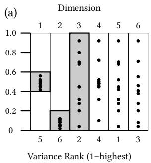

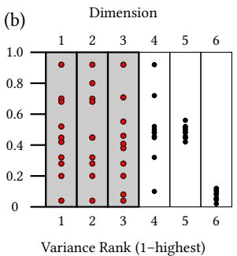  
Fig. 2. Dimensionality reordering by variance on a 6-D dataset having |D | = 10 indexing k = 3 dimensions. (a) initial input dataset; (b) reordering the point coordinates from largest to smallest variance in each dimension. Red points denote those used to index $k = 3$ di<sub>mens</sub>i<sub>ons</sub> b<sub>ase</sub>d <sub>on</sub> hi<sub>g</sub>h <sub>var</sub>i<sub>ance</sub> i<sub>n correspon</sub>di<sub>ng</sub> di<sub>mens</sub>i<sub>ons.</sub> Sh<sub>a</sub>d<sub>e</sub>d <sub>ce</sub>ll<sub>s</sub> d<sub>eno</sub>t<sub>e</sub> i<sub>n</sub>d<sub>exe</sub>d <sub>area.</sub>

## 4<sub>.</sub>2 Di<sub>mens</sub>i<sub>ona</sub>lit<sub>y</sub> R<sub>eor</sub>d<sub>er</sub>i<sub>ng</sub> b<sub>y</sub> V<sub>ar</sub>i<sub>ance</sub>

Index searches are increasin<sub>g</sub>l<sub>y</sub> exhaustive and more ex<sub>p</sub>ensive in hi<sub>g</sub>her dimensions. Œe statistical <sub>p</sub>ro<sub>p</sub>erties of hi<sub>g</sub>h di<sub>mens</sub>i<sub>ona</sub>l f<sub>ea</sub>t<sub>ure</sub> <sub>vec</sub>t<sub>ors</sub> <sub>can</sub> b<sub>e</sub> <sub>exp</sub>l<sub>o</sub>it<sub>e</sub>d t<sub>o</sub> i<sub>mprove</sub> th<sub>e</sub> €lt<sub>er</sub>i<sub>ng</sub> <sub>power</sub> <sub>o</sub>f th<sub>e</sub> i<sub>n</sub>d<sub>ex</sub> t<sub>o</sub> <sub>prune</sub> th<sub>e</sub> <sub>searc</sub>h <sub>space</sub> <sub>an</sub>d eliminate points that are not within ϵ (e.<sub>g</sub>., see [27] in related work, Section 2). Œe dimensions of the data that have the <sub>g</sub>reatest variance should im<sub>p</sub>rove the <sub>p</sub>runin<sub>g</sub> <sub>p</sub>ower of index searches. Since we ma<sub>y</sub> not index all dimensions<sub>,</sub> as discussed in Section 4.1<sub>,</sub> it is im<sub>p</sub>ortant to select dimensions that o<sub>p</sub>timize the abilit<sub>y</sub> of the index to <sub>p</sub>rune the search and minimize the size of the candidate set. Otherwise, if we simply select the €rst k dimensions in the dataset, we may inadvertentl<sub>y</sub> select dimensions to index that <sub>y</sub>ield a minimal de<sub>g</sub>ree of <sub>p</sub>runin<sub>g p</sub>ower.

Fi<sub>g</sub>ure 2 (a) shows an exam<sub>p</sub>le dataset of 10 <sub>p</sub>oints in 6 dimensions <sub>g</sub>enerated in the ran<sub>g</sub>e [0,1]. We can see that the €rst two dimensions have a low de ree of variance. Œus, if we index k = 3 dimensions (and not all $n = 6 )$ <sub>, we w</sub>ill h<sub>ave a</sub> l<sub>ow amoun</sub>t <sub>o</sub>f i<sub>n</sub>d<sub>ex</sub> €lt<sub>er</sub>i<sub>ng power</sub> d<sub>ue</sub> t<sub>o</sub> th<sub>e</sub> l<sub>ow var</sub>i<sub>ance o</sub>f th<sub>e</sub> €<sub>rs</sub>t t<sub>wo</sub> di<sub>mens</sub>i<sub>ons.</sub> If <sub>we assume</sub> th<sub>a</sub>t th<sub>e</sub> <sub>gr</sub>id <sub>ce</sub>ll<sub>s are o</sub>f l<sub>eng</sub>th $\epsilon = 0 . 2$ <sub>, we</sub> €<sub>n</sub>d th<sub>a</sub>t di<sub>mens</sub>i<sub>ons</sub> 1 <sub>an</sub>d 2 <sub>w</sub>ill <sub>on</sub>l<sub>y pro</sub>d<sub>uce a s</sub>i<sub>ng</sub>l<sub>e ce</sub>ll i<sub>n</sub> th<sub>e</sub>i<sub>r</sub> di<sub>mens</sub>i<sub>ons</sub> (denoted by the shaded re<sub>g</sub>ions). Œus, when searchin<sub>g</sub> the index for points, dimensions 1 and 2 do not reduce the number of points that may be within ϵ. However, we can select the dimensions with greater variance to improve €lterin<sub>g</sub> power. For instance, dimensions 5, 3 and 6 in Fi<sub>g</sub>ure 2 (a) have the <sub>g</sub>reatest variance. If we reorder the data by decreasin<sub>g</sub> variance, then we obtain Fi<sub>g</sub>ure 2 (b). Now, each of the €rst 3 dimensions spans 5 <sub>g</sub>rid cells (assumin<sub>g</sub> $\epsilon = 0 . 2 )$ . Consequently, when the index is searched, it will return cells with fewer points on average in comparison to the ori inal input distribution in Fi ure 2 (a). We note that in Fi ure 2, it seems like the number of cells should be maximized and not the variance. While data with high variance will tend to produce more cells, it is possible to have many cells in a dimension with low variance (e.<sub>g</sub>., one point per cell, and the remainin<sub>g</sub> points in a sin<sub>g</sub>le cell, as in dimension 4 in Fi<sub>g</sub>ure 2 (b)).

To re-order the dimensions b<sub>y</sub> their variance, we use a sam<sub>p</sub>le of 1% of |D| and estimate the variance in each di<sub>mens</sub>i<sub>on.</sub> Œ<sub>en, we reor</sub>d<sub>er</sub> th<sub>e coor</sub>di<sub>na</sub>t<sub>e va</sub>l<sub>ues</sub> i<sub>n eac</sub>h di<sub>mens</sub>i<sub>on o</sub>f $p _ { i } \in D ,$ <sub>, suc</sub>h th<sub>a</sub>t th<sub>e va</sub>l<sub>ues are</sub> i<sub>n</sub> d<sub>escen</sub>di<sub>ng</sub> order from hi<sub>g</sub>hest to lowest variance. Œus, when we index the €rst k dimensions (Section 4.1), they potentially have <sub>g</sub>reater €lterin<sub>g p</sub>ower than the initial in<sub>p</sub>ut dataset. Reorderin<sub>g</sub> dimensions does not im<sub>p</sub>act the correctness of the result, as we are sim<sub>p</sub>l<sub>y</sub> swa<sub>pp</sub>in<sub>g</sub> the coordinate values of the <sub>p</sub>oints. Œis re<sub>q</sub>uires O(|D|n) work, which is ne<sub>g</sub>li<sub>g</sub>ible w<sup>h</sup>en compare<sup>d</sup> to per<sup>f</sup>orming t<sup>h</sup>e se<sup>lf</sup>-join. We <sup>d</sup>enote reor<sup>d</sup>ering t<sup>h</sup>e <sup>d</sup>ata <sup>b</sup>y variance in eac<sup>h</sup> <sup>d</sup>imension as reorder. If <sub>we</sub> ind<sub>e</sub>x $k < n$ dimensions, but do not use reorder, we simply index the €rst k dimensions of the input dataset.

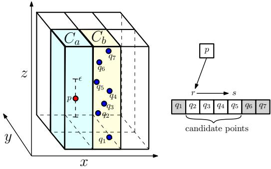  
Fig. 3. Example of the sortidu optimization. We first sort points within each cell by z-coordinate. We then search query point p into th<sub>e</sub> li<sub>s</sub>t <sub>o</sub>f $C _ { b }$ to find r and scan and compare points until s is reached

## 4<sub>.</sub>3 S<sub>earc</sub>hi<sub>ng</sub> <sub>on</sub> <sub>an</sub> U<sub>n-</sub>i<sub>n</sub>d<sub>exe</sub>d Di<sub>mens</sub>i<sub>on</sub>

B<sub>y</sub> indexin<sub>g</sub> onl<sub>y</sub> $k < n$ di<sub>mens</sub>i<sub>ons, we re</sub>d<sub>uce</sub> th<sub>e</sub> i<sub>n</sub>d<sub>ex</sub>i<sub>n over</sub>h<sub>ea</sub>d b <sub>re</sub>d<sub>uc</sub>i<sub>n</sub> th<sub>e num</sub>b<sub>er o</sub>f <sub>r</sub>id <sub>ce</sub>ll<sub>s, w</sub>hi<sub>c</sub>h i<sub>s</sub> exponential with k. However, this comes at the cost of reduced €ltering power, resulting in more distance calculations. I<sub>n</sub> thi<sub>s sec</sub>ti<sub>on we</sub> i<sub>n</sub>t<sub>ro</sub>d<sub>uce a</sub> t<sub>ec</sub>h<sub>n</sub>i<sub>que o</sub>f <sub>searc</sub>hi<sub>ng on an un-</sub>i<sub>n</sub>d<sub>exe</sub>d di<sub>mens</sub>i<sub>on</sub> t<sub>o</sub> f<sub>ur</sub>th<sub>er re</sub>d<sub>uce</sub> th<sub>e num</sub>b<sub>er o</sub>f necessary distance calculations. Consider an input set with n dimensions that is indexed on $k < n$ dimensions usin<sub>g</sub> the indexing scheme presented in Section 3.2.1. For a given point p in cell $C _ { a }$ <sub>an</sub>d <sub>ne</sub>i<sub>g</sub>hb<sub>or ce</sub>ll $C _ { b }$ , we compare p to each <sub>p</sub>o<sup>i</sup>nt $q \in C _ { b }$ t<sub>o</sub> d<sub>e</sub>t<sub>e</sub>rmin<sub>e</sub> if $\dot { \boldsymbol { p } }$ and q are within distance ϵ of each other. Since we have indexed k dimensions, the points contained in $C _ { b }$ are only €ltered by these k dimensions. Œus, if we consider dimension u that is not indexed, each poin in $C _ { b }$ can have an<sub>y</sub> value in this dimension. Currentl<sub>y,</sub> we must <sub>p</sub>erform a distance com<sub>p</sub>arison on all $q \in C _ { b }$ <sub>, w</sub>hi<sub>c</sub>h i<sub>nc</sub>l<sub>u</sub>d<sub>es suc</sub>h <sub>po</sub>i<sub>n</sub>t<sub>s</sub> th<sub>a</sub>t <sub>may</sub> b<sub>e very</sub> di<sub>s</sub>t<sub>an</sub>t f<sub>rom</sub> $\mathcal { P }$ in dimension u $( \mathrm { i . e . , } | p ( u ) - q ( u ) | > \epsilon )$ . <sup>Œ</sup>ere<sup>f</sup>ore, we <sub>p</sub>ro<sub>p</sub>ose an optimization called sortidu to only compare p with $q \in C _ { b }$ if they are within ϵ distance along the u-coordinate. We accomplish this by €rst sorting the points within each cell by increasing u-coordinate. When comparing p with al $q \in C _ { b } .$ , we €rst search p(u) into the points in $C _ { b }$ to €nd the point r with the smallest u-coordinate that is still within ϵ <sub>o</sub>f $\begin{array} { r } { p \left( \mathrm { i . e } , | p ( u ) - r ( u ) | \leq \epsilon \right) } \end{array}$ . We then scan <sub>p</sub>oints in $C _ { b }$ by increasing u coordinate until we reach point s with more than the ϵ distance in the u-coordinate (i.e., $| p ( u ) - s ( u ) | > \epsilon )$ . Fi<sub>g</sub>ure 3 illustrates an exam<sub>p</sub>le of the sortidu o<sub>p</sub>timization. In this example, the z-axis is not indexed and we use the sortidu to reduce the number of candidate points we have to <sub>cons</sub>id<sub>er,</sub> f<sub>rom</sub> $q _ { 1 } , q _ { 2 } , \ldots , q _ { 7 } \ ( 7$ points) to $q _ { 2 } , \ldots , q _ { 5 }$ (4 points). We note that we only perform this optimization on one <sub>un-</sub>i<sub>n</sub>d<sub>exe</sub>d di<sub>mens</sub>i<sub>on an</sub>d <sub>a</sub>ll <sub>o</sub>th<sub>er un-</sub>i<sub>n</sub>d<sub>exe</sub>d di<sub>mens</sub>i<sub>ons rema</sub>i<sub>n un</sub>€lt<sub>ere</sub>d<sub>.</sub>

If ever<sub>y p</sub>oint in $C _ { b }$ is within ϵ from ${ \boldsymbol { \mathit { p } } } ,$ the sortidu o<sub>p</sub>timization <sub>p</sub>rovides no <sub>p</sub>erformance im<sub>p</sub>rovement. However<sub>,</sub> for reasonably small ϵ values, this can signi€cantly reduce the number of candidate points. Œis comes at the cost of <sub>sor</sub>ti<sub>ng an</sub>d <sub>searc</sub>hi<sub>ng.</sub> If <sub>we cons</sub>id<sub>er</sub> th<sub>a</sub>t <sub>ce</sub>ll $C _ { b }$ h<sub>as</sub> $| C _ { b } | \mathrm { p o i n t s }$ , we must <sub>p</sub>er<sup>f</sup>orm $\left| C _ { b } \right|$ di<sub>s</sub>t<sub>ance ca</sub>l<sub>cu</sub>l<sub>a</sub>ti<sub>ons w</sub>ith<sub>ou</sub> the sortidu o<sub>p</sub>timization. However<sub>,</sub> sortidu reduces this to $( \log | C _ { b } | + m )$ calculations, where m is the number of <sub>p</sub>oints in $C _ { b }$ with u-coordinate within ϵ of $p ( u )$ . While sortidu re<sub>q</sub>uires that we sort <sub>p</sub>oints within each cell<sub>,</sub> we onl<sub>y</sub> have to sort once for all <sub>p</sub>oint evaluations. We can a<sub>pp</sub>l<sub>y</sub> the sortidu o<sub>p</sub>timization even when we index all dimensions $( \mathrm { i . e . , } k = n )$ <sub>.</sub> I<sub>n</sub> thi<sub>s</sub> <sub>case,</sub> <sub>we</sub> <sub>sor</sub>t <sub>eac</sub>h <sub>ce</sub>ll b<sub>y</sub> <sub>one</sub> <sub>o</sub>f th<sub>e</sub> i<sub>n</sub>d<sub>exe</sub>d di<sub>mens</sub>i<sub>ons;</sub> h<sub>owever,</sub> <sub>we</sub> <sub>expec</sub>t <sub>more</sub> <sub>s</sub>i<sub>gn</sub>i€<sub>can</sub>t b<sub>ene</sub>€t<sub>s</sub> <sub>w</sub>h<sub>en</sub> <sub>we</sub> <sub>app</sub>l<sub>y</sub> <sub>sortidu</sub> t<sub>o</sub> <sub>an</sub> <sub>un-</sub>i<sub>n</sub>d<sub>exe</sub>d di<sub>mens</sub>i<sub>on.</sub>

## 4<sub>.</sub>4 Sh<sub>or</sub>t Ci<sub>rcu</sub>iti<sub>ng</sub> th<sub>e</sub> Di<sub>s</sub>t<sub>ance</sub> C<sub>a</sub>l<sub>cu</sub>l<sub>a</sub>ti<sub>on</sub>

Œe number of ƒoating point operations needed to compute the Euclidean distance between two n-dimensional points is 3n. Œus, the distance calculation cost increases with dimensionality. Since the calculation of Euclidean distance is based on the sum of values, we can incrementally compute it. During computation, if the partial sum exceeds ϵ before the entire Euclidean distance is calculated, we know the two points are not within ϵ distance of each other and can stop further calculation. Œis type of sort-circuiting is a well-known optimization and has been used in other works such as SuperEGO [27], and we show that it leads to si<sub>g</sub>ni€cant <sub>p</sub>erformance <sub>g</sub>ains in some scenarios. We denote this o<sub>p</sub>timization as shortc.

## 4<sub>.</sub>5 O<sub>u</sub>tli<sub>ne</sub> <sub>o</sub>f th<sub>e</sub> Al<sub>gor</sub>ith<sub>m</sub>

Al<sub>g</sub>orithm 1 outlines GPU-Join, which be<sub>g</sub>ins by re-orderin<sub>g</sub> the input set, D, by variance, if reorder is enabled (line 3). Next, the index is computed usin<sub>g</sub> the dataset and the number of indexed dimensions, k (line 4). Œen, the number <sub>o</sub>f b<sub>a</sub>t<sub>c</sub>h<sub>es,</sub> $n _ { b } .$ <sub>,</sub> t<sub>o</sub> b<sub>e</sub> <sub>execu</sub>t<sub>e</sub>d <sub>are</sub> <sub>compu</sub>t<sub>e</sub>d <sub>us</sub>i<sub>ng</sub> th<sub>e</sub> b<sub>a</sub>t<sub>c</sub>h <sub>s</sub>i<sub>ze,</sub> $b _ { s }$ (line 5). Œe al<sub>g</sub>orithm then loops over all of the batches (line 7) and executes them on the GPU (line 8, detailed below). Œe result of each batch is stored as key/value pairs, where the key is the a query point and the value is a point within ϵ distance (i.e., for each query point $\mathbf { \nabla } \mathcal { P } i$ th<sub>ere</sub> ma<sub>y</sub> be multi<sub>p</sub>le resultin<sub>g</sub> <sub>p</sub>airs $( p _ { i } , p _ { j } ) )$ . Since the keys are o‰en redundant (multiple points are within ϵ of a given point), they are stored without redundant information usin<sub>g</sub> constructNei<sub>g</sub>hborTable, and stored into the €nal result (line 9).

Each batch is executed by runnin<sub>g</sub> SelfJoinKernel, a GPU kernel. First, the result set for the batch is initialized (line 12), the <sub>g</sub>lobal id of the thread is obtained (line 13), and the point, $p _ { i } \in D$ i<sub>s compu</sub>t<sub>e</sub>d <sub>as a</sub> f<sub>unc</sub>ti<sub>on o</sub>f th<sub>e g</sub>l<sub>o</sub>b<sub>a</sub>l id (line 14). Next, all of the adjacent non-empty cells are computed from G (the index), k, and the point (line 15). Œe al<sub>g</sub>orithm loops over each nei<sub>g</sub>hbor cell (line 16), and computes the distance between the query point and all of the points within the nei<sub>g</sub>hbor cell to determine if they are within ϵ (line 17). A‰er all nei<sub>g</sub>hbor cells have been processed, the points within ϵ of the query point assigned to the thread are added to the result set, and the kernel returns (lines 18–19). Œe execution of the calcDistancePts function di‚ers if sortidu or shortc are enabled.

Whil<sub>e</sub> Al<sub>gor</sub>ith<sub>m</sub> 1 <sub>appears</sub> t<sub>o</sub> b<sub>e</sub> <sub>sequen</sub>ti<sub>a</sub>l<sub>,</sub> <sub>we</sub> <sub>execu</sub>t<sub>e</sub> <sub>severa</sub>l <sub>o</sub>f th<sub>e</sub> <sub>a</sub>l<sub>gor</sub>ith<sub>m</sub> b<sub>a</sub>t<sub>c</sub>hi<sub>ng</sub> <sub>sc</sub>h<sub>eme</sub> t<sub>as</sub>k<sub>s</sub> <sub>concurren</sub>tl<sub>y.</sub> Œe loo<sub>p</sub> on line 7 in Al<sub>g</sub>orithm 1 is executed in <sub>p</sub>arallel. Fi<sub>g</sub>ure 4 shows an overview of a <sub>p</sub>i<sub>p</sub>eline of tasks that are <sub>execu</sub>t<sub>e</sub>d <sub>concurren</sub>tl<sub>y, w</sub>h<sub>ere we use a</sub> b<sub>a</sub>l<sub>ance</sub>d <sub>p</sub>i<sub>pe</sub>li<sub>ne</sub> f<sub>or</sub> ill<sub>us</sub>t<sub>ra</sub>ti<sub>ve purposes.</sub> F<sub>or eac</sub>h b<sub>a</sub>t<sub>c</sub>h<sub>,</sub> th<sub>e</sub> k<sub>erne</sub>l <sub>parame</sub>t<sub>ers</sub> relevant to the batch are sent to the GPU (HtoD), the GPU computes the self-join result for the batch (Kernel), and then the result is transferred back to the host (DtoH), and €nally the neighbor table is constructed (Table). Œis pipeline shows th<sub>a</sub>t <sub>up</sub> t<sub>o</sub> f<sub>our concurren</sub>t t<sub>as</sub>k<sub>s can</sub> b<sub>e execu</sub>t<sub>e</sub>d <sub>a</sub>t th<sub>e same</sub> ti<sub>me.</sub> P<sub>ar</sub>ti<sub>cu</sub>l<sub>ar</sub>l<sub>y</sub> i<sub>mpor</sub>t<sub>an</sub>t i<sub>s</sub> t<sub>rans</sub>f<sub>err</sub>i<sub>ng o</sub>f th<sub>e resu</sub>lt sets back to the host (DtoH) while the next batch is executing (Kernel), which hides much of the data transfer overhead. Note that this <sub>p</sub>i<sub>p</sub>eline is for illustrative <sub>p</sub>ur<sub>p</sub>oses onl<sub>y</sub>. In hi<sub>g</sub>h dimensionalit<sub>y,</sub> the al<sub>g</sub>orithm is com<sub>p</sub>ute-bound<sub>,</sub> so Kernel is much longer than the other stages. However, if there are smaller workloads that have short kernel execution phases, then the fraction of GPU-related overheads increase (HtoD and DtoH). In this case, the pipeline is important to ensure that GPU-Join remains competitive with CPU-only al<sub>g</sub>orithms on small workloads

```txt
Algorithm 1 GPU-JOIN Algorithm
1: procedure GPU-JOIN(D, ε, n, k, bs)
2:    D ← importData()
3:    D ← reorderVariance(D)
4:    G ← constructIndex(D, k)
5:    nb ← computeNumBatches(bs)
6:    result ← ∅
7:    for i ∈ 1, . . . , nb do
8:    kernelResult[i] ← selfJoinKernel(D, G, n, k, ε)
9:    result ← result ∪ constructNeighborTable(kernelResult[i])
10:    return
11: procedure SELFJOINKERNEL(D, G, n, k, ε)
12:    resultSet ← ∅
13:    gid ← getGlobalId()
14:    point ← endPoint(gid, D)
15:    adjCells ← getAdjCells(G, k, point)
16:    for cell ∈ adjCells.min, . . . , adjCells.max do
17:    pntResult ← pntResult ∪ calcDistancePts(point, cell, n, ε)
18:    resultSet ← resultSet ∪ pntResult
19:    return resultSet
```

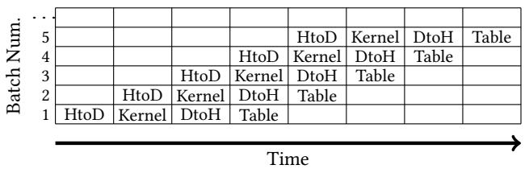  
Fig. 4. Illustrative example of pipelined operations in GPU-Join. HtoD denotes a host-to-device data transfer, Kernel denotes execution of the GPU kernel, DtoH denotes a device-to-host data transfer, and Table denotes constructing the neighbor table on the host.

## 5 EXPERIMENTAL EVALUATION

## 5.1 Datasets

W<sub>e u</sub>tili<sub>ze</sub> b<sub>o</sub>th <sub>rea</sub>l <sub>an</sub>d <sub>syn</sub>th<sub>e</sub>ti<sub>c</sub> d<sub>a</sub>t<sub>ase</sub>t<sub>s</sub> t<sub>o eva</sub>l<sub>ua</sub>t<sub>e</sub> th<sub>e per</sub>f<sub>ormance o</sub>f <sub>our a</sub>l<sub>gor</sub>ith<sub>m an</sub>d <sub>op</sub>ti<sub>m</sub>i<sub>za</sub>ti<sub>ons, w</sub>hi<sub>c</sub>h we summarize in Table 1 and describe below. We use some of the real-world datasets to evaluate both LSS [32] and SuperEGO [27]. We normalize all datasets in the ran<sub>g</sub>e [0,1] to conform to the re<sub>q</sub>uirements of SuperEGO. Real-world datasets were obtained from UCI ML re<sub>p</sub>ositor<sub>y</sub> [31].

• Co-occurrence Texture, CoocTexture– 16-D image features, and 68,040 points. Used in LSS and SuperEGO.

• Color Histogram, ColorHist– 32-D image features, and 68,040 points. Used in LSS and SuperEGO.

• Layout Histogram, LayoutHist– 32-D image features and 66,616 points. Used in LSS and SuperEGO.

• Supersymmetry Particles, SuSy 18-D – kinematic properties of 5 million particles from the Large Hadron Collider. Used for classi€cation [5].

• Song Prediction Dataset, Songs 90-D – extracted features of songs, with 415,345 points. Used for classi€cation [8].

We use rea<sup>l</sup>-wor<sup>ld d</sup>atasets to eva<sup>l</sup>uate per<sup>f</sup>ormance o<sup>f h</sup>ig<sup>h d</sup>imensiona<sup>l</sup> se<sup>lf</sup>-joins, as synt<sup>h</sup>etic <sup>d</sup>atasets are not representative of real-world data. However, the similarity joins in the literature (and our work) rely on statistical techniques for improving index ecacy. Œe worst case scenario for our algorithm is when there is low variance in each dimension, reducin<sub>g</sub> the impact of dimensionality reorderin<sub>g</sub> (Section 4.2). To evaluate performance on such worst-case inputs, we generate synthetic datasets with an exponential distribution with λ = 40. We generate 16, 32, and 64-dimensional synthetic datasets, denoted Syn-, with coordinates in [0,1].

## 5<sub>.</sub>2 Ex<sub>p</sub>erimental Methodolo<sub>gy</sub>

Œe GPU code is wriŠen in CUDA and executed on an NVIDIA GP100 GPU with 16 GiB of <sub>g</sub>lobal memor<sub>y</sub>. Œe C/C++ host code is compiled with the GNU compiler (v. 5.4.0) and O3 optimization ƒa<sub>g</sub>. Œe platform that executes all ex<sub>p</sub>eriments has 2× E5-2620 v4 2.1 GHz CPUs, with each havin<sub>g</sub> 8 cores (16 total cores). Our self-join CUDA kernel <sub>uses</sub> 256 th<sub>rea</sub>d<sub>s per</sub> bl<sub>oc</sub>k<sub>, an</sub>d <sub>uses</sub> 32<sub>-</sub>bit ƒ<sub>oa</sub>t<sub>s</sub> f<sub>or cons</sub>i<sub>s</sub>t<sub>ency w</sub>ith S<sub>uper</sub>EGO<sub>.</sub> W<sub>e exc</sub>l<sub>u</sub>d<sub>e</sub> th<sub>e</sub> ti<sub>me</sub> t<sub>o</sub> l<sub>oa</sub>d th<sub>e</sub> <sup>d</sup>ataset an<sup>d</sup> construct t<sup>h</sup>e in<sup>d</sup>ex. We inc<sup>l</sup>u<sup>d</sup>e t<sup>h</sup>e time to execute t<sup>h</sup>e se<sup>lf</sup>-join, store t<sup>h</sup>e resu<sup>l</sup>t set on t<sup>h</sup>e <sup>h</sup>ost an<sup>d</sup> ot<sup>h</sup>e host-side o<sub>p</sub>erations<sub>,</sub> and <sub>p</sub>erform the dimensionalit<sub>y</sub> reorderin<sub>g</sub>. Œus<sub>,</sub> we include the res<sub>p</sub>onse time of com<sub>p</sub>onents <sub>use</sub>d i<sub>n o</sub>th<sub>er wor</sub>k<sub>s</sub> t<sub>o ma</sub>k<sub>e a</sub> f<sub>a</sub>i<sub>r compar</sub>i<sub>son</sub> b<sub>e</sub>t<sub>ween approac</sub>h<sub>es.</sub>

We perform experiments using a series of datasets and ϵ values such that we do not have too many $( \mathrm { e . g . } , | D | ^ { 2 } )$ or too few (e.<sub>g</sub>., 0) total results. Œus, the values of ϵ should represent values that are pra<sub>g</sub>matically useful to a user of the se<sup>lf</sup>-join a<sup>l</sup>gorit<sup>h</sup>m. For instance, w<sup>h</sup>en using t<sup>h</sup>e se<sup>lf</sup>-join <sup>f</sup>or <sup>d</sup>ata ana<sup>l</sup>ysis, it is not use<sup>f</sup>u<sup>l</sup> to return a <sup>l</sup>arge <sup>f</sup>raction o<sup>f</sup> the total database, D. We denote the selectivity of the self-join as follows:

$$
S _ {D} = \frac {| R | - | D |}{| D |},\tag{1}
$$

where |R| is the total result set size. Œis yields the average number of points within ϵ, excluding a point, $\phi _ { a }$ <sub>,</sub> €ndin<sub>g</sub> itself (i.e., a result tuple: $( p _ { a } \in D , p _ { a } \in D ) )$ . We re<sub>p</sub>ort the selecti<sub>v</sub>it<sub>y</sub> in o<sub>u</sub>r <sub>p</sub>lots so that o<sub>u</sub>r res<sub>u</sub>lts can be re<sub>p</sub>rod<sub>u</sub>ced b<sub>y</sub> other researchers and to demonstrate that the res<sub>p</sub>ective ex<sub>p</sub>erimental scenario is meanin<sub>g</sub>ful. Our ex<sub>p</sub>eriment cover a ran<sub>g</sub>e of ϵ values that include those used b<sub>y</sub> Kalashnikov [27] to evaluate SuperEGO.

## 5.3 State-of-the-art Implementation (SuperEGO)

Su<sub>p</sub>er-EGO [27] <sub>p</sub>erforms fast self-joins on multidimensional data and has been shown to out<sub>p</sub>erform other al<sub>g</sub>orithms on low and hi<sub>g</sub>h dimensional data. We use a multi-threaded im<sub>p</sub>lementation of Su<sub>p</sub>er-EGO<sub>,</sub> usin<sub>g</sub> 16 threads on 16 <sub>p</sub>h<sub>y</sub>sical cores (the maximum number of cores on our <sub>p</sub>latform). We normalize the datasets in the ran<sub>g</sub>e [0,1] in each <sup>d</sup>imension, as nee<sup>d</sup>e<sup>d</sup> <sup>b</sup>y t<sup>h</sup>e a<sup>l</sup>gorit<sup>h</sup>m. We compute t<sup>h</sup>e tota<sup>l</sup> time using t<sup>h</sup>e time to ego-sort an<sup>d</sup> join on 32-<sup>b</sup>it <sup>ƒ</sup>oats and exclude the other components (e.<sub>g</sub>., loadin<sub>g</sub> the dataset and indexin<sub>g</sub>). We ensure self-join correctness by comparin<sub>g</sub> the results of GPU-Join and SuperEGO. We are <sub>g</sub>rateful to D. Kalashnikov for makin<sub>g</sub> SuperEGO publicly available.

## 5.4 Performance on Datasets in the Su<sub>p</sub>erE<sub>g</sub>o Pa<sub>p</sub>er

As ϵ increases, the workload of the self-join increases for two reasons: (i) index searches are more exhaustive as more data overlaps the query point being searched; and (ii) larger candidate sets need to be €ltered using Euclidean distance calculations. In this section, we compare the performance of GPU-Join to LSS and SuperEGO, for $n \geq 1 6$ an<sup>d</sup> varyin<sub>g</sub> ϵ, usin<sub>g</sub> the same datasets as those used b<sub>y</sub> Kalashnikov [27]. We do not use an<sub>y</sub> o<sub>p</sub>timizations exce<sub>p</sub>t indexin<sub>g</sub> $k < n$ dimensions (Section 4.1). We discuss how to select k in Section 5.5.

Table 1. Dataset, data points, |D |, and dimension, n.

<table><tr><td>Dataset</td><td> $|D|$ </td><td>n</td><td>Dataset</td><td> $|D|$ </td><td>n</td></tr><tr><td>CoocTexture</td><td>68,040</td><td>16</td><td>Songs</td><td>515,345</td><td>90</td></tr><tr><td>LayoutHist</td><td>66,616</td><td>32</td><td>Syn16D2M</td><td> $2 \times 10^{6}$ </td><td>16</td></tr><tr><td>ColorHist</td><td>68,040</td><td>32</td><td>Syn32D2M</td><td> $2 \times 10^{6}$ </td><td>32</td></tr><tr><td>SuSy</td><td> $5 \times 10^{6}$ </td><td>18</td><td>Syn64D2M</td><td> $2 \times 10^{6}$ </td><td>64</td></tr></table>

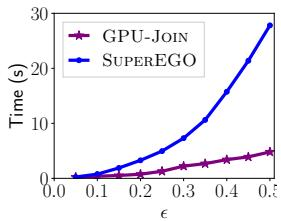  
(a) ColorHist (32-D)

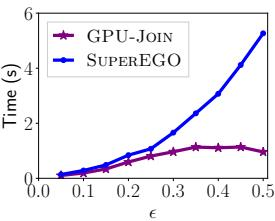  
(b) LayoutHist (32-D)

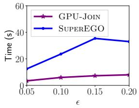  
(c) CoocTexture (16-D)  
Fig. 5. Response time vs. ϵ on the real-world datasets used in SuperEGO [27]. k = 6 dimensions are indexed across all datasets. R<sub>oun</sub>d<sub>e</sub>d <sub>va</sub>l<sub>ues o</sub>f $S _ { D }$ in the plots are in the ran<sub>g</sub>e (a) 4–26k, (b) 3–1.1k, and (c) 14k–62k.

Figure 5 plots response time vs. ϵ on ColorHist, LayoutHist, and CoocTexture. We €nd that across all datasets GPU-Join tends to outperform SuperEGO (recall that SuperEGO uses 16 cores/threads) on all experimental scenarios. In Fi<sub>g</sub>ure 5 (b) we see that GPU-Join and SuperEGO have nearly identical performance when $\epsilon \leq 0 . 1 5$ <sub>,</sub> b<sub>u</sub>t <sub>w</sub>h<sub>en</sub> $\epsilon > 0 . 1 5$ , the performance of the approaches diver<sub>g</sub>e. Also, note that in Fi<sub>g</sub>ure 5 (c) the performance of SuperEGO i<sub>ncreases</sub> <sub>an</sub>d th<sub>en</sub> d<sub>ecreases.</sub> Œi<sub>s</sub> i<sub>s</sub> b<sub>ecause</sub> b<sub>y</sub> $\epsilon = 0 . 1 5 ,$ nearly all neighbors are within ϵ of each other on this dataset. Since SuperEGO uses dimensionality reordering as a function of ϵ, it is possible that performance decreases with smal increases in ϵ due to the €ltering e‚ects of the algorithm.

Œe reason the performance of GPU-Join does not degrade signi€cantly with ϵ is because these datasets are relatively small. Œere is liŠle work for the GPU to execute, and the GPU’s resources are not fully saturated. Œus, as ϵ increases, the response time does not increase in the same manner as SuperEGO. Furthermore, these datasets could nearly (o entirely) €t in the L3 cache of a modern CPU. Œus, to fully levera<sub>g</sub>e the GPU and observe the e‚ects of our optimizations we need to execute GPU-Join on lar<sub>g</sub>er workloads. However, our comparison of GPU-Join and SuperEGO on these datasets used b<sub>y</sub> Kalashnikov [27] demonstrates that GPU-Join out<sub>p</sub>erforms the state-of-the-art al<sub>g</sub>orithm.

For the reader that would like to compare our work to SuperEGO, we note that the selectivity values (the avera<sub>g</sub>e number of nei<sub>g</sub>hbors), $S _ { D } ,$ , in the corresponding plots provided by Kalashnikov [27] are consistent for ColorHist and LayoutHist, but not for CoocTexture. We cannot determine why there is an inconsistency, but we suspect that it is due t<sub>o</sub> di‚<sub>e</sub>r<sub>e</sub>n<sub>ces</sub> in d<sub>a</sub>t<sub>ase</sub>t n<sub>o</sub>rm<sub>a</sub>liz<sub>a</sub>ti<sub>o</sub>n<sub>.</sub>

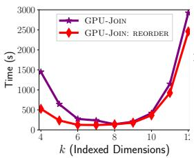  
(a) SuSy (18-D), $\epsilon = 0 . 0 1$

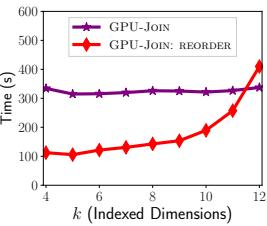  
(b) Songs (90-D), ϵ = 0 005  
Fig. 6. Response time vs. indexed dimension, k.

## 5<sub>.</sub>5 I<sub>n</sub>d<sub>ex</sub> Di<sub>mens</sub>i<sub>ona</sub>lit<sub>y</sub> R<sub>e</sub>d<sub>uc</sub>ti<sub>on</sub> <sub>an</sub>d R<sub>eor</sub>d<sub>er</sub>i<sub>ng</sub>

R<sub>eca</sub>ll f<sub>rom</sub> S<sub>ec</sub>ti<sub>on</sub> 4<sub>.</sub>1 th<sub>a</sub>t<sub>,</sub> b i<sub>n</sub>d<sub>ex</sub>i<sub>n</sub> $k < n$ dim<sub>e</sub>n<sub>s</sub>i<sub>o</sub>n<sub>s, we</sub> h<sub>ave a</sub> l<sub>ess</sub> di<sub>sc</sub>rimin<sub>a</sub>tin <sub>sea</sub>r<sub>c</sub>h f<sub>o</sub>r <sub>o</sub>int<sub>s, w</sub>hi<sub>c</sub>h <sub>y</sub>i<sub>e</sub>ld<sub>s</sub> l<sub>arger</sub> <sub>can</sub>did<sub>a</sub>t<sub>e</sub> <sub>s</sub>i<sub>zes</sub> th<sub>a</sub>t <sub>nee</sub>d t<sub>o</sub> b<sub>e</sub> €lt<sub>ere</sub>d <sub>us</sub>i<sub>ng</sub> E<sub>uc</sub>lid<sub>ean</sub> di<sub>s</sub>t<sub>ance</sub> <sub>ca</sub>l<sub>cu</sub>l<sub>a</sub>ti<sub>ons.</sub> H<sub>owever,</sub> thi<sub>s</sub> i<sub>s</sub> <sub>nee</sub>d<sub>e</sub>d t<sub>o</sub> reduce the overhead of searchin for hi h-dimensional data (recall that the total number of rid cells searched for a query point is 3<sup>n</sup>). We also reorder the points to exploit variance in the dimensions of the data (Section 4.2). Œis has th<sub>e e</sub>‚<sub>ec</sub>t <sub>o</sub>f i<sub>n</sub>d<sub>ex</sub>i<sub>ng on</sub> th<sub>e</sub> di<sub>mens</sub>i<sub>ons</sub> th<sub>a</sub>t <sub>mos</sub>t i<sub>mprove</sub> th<sub>e</sub> €lt<sub>er</sub>i<sub>ng power o</sub>f th<sub>e</sub> i<sub>n</sub>d<sub>ex.</sub>

Figure 6 (a) shows the response time vs. k on SuSy with and without using reorder. In both cases, we see that <sub>p</sub>erformance de<sub>g</sub>rades <sub>w</sub>hen too fe<sub>w</sub> or too man<sub>y</sub> dimensions are indexed d<sub>u</sub>e to increased <sub>p</sub>oint com<sub>p</sub>arisons or search o<sub>v</sub>erhead<sub>,</sub> res<sub>p</sub>ecti<sub>v</sub>el<sub>y</sub>. Ho<sub>w</sub>e<sub>v</sub>er<sub>, w</sub>hen <sub>w</sub>e reorder the data b<sub>y v</sub>ariance<sub>,</sub> the res<sub>p</sub>onse time is si<sub>g</sub>ni€cantl<sub>y</sub> red<sub>u</sub>ced<sub>,</sub> particularly for small k. Since the data is indexed in the €rst k dimensions when we do not use reorder, it is possible that a given dataset will still exhibit good performance if the €rst k dimensions, by chance, have a large amount of <sub>var</sub>i<sub>ance.</sub> H<sub>owever,</sub> if th<sub>ey</sub> d<sub>o no</sub>t<sub>, per</sub>f<sub>ormance w</sub>ill <sub>s</sub>i<sub>gn</sub>i€<sub>can</sub>tl<sub>y</sub> d<sub>egra</sub>d<sub>e.</sub> Œ<sub>e wors</sub>t <sub>poss</sub>ibl<sub>e scenar</sub>i<sub>o wou</sub>ld b<sub>e w</sub>h<sub>en</sub> the variance is so small in the €rst k indexed dimensions that all of the points fall within a single grid cell, resulting in $O ( n ^ { 2 } )$ distance com<sub>p</sub>arisons. In such a case<sub>,</sub> usin<sub>g</sub> reorder can si<sub>g</sub>ni€cantl<sub>y</sub> im<sub>p</sub>rove the abilit<sub>y</sub> of the index to <sub>p</sub>rune the search for points within ϵ. Figure 6 (b) shows the same plot for the Songs dataset. Œis is an example where the €rst k . 12 dimensions have low variance, thereby generating a grid with few cells and low index €ltering power. We <sub>no</sub>t<sub>e</sub> th<sub>a</sub>t <sub>w</sub>h<sub>en</sub> $k > 1 0$ the res<sub>p</sub>onse time when usin<sub>g</sub> reorder exceeds the time when not usin<sub>g</sub> the a<sub>pp</sub>roach. Œis is b<sub>ecause</sub> <sub>w</sub>hil<sub>e</sub> <sub>reorder</sub> <sub>exp</sub>l<sub>o</sub>it<sub>s</sub> <sub>var</sub>i<sub>ance</sub> t<sub>o</sub> i<sub>mprove</sub> th<sub>e</sub> i<sub>n</sub>d<sub>ex</sub> €lt<sub>er</sub>i<sub>ng</sub> <sub>power,</sub> it <sub>a</sub>l<sub>so</sub> i<sub>ncreases</sub> th<sub>e</sub> <sub>num</sub>b<sub>er</sub> <sub>o</sub>f <sub>ce</sub>ll<sub>s</sub> i<sub>n</sub> the index, increasing the number of cells to consider when performing index searches. However, for either SuSy or Songs, reorder signi€cantly reduces the response time when $3 \leq k \leq 8 .$ , which is a large range from which to select k. Œ<sub>us,</sub> h<sub>erea</sub>‰<sub>er</sub> <sub>we</sub> <sub>s</sub>i<sub>mp</sub>l<sub>y</sub> <sub>se</sub>l<sub>ec</sub>t $k = 6$ dimensions, but describe how to select k in the next subsection.

## 5<sub>.</sub>6 S<sub>e</sub>l<sub>ec</sub>ti<sub>ng</sub> th<sub>e</sub> N<sub>um</sub>b<sub>er</sub> <sub>o</sub>f Di<sub>mens</sub>i<sub>ons</sub> t<sub>o</sub> I<sub>n</sub>d<sub>ex</sub>

When indexin<sub>g</sub> on fewer dimensions $( \mathrm { i . e . , } k < n )$ <sub>,</sub> th<sub>ere</sub> i<sub>s an</sub> i<sub>ncrease</sub> i<sub>n</sub> th<sub>e num</sub>b<sub>er o</sub>f di<sub>s</sub>t<sub>ance ca</sub>l<sub>cu</sub>l<sub>a</sub>ti<sub>ons,</sub> b<sub>u</sub>t f<sub>ewer</sub> cells are searched. Œus, we describe a method to select a good value of k. Real-world and skewed datasets in high dimensions do not allow us to use a<sub>gg</sub>re<sub>g</sub>ate metrics to select $k , { \mathrm { e . g . } }$ <sub>,</sub> th<sub>e average num</sub>b<sub>er o</sub>f <sub>ce</sub>ll<sub>s searc</sub>h<sub>e</sub>d<sub>,</sub> th<sub>e average</sub> number of <sub>p</sub>oint com<sub>p</sub>arisons<sub>,</sub> and the avera<sub>g</sub>e number of nei<sub>g</sub>hbors <sub>p</sub>er <sub>p</sub>oint. Œus<sub>,</sub> we cannot utilize anal<sub>y</sub>tical met<sup>h</sup>o<sup>d</sup>s to estimate t<sup>h</sup>e amount o<sup>f</sup> wor<sup>k</sup> nee<sup>d</sup>e<sup>d</sup> to per<sup>f</sup>orm t<sup>h</sup>e se<sup>lf</sup>-join. Instea<sup>d</sup>, we re<sup>l</sup>y on a samp<sup>l</sup>ing tec<sup>h</sup>nique t<sup>h</sup>at we execute when estimatin<sub>g</sub> the total result set size needed for batchin<sub>g</sub> (Section 3.2.2). Samplin<sub>g</sub> the datasets yields an estimate of selected metrics, and can be computed in a small fraction of the total response time of GPU-Join. When com<sub>p</sub>utin<sub>g</sub> the index, we store the number of non-em<sub>p</sub>t<sub>y g</sub>rid cells, denoted as |G|. For a <sub>g</sub>iven value of $k ,$ we execute GPU-Join for a fraction $f$ of the data points, and record the number of point comparisons (points that are tested to be within ϵ of each other), denoted as $\mu .$ Œ<sub>e es</sub>ti<sub>ma</sub>t<sub>e</sub>d t<sub>o</sub>t<sub>a</sub>l <sub>num</sub>b<sub>er o</sub>f <sub>memory opera</sub>ti<sub>ons</sub> t<sub>o searc</sub>h <sub>a</sub>ll <sub>o</sub>f th<sub>e ce</sub>ll<sub>s</sub> i<sub>s as</sub> f<sub>o</sub>ll<sub>ows:</sub> $| D | 3 ^ { k } \mathrm { l o g } _ { 2 } ( | \mathrm { G } | )$ , w<sup>h</sup>ere <sup>f</sup>or eac<sup>h</sup> point in t<sup>h</sup>e <sup>d</sup>ataset, we searc<sup>h</sup> t<sup>h</sup>e a<sup>d</sup>jacent ce<sup>ll</sup>s, an<sup>d</sup> per<sup>f</sup>orm a <sup>b</sup>inary searc<sup>h</sup> t<sub>o</sub> €<sub>n</sub>d th<sub>e non-emp</sub>t<sub>y ce</sub>ll<sub>s</sub> th<sub>a</sub>t <sub>ex</sub>i<sub>s</sub>t i<sub>n</sub> th<sub>e</sub> i<sub>n</sub>d<sub>ex.</sub> Œ<sub>e es</sub>ti<sub>ma</sub>t<sub>e</sub>d t<sub>o</sub>t<sub>a</sub>l <sub>num</sub>b<sub>er o</sub>f <sub>memory opera</sub>ti<sub>ons nee</sub>d<sub>e</sub>d f<sub>or</sub> th<sub>e</sub> distance com<sub>p</sub>arisons is sim<sub>p</sub>l<sub>y</sub> $\mu ( 1 / f )$ . We can select a good value of k by comparing the total number of memory o<sub>p</sub>erations for: (i) searchin<sub>g</sub> whether the cells exist; and, (ii) distance com<sub>p</sub>arisons.

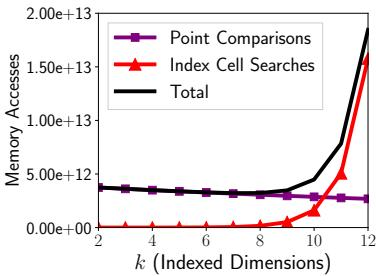  
Fi<sub>g</sub>. 7. The number of index search and <sub>p</sub>oint com<sub>p</sub>arison memor<sub>y</sub> accesses.

Fi<sub>g</sub>ure 7 <sub>p</sub>lots the number of memor<sub>y</sub> o<sub>p</sub>erations vs. $k$ on the Syn16D2M dataset. As expected, we observe a reduction in the number of distance comparison memory operations with increasing k, indicating that indexing on more di<sub>mens</sub>i<sub>ons re</sub>d<sub>uces</sub> th<sub>e num</sub>b<sub>er o</sub>f di<sub>s</sub>t<sub>ance compar</sub>i<sub>sons.</sub> Whil<sub>e</sub> th<sub>e num</sub>b<sub>er o</sub>f <sub>memory opera</sub>ti<sub>ons assoc</sub>i<sub>a</sub>t<sub>e</sub>d <sub>w</sub>ith th<sub>e</sub> <sub>ce</sub>ll <sub>searc</sub>h<sub>es</sub> i<sub>s</sub> <sub>re</sub>l<sub>a</sub>ti<sub>ve</sub>l<sub>y</sub> l<sub>ow</sub> f<sub>or</sub> $k \leq 8 ,$ t<sup>h</sup>e exponentia<sup>l</sup> increase in t<sup>h</sup>e num<sup>b</sup>er o<sup>f</sup> a<sup>d</sup>jacent ce<sup>ll</sup>s wit<sup>h</sup> increasing k makes indexing $k > 1 0$ si<sub>g</sub>ni€cantl<sub>y</sub> de<sub>g</sub>rade <sub>p</sub>erformance. We note that since we use an ex<sub>p</sub>onentiall<sub>y</sub> distributed dataset<sub>,</sub> there are man<sub>y p</sub>oint com<sub>p</sub>arisons<sub>,</sub> as the <sub>p</sub>oints are stron<sub>g</sub>l<sub>y</sub> co-located. For datasets that exhibit a more uniform distribution, we expect that varying k will more have a larger impact on the number of point comparisons. In this case, a di‚erent value of k may be more appropriate than the value of k for Syn16D2M.

R<sub>egar</sub>dl<sub>ess o</sub>f th<sub>e</sub> d<sub>a</sub>t<sub>ase</sub>t <sub>use</sub>d<sub>,</sub> it i<sub>s c</sub>l<sub>ear</sub> th<sub>a</sub>t i<sub>n</sub>d<sub>ex</sub>i<sub>ng</sub> $k > 1 0$ i<sub>s</sub> lik<sub>e</sub>l<sub>y</sub> t<sub>o</sub> d<sub>egra</sub>d<sub>e per</sub>f<sub>ormance;</sub> h<sub>owever, we o</sub>b<sub>serve</sub> that in terms of the number of memory accesses needed for index cell searches, in practice we can select a value of k within a fairl<sub>y</sub> lar<sub>g</sub>e ran<sub>g</sub>e<sub>,</sub> rou<sub>g</sub>hl<sub>y</sub> within $k \leq 1 0$ without a si<sub>g</sub>ni€cant <sub>p</sub>erformance <sub>p</sub>enalt<sub>y</sub>. Œis demonstrates that we do not need excessive parameter tuning of k to achieve good performance.

## 5.7 Performance on Lar<sub>g</sub>er Datasets

We execute GPU-Join on lar<sub>g</sub>er real-world and synthetic datasets (the laŠer bein<sub>g</sub> the worst case for GPU-Join).

5.7.1 Real World Datasets. Figure 8 (a) plots the response time vs. ϵ on the SuSy dataset. Note that the SuSy dataset is t<sub>w</sub>o orders of ma<sub>g</sub>nit<sub>u</sub>de lar<sub>g</sub>er $( | D | = 5 \times 1 0 ^ { 6 } )$ than those used in Figure 5. Results indicate that, for the SuSy dataset, sortidu reduces response time by a reasonable mar<sub>g</sub>in (e.<sub>g</sub>., at $\epsilon = 0 . 0 1$ <sub>, u</sub>sin<sub>g</sub> sortidu and reorder is 38% faster than reorder alone), thou<sub>g</sub>h the shortc optimization has a ne<sub>g</sub>li<sub>g</sub>ible e‚ect. Usin<sub>g</sub> all optimizations, GPU-Join outperforms S<sub>uper</sub>EGO <sub>across</sub> <sub>a</sub>ll <sub>va</sub>l<sub>ues</sub> <sub>o</sub>f $\epsilon ,$ <sub>y</sub>ieldin<sub>g</sub> s<sub>p</sub>eedu<sub>p</sub>s between $1 . 0 7 \times ( \epsilon = 0 . 0 2 )$ <sub>an</sub>d $1 . 6 1 \times ( \epsilon = 0 . 0 1 )$ .

Figure 8 (b) plots the response time vs. ϵ on the Songs dataset, which is the highest dimensional dataset that we use. W<sub>e</sub> <sub>see</sub> th<sub>a</sub>t <sub>us</sub>i<sub>ng</sub> <sub>sortidu</sub> <sub>re</sub>d<sub>uces</sub> th<sub>e</sub> <sub>response</sub> ti<sub>me</sub> <sub>a</sub>t l<sub>ower</sub> <sub>va</sub>l<sub>ues</sub> <sub>o</sub>f $\epsilon .$ In contrast to the SuSy dataset (Figure 8 (a)), shortc yields a signi€cant reduction in response time on the Songs dataset due to its much higher dimensionality. We note that SuperEGO also employs an optimization that short circuits the distance calculation. We €nd that GPU-Join outperforms SuperEGO across all values of ϵ with the exception of $\epsilon = 0 . 0 1$ . Œus, the speedup (or slowdown) over SuperEGO ran<sub>g</sub>es from 1.53× $( \epsilon = 0 . 0 0 5 )$ to 0.92× $( \epsilon = 0 . 0 1 )$ . Œe slight slowdown on Songs at $\epsilon = 0 . 0 1$ indi<sub>ca</sub>t<sub>es</sub> th<sub>a</sub>t SuperEGO is competitive with GPU-Join under some experimental scenarios.

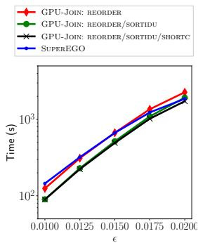  
(a) SuSy (18-D)

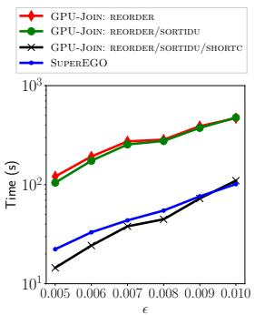  
(b) Songs (90-D)  
Fig. 8. Response time vs. ϵ. k = 6 dimensions are indexed. Rounded values of $S _ { D }$ in the plots are in the range (a) 5–781, and (b) 4<sub>–</sub>1<sub>.</sub>9k<sub>.</sub>

5.7.2 Synthetic Datasets. We use synthetic datasets to understand the performance of GPU-Join when the approach cannot exploit the dimensionality reorderin<sub>g</sub> optimization (Section 4.2). Under these conditions, it is not possible to <sub>reor</sub>d<sub>er</sub> th<sub>ese</sub> d<sub>a</sub>t<sub>a</sub> t<sub>o</sub> i<sub>mprove</sub> th<sub>e</sub> €lt<sub>er</sub>i<sub>ng power o</sub>f th<sub>e</sub> i<sub>n</sub>d<sub>ex</sub> b<sub>ecause</sub> th<sub>e var</sub>i<sub>ance</sub> i<sub>s near</sub>l<sub>y</sub> th<sub>e same</sub> i<sub>n eac</sub>h di<sub>mens</sub>i<sub>on</sub> Œi<sub>s</sub> d<sub>a</sub>t<sub>a</sub> di<sub>s</sub>t<sub>r</sub>ib<sub>u</sub>ti<sub>on ma</sub> b<sub>e common</sub> i<sub>n rea</sub>l<sub>-wor</sub>ld <sub>scenar</sub>i<sub>os</sub> if <sub>a</sub>ll <sub>o</sub>f th<sub>e</sub> f<sub>ea</sub>t<sub>ures are</sub> d<sub>rawn</sub> f<sub>rom</sub> th<sub>e same s</sub>t<sub>a</sub>ti<sub>s</sub>ti<sub>ca</sub>l distribution. We utilize s<sub>y</sub>nthetic datasets with an ex<sub>p</sub>onential distribution. If we were to use a uniform<sub>,</sub> or even a normal distribution with a moderate variance, we will be unable to €nd many (or any) nei<sub>g</sub>hbors within ϵ because the <sub>p</sub>oints will be too far awa<sub>y</sub> from each other in hi<sub>g</sub>h dimensions. Œus<sub>,</sub> usin<sub>g</sub> an ex<sub>p</sub>onential distribution ensures that we will €nd on average a reasonable number of neighbors for a given ϵ, similarly to €nding neighbors in the high di<sub>mens</sub>i<sub>ona</sub>l <sub>rea</sub>l<sub>-wor</sub>ld d<sub>a</sub>t<sub>ase</sub>t<sub>s.</sub>

Figure 9 plots the response time vs. ϵ on 16, 32, and 64-D synthetic datasets. We observe that GPU-Join outperforms SuperEGO on all scenarios, with the smallest performance <sub>g</sub>ain on the smallest workload (Fi<sub>g</sub>ure 9 (a), $\epsilon = 0 . 0 3 )$ <sub>,</sub> <sub>w</sub>h<sub>ere</sub> the speedup is 1.84×. Œe largest speedup is 8.25× on Syn32D2M with ϵ = 0 08. Both SuperEGO and GPU-Join exploit the statistical <sub>p</sub>ro<sub>p</sub>erties of the data. However<sub>,</sub> these results indicate that the index search <sub>p</sub>erformance of SuperEGO is more sensitive to the dimensionalit<sub>y</sub> reorderin<sub>g</sub> techni<sub>q</sub>ue [27] than the reorder techni<sub>q</sub>ue used b<sub>y</sub> GPU-Join. In cases where the variance is similar across dimensions, GPU-Join is likely to si<sub>g</sub>ni€cantly outperform SuperEGO.

## 6 SCALING TO MULTI-GPU SYSTEMS

Further im<sub>p</sub>rovin<sub>g</sub> sin<sub>g</sub>le-GPU <sub>p</sub>erformance throu<sub>g</sub>h additional al<sub>g</sub>orithmic innovations are unlikel<sub>y</sub> to <sub>y</sub>ield lar<sub>g</sub>e erformance ains (there are certainl im rovements to GPU-Join, but likel none that can achieve order-of-ma nitude reductions in the time-to-solution). Œe self-join, particularly in high dimensions, is an expensive operation. For instance, on the SuSy dataset in Figure 8 (a) at $\epsilon = 0 . 0 2 ,$ the response time of GPU-Join with all optimizations is 1729 s. In this section, we discuss potential strate<sub>g</sub>ies to eciently apply GPU-Join to multi-GPU and distributed-memory <sup>s</sup>y<sup>stems.</sup>

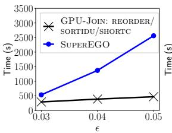  
(a) Syn16D2M (16-D)

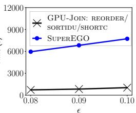  
(b) Syn32D2M (32-D)

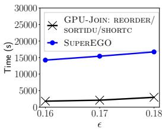  
(c) Syn64D2M (64-D)  
Fig. 9. Response time vs. ϵ on the synthetic datasets. k = 6 dimensions are indexed and GPU-Join is configured using all optimizations. R<sub>oun</sub>d<sub>e</sub>d <sub>va</sub>l<sub>ues o</sub>f $S _ { D }$ in the plots are in the ran<sub>g</sub>e (a) 4–1.2k, (b) 31–1.4k, and (c) 132–2.3k.

In multi-GPU s<sub>y</sub>stems<sub>,</sub> one issue is contention on the PCIe bus<sub>,</sub> assumin<sub>g</sub> a con€<sub>g</sub>uration where all GPUs communicate over PCIe (new interconnects such as NVLink will reduce contention [18]). For distributed-memor<sub>y</sub> s<sub>y</sub>stems, a ke<sub>y</sub> boŠleneck is communication between com<sub>p</sub>ute nodes [33]. Œus, the communication re<sub>q</sub>uirements in either s<sub>y</sub>stem <sub>may</sub> d<sub>egra</sub>d<sub>e per</sub>f<sub>ormance.</sub> A<sub>no</sub>th<sub>er</sub> b<sub>o</sub>Šl<sub>enec</sub>k i<sub>n e</sub>ith<sub>er con</sub>€<sub>gura</sub>ti<sub>on</sub> i<sub>s</sub> l<sub>oa</sub>d b<sub>a</sub>l<sub>anc</sub>i<sub>ng;</sub> id<sub>ea</sub>ll<sub>y a</sub>ll <sub>no</sub>d<sub>es</sub>/GPU<sub>s</sub> h<sub>ave</sub> <sub>s</sub>i<sub>m</sub>il<sub>ar wor</sub>kl<sub>oa</sub>d<sub>s an</sub>d €<sub>n</sub>i<sub>s</sub>h <sub>a</sub>t <sub>approx</sub>i<sub>ma</sub>t<sub>e</sub>l<sub>y</sub> th<sub>e same</sub> ti<sub>me.</sub> If th<sub>ere</sub> i<sub>s a</sub> l<sub>arge</sub> l<sub>oa</sub>d i<sub>m</sub>b<sub>a</sub>l<sub>ance,</sub> th<sub>e per</sub>f<sub>ormance w</sub>il <sub>no</sub>t <sub>sca</sub>l<sub>e we</sub>ll <sub>as we</sub> i<sub>ncrease</sub> th<sub>e num</sub>b<sub>er o</sub>f <sub>no</sub>d<sub>es</sub>/GPU<sub>s.</sub>

## 6.1 Sin<sub>g</sub>le-Node Multi-GPU Overheads

As mentioned above<sub>,</sub> load balancin<sub>g</sub> and communication overheads are a concern for multi-GPU s<sub>y</sub>stems. With re<sub>g</sub>ards to hi<sub>g</sub>h-dimensional GPU-Join performance, we demonstrate that the overhead of usin<sub>g</sub> a sin<sub>g</sub>le-node, multi-GPU system is ne<sub>g</sub>li<sub>g</sub>ible. We quantify the sin<sub>g</sub>le-GPU host-side overheads as follows. We execute GPU-Join on our sin<sub>g</sub>le-GPU platform with a sin<sub>g</sub>le batch/stream (i.e., not overlappin<sub>g</sub> data transfers and host-side operations), and record the t<sub>o</sub>t<sub>a</sub>l <sub>compu</sub>t<sub>e-on</sub>l<sub>y</sub> ti<sub>me nee</sub>d<sub>e</sub>d t<sub>o execu</sub>t<sub>e</sub> th<sub>e</sub> GPU k<sub>erne</sub>l <sub>across a</sub>ll <sub>o</sub>f th<sub>e</sub> b<sub>a</sub>t<sub>c</sub>h<sub>es.</sub> T<sub>a</sub>bl<sub>e</sub> 2 <sub>s</sub>h<sub>ows</sub> th<sub>e compu</sub>t<sub>e-on</sub>l<sub>y an</sub>d total response times, and the percenta<sub>g</sub>e of time spent performin<sub>g</sub> host-side operations (data transfers and overheads) on Syn16D2M and SuSy. We €nd that on SuSy and Syn16D2M, only 0.69% and 1.8%, respectively, of the total response time is needed for host-side and data transfer o<sub>p</sub>erations. Note that<sub>,</sub> since this res<sub>u</sub>lt is obtained <sub>u</sub>sin<sub>g</sub> a sin<sub>g</sub>le stream the actual communication overhead is much less due to pipelinin<sub>g</sub> (see Fi<sub>g</sub>ure 4). Œerefore, overheads associated with PCIe and Host-GPU communication are ne<sub>g</sub>li<sub>g</sub>ible compared to overall GPU-Join response time. Œis indicates that <sub>p</sub>erformance will scale well on sin<sub>g</sub>le-node<sub>,</sub> multi-GPU s<sub>y</sub>stems or s<sub>y</sub>stems that re<sub>q</sub>uire liŠle inter-node communication (i.e., if |D| does not exceed GPU <sub>g</sub>lobal memory). Œus, if we can achieve a balanced workload across all GPUs, the performance of GPU-Join will scale well on multi-GPU systems.

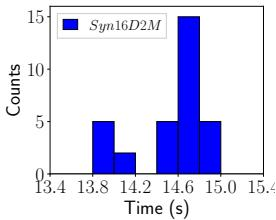  
(a) Syn16D2M

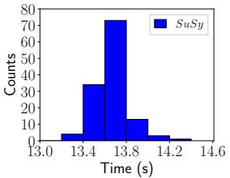  
(b) SuSy  
Fig. 10. Histogram of the computation time of entity partitioned batches in 0.2 s bins for (a) Syn16D2M with $N _ { b } = 3 2 ,$ <sub>an</sub>d $\epsilon = 0 . 0 5 ;$ (b) SuSy with $N _ { b } = 1 2 8$ <sub>, an</sub>d $\epsilon = 0 . 0 2$

Table 2. Compute-onl<sub>y</sub> time compared to the time performin<sub>g</sub> other host-side operations (overhead).

<table><tr><td>Dataset</td><td>ε</td><td>Compute (s)</td><td>Total (s)</td><td>Overhead</td></tr><tr><td>Syn16D2M</td><td>0.05</td><td>460.58</td><td>469.00</td><td>1.8%</td></tr><tr><td>SuSy</td><td>0.02</td><td>1717.26</td><td>1729.24</td><td>0.69%</td></tr></table>

## 6<sub>.</sub>2 B<sub>a</sub>l<sub>anc</sub>i<sub>ng</sub> W<sub>or</sub>kl<sub>oa</sub>d<sub>s:</sub> E<sub>n</sub>tit<sub>y</sub> P<sub>ar</sub>titi<sub>on</sub>i<sub>ng</sub>

We <sub>p</sub>ro<sub>p</sub>ose an entit<sub>y</sub> <sub>p</sub>artitionin<sub>g</sub> a<sub>pp</sub>roach to achieve a balanced workload amon<sub>g</sub> nodes. We denote each <sub>p</sub>rocessin<sub>g</sub> element (node) as a sin le GPU, $\mathcal { P } k$ <sub>, w</sub>h<sub>ere</sub> $k = 0 , \ldots , | p | - 1$ <sub>, an</sub>d $| p |$ i<sub>s</sub> th<sub>e</sub> t<sub>o</sub>t<sub>a</sub>l n<sub>u</sub>mb<sub>e</sub>r <sub>o</sub>f GPU<sub>s.</sub> W<sub>e co</sub>n<sub>s</sub>id<sub>e</sub>r<sub>e</sub>d <sub>a</sub> s<sub>p</sub>atial <sub>p</sub>artitionin<sub>g</sub> strate<sub>gy,</sub> but found that it does not ensure a balanced workload across GPUs.

In our ex<sub>p</sub>erimental evaluation of GPU-Join on our sin<sub>g</sub>le-GPU <sub>p</sub>latform, the size of the dataset, |D|, does not exceed main memor<sub>y</sub> on the host or the GPU’s <sub>g</sub>lobal memor<sub>y</sub> ca<sub>p</sub>acit<sub>y</sub>. Since the datasets never exceed <sub>g</sub>lobal memor<sub>y</sub> in our ex<sub>p</sub>erimental e<sub>v</sub>al<sub>u</sub>ation<sub>,</sub> and $| D | \ll | R | ,$ <sub>, we s</sub>t<sub>ore</sub> th<sub>e en</sub>ti<sub>re</sub> d<sub>a</sub>t<sub>ase</sub>t <sub>on eac</sub>h $\mathcal { P } k$ <sub>once.</sub> R<sub>eca</sub>ll th<sub>a</sub>t <sub>eac</sub>h $\mathcal { P } k$ is assi<sub>g</sub>ned <sub>a</sub> <sub>un</sub>if<sub>orm</sub> <sub>se</sub>l<sub>ec</sub>ti<sub>on</sub> <sub>o</sub>f th<sub>e</sub> t<sub>o</sub>t<sub>a</sub>l d<sub>a</sub>t<sub>ase</sub>t t<sub>o</sub> <sub>query.</sub> F<sub>orma</sub>ll<sub>y,</sub> <sub>we</sub> d<sub>eno</sub>t<sub>e</sub> th<sub>e</sub> t<sub>o</sub>t<sub>a</sub>l <sub>num</sub>b<sub>er</sub> <sub>o</sub>f <sub>en</sub>tit<sub>y</sub> <sub>par</sub>titi<sub>one</sub>d <sub>query</sub> b<sub>a</sub>t<sub>c</sub>h<sub>es</sub> <sub>as</sub> $N _ { b }$ . We de€ne a set of entit<sub>y</sub> <sub>p</sub>artitioned <sub>q</sub>uer<sub>y</sub> <sub>p</sub>oint sets as $Q _ { l }$ <sub>,</sub> <sub>w</sub>h<sub>ere</sub> $l = 0 , \ldots , N _ { b } - 1$ <sub>, w</sub>h<sub>ere</sub> th<sub>e s</sub>i<sub>ze o</sub>f eac<sup>h</sup> query set is simp<sup>l</sup>y $| Q _ { l } | = | D | / N _ { b }$ (assumin<sub>g</sub> |D| evenl<sub>y</sub> divides $N _ { b } )$ . Let us assi<sub>g</sub>n the $N _ { b }$ q<sup>uer</sup>y <sup>sets</sup> <sup>to</sup> $\mathcal { P } k$ in a <sub>roun</sub>d <sub>ro</sub>bi<sub>n</sub> f<sub>as</sub>hi<sub>on,</sub> <sub>w</sub>h<sub>ere</sub> $\mathrm { G P U } p _ { k }$ is assi<sub>g</sub>ned $Q _ { l }$ to per<sup>f</sup>orm t<sup>h</sup>e join operation, $\boldsymbol { Q } _ { l } \bowtie _ { \epsilon } \boldsymbol { D } ,$ , if l mod $\left| p \right| = k .$ . To ens<sub>u</sub>re <sub>goo</sub>d l<sub>oa</sub>d b<sub>a</sub>l<sub>anc</sub>i<sub>ng, we se</sub>l<sub>ec</sub>t $N _ { b }$ <sub>suc</sub>h th<sub>a</sub>t $N _ { b }$ mod $| p | = 0$ <sub>,</sub> <sub>an</sub>d th<sub>ere</sub>f<sub>ore,</sub> <sub>a</sub>ll GPU<sub>s</sub> h<sub>ave</sub> th<sub>e</sub> <sub>same</sub> <sub>num</sub>b<sub>er</sub> <sub>o</sub>f <sub>query</sub> <sup>sets</sup> <sup>to</sup> p<sup>rocess.</sup>

Œe scalability of GPU-Join on multi-GPU systems is lar<sub>g</sub>ely a function of load balancin<sub>g</sub>. Œus, to ascertain the expected scalability of GPU-Join on a distributed-memory system, we consider the computation time of the work performed by each node. Fi<sub>g</sub>ure 10 (a)–(b) plots a histo<sub>g</sub>ram of the computation times (excludin<sub>g</sub> all other host-side boŠlenecks and overheads as discussed in Section 6.1) of performing the join between each query set and the dataset as executed se<sub>p</sub>aratel<sub>y</sub> on our sin<sub>g</sub>le-GPU <sub>p</sub>latform. We <sub>g</sub>enerate $N _ { b } = 3 2$ <sub>an</sub>d $N _ { b } = 1 2 8$ query sets for Syn16D2M and SuSy, respectively (the datasets are di‚erent sizes, so we generated a di‚erent number of query sets for each). We €nd that on the Syn16D2M and SuSy datasets, the minimum (maximum) kernel execution times are: 13.88 s (14.95 s) and 13.36 s (14.34 s), respectively, indicatin<sub>g</sub> a small variance amon<sub>g</sub> the computation time of each query batch. Œis small <sub>v</sub>ariance demonstrates the ecac<sub>y</sub> of the entit<sub>y</sub> <sub>p</sub>artitionin<sub>g</sub> strate<sub>gy</sub> to achie<sub>v</sub>e a balanced <sub>w</sub>orkload. F<sub>u</sub>rthermore<sub>,</sub> if these <sub>q</sub>uer<sub>y</sub> sets were to be assi<sub>g</sub>ned to multi<sub>p</sub>le $\mathrm { G P U s } ,$ <sub>we wou</sub>ld <sub>e</sub>x<sub>pec</sub>t th<sub>a</sub>t <sub>eac</sub>h GPU <sub>wou</sub>ld €ni<sub>s</sub>h it<sub>s co</sub>m<sub>pu</sub>t<sub>a</sub>ti<sub>o</sub>n <sub>a</sub>t rou<sub>g</sub>hly the same time (assumin<sub>g</sub> $N _ { b }$ mod $| p | = 0 )$

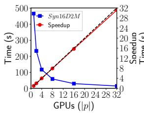  
(a) Syn16D2M

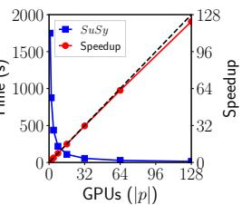  
(b) SuSy  
Fig. 11. Scalability on (a) Syn16D2M, and (b) SuSy, using the response time measurements summarized in Figure 10

To understand the potential scalability of GPU-Join, we simulate the expected response time if we executed the <sub>q</sub>uer<sub>y</sub> batches in Fi<sub>g</sub>ure 10 on |p| GPUs. We i<sub>g</sub>nore host-side overheads, as we demonstrated that the<sub>y</sub> are ne<sub>g</sub>li<sub>g</sub>ible in S<sub>ec</sub>ti<sub>on</sub> 6<sub>.</sub>1<sub>.</sub> A<sub>s</sub> d<sub>escr</sub>ib<sub>e</sub>d <sub>a</sub>b<sub>ove, we genera</sub>t<sub>e a</sub> €<sub>xe</sub>d <sub>num</sub>b<sub>er o</sub>f <sub>query</sub> b<sub>a</sub>t<sub>c</sub>h<sub>es</sub> $( N _ { b } )$ and assi<sub>g</sub>n them to the |p| GPUs in a round-robin fashion. Fi<sub>g</sub>ure 11 <sub>p</sub>lots the res<sub>p</sub>onse time and s<sub>p</sub>eedu<sub>p</sub> of $\mathrm { G P U - J o r N }$ for var<sub>y</sub>in<sub>g</sub> |p| (and €xed $N _ { b } )$ . We €nd that the entit<sub>y</sub> <sub>p</sub>artitionin<sub>g</sub> strate<sub>gy</sub> achieves near-ideal scalabilit<sub>y</sub>. Assumin<sub>g</sub> that |D| does not exceed the <sub>g</sub>lobal memor<sub>y</sub> ca<sub>p</sub>acit<sub>y</sub> of a sin<sub>g</sub>le GPU<sub>,</sub> this can be executed on a distributed-memor<sub>y</sub> s<sub>y</sub>stem without an<sub>y</sub> communication overhead. Each node independently computes its assi<sub>g</sub>ned query batches (Q ) from its correspondin<sub>g</sub> MPI rank and communicator size (assumin an MPI im lementation). Œus, we ex ect that distributed-memor self-joins will exhibit good scalability when D can be replicated on each GPU. However, on multi-node systems where |D| exceeds global memor<sub>y,</sub> inter-node communication ma<sub>y</sub> de<sub>g</sub>rade <sub>p</sub>erformance and reduce scalabilit<sub>y</sub>.

## 6.3 Extendin<sub>g</sub> to Ver<sub>y</sub> Lar<sub>g</sub>e Datasets

In this previous section, we demonstrated that GPU-Join achieves excellent scalability when the dataset is duplicated on each GPU. However<sub>,</sub> if the dataset exceeds the <sub>g</sub>lobal memor<sub>y</sub> ca<sub>p</sub>acit<sub>y</sub> of a sin<sub>g</sub>le GPU<sub>,</sub> we must <sub>p</sub>artition and distribute the data amon<sub>g</sub> the di‚erent nodes in the s<sub>y</sub>stem. Œus<sub>,</sub> we outline a <sub>p</sub>artitionin<sub>g</sub> and communication strate<sub>gy</sub> that allows the dataset to be distributed across multiple compute nodes such that we can perform GPU-Join on lar<sub>g</sub>e d<sub>a</sub>t<sub>ase</sub>t<sub>s.</sub>

We assume the in<sub>p</sub>ut set<sub>,</sub> $D ,$ is initiall<sub>y</sub> evenl<sub>y</sub> distributed amon<sub>g</sub> all |p| nodes $( { \mathrm { i . e . } }$ <sub>,</sub> <sub>eac</sub>h <sub>no</sub>d<sub>e</sub> h<sub>as</sub> <sub>a</sub> <sub>un</sub>if<sub>orm</sub> <sub>en</sub>tit<sub>y</sub> <sub>p</sub>artitioned selection of $| D | / | p |$ data points). We call this initial set of points the query points, and we refer to the set of query points o<sup>f</sup> no<sup>d</sup>e $\mathcal { P } k$ as $Q _ { k }$ <sub>, w</sub>h<sub>ere</sub> $| Q _ { k } | = | D | / | p |$ <sub>.</sub> E<sub>ac</sub>h <sub>no</sub>d<sub>e ma</sub>k<sub>es a copy o</sub>f thi<sub>s se</sub>t <sub>an</sub>d <sub>ca</sub>ll<sub>s</sub> it th<sub>e en</sub>t<sub>ry</sub> d<sub>a</sub>t<sub>a</sub> <sub>p</sub>o<sup>i</sup>nts, $E _ { k }$ (entry meaning a set of entries in the index). To solve the global self-join, each node computes the join from its set of query points to every other data point in D. To do this, each node $\mathcal { P } k$ starts b<sub>y p</sub>erformin<sub>g</sub> an inde<sub>p</sub>enden join operation <sup>b</sup>etween $Q _ { k }$ <sub>an</sub>d $E _ { k }$ <sub>,</sub> <sub>w</sub>hi<sub>c</sub>h <sub>we</sub> d<sub>eno</sub>t<sub>e</sub> ${ Q } _ { k } \bowtie _ { \epsilon } { E } _ { k }$ <sub>.</sub> E<sub>ac</sub>h <sub>no</sub>d<sub>e</sub> th<sub>en sen</sub>d<sub>s</sub> it<sub>s se</sub>t $E _ { k }$ t<sub>o</sub> th<sub>e nex</sub>t <sub>no</sub>d<sub>e,</sub> $\mathcal { P } ( k { + } 1 ) m o d | p |$ and receives a new entr<sub>y</sub> set from <sub>p</sub>rocessor $\mathop { p } ( k { - } 1 ) \mathop { m o d } | p |$ <sub>.</sub> N<sub>o</sub>d<sub>e</sub> $\mathcal { P } k$ th<sub>en</sub> <sub>per</sub>f<sub>orms</sub> $Q _ { k } \bowtie _ { \epsilon } E _ { ( k - 1 ) m o d | p | }$ and<sub>,</sub> a<sub>g</sub>ain<sub>,</sub> <sub>p</sub>asses the entr<sub>y</sub> data set to node $\mathcal { P } ( k { + } 1 ) m o d | p |$ <sub>.</sub> Œi<sub>s con</sub>ti<sub>nues</sub> f<sub>or</sub> $| p | - 1$ <sub>roun</sub>d<sub>s,</sub> <sub>a</sub>t <sub>w</sub>hi<sub>c</sub>h <sub>po</sub>i<sub>n</sub>t <sub>a</sub>ll <sub>no</sub>d<sub>es</sub> <sup>h</sup>ave compare<sup>d</sup> t<sup>h</sup>eir query points to eac<sup>h</sup> su<sup>b</sup>set o<sup>f</sup> t<sup>h</sup>e entity partitione<sup>d</sup> <sup>d</sup>ata. <sup>Œ</sup>e resu<sup>l</sup>t o<sup>f</sup> a<sup>ll</sup> t<sup>h</sup>e in<sup>d</sup>epen<sup>d</sup>ent join operations constitutes t<sup>h</sup>e tota<sup>l</sup> se<sup>lf</sup>-join.

While our partitionin<sub>g</sub> and communication strate<sub>g</sub>y allows us to execute GPU-Join on lar<sub>g</sub>er datasets with a b<sub>a</sub>l<sub>ance</sub>d <sub>wor</sub>kl<sub>oa</sub>d <sub>across</sub> <sub>a</sub> di<sub>s</sub>t<sub>r</sub>ib<sub>u</sub>t<sub>e</sub>d<sub>-memory</sub> <sub>sys</sub>t<sub>em,</sub> it <sub>comes</sub> <sub>a</sub>t th<sub>e</sub> <sub>cos</sub>t <sub>o</sub>f <sub>a</sub>dditi<sub>ona</sub>l <sub>commun</sub>i<sub>ca</sub>ti<sub>on</sub> <sub>over</sub>h<sub>ea</sub>d<sub>s.</sub> S<sub>p</sub>eci€call<sub>y,</sub> each communication <sub>p</sub>hase re<sub>q</sub>uires transmiŠin<sub>g</sub> a total of $| \boldsymbol { p } | \times | \boldsymbol { D } | / | \boldsymbol { p } | = | \boldsymbol { D } |$ <sub>e</sub>l<sub>emen</sub>t<sub>s</sub> b<sub>e</sub>t<sub>ween no</sub>d<sub>es,</sub> <sub>an</sub>d i<sub>n</sub> t<sub>o</sub>t<sub>a</sub>l th<sub>ere are</sub> $| p | - 1$ <sub>commun</sub>i<sub>ca</sub>ti<sub>on p</sub>h<sub>ases.</sub> Œ<sub>us,</sub> th<sub>e</sub> t<sub>o</sub>t<sub>a</sub>l <sub>num</sub>b<sub>er o</sub>f d<sub>a</sub>t<sub>a e</sub>l<sub>emen</sub>t<sub>s commun</sub>i<sub>ca</sub>t<sub>e</sub>d i<sub>s</sub> $( | p | ^ { 2 } - | p | ) \times | D | / | p | = ( | p | - 1 ) | D |$ <sub>, w</sub>ith <sub>eac</sub>h <sub>no</sub>d<sub>e sen</sub>di<sub>ng an</sub>d <sub>rece</sub>i<sub>v</sub>i<sub>ng a</sub> t<sub>o</sub>t<sub>a</sub>l <sub>o</sub>f $| D | - ( | D | / | p | )$ d<sub>a</sub>t<sub>a</sub> <sub>e</sub>l<sub>emen</sub>t<sub>s.</sub>

To determine the cost of communication overhead<sub>,</sub> we assume a scenario where there is one GPU <sub>p</sub>er node on a distributed-memor<sub>y</sub> cluster. We measure communication overhead b<sub>y</sub> im<sub>p</sub>lementin<sub>g</sub> the inter-node communication re<sub>q</sub>uired b<sub>y</sub> the data <sub>p</sub>artitionin<sub>g</sub> and communication strate<sub>gy</sub> outlined above usin<sub>g</sub> MPI 4.1 as executed on u<sub>p</sub> to 128 nodes in a cluster with a 40Gbit/s In€niBand interconnect. We com<sub>p</sub>ute the time needed to <sub>p</sub>artition the data and perform inter-node communication, assuming D is initially distributed across |p| nodes. We assume a Bulk Synchronous Parallel (BSP) [36] communication <sub>p</sub>aŠern, where at each <sub>g</sub>lobal su<sub>p</sub>erste<sub>p</sub> the data is transferred between nodes and then all nodes synchronize before the next round of GPU computation can be<sub>g</sub>in (althou<sub>g</sub>h we do not incorporate computation). Œus, the time of each communication phase is measured from the start of the communication phase until last node com<sub>p</sub>letes communicatin<sub>g</sub>. Let $t _ { a }$ be the time needed to communicate at phase a, where $a = 1 , \ldots , | p | - 1$ (since there are $| p | - 1$ communication phases). Œus, the total communication time, t, is

$$
t = \sum_ {i = 1} ^ {| p | - 1} t _ {i}.\tag{2}
$$

Figure 12 (a)–(b) plots the total communication time of the distributed entity partitioning strategy on the Syn16D2M and SuSy datasets, respectively, on up to 128 nodes on the cluster. Communication cost is low relative to computation costs. For instance, on Syn16D2M in Fi ure 9 (a), at $\epsilon = 0 . 0 5 \mathrm { G P U }$ -Join executes in 469 s, and the communication time for the entit<sub>y</sub> <sub>p</sub>artitionin<sub>g</sub> strate<sub>gy</sub> on 128 nodes is onl<sub>y</sub> 0.2 s. Œerefore<sub>,</sub> in the case where the dataset cannot be r<sub>ep</sub>li<sub>ca</sub>t<sub>e</sub>d <sub>o</sub>n <sub>eac</sub>h GPU<sub>,</sub> th<sub>e co</sub>mm<sub>u</sub>ni<sub>ca</sub>ti<sub>o</sub>n <sub>ove</sub>rh<sub>ea</sub>d <sub>o</sub>f <sub>us</sub>in<sub>g a</sub> di<sub>s</sub>trib<sub>u</sub>t<sub>e</sub>d d<sub>a</sub>t<sub>ase</sub>t i<sub>s</sub> n<sub>eg</sub>li<sub>g</sub>ibl<sub>e</sub> r<sub>e</sub>l<sub>a</sub>ti<sub>ve</sub> t<sub>o</sub> th<sub>e</sub> t<sub>o</sub>t<sub>a</sub>l time spent computing t<sup>h</sup>e join operation at eac<sup>h</sup> no<sup>d</sup>e. Furt<sup>h</sup>ermore, t<sup>h</sup>e entity partitioning strategy <sup>d</sup>oes not require <sub>any</sub> d<sub>a</sub>t<sub>a</sub> d<sub>up</sub>li<sub>ca</sub>ti<sub>on an</sub>d <sub>ac</sub>hi<sub>eves a</sub> b<sub>a</sub>l<sub>ance</sub>d <sub>wor</sub>kl<sub>oa</sub>d<sub>.</sub>

## 6<sub>.</sub>4 Discussion

While the scalability analysis is not the focus of this paper, we have shown several insi<sub>g</sub>hts into scalin<sub>g</sub> GPU-Join onto multi-GPU s<sub>y</sub>stems or distributed-memor<sub>y</sub> nodes in a cluster. We summarize these insi<sub>g</sub>hts as follows: (i) the fraction <sub>o</sub>f th<sub>e en</sub>d<sub>-</sub>t<sub>o-en</sub>d <sub>res onse</sub> ti<sub>me assoc</sub>i<sub>a</sub>t<sub>e</sub>d <sub>w</sub>ith <sub>over</sub>h<sub>ea</sub>d<sub>s suc</sub>h <sub>as</sub> d<sub>a</sub>t<sub>a</sub> t<sub>rans</sub>f<sub>ers an</sub>d <sub>o</sub>th<sub>er</sub> h<sub>os</sub>t<sub>-s</sub>id<sub>e o era</sub>ti<sub>ons</sub> i<sub>s</sub> ne<sub>g</sub>li<sub>g</sub>ible in hi<sub>g</sub>h-dimensionalit<sub>y;</sub> therefore<sub>,</sub> multi-GPU s<sub>y</sub>stems will not need to contend for limited PCIe bandwidth<sub>;</sub> (ii) the entity partitioning strategy we propose achieves excellent load balancing, which is needed to scale GPU-Join to multi-GPU systems; and, (iii) if the dataset needs to be distributed across compute nodes, the distributed-memory communication cost is low relative to computation. Œus, GPU-Join is expected to scale well on both multi-GPU s<sub>y</sub>stems and clusters with nodes havin<sub>g</sub> one or more GPUs.

## 7 CONCLUSIONS

We summarize the speedup (or slowdown) of GPU-Join over SuperEGO in Table 3 for two values ofϵ on each dataset (the lowest and hi hest ϵ values examined), and re ort GPU-Join con€ ured with the reatest number of o timizations in the respective €<sub>g</sub>ures. We €nd that GPU-Join outperforms SuperEGO under most experimental scenarios. SuperEGO has excellent dimensionalit<sub>y</sub> reorderin<sub>g p</sub>ro<sub>p</sub>erties that are able to si<sub>g</sub>ni€cantl<sub>y</sub> im<sub>p</sub>rove the <sub>p</sub>erformance of the al<sub>g</sub>orithm. However, if there is very liŠle variance in the data distribution, then our GPU-Join approach typically yields substantia erformance ains over SuperEGO. Œus, the erformance of GPU-Join ma be less sensitive to the data distribution than SuperEGO. On datasets that have been used to compare the performance of self-joins in other works (ColorHist, LayoutHist, and CoocTexture) GPU-Join outperforms SuperEGO to a larger degree on the larger values of ϵ (Table 3). Œis occurs because on smaller values of ϵ, the GPU’s resources are not saturated, and thus GPU-Join only yields a minor <sub>p</sub>erformance advanta<sub>g</sub>e over SuperEGO.

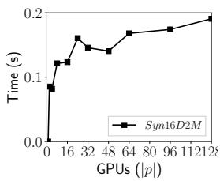  
(a) Syn16D2M

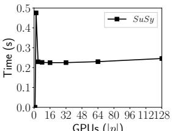  
<sup>GPUs</sup> <sup>(</sup>|<sup>p</sup>|<sup>)</sup>  
(b) SuSy  
Fig. 12. Communication cost of the entity partitioning strategy on up to |p | = 128 nodes for (a) Syn16D2M; and (b) SuSy.

<sup>Œ</sup>e se<sup>lf</sup>-join is a wi<sup>d</sup>e<sup>l</sup>y use<sup>d</sup> operation in many <sup>d</sup>ata-intensive a<sup>l</sup>gorit<sup>h</sup>ms. We s<sup>h</sup>ow t<sup>h</sup>at a gri<sup>d</sup>-<sup>b</sup>ase<sup>d</sup> in<sup>d</sup>ex t<sup>h</sup>at is suited for the GPU, combined with index dimensionality reduction (indexing k < n), reordering the data by the variance in each dimension (reorder), and distance calculation reduction (sortidu and shortc), outperforms the state-of-the-ar se<sup>lf</sup>-join, SuperEGO. We a<sup>l</sup>so s<sup>h</sup>ow initia<sup>l</sup> insig<sup>h</sup>ts into mu<sup>l</sup>ti-GPU an<sup>d d</sup>istri<sup>b</sup>ute<sup>d</sup>-memory imp<sup>l</sup>ementations t<sup>h</sup>at are expected to have low communication overheads (over PCIe or between distributed-memory nodes). By utilizin<sub>g</sub> an entit<sub>y</sub> <sub>p</sub>artitionin<sub>g</sub> strate<sub>gy,</sub> we are able to balance the workload across man<sub>y</sub> GPUs<sub>,</sub> which we ex<sub>p</sub>ect to enable near-ideal s<sub>p</sub>eed<sub>up</sub>s on <sub>up</sub> to 128 nodes.

F<sub>u</sub>t<sub>ure</sub> <sub>wor</sub>k i<sub>nc</sub>l<sub>u</sub>d<sub>es</sub> d<sub>eve</sub>l<sub>op</sub>i<sub>ng</sub> <sub>a</sub> <sub>per</sub>f<sub>ormance</sub> <sub>mo</sub>d<sub>e</sub>l t<sub>o</sub> f<sub>ur</sub>th<sub>er</sub> i<sub>nves</sub>ti<sub>ga</sub>t<sub>e</sub> th<sub>e</sub> <sub>e</sub>‚<sub>ec</sub>t<sub>s</sub> <sub>o</sub>f <sub>our</sub> <sub>op</sub>ti<sub>m</sub>i<sub>za</sub>ti<sub>ons,</sub> <sub>an</sub>d improving t<sup>h</sup>e per<sup>f</sup>ormance o<sup>f</sup> t<sup>h</sup>e se<sup>lf</sup>-join on sma<sup>ll</sup> wor<sup>kl</sup>oa<sup>d</sup>s.

Table 3. Summary of the speedup (or slowdown) of GPU-Join over SuperEGO on all datasets for the smallest and largest values of ϵ in the corres<sub>p</sub>ondin<sub>g</sub> fi<sub>g</sub>ures in Section 5.

<table><tr><td>Dataset</td><td>ε</td><td>Speedup</td><td>ε</td><td>Speedup</td></tr><tr><td>ColorHist</td><td>0.05</td><td>1.13</td><td>0.50</td><td>5.79</td></tr><tr><td>LayoutHist</td><td>0.05</td><td>1.36</td><td>0.50</td><td>5.49</td></tr><tr><td>CoocTexture</td><td>0.05</td><td>3.65</td><td>0.20</td><td>4.13</td></tr><tr><td>SuSy</td><td>0.01</td><td>1.61</td><td>0.02</td><td>1.07</td></tr><tr><td>Songs</td><td>0.005</td><td>1.53</td><td>0.01</td><td>0.92</td></tr><tr><td>Syn16D2M</td><td>0.03</td><td>1.84</td><td>0.05</td><td>5.46</td></tr><tr><td>Syn32D2M</td><td>0.08</td><td>8.25</td><td>0.10</td><td>7.50</td></tr><tr><td>Syn64D2M</td><td>0.16</td><td>7.86</td><td>0.18</td><td>5.63</td></tr></table>

## REFERENCES

[1] Rakesh Agrawal, Christos Faloutsos, and Arun Swami. 1993. Ecient similarity search in sequence databases. Foundations of data organization and algorithms (1993), 69–84.

[2] Alexandr Andoni and Piotr Indyk. 2006. Near-optimal hashing algorithms for approximate nearest neighbor in high dimensions. In IEEE Symposium on Foundations ofComputer Science. 459–468

[3] Mihael Ankerst, Markus M. Breuni<sub>g</sub>, Hans-Peter Krie<sub>g</sub>el, and Jor<sub>g</sub> Sander. 1999. OPTICS: Orderin<sub>g</sub> Points to Identif<sub>y</sub> the Clusterin<sub>g</sub> Structure. In¨ Proc. ofthe ACM SIGMOD Intl. Conf. on Management ofData. 49–60.

[4] Arvind Arasu, Venkatesh Ganti, and Raghav Kaushik. 2006. Ecient Exact Set-similarity Joins. In Proc. ofthe 32nd Intl. Conf. on Very Large Data Bases. 918–929.

[5] P. Baldi, P. Sadowski, and D. Whiteson. 2014. Searching for exotic particles in high-energy physics with deep learning. Nature Communications 5, Article 4308 (July 2014), 4308 pa<sub>g</sub>es. arXiv:hep-ph/1402.4735

[6] Roberto J. Bayardo, Yiming Ma, and Ramakrishnan Srikant. 2007. Scaling Up All Pairs Similarity Search. In Proc. ofthe 16th Intl. Conf. on World Wide Web. 131–140.

[7] Richard E Bellman. 1961. Adaptive control processes: a guided tour. Princeton university press.

[8] Œierry Bertin-Mahieux, Daniel P.W. Ellis, Brian Whitman, and Paul Lamere. 2011. Œe Million Song Dataset. In Proc. ofthe 12th Intl. Conf. on Music Information Retrieval.

[9] Christian Bohm, Bernhard Braunm¨ uller, Markus Breuni<sub>g</sub>, and Hans-Peter Krie<sub>g</sub>el. 2000. Hi<sub>g</sub>h Performance Clusterin<sub>g</sub> Based on the Similarit<sub>y</sub> Join.¨ In Proc. ofthe Ninth Intl. Conf. on Information and Knowledge Management. 298–305.

[10] Christian Bohm, Bernhard Braunm¨ uller, Florian Krebs, and Hans-Peter Krie<sub>g</sub>el. 2001. E<sub>p</sub>silon <sub>g</sub>rid order: An al<sub>g</sub>orithm for the similarit<sub>y</sub> join on¨ massive high-dimensional data. In ACM SIGMOD Record, Vol. 30. 379–388.

[11] C. Bohm and H. P. Kriegel. 2001. A cost model and index architecture for the similarity join. In Proc. 17th Intl. Conf. on Data Engineering. 411–420.

[12] Christian Bohm, Robert Noll, Claudia Plant, and Andrew Zherdin. 2009. Index-supported Similarity Join on Graphics Processors. In ¨ BTW. 57–66.

[13] Brent Bryan, Frederick Eberhardt, and Christos Faloutsos. 2008. Compact similarity joins. In IEEE 24th Intl. Conf. on Data Engineering. 346–355

[14] Je‚rey Dean and Sanjay Ghemawat. 2008. MapReduce: simpli€ed data processing on large clusters. Commun. ACM 51, 1 (2008), 107–113.

[15] Jens-Peter DiŠrich and Bernhard Seeger. 2001. GESS: A Scalable Similarity-join Algorithm for Mining Large Data Sets in High Dimensional Spaces. In Proc. of the ACM Intl. Conf. on Knowledge Discovery and Data Mining. 47–56.

[16] Robert J. Durrant and Ata Kaban. 2009. When is ‘Nearest Neighbour’ Meaningful: A Converse Œeorem and Implications. ´ Journal of Complexity 25, 4 (2009), 385–397.

[17] Martin Ester, Hans Krie<sub>g</sub>el, Jor<sub>g</sub> Sander, and Xiaowei Xu. 1996. A densit<sub>y</sub>-based al<sub>g</sub>orithm for discoverin<sub>g</sub> clusters in lar<sub>g</sub>e s<sub>p</sub>atial databases with¨ noise. In Proc. ofthe 2nd KDD. 226–231

[18] D. Foley and J. Danskin. 2017. Ultra-Performance Pascal GPU and NVLink Interconnect. IEEE Micro 37, 2 (Mar 2017), 7–17.

[19] S. Fries, B. Boden, G. Stepien, and T. Seidl. 2014. PHiDJ: Parallel similarity self-join for high-dimensional vector data with MapReduce. In 2014 IEEE 30th International Conference on Data Engineering. 796–807.

[20] Michael Gowanlock and Henri Casanova. 2015. Indexin<sub>g</sub> of S<sub>p</sub>atiotem<sub>p</sub>oral Trajectories for Ecient Distance Œreshold Similarit<sub>y</sub> Searches on the GPU. In Proc. of the 29th IEEE Intl. Parallel & Distributed Processing Symposium. 387–396.

[21] Michael Gowanlock and Henri Casanova. 2016. Distance Œreshold Similarity Searches: Ecient Trajectory Indexing on the GPU. IEEE Transactions on Parallel and Distributed Systems 27, 9 (2016), 2533–2545.

[22] Michael Gowanlock and Ben Karsin. 2018. GPU Accelerated Self-join for the Distance Similarity Metric. In IEEE Intl. Workshop on High-Performance Big Data, Deep Learning, and Cloud Computing, in IEEE IPDPS Workshops, acceptedfor publication.

[23] Michael Gowanlock, Cod<sub>y</sub> M Rude, David M Blair, Justin D Li, and Victor Pankratius. 2017. Clusterin<sub>g</sub> Œrou<sub>g</sub>h<sub>p</sub>ut O<sub>p</sub>timization on the GPU. In Proc. ofthe 31st IEEE Intl. Parallel and Distributed Processing Symposium. 832–841.

[24] Antonin GuŠman. 1984. R-trees: a dynamic index structure for spatial searching. In Proc. ofACM SIGMOD Intl. Conf. on Management ofData. 47–57.

[25] Edwin H. Jacox and Hanan Samet. 2007. Spatial Join Techniques. ACM Trans. Database Syst. 32, 1, Article 7 (March 2007)

[26] Edwin H. Jacox and Hanan Samet. 2008. Metric Space Similarity Joins. ACM Trans. Database Syst. 33, 2, Article 7 (2008), 38 pages.

[27] Dmitri V Kalashnikov. 2013. Super-EGO: fast multi-dimensional similarity join. Še VLDB Journal 22, 4 (2013), 561–585.

[28] Jinwoon<sub>g</sub> Kim, Won-Ki Jeon<sub>g</sub>, and Beomseok Nam. 2015. Ex<sub>p</sub>loitin<sub>g</sub> Massive Parallelism for Indexin<sub>g</sub> Multi-Dimensional Datasets on the GPU. IEEE Transactions on Parallel and Distributed Systems 26, 8 (2015), 2258–2271.

[29] Jinwoong Kim and Beomseok Nam. 2018. Co-processing heterogeneous parallel index for multi-dimensional datasets. J. Parallel and Distrib. Comput 113 (2018), 195 – 203.

[30] Krzysztof Koperski and Jiawei Han. 1995. Discovery of spatial association rules in geographic information databases. In Advances in spatial databases. <sup>S</sup><sub>p</sub>r<sup>i</sup>n<sub>g</sub>er, 47–66.

[31] M. Lichman. 2013. UCI Machine Learnin<sub>g</sub> Re<sub>p</sub>ositor<sub>y</sub>. (2013).

[32] Michael D Lieberman, Jagan Sankaranarayanan, and Hanan Samet. 2008. A fast similarity join algorithm using graphics processing units. In IEEE 24th Intl. Conf. on Data Engineering. 1111–1120.

[33] Nancy A. Lynch. 1996. Distributed Algorithms. Morgan Kaufmann Publishers Inc., San Francisco, CA, USA

[35] Œomas Seidl, Sergej Fries, and BrigiŠe Boden. 2013. MR-DSJ: Distance-Based Self-Join for Large-Scale Vector Data Analysis with MapReduce.. In BTW, Vol. 214. 37–56.

[34] NVIDIA. 2018. Pascal Tunin<sub>g</sub> Guide. hŠ<sub>p</sub>://docs.nvidia.com/cuda/<sub>p</sub>ascal-tunin<sub>g</sub>-<sub>g</sub>uide/index.html. (2018). Accessed 18-June-2018.

[36] Leslie G Valiant. 1990. A bridging model for parallel computation. Commun. ACM 33, 8 (1990), 103–111.

[37] Ilya Volnyansky and Vladimir Pestov. 2009. Curse of Dimensionality in Pivot Based Indexes. In Proc. ofthe Second Intl. Workshop on Similarity Search and Applications. 39–46.

[38] Jianting Zhang, Simin You, and Le Gruenwald. 2012. U<sup>2</sup>STRA: High-performance Data Management of Ubiquitous Urban Sensing Trajectories on GPGPUs. In Proc. ofthe ACM Workshop on City Data Management. 5–12.