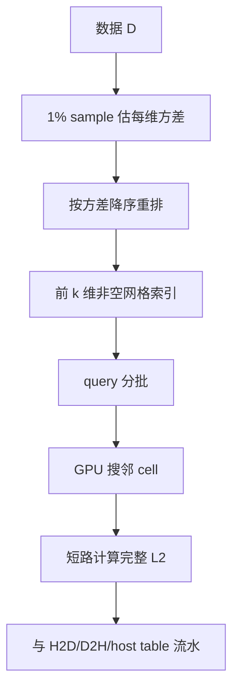
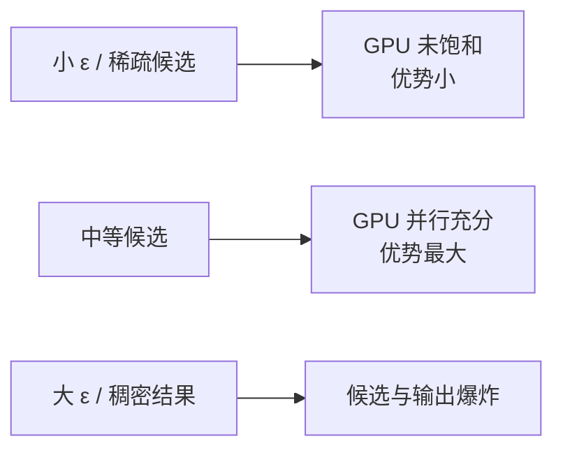

# GPU Accelerated Similarity Self-Join for Multi-Dimensional Data：批判性分析

## 1. Executive Summary + Visual Abstract

GPU-Join 是 exact Euclidean self-join 基线。作者面对的矛盾是：完整 $n$ 维网格在高维产生指数邻接 cell，完全不建索引又退化为全对比较。方案只索引方差较大的 $k<n$ 个维度，用这些维度生成候选，再在完整维度上精确验证；同时通过批处理和 CPU/GPU pipeline 隐藏传输与结果构建 [Section 4]。

论文在 16–90 维、最多 5M 点的真实数据上多数场景优于 16-thread SuperEGO，并讨论多 GPU/分布式扩展 [Sections 5–7]。它对现代 vector DB 的价值主要是 exact ground truth 与 dense-output fallback；实验维度、GPU 世代和数据分布均已过时，不能直接代表 768–1536 维 embedding。


图 1：设计取舍。解读：降维只用于过滤，不改变最终 exact 语义。

**tl;dr：** GPU-Join 的新意是部分维度网格、方差重排和批量流水线的组合。它没有打破 $O(n^2)$ worst case；低方差、候选密集或输出爆炸时仍会退化。适合作为小/中规模 exact baseline，不宜直接当现代高维 join 的主方案。

## 2. Problem Definition

### 2.1 Essence

给定数据集，枚举每个 ε-neighbor pair。exact 语义要求任何过滤都不能漏 pair；因此索引维度减少后，剩余维度只能做后验验证，不能参与错误剪枝。

### 2.2 Formal Definition

$$SSJ_\epsilon(D)=\{(p_i,p_j)\mid i<j,\ \|p_i-p_j\|_2\le\epsilon\}.$$

目标是最小化 index search、distance computation、GPU transfer 与 result materialization 的总时间，同时结果精确。

| 参数 | 含义 | 风险 |
|---|---|---|
| $n$ | 原始维度 | distance cost 线性增长 |
| $k$ | 网格索引维度 | 小则候选多，大则 cell 邻域多 |
| $\epsilon$ | 距离阈值 | 大时结果/候选急剧增加 |
| batch | GPU 批大小 | 受显存与结果量限制 |

## 3. Method + Experimental Credibility

### 3.1 Method Mechanism



图 2：GPU-Join pipeline。解读：高方差维度提升过滤力；pipeline 只隐藏开销，不减少候选。

```text
Algorithm: GPU-Join（Algorithm 1）
Input: D, ε, indexed dimensions k
Output: exact self-join pairs

1: reorder dimensions by sampled variance
2: build sparse grid on first k dimensions
3: partition queries into batches
4: for each batch in overlapped streams do
5:     enumerate adjacent non-empty grid cells
6:     for candidate point q do
7:         accumulate full-dimensional squared distance; stop if > ε²
8:         emit pair if final distance ≤ ε
9: overlap kernel, transfer, and host neighbor-table construction
```

索引构建约 $O(|D|k)$，完整验证最坏 $O(|D|^2n)$，空间包括数据、非空 cells、candidate/result buffers。结果集本身可能是 $\Theta(|D|^2)$，任何实现都无法避免物化成本 [Section 3.1]。

### 3.2 Experimental Credibility

数据含 5 个真实集和 3 个合成集；真实维度 16–90、最大 SuSy 5M，合成数据专门降低各维方差以测试 worst case [Sections 5.1–5.2]。硬件是 NVIDIA GP100 16GB，与 16-core SuperEGO 比较。论文包含参数 $k$、重排、short-circuit 和大数据消融，机制证据较完整。

计时排除数据加载和 index construction，但包含 reorder、join、结果回传和 host table；这对重复查询合理，对 one-shot 不完整 [Section 5.2]。没有多次运行方差；多 GPU 主要是分析与模拟，不是完整 end-to-end 集群实验。

## 4. Results, Boundaries, Anti-Packaging

### 4.1 Claim Verification

| 声称 | 判断 | 锚点 |
|---|---|---|
| 多数场景优于 SuperEGO | Supported | Figures 5–9, Table 3 |
| 方差重排改善过滤 | Supported but distribution-dependent | Section 5.5 |
| 对低方差数据更不敏感 | Partial | 合成实验支持，数据种类有限 [Section 7] |
| 可扩到 multi-GPU/cluster | Plausible, not fully validated | Section 6 |



图 3：性能区域。解读：GPU 的最佳区间不是候选最少或最多，而是有足够并行度且输出仍可控。

### 4.2 Boundary and Failure Profile

| 条件 | 行为 | 影响 | 缓解 |
|---|---|---|---|
| 维度极高 | partial grid 过滤弱、distance 贵 | 接近 brute force | quantization/tensor GEMM |
| 维度方差不代表区分力 | reorder 选错维 | 候选膨胀 | 学习 selectivity 而非 variance |
| 大 ε | 输出 $O(n^2)$ | 显存/PCIe/host table 成瓶颈 | count-only/stream output |
| 小 workload | GPU 不饱和 | CPU 可能更快 | cost-based device choice |
| 非 L2/IP 语义 | 网格假设不适用 | 需重新设计 | metric-specific filter |

作者展望是 multi-GPU 与 distributed-memory 扩展，并认为高维 compute-bound 会使通信相对较小 [Section 6.4]。这是推断，不是现代互联和真实超大输出上的证明。

### 4.3 Anti-Packaging

“high-dimensional”在本文主要是 16–90 维，今天不应等同于 transformer embedding。多 GPU scalability 也不应写成已验证。去包装后结论是：对 exact L2 self-join，使用少量有区分力的维度做无损候选过滤，再让 GPU 批量验证，是可靠且可解释的基线。

## 5. Cross-Paper Impact + Inspiration + Action

### 5.1 Cross-Paper Relation

| 工作 | 关系 | 启示 |
|---|---|---|
| SimJoin/Fast AVJ | baseline/alternative | approximate graph search 与 exact GPU filter 的交叉由 recall SLA 决定 |
| DiskJoin | hardware alternative | SSD bucket 候选可交给 GPU 批量验证 |
| IPS complexity | consistent | GPU 改善常数，不改变 worst-case 输出/比较下界 |

### 5.2 Impacted Existing Reports

实验路线应把 GPU blocked brute force 与 GPU-Join 式 partial-grid filter 分开；前者更适合极高维 GEMM，后者适合中维 L2。

### 5.3 科研启发与跨领域类比

| 结构 | 类比 | 迁移 |
|---|---|---|
| 先便宜筛再精确算 | cascade classifier | 动态选择筛选维度数 |
| pipeline 隐藏传输 | 流水线处理器 | 双缓冲结果物化 |
| 维度选择 | feature selection | 以候选 selectivity/成本训练选择器 |

### 5.4 Actionable Next Steps

- 在现代 GPU 上重做 exact baseline：GEMM、partial-grid、FAISS range search。
- 单独报告 index、kernel、D2H、materialization。
- 扩到 128/384/768/1536 维，找出 partial-grid 失效点。
- 把 result count 与 result materialization 两种任务分开。

### 5.5 推荐阅读

同题：Fast AVJ、DiskJoin；基线：SuperEGO、GPU low-dimensional self-join；改进对象：FAISS GPU、blocked GEMM；局限相关：output-sensitive algorithms、modern multi-GPU graph search。

## Appendix: Evidence & Metadata

### A. 参考文献

- [Ref-01] Michael Gowanlock, Ben Karsin. GPU Accelerated Similarity Self-Join for Multi-Dimensional Data. arXiv:1809.09930, 2018/2019.
- [Ref-02] Dmitri Kalashnikov. SuperEGO / multidimensional similarity join.
- [Ref-03] Thomas Ahle et al. On the Complexity of Inner Product Similarity Join. PODS 2016.

### B. 证据锚点速查

| 结论 | 锚点 |
|---|---|
| 算法 | Sections 4.1–4.5, Algorithm 1 |
| 计时口径 | Section 5.2 |
| 主结果 | Sections 5.4–5.7, Table 3 |
| 扩展展望 | Section 6 |

### C. 资产清单

三张 Mermaid 图为自绘。

### D. 论文元数据

- arXiv：1809.09930
- 作者：Michael Gowanlock, Ben Karsin
- 年份：2018/2019
- 分析日期：2026-10-10
