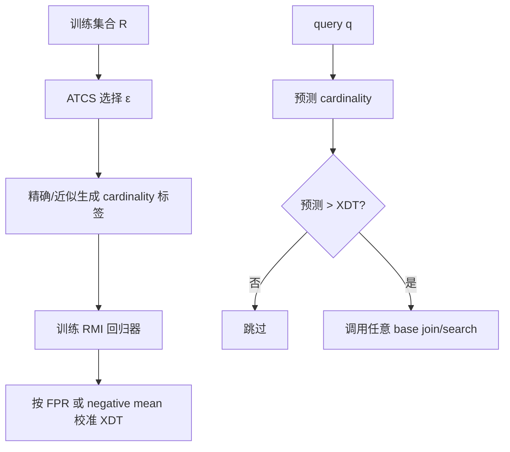

# Xling：批判性分析

## 1. Executive Summary + Visual Abstract

Xling 从一个简单统计事实出发：很多 query 没有邻居或邻居很少，执行完整 range search 没有收益；论文报告负 query 可占 20%–90% [Section I]。传统 LSBF 用 LSH bucket 判断存在性，但丢失分布信息且受距离函数限制。作者将问题改写成邻居数回归：预测 $card(q,\epsilon)$，再用决策阈值 XDT 过滤 query。这让过滤器可插入 brute-force、LSH、KMeansTree、IVFPQ 等 loop-based join。

Xling 的工程价值是作为可组合前置算子，而不是 XJoin 本身。XJoin 在实验里把过滤器接到 brute-force range search，最高相对基线约 17×；速度来自主动放弃低产出 query，因此“quality guarantee”实质上是训练集校准后的经验性速度—召回控制，不是分布无关的零漏报保证 [Sections IV–VI]。


图 1：方法来源。解读：核心创新是把 metric Bloom filter 从二分类改成可调阈值的回归过滤器。

**tl;dr：** Xling 适合“空 query 多、允许召回损失、分布相对稳定”的 workload。它不能替代候选生成器，只减少调用次数。训练标签、分布漂移和 per-query 尾部漏报是主要风险；论文的迁移实验只是在同一数据集的第二个 150K 分片上进行，不能支持广义跨域泛化。

## 2. Problem Definition

### 2.1 Essence

如果应用只关心拥有至少 $\tau$ 个邻居的 query，可以先预测结果数；预测为低产出的 query 直接跳过。这个取舍把计算预算集中到“可能贡献大量 pair”的 query，却会系统性牺牲长尾 query，尤其当 global pair recall 高但 per-query coverage 重要时。

### 2.2 Formal Definition

$$c(q,\epsilon)=|\{x\in R\mid d(q,x)\le\epsilon\}|.$$

学习模型 $\hat c=f_\phi(q,\epsilon)$；若 $\hat c>XDT(\epsilon,\tau)$ 则执行 base search，否则跳过。目标是在 recall 约束下最小化

$$T_{train}+\sum_{q\in S}[T_f(q)+\mathbf 1(\hat c>XDT)T_{base}(q)].$$

| 参数 | 含义 | 作用 |
|---|---|---|
| $\epsilon$ | 距离阈值 | 同时影响标签和结果密度 |
| $\tau$ | 最少邻居数 | 越大越激进地过滤 |
| XDT | 模型输出阈值 | FPR/mean 两种校准策略 |
| ATCS | 训练 ε 采样 | 覆盖非线性 ε-cardinality 曲线 |

## 3. Method + Experimental Credibility

### 3.1 Method Mechanism



图 2：训练和在线路径。解读：昂贵工作并未消失，而是部分转移到标签生成与离线校准；重复 workload 才能摊销。

```text
Algorithm: Xling-filtered Join（Sections IV–V）
Input: trained estimator f, decision threshold XDT, queries S, base method B
Output: approximate join pairs

1: for q in S do
2:     ĉ ← f(q, ε)
3:     if ĉ ≤ XDT(ε, τ) then continue       # 核心：主动丢弃 query
4:     C ← B.range_search(q, ε)
5:     verify and emit C
6: return all emitted pairs
```

在线额外成本约 $O(|S|T_f)$，节省量取决于 filtered ratio 与 base-search cost。空间是模型、训练样本和 base index。训练标签若靠 exact range count，最坏代价仍接近原 join；论文用采样与插值降低成本 [Section V]。

### 3.2 Experimental Credibility

论文从每个数据集随机取 150K，8:2 划分为 R/S；全部单位归一化，使 cosine 与 Euclidean 可转换 [Section VI-A]。这控制了度量比较，却缩小了规模且改变了原始分布。模型统一用 RMI，作者承认选择最佳 estimator 不在范围内，未来才比较 [Section VI-A]。

基线较广：Naive、SuperEGO、LSH、KMeansTree、LSBF、IVFPQ，且同时测试 plugin 增益。缺陷是不同方法处于不同质量区域；IVFPQ 因“不适合固定参数比较”只出现在 trade-off 图中，带有选择性。迁移实验把同一数据集的前/后 150K 当 source/target，只证明同分布分片稳定，不证明 encoder、时间或领域漂移下泛化 [Section VI-F]。

## 4. Results, Boundaries, Anti-Packaging

### 4.1 Claim Verification

| 声称 | 判断 | 证据 |
|---|---|---|
| ATCS 降低回归误差 | Supported | 多模型/数据 MSE 降 50%–98% [Section VI-B] |
| XJoin 最快且质量高 | Partial | 最高 17×，但配置 $\tau=50$ 主动忽略小结果 query [Section VI-D] |
| 可泛化到新数据 | Weak/Partial | 仅同数据集无重叠分片 [Figure 5] |
| generic plugin | Supported mechanically | LSH/KMeansTree/IVFPQ 均可前接过滤 [Sections IV-C, VI-E] |
| quality guarantee | Partial | XDT 基于训练 FPR/mean；分布外无确定性保证 |


图 3：指标风险。解读：过滤低基数 query 可能保住大多数 pair，却让一批实体完全没有匹配；应用必须选对质量指标。

### 4.2 Boundary and Failure Profile

| 条件 | 退化 | 影响 | 缓解 |
|---|---|---|---|
| 分布/encoder 漂移 | cardinality 校准失效 | false negative 上升 | drift detector + fallback |
| 大多数 query 都有结果 | filtered ratio 低 | 只增加模型开销 | optimizer 禁用 Xling |
| 低基数结果很重要 | 被 $\tau$ 系统性丢弃 | fairness/coverage 问题 | $\tau=0$ 或 per-query SLA |
| 标签生成昂贵 | offline 成本大 | 单次 join 不划算 | reuse、active sampling |
| base search 已很便宜 | 模型推理占比上升 | 无加速甚至变慢 | cost-based gating |

论文明确未来测试其他 estimator [Section VI-A]。未覆盖的关键方向是持续校准、误差置信区间、在线更新以及跨 encoder 泛化。

### 4.3 Anti-Packaging

“outstanding generalization”证据过强包装：训练/测试来自同一数据源的两段样本。“quality guarantee”也应改为“可通过训练集 XDT 调节经验质量”。去包装后的结论仍有价值：一个足够便宜的 cardinality predictor 可以作为 join 前置 gate，在 negative-heavy workload 中减少昂贵 range search 调用。

## 5. Cross-Paper Impact + Inspiration + Action

### 5.1 Cross-Paper Relation

| 论文 | 关系 | 组合方式 |
|---|---|---|
| SimJoin, DOI 10.1145/3725403 | complementary | Xling 先 filter，SimJoin 处理保留 query |
| Fast AVJ, arXiv:2603.16360 | complementary/partly superseded | merged witness 可直接判断空 query，减少 learned filter 需求 |
| LSH-SS, arXiv:1104.3212 | conceptual predecessor | 都估 cardinality；一个 per-query gate，一个估总 join size |

### 5.2 Impacted Existing Reports

优化器研究必须区分“semi-join 非空率”“per-query cardinality”“full join size”，并统一误差传播到 pair recall。

### 5.3 科研启发与跨领域类比

| 结构 | 类比 | 迁移 |
|---|---|---|
| 先预测是否值得执行 | 医疗 triage | 高置信 negative 快速退出 |
| 漂移下阈值失效 | 统计过程控制 | calibration residual 触发重训 |
| 速度—漏报预算 | selective classification | abstain/fallback 而非硬跳过 |

建议把硬 gate 改成三路：execute、skip、uncertain fallback；输出 conformal/quantile cardinality 区间，并以 recall SLA 调整 XDT。

### 5.4 Actionable Next Steps

- 复现必须报告训练标签成本和 break-even join 次数。
- 加 per-query recall、zero-result accuracy、低基数 query coverage。
- 用时间切分、不同 encoder 和 OOD query 验证泛化。
- 与 Fast AVJ 的 NN-Map exact semi-join statistic 对比，确认何时无需学习模型。

### 5.5 推荐阅读

同题：SimJoin（2025）、Fast AVJ（2026）；基线：LSBF/LSH join、SuperEGO；改进对象：learned cardinality estimation 与 RMI；局限相关：dataset shift calibration、selective prediction/conformal risk control。

## Appendix: Evidence & Metadata

### A. 参考文献

- [Ref-01] Yifan Wang, Vyom Pathak, Daisy Zhe Wang. Xling. arXiv:2402.13397, 2024.
- [Ref-02] Jiadong Xie et al. Fast Approximate Similarity Join in Vector Databases. PACMMOD, 2025.
- [Ref-03] Kyoungmin Kim et al. Fast Approximate Vector Joins via Offline-Online Co-Design. arXiv:2603.16360, 2026.
- [Ref-04] Hongrae Lee et al. Similarity Join Size Estimation using LSH. arXiv:1104.3212, 2011.

### B. 证据锚点速查

| 结论 | 锚点 |
|---|---|
| 动机 | Sections I–II |
| ATCS/XDT | Section V |
| 数据缩减与设置 | Section VI-A |
| 泛化证据 | Section VI-F, Figure 5 |

### C. 资产清单

三张 Mermaid 图为自绘。

### D. 论文元数据

- arXiv：2402.13397
- 作者：Yifan Wang, Vyom Pathak, Daisy Zhe Wang
- 年份：2024
- 分析日期：2026-10-10
