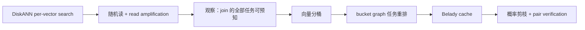
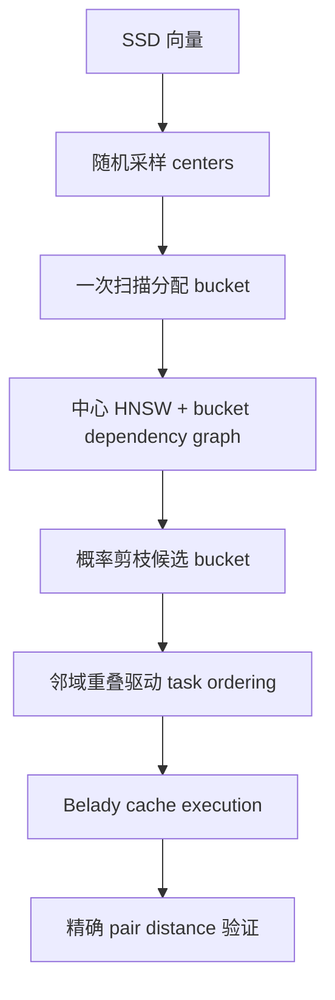
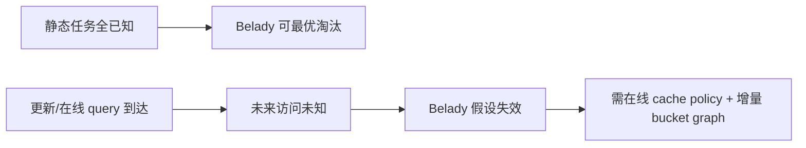

# DiskJoin：批判性分析

## 1. Executive Summary + Visual Abstract

DiskJoin 的核心判断是：把 DiskANN 对每个向量重复调用，并不能得到好的外存 join。profiling 显示 DiskANN 约 70% 时间花在 I/O，单向量随机访问让每个向量平均读取 1.2–1.4 MB；DiskJoin 通过顺序 bucket 访问把它降到 1.9–2.8 KB [Figures 15–16]。因此作者没有继续微调 ANN traversal，而是把 self-join 重写成“bucket-pair task graph + 全局已知访问序列”的批处理。

设计中最扎实的部分是任务调度：先重排 bucket graph 以制造邻域复用，再用 Belady 最优离线淘汰策略管理缓存。概率剪枝带来最大计算收益，但也是唯一直接损害 recall 的组件。论文在 100M/1B 规模上报告相对 DiskANN 50–1000× 的速度差；这个数字主要说明逐查询 DiskANN 是不合适的 join baseline，而不是说明 DiskJoin 对所有外存 join 都有同量级优势 [Sections 6.2–6.5]。



图 1：从 I/O profiling 到 DiskJoin。解读：算法来自 workload 的“离线、批量、访问序列可知”，不是来自更强的 ANN 索引。

**tl;dr：** DiskJoin 是 SSD 上静态大规模 self-join 的强基线。其 bucket layout、task ordering 与 offline-optimal cache replacement确实消除了读放大；但系统假设静态批任务、单机 NVMe 和可预知访问序列。概率剪枝的 target recall 是经验控制而非端到端严格保证，更新与并发在线查询没有解决。

## 2. Problem Definition

### 2.1 Essence

数据远大于内存时，逐 query 图搜索会频繁读取 SSD page，而 page 中大部分向量没有被使用。join 与在线 ANN 的差异是所有 query 已知，因此可以重排整个任务序列，并预知每个 bucket 下一次何时访问。这正好允许使用在线查询系统无法使用的 Belady 策略 [Sections 1, 3–4]。

### 2.2 Formal Definition

$$SSJ_\epsilon(X)=\{(x_i,x_j)\mid i<j,\ \|x_i-x_j\|\le\epsilon\}.$$

系统优化目标是在内存预算 $M\ll |X|d$ 与目标 recall $\lambda$ 下最小化

$$T=T_{I/O}+T_{candidate}+T_{verify}+T_{materialize}.$$

| 对象 | 含义 | 约束 |
|---|---|---|
| bucket | 相近向量的连续磁盘块 | 大小影响 I/O 与候选膨胀 |
| bucket graph | 需要比较的 bucket pair | 剪枝可能漏 pair |
| cache $C$ | 内存可驻留 bucket 数 | 实验常为数据的 10% |
| $\lambda$ | target recall | 基于采样距离分布控制 |

## 3. Method + Experimental Credibility

### 3.1 Method Mechanism



图 2：完整 pipeline。解读：bucketization 解决访问粒度，ordering/cache 解决重复访问，pruning 解决候选爆炸；三者不可互换。

```text
Algorithm: DiskJoin（Sections 3–5）
Input: disk dataset X, threshold ε, recall target λ, memory budget C
Output: approximate SSJ pairs

1: sample centers; stream X to assign/write contiguous buckets
2: build center index and candidate bucket graph
3: probabilistically prune bucket edges under λ
4: reorder graph nodes to maximize neighbor overlap in cache window
5: derive complete bucket access sequence S
6: for bucket-pair task in order do
7:     load missing buckets; evict farthest-next-use bucket  # Belady
8:     compare vector pairs and verify distance ≤ ε
9: return emitted pairs
```

给定访问序列，Belady 实现为 $O(|E|\log C)$ [Algorithm 1]。联合最小 cache load 的 MECC 问题是 NP-hard [Theorem 1]，因此 ordering 只是 Gorder 风格启发式。bucket 内验证最坏仍为二次候选数；输出本身也给出不可消除的下界。

### 3.2 Experimental Credibility

实验包含 Deep/BigANN 的 100M 与 billion-scale 版本，内存比例、target recall、threshold 和 SSD 配置均有 sweep [Section 6.1–6.3]。对比覆盖 distributed ClusterJoin、in-memory RSHJ 和 DiskANN adapter。最强证据不是总速度，而是 I/O 字节、cache hit、候选数的机制指标 [Figures 15–18]。

外部效度仍有限：仅一类服务器与 NVMe 层次；静态数据、专用批作业；没有与数据库并发负载共享 SSD；bucket/index build 的摊销条件需要按实际重复次数重算。50–1000× 主要相对不适配批处理的 DiskANN，不能替代与其他专用 disk join 的全面比较。

## 4. Results, Boundaries, Anti-Packaging

### 4.1 Claim Verification

| 声称 | 判断 | 证据 |
|---|---|---|
| 消除 I/O bottleneck | Supported on tested hardware | I/O 占比降至 16.7–21.4% [Figure 15] |
| 读放大几乎消失 | Supported | 每向量 KB vs MB，流量差 >400× [Figure 16] |
| 所有优化都有效 | Supported | Belady/reorder 提 cache hit；pruning 大降候选 [Figures 17–18] |
| pruning 对 recall 影响很小 | Partial | 实验约 0.1%，但概率模型跨分布保证不足 [Section 6.5] |
| 适合任意动态 vector DB | Unsupported | 论文目标是 static end-to-end batch [Section 1] |



图 3：部署边界。解读：DiskJoin 的主要优势与 static batch 假设绑定，不能直接转成持续更新服务。

### 4.2 Boundary and Failure Profile

| 条件 | 行为 | 影响 | 缓解 |
|---|---|---|---|
| bucket 分布高度不均 | 大 bucket 产生平方候选 | compute 再次主导 | split/learned bucket size |
| recall target 高 | 剪枝边减少 | 候选与 I/O 上升 | 更多内存或多阶段验证 |
| 流式更新 | layout、access sequence 过期 | 重排/Belady 失效 | delta buckets + periodic merge |
| 密集阈值 | 输出和验证巨大 | I/O 优化不再决定总时延 | output-aware plan |
| SSD/CPU 比例变化 | bottleneck 转移 | 报告速度不可移植 | hardware-aware cost model |

作者没有专门的 future-work 段；从问题设定可确定的未覆盖项是动态更新、跨任务复用、并发资源治理与分布式/多 SSD 调度。cross-join 有实验讨论，但系统主线和形式化仍以 SSJ 为中心。

### 4.3 Anti-Packaging

“first disk-based”与“removes disk access as bottleneck”应限定到论文硬件和基线。“2–3 orders”很大一部分来自批处理与 per-query adapter 的范式差异。去包装后的可靠事实是：对静态外存 join，连续 bucket layout、邻域相似任务排序和未来感知缓存能把随机 page I/O 转成高复用块访问；pruning 再把计算量压低一个数量级。

## 5. Cross-Paper Impact + Inspiration + Action

### 5.1 Cross-Paper Relation

| 论文 | 关系 | 启示 |
|---|---|---|
| Xie et al., PACMMOD 2025 | analogous | 都重排批任务以复用状态；复用对象分别是窗口和 bucket cache |
| Kim et al., arXiv:2603.16360 | orthogonal | entry discovery 优化可与外存 layout 结合 |
| Gowanlock & Karsin, arXiv:1809.09930 | hardware alternative | GPU brute force 与 SSD pruning 的交叉点取决于候选密度 |

### 5.2 Impacted Existing Reports

`survey.md` 中“异构执行计划”应把 disk traffic、cache hit 和候选对数列为 cost model 输出，而不只估 join cardinality。

### 5.3 科研启发与跨领域类比

| 结构 | 类比 | 迁移 |
|---|---|---|
| 已知未来访问 | 编译器 offline register allocation | 全局 schedule 而非 LRU |
| 相似 task 相邻执行 | vehicle routing / graph ordering | 以共享 bucket 数作局部收益 |
| 概率删边 | 风险预算分配 | 将总漏报预算分摊到 bucket edge |

研究机会：把 DiskJoin 的 bucket-edge recall budget 与 Xling/ANN 的漏报概率做端到端组合；用在线 drift 指标决定何时重排；让 optimizer 在 GPU scan 与 SSD bucket join 间选择。

### 5.4 Actionable Next Steps

- 复现优先记录实际 `bytes read / useful bytes`，不要只看 wall time。
- 分别关闭 Belady、reorder、pruning，验证瓶颈是否与论文一致。
- 加入 update batch 与 mixed ANN workload，测试 static 假设破裂后的退化。
- 用现有 SIFT1M 先做内存受限模拟，再扩展 SSD 数据。

### 5.5 推荐阅读

同题：SimJoin（2025）、Fast AVJ（2026）；基线：DiskANN（Subramanya et al., NeurIPS 2019）、ClusterJoin/RSHJ；改进对象：SPANN（Chen et al., NeurIPS 2021）、SmartSSD/Starling 类 disk ANN；局限相关：SPFresh（SOSP 2023）与 graph update 工作。

## Appendix: Evidence & Metadata

### A. 参考文献

- [Ref-01] Yanqi Chen, Xiao Yan, Alexandra Meliou, Eric Lo. DiskJoin: Large-scale Vector Similarity Join with SSD. arXiv:2508.18494, 2025.
- [Ref-02] Jiadong Xie et al. Fast Approximate Similarity Join in Vector Databases. PACMMOD, 2025. DOI:10.1145/3725403.
- [Ref-03] Suhas Jayaram Subramanya et al. DiskANN. NeurIPS, 2019.
- [Ref-04] Qianxi Zhang et al. SPFresh. SOSP, 2023.

### B. 证据锚点速查

| 结论 | 锚点 |
|---|---|
| MECC NP-hard | Theorem 1 |
| cache 算法 | Algorithm 1, Section 4.2 |
| I/O 根因 | Figures 15–16 |
| 组件消融 | Figures 17–18 |

### C. 资产清单

三张 Mermaid 图为自绘。

### D. 论文元数据

- arXiv：2508.18494
- 作者：Yanqi Chen, Xiao Yan, Alexandra Meliou, Eric Lo
- 年份：2025
- 分析日期：2026-10-10
