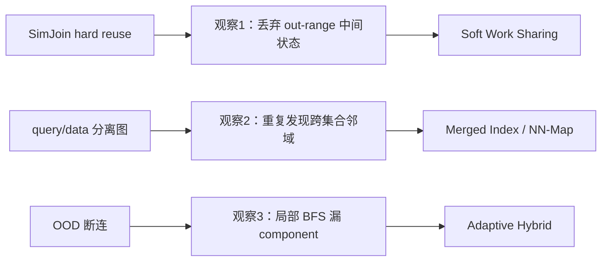
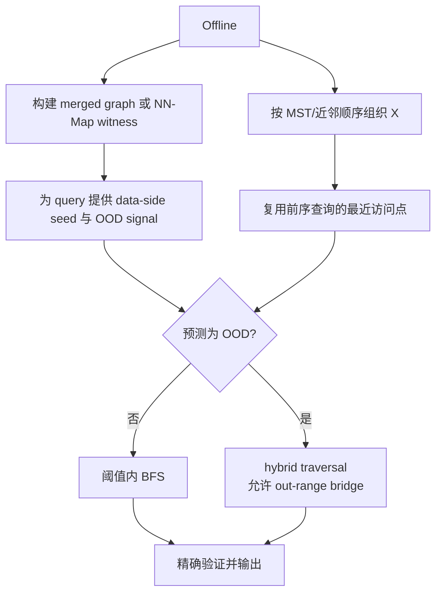
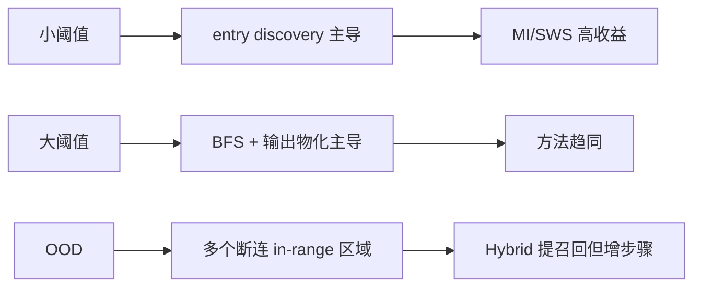

# Fast Approximate Vector Joins via Offline-Online Co-Design：批判性分析

> 本报告分析 arXiv v2（2026-07-23）。论文在 SimJoin 之后重新划分 offline/online 边界；强结论均以节、图或表为锚点。

## 1. Executive Summary + Visual Abstract

论文没有发明新的 graph ANN，而是重构 join 的状态复用方式。作者从三类失败出发：SimJoin 只复用最终 in-range 结果；query/data 分离索引每次在线重建跨集合几何联系；OOD query 的阈值内区域可能在图上断开。对应方案是 soft work sharing（复用中间最近点）、merged index（离线显式编码跨集合邻域）和 OOD-aware hybrid traversal（必要时穿过 out-range 节点）[Sections 1, 4]。

实验报告 merged index 最高 44.1× 降低 join latency，soft sharing 相对 hard sharing最高约 3×，OOD 数据上 adaptive hybrid recall 最高提高 43%；但收益集中在小阈值、稀疏输出。大阈值时所有方法被结果枚举支配，论文明确不声称解决该区域 [Sections 5.2, 5.8]。



图 1：三个观察与三个组件的对应关系。解读：设计不是随意堆叠；每个组件有不同的瓶颈对象，因此必须分开消融。

**tl;dr：** 这是当前最完整的内存 vector threshold join 设计框架。它把 SimJoin 的结果复用扩展为搜索状态复用，并将 query-data 几何关系提前物化。主要限制是 query 集必须可预知或可维护、共享 encoder 假设较强、实验止于 10M 内存规模，且密集输出仍无解。

## 2. Problem Definition

### 2.1 Essence

小阈值 join 的主要时间不在收集结果，而在每个 query 从全局入口走到第一个 in-range 点；论文测得 greedy phase 最多占 99% [Section 1, Figure 10]。这提示作者：如果离线阶段已经知道两集合处在同一空间，就应预先保存跨集合入口，而不是在线重复导航。

### 2.2 Formal Definition

$$J_\theta(X,Y)=\{(x,y)\in X\times Y\mid dist(x,y)<\theta\},\quad |X|\le |Y|.$$

近似算法优化在线 latency，同时最大化 pair/per-query recall。额外约束是图索引、内存预算以及离线结构的构建/维护成本。

| 符号 | 含义 | 备注 |
|---|---|---|
| $G_X,G_Y$ | 分离图 | INLJ/SimJoin 基线 |
| $G_{X\cup Y}$ | merged graph | query 与 data 共用图 |
| $s(x)$ | soft-reuse seed | 上个 query 搜索到的最近 data point |
| OOD bit | query-data overlap 信号 | 控制 hybrid 是否开启 |

## 3. Method + Experimental Credibility

### 3.1 Method Mechanism



图 2：offline–online 分工。解读：merged index 和 soft sharing都在削减 entry discovery；当 merged index 已把入口成本降得很低时，两者的 latency 增益并不相加 [Section 5.2.1]。

```text
Algorithm: MI + SWS + Adaptive Hybrid（Sections 4.2–4.4）
Input: ordered queries X, data Y, threshold θ, merged graph or NN-Map
Output: approximate join pairs

1: build cross-set neighborhood evidence offline
2: for q in locality-preserving order do
3:     seed ← best of local merged neighbors and prior-query soft state
4:     if overlap_signal(q) indicates OOD then
5:         candidates ← hybrid_search(seed, allow out-range bridges)
6:     else candidates ← in_range_BFS(seed)
7:     cache closest visited data point as soft state
8:     verify candidates and emit pairs
```

单 query 的图搜索仍是数据相关；论文把 merged neighborhood probe描述为实践中的 $O(1)$，并非严格保证。NN-Map 为较小集合每个向量保存 witness、距离和 OOD bit，空间约 $O(\min(|X|,|Y|))$；它比 union graph 更接近传统 join index [Section 6]。

### 3.2 Experimental Credibility

8 个数据集覆盖 SIFT、GIST、GloVe、NYTimes、FMNIST、COCO、ImageNet、LAION，包含 3 个 OOD-heavy 数据集；使用 NSG/HNSW 并统一实现基线 [Section 5.1, Tables 4–5]。阈值每数据集 7 个，另对 SIFT 精确校准平均 1–10 个结果的稀疏区间 [Section 5.8]。这比只挑有利阈值更可信。

风险有三项：最大规模 10M 是作者内存上限，不支持 billion-scale；应用场景仍是 ANN benchmark 的 query/data split，而非端到端产品匹配；“offline once”依赖集合稳定，流式更新成本没有实验 [Sections 5.6, 7, Appendix A]。论文提供 query-level distance-computation 分析，弥补亚毫秒时延噪声，但未报告置信区间。

## 4. Results, Boundaries, Anti-Packaging

### 4.1 Claim Verification

| 声称 | 判断 | 锚点 |
|---|---|---|
| SWS 优于 HWS | Supported but not universal | 多数 query 步数更少，少数 recall 反而偏低 [Figures 11–12] |
| MI 近似消除 greedy phase | Supported in tested graphs | latency breakdown 与 10M scaling [Figures 10, 16] |
| Adaptive hybrid 只为难 query 付费 | Supported | force-all hybrid 增加所有数据集 latency，仅 OOD 改善 recall [Section 5.2.1] |
| merged index 通用 | Partial | 对 NSG/HNSW 有效；严格 RNG 太贵，实际图仅近似局部性质 [Appendix B] |
| 大阈值也显著领先 | Unsupported | 作者明确称方法趋同，结果枚举主导 [Section 5.8] |



图 3：收益区域。解读：这不是“所有 vector join 都快”，而是对 sparse threshold join 的 entry-cost 优化。

### 4.2 Boundary and Failure Profile

| 条件 | 失败/退化 | 实际影响 | 缓解 |
|---|---|---|---|
| 大阈值、每 query 上万结果 | expansion 和输出主导 | 组件收益消失 | 换 join 方向、scan/GPU |
| query/data 非同一 encoder | merged graph 几何意义变弱 | seed 质量下降 | 独立图 + SWS |
| 集合频繁更新 | merged index/NN-Map 维护成本 | offline 优势被稀释 | 增量 witness 更新 |
| 图低连通/高度偏斜 | MI+Adapt recall 下降 | NYTimes 大阈值已有迹象 | 多 witness / graph repair |
| query 完全未知 | 无法预插入 merged graph | 退回普通 ANN | NN-Map 仅适合 known batch |

作者展望包括 disk-based、distributed、vector-relational filters、multi-table joins、非图索引与 streaming support [Section 7]；端到端任务基准也留给未来 [Appendix A]。

### 4.3 Anti-Packaging

“constant-time in-range discovery”是局部邻域探测的工程描述，依赖 approximate RNG 性质，不是所有图/分布上的复杂度保证。“up to 44.1×”不能代表大阈值；论文自己展示了不利区域，这是优点。去包装后的贡献是：对已知批次、共享空间和稀疏输出，把 entry point 物化或局部化，可显著减少在线距离计算；hybrid 是召回保险，不是免费增强。

## 5. Cross-Paper Impact + Inspiration + Action

### 5.1 Cross-Paper Relation

| 论文 | 关系 | 变化 |
|---|---|---|
| Xie et al., PACMMOD 2025, DOI 10.1145/3725403 | supersede | final-window reuse → traversal-state reuse |
| Chen et al., arXiv:2508.18494, 2025 | orthogonal | 内存 entry cost vs SSD I/O cost |
| Wang et al., arXiv:2402.13397, 2024 | complementary | query filter 可先于 MI/SWS |

### 5.2 Impacted Existing Reports

现有 survey 对 small/large threshold 的区分应保留；研究计划应增加 NN-Map 作为比 merged graph 更轻的离线结构。

### 5.3 科研启发与跨领域类比

| 结构 | 类比 | 迁移 |
|---|---|---|
| 离线物化入口 | 数据库 join index / materialized view | 根据更新率选择 union graph 或 NN-Map |
| 难例才启用重搜索 | 双系统决策 | 快路径 + 风险触发慢路径 |
| 多个断连结果区 | 可靠性冗余 | 保存多 witness 而非单 witness |

潜在改进：学习“MI、SWS、hybrid、scan”的 per-query policy；为 witness 添加版本与置信度；在 SSD 上把 witness 排序与 DiskJoin bucket schedule 联合优化。

### 5.4 Actionable Next Steps

- 复现时以 SimJoin 为直接基线，保持同一图和同一阈值。
- 先测 greedy/BFS/materialization 三段成本，再决定研究 entry 还是 output bottleneck。
- 增加 encoder drift、append-only 更新与 unknown-query 三组压力测试。
- 对大阈值加入 query/data 方向切换和 GPU scan，避免把方法放在其非目标区域。

### 5.5 推荐阅读

近年同题：SimJoin（Xie et al., 2025）、DiskJoin（Chen et al., 2025）；基线：VBASE（Zhang et al., OSDI 2023）、Xling（Wang et al., 2024）；改进对象：NSG（Fu et al., 2017）、HNSW（Malkov & Yashunin, 2020）；局限相关：RoarGraph/CDMG 类 OOD graph search、SPFresh（Xu et al., SOSP 2023）增量索引。

## Appendix: Evidence & Metadata

### A. 参考文献

- [Ref-01] Kyoungmin Kim, Lennart Roth, Liang Liang, Anastasia Ailamaki. Fast Approximate Vector Joins via Offline-Online Co-Design. arXiv:2603.16360, 2026.
- [Ref-02] Jiadong Xie, Jeffrey Xu Yu, Yingfan Liu. Fast Approximate Similarity Join in Vector Databases. PACMMOD, 2025. DOI: 10.1145/3725403.
- [Ref-03] Yanqi Chen et al. DiskJoin: Large-scale Vector Similarity Join with SSD. arXiv:2508.18494, 2025.
- [Ref-04] Yifan Wang et al. Xling. arXiv:2402.13397, 2024.

### B. 证据锚点速查

| 结论 | 锚点 |
|---|---|
| greedy 最多 99% | Section 1, Figure 10 |
| 组件互补/非叠加 | Section 5.2.1 |
| 断连成因 | Section 5.3, Figures 11–14 |
| 大阈值退化 | Section 5.8 |
| 展望 | Section 7 |

### C. 资产清单

三张 Mermaid 图为自绘，支持动机、执行和收益边界分析。

### D. 论文元数据

- arXiv：2603.16360v2
- 作者：Kyoungmin Kim, Lennart Roth, Liang Liang, Anastasia Ailamaki
- 版本日期：2026-07-23
- 分析日期：2026-10-10
