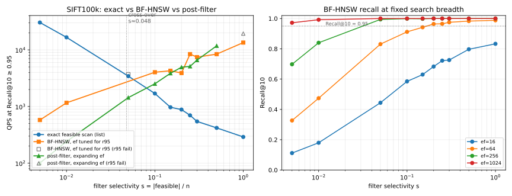
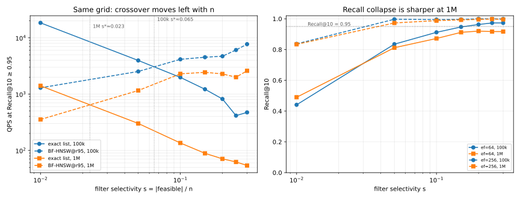

# 动机实验：选择率对 FAISS 过滤 HNSW/IVF 效率的影响

日期：2026-10-26。目的：为 Directory-Aware 方向提供选择率成本的直接证据。问题不是“FAISS 能不能过滤”，而是“过滤后的向量搜索效率如何随选择率变化”。

## 结论

1. **FAISS 没有属性过滤索引。** 核心 FAISS 只有 `IDSelector`/`SearchParameters.sel`；调用方先把属性条件编译成可行位图，再交给 Flat/IVF/HNSW。HNSW 的 selector 只过滤结果堆、不剪枝遍历，所以固定 `efSearch` 的召回随选择率 $s$ 下降。
2. **效率分三段，依索引族而变。** 仅比较精确枚举与 BF-HNSW 时，100k 扩展网格中后者首个合格胜出桶是 10%，二者未门控 QPS 的对数插值为 $s\approx0.048$。加入 `IndexIVFFlat + IDSelectorBitmap` 后，0.5%/1% 仍由精确枚举胜出，5%–20% 由 IVF 胜出，25%–100% 由 HNSW 胜出；首个精确到合格索引的交叉区间变为 1%–5%。
3. **固定 ef 的召回在低 $s$ 崩塌。** $ef=64$ 在 $s=30\%$ 时 Recall@10=97.3%，在 $s=1\%$ 只有 44.1%。要维持 r95，必须按 $s$ 放大 `ef`，本数据上 $\mathrm{ef}\approx35.9\,s^{-0.60}$。
4. **post-filter 只在高 $s$ 接近 BF-HNSW，不能替代精确枚举。** $s=1\%$ 时 post 需要把全局候选池扩到 2000 才凑够 10 个可行点，QPS 223；$s=30\%$ 时 post 7,354 QPS，接近 HNSW 的 7,718，但召回只有 97.5%，更脆弱。

## 实验设置

- 向量：SIFT100k，$n=100000$，$d=128$，L2，1000 条真实查询向量。
- 谓词：每查询独立随机选取 `round(s·n)` 个 ID，$s\in\{0.5\%,1\%,5\%,10\%,15\%,20\%,25\%,30\%,50\%,100\%\}$；每桶 200 条，随机打乱后前 100 调参、后 100 评估，3 次评估取中位数。1%–30% 为原始请求范围，0.5%/50%/100% 为扩展点。
- 索引：FAISS `IndexHNSWFlat` M=16、efc=200（62.6 MB）和新增 `IndexIVFFlat` nlist=1024（50.1 MB）；同一 `IDSelectorBitmap` 可行集。IVF 先在全部基向量训练/入库，按查询选择 `nprobe`，最初网格 `{1,4,16,64,256,1024}`；`exact` 为可行集精确枚举（posting list + prefetch），`post` 为全局 top-`ef` 后筛。缓存加载，构建成本另计。
- 目标：Recall@10 ≥ 0.95；`ef` 在调参半集上取最小达标值（目标带 1pp margin）。
- Oracle：`exact_topk` 与 `faiss::IndexFlat + IDSelectorBitmap` 在 $s=0.01$ 和 $s=1.0$ 上逐 ID 对比通过。
- 环境：单线程，WSL2，`OMP_NUM_THREADS=1`。

## 结果



扩展网格（0.5%–100%）：

| 选择率 | exact list QPS | BF-HNSW QPS（ef） | Recall@10 | post-filter QPS | post Recall |
|---:|---:|---:|---:|---:|---:|
| 1% | **18,443** | 1,294（512） | 95.5% | 223 | 100% |
| 5% | **3,958** | 2,523（256） | 99.7% | 1,517 | 100% |
| 10% | 1,981 | **4,148（128）** | 98.3% | 3,114 | 99.4% |
| 15% | 1,219 | **4,523（128）** | 98.8% | 3,211 | 98.8% |
| 20% | 819 | **4,706（128）** | 99.6% | 4,551 | 99.0% |
| 25% | 415 | **6,077（64）** | 97.3% | 5,176 | 98.8% |
| 30% | 473 | **7,718（64）** | 97.3% | 7,354 | 97.5% |

| 0.5% | **30,397** | 578（1024） | 97.2% | 101 | 100% |
| 50% | 419 | 8,412（64） | 98.3% | **11,782** | 95.9% |
| 100% | 291 | **13,444（32）** | 95.1% | 19,370 | 86.5% ✗ |

固定 `ef` 的 Recall@10：

| s | ef=16 | ef=64 | ef=256 | ef=1024 |
|---:|---:|---:|---:|---:|
| 1% | 18.6% | 44.1% | 83.7% | 99.2% |
| 5% | 42.7% | 83.5% | 99.7% | 99.9% |
| 10% | 56.6% | 91.2% | 99.5% | 100% |
| 15% | 66.1% | 94.7% | 99.6% | 100% |
| 20% | 69.5% | 96.3% | 100% | 100% |
| 25% | 73.3% | 97.3% | 100% | 100% |
| 30% | 74.6% | 97.3% | 99.9% | 100% |

仅有 HNSW 的扩展网格主指标 `gmean_qps_r95=8,254`；7 桶 1%–30% 版本为 6,066。固定策略 `s<0.06 → exact`、`s≥0.06 → BF-HNSW` 在 7 桶网格上已达同一前沿；不等于新增 IVF 的最优三段策略。

扩展点的含义：
- $s=0.5\%$ 时精确枚举比 BF-HNSW 快约 53×，精确枚举的低选择率余量很大。
- $s=20\%$ 时 post-filter 首次反超 HNSW（4,940 vs 3,904）；$s=50\%$ 时 post 11,782 vs HNSW 8,412，但召回只有 95.9%；$s=100\%$ 时 post 召回 86.5% 不合格。
- 维持 r95 的 `ef` 拟合为 $\mathrm{ef}\approx34.3\,s^{-0.60}$，与 7 桶网格一致。

## 解释

FAISS 的 `IDSelector` 是 filter-agnostic：HNSW 仍遍历不可行节点，只是不把它们放入结果堆；`efSearch` 的预算按全部候选计数。选择率低时，为了凑够 10 个可行近邻，`efSearch` 必须约按 $1/s$ 放大，延迟从几十微秒升到几毫秒；此时直接枚举可行 ID 做精确扫描更便宜。选择率高时，可行点遍布全图，BF-HNSW 用很小的 `ef` 就能达标，精确扫描反而要遍历大量点。

因此，一个基于全局向量索引的属性过滤系统不能忽略选择率：要么在低 $s$ 切换到可行集精确扫描，要么让属性索引把可行集显式枚举出来。Directory-Aware 的设计目标正是把属性条件编译成可行的执行器选择，而不是把过滤简单下推给全局 HNSW。

## 新增 FAISS IVF 对照（SIFT100k）

与前述 100k 扩展网格使用相同谓词、调参/评估划分、r95 门槛和 3 次中位数；独立再次计时，故 HNSW/精确 QPS 允许有系统负载噪声。以下为 run #97（`nlist=1024`，IVF nprobe 在调参半集选最小满足 r96 的值；`ok` 必须在评估半集达到 r95）。

| s | exact list QPS | IVF QPS（nprobe；Recall@10） | HNSW QPS（ef；Recall@10） | 合格最优 |
|---:|---:|---:|---:|---|
| 0.5% | **32,339** | 8,050（256；99.8%） | 592（1024；97.2%） | exact |
| 1% | **16,546** | 5,009（256；100%） | 1,126（512；95.7%） | exact |
| 5% | 3,133 | **11,313（64；97.1%）** | 4,359（128；94.7%，未过 r95） | IVF |
| 10% | 1,767 | **7,663（64；98.2%）** | 4,462（128；98.5%） | IVF |
| 15% | 890 | **6,358（64；97.8%）** | 3,742（128；98.7%） | IVF |
| 20% | 735 | **5,176（64；98.4%）** | 4,429（128；99.6%） | IVF |
| 25% | 646 | 5,353（64；98.2%） | **7,967（64；96.5%）** | HNSW |
| 30% | 546 | 4,980（64；98.1%） | **7,461（64；97.5%）** | HNSW |
| 50% | 357 | 3,698（64；98.3%） | **7,894（64；98.3%）** | HNSW |
| 100% | 279 | 3,337（64；98.9%） | **12,661（32；95.1%）** | HNSW |

四方法可达前沿几何均值 9,903 QPS，相比不包含 IVF 的 100k 扩展网格 8,254 高约 20%（不同运行，非配对加速比）。IVF 5%/10%/15%/20% 桶分别快于同轮 HNSW 2.59×/1.72×/1.70×/1.17×（5% 的 HNSW 未过门槛）。首次合格的索引胜出在 1%–5%；图中对数插值约 2.2%，只是本配置的画图估计。IVF 不消除低选择率精确枚举优势，也不能从独立随机谓词外推到相关属性。

## 1M 规模复测（先前 HNSW-only，随后加入 IVF）

把同一组 0.5%–100% 随机谓词搬到 SIFT1M（`n=1000000`，200 条/桶，100 调参 + 100 评估，3 次中位数，margin 0.01；HNSW M=16/efc=200，625.9 MB，冷构建 499.8 s）：



| 选择率 | exact list QPS | BF-HNSW QPS（ef） | Recall@10 | post-filter QPS | post Recall |
|---:|---:|---:|---:|---:|---:|
| 0.5% | **2,739** | 155（2048） | 99.0% | 62 | 99.8% |
| 1% | **1,514** | 359（1024） | 99.6% | 162 | 100% |
| 5% | 271 | **1,162（256）** | 98.9% | 785 | 99.6% |
| 10% | 150 | 974（256） | 99.0% | **1,540** | 98.4% |
| 15% | 85 | **2,103（128）** | 96.9% | 1,685 | 97.2% |
| 20% | 62 | 1,594（128） | 97.8% | **2,063** | 96.6% |
| 25% | 63 | 2,109（128） | 98.2% | **3,320** | 95.8% |
| 30% | 56 | **2,588（128）** | 98.0% | 4,011 | 94.5% ✗ |
| 50% | 39 | **2,469（128）** | 99.1% | 5,308 | 92.0% ✗ |
| 100% | 29 | **3,814（64）** | 96.9% | 10,928 | 81.9% ✗ |

- **HNSW-only 交叉点左移**：约 $s^*\approx0.022$（100k 为 0.048），即在 1M 上 5% 已足以让 BF-HNSW 反超；这不是包含 IVF 的多索引交叉点。
- **固定 ef 的召回更脆**：`ef=64` 在 0.5% 只有 31.4%（100k 为 32.7%），在 100% 为 96.9%（100k 为 98.8%）。
- **post-filter 在 10%/20%/25% 反超 HNSW**，但 30%/50%/100% 召回只有 94.5%/92.0%/81.9%，不可用。

原 HNSW-only 主指标 `gmean_qps_r95=2,196`（不与 100k 直接可比）。规模效应一致：$n$ 从 100k 到 1M，精确枚举的相对优势缩小；post-filter 只在中间选择率短暂占优。图已更新为 IVF 复测后的索引对照，原 HNSW-only 数值保留于上表。

### SIFT1M IVF 复测（run #99 首次构建；#100 缓存索引复现）

仍用相同 10 桶/100 tune + 100 eval/3 次中位数、同一可行位图；IVF `nlist=1024`、`nprobe` 从 `{1,4,16,64,256,1024}` 选最小 tune r96 后按 eval r95 门控。下表取缓存查询的 run #100；#99 冷构建 IVF 11.56 s、496.4 MB，HNSW 索引 625.9 MB（另一次冷构建约 499.8 s），两者构建均未计入 QPS。

| s | IVF nprobe | IVF QPS | IVF Recall@10 | 本轮最优方法（QPS） |
|---:|---:|---:|---:|---|
| 0.5% | 256 | 1,147 | 100% | exact list（2,845） |
| 1% | 64 | **3,051** | 96.2% | IVF（3,051） |
| 5% | 64 | **1,401** | 98.7% | IVF（1,401）；HNSW 1,248 |
| 10% | 64 | 920 | 99.7% | post（1,417；98.4%） |
| 15% | 64 | 687 | 99.6% | HNSW（2,049） |
| 20% | 64 | 623 | 99.3% | post（2,551；96.6%） |
| 25% | 64 | 553 | 99.6% | post（2,707；95.8%） |
| 30% | 64 | 535 | 99.7% | HNSW（2,278） |
| 50% | 64 | 448 | 99.8% | HNSW（2,254） |
| 100% | 64 | 359 | 99.8% | HNSW（4,410） |

100k 的首次合格 IVF 胜出在 1%–5%，1M 在 0.5%–1%；对应的 exact→合格 ANN 对数插值约 2.2% 和 0.7%（图左，仅取精确/HNSW/IVF；post 不影响这两个首次区间）。1M 1% IVF 3,051 QPS vs 同轮 exact list 1,124；5% IVF 仅比同轮 HNSW 快 12%，不能视为稳健的普遍优势。run #99/#100 的最优方法逐桶相同，主指标分别 2,342/2,367 QPS；与 HNSW-only 旧运行的 2,196 差异非配对，不能当作同硬件确定性加速比。两轮 1% IVF 评估召回均 96.2%，离 r95 仅 1.2pp；真实属性或其他查询分布尚未验证。

## 局限

- 谓词与几何独立（随机子集）；真实属性通常与向量分布相关，相关方向会进一步改变结果（见同目录 cluster-far/cluster-near 结果）。
- 只测 SIFT100k/1M 随机谓词、FAISS IVF nlist=1024 与 HNSW M=16/efc=200；未在 IVF 对照中测属性-几何相关谓词、真实属性或 ACORN/PathSeer。单线程、缓存查询 QPS 不含索引构建；100k/1M IVF 首次构建分别约 3.26/11.56 s、50.1/496.4 MB。
- 精确枚举是下界，不是 ANN；交叉点数值只对本数据/硬件有效，但 100k 与 1M 的趋势一致。
- 1M 的 s=1% HNSW 需要 ef=1024（评估召回 99.6%），而 100k 只需 512；规模效应需要更大 ef。
- 旧的 HNSW-only 100k 扩展网格中，5% HNSW 评估召回 94.7%（未过 r95），因此当时最优是精确枚举；加入 IVF 后 5% 最优改为 IVF。未门控 HNSW QPS 推算的 0.048 与合格的 exact→IVF 首胜区间不是同一交叉点。
- 调参/评估分半，样本量有限；$s=1\%$ 的 HNSW 评估召回 95.5% 贴近门槛。

## 复现

```bash
python3 production/nested-attr-vector-search/src/selectivity_harness.py \
  --fixtures production/nested-attr-vector-search/work/fixtures_ccs \
  --out-dir production/nested-attr-vector-search/work/selectivity_grid_ext_ivf \
  --modes random --metric-mode random --nq-per-bucket 200 --max-ef 16384 \
  --policy-s 0.06 --tune-margin 0.01 --repeats 3 \
  --ivf --ivf-nlist 1024 --ivf-max-nprobe 1024

# SIFT1M（索引和 fixtures 在忽略提交的 work/ 内，初次需要生成）
python3 production/nested-attr-vector-search/src/selectivity_harness.py \
  --fixtures production/nested-attr-vector-search/work/fixtures_1m \
  --out-dir production/nested-attr-vector-search/work/selectivity_grid_ext_1m_ivf \
  --modes random --metric-mode random --nq-per-bucket 200 --max-ef 8192 \
  --policy-s 0.02 --tune-margin 0.01 --repeats 3 \
  --ivf --ivf-nlist 1024 --ivf-max-nprobe 1024
python3 production/nested-attr-vector-search/src/plot_selectivity_motivation.py
python3 production/nested-attr-vector-search/src/plot_selectivity_motivation_scale.py
```

run #97 使用提交 `ad6a4da` 中 `{1,4,16,64,256,1024}` 调参网格；之后调整 `nprobe` 网格时应同时报告版本与评估召回。

归档：100k [`CSV`](../data/selectivity_grid_ext_ivf_curve_20261026.csv) / [`summary`](../data/summary_grid_ext_ivf_20261026.json)（run #97），1M [`CSV`](../data/selectivity_grid_ext_1m_ivf_curve_20261026.csv) / [`summary`](../data/summary_grid_ext_1m_ivf_20261026.json)（缓存 run #100）；旧 100k HNSW-only 网格见 [`CSV`](../data/selectivity_grid_ext_curve_20261026.csv)，旧 1M HNSW-only 网格见 [`CSV`](../data/selectivity_grid_ext_1m_curve_20261026.csv)。
