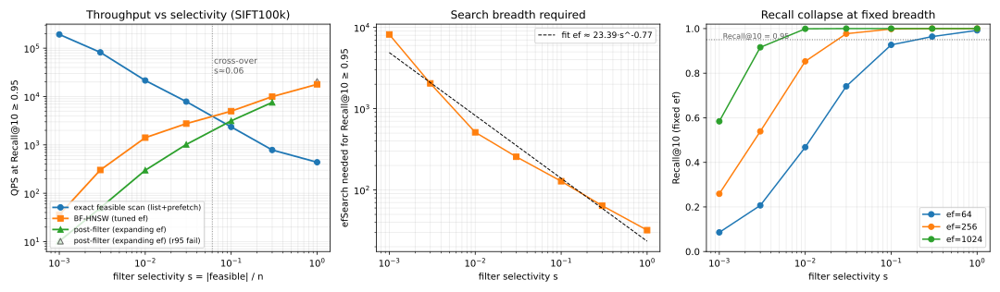
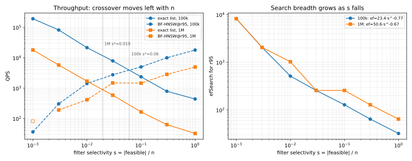
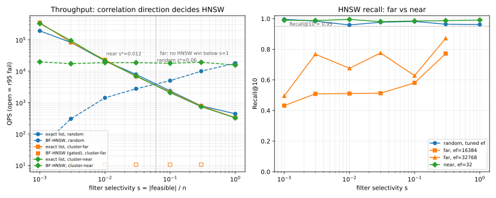

# 选择率对属性过滤索引效率的影响（SIFT100k/1M，随机与相关谓词）

日期：2026-10-26。方向：`01-directory-aware-acceleration` 的测量诊断，不是对 2026-10-19 停止独立立项结论的翻案。代码：`production/nested-attr-vector-search/src/{selectivity_bench.cpp,selectivity_harness.py,analyze_selectivity.py,plot_selectivity.py,plot_scale_compare.py,export_sift1m.py}`。协议：[`experiments/selectivity-benchmark.md`](experiments/selectivity-benchmark.md)；FAISS 接口证据：[`experiments/faiss-attribute-filter-support.md`](experiments/faiss-attribute-filter-support.md)。

## 1. 结论

1. **FAISS 没有属性过滤索引。** 它只提供 ID 级过滤钩子 `IDSelector` + `SearchParameters.sel`，由调用方先把属性条件编译成可行位图/ID 集合；Flat、IVF、HNSW（以及 PathSeer fork 的 ACORN/PathSeer）都消费这个钩子。HNSW 的 selector **过滤结果堆、不剪枝遍历**，所以固定 `efSearch` 下召回随选择率 `s` 下降。
2. **选择率把执行策略分成两段。** 在 SIFT100k 上，精确枚举可行 ID（posting list + prefetch）在 $s\le0.03$ 全面胜出；BF-HNSW 在 $s\ge0.1$ 胜出；交叉点约 $s^\*\approx0.06$（对数插值）。
3. **维持 r95 所需的 `efSearch` 近似按幂律增长**：拟合 $\mathrm{ef}\approx23.4\,s^{-0.774}$。从 $s=1$ 的 `ef=32` 到 $s=0.001$ 的 `ef=8192`，查询延迟从 57 µs 升到 27.7 ms（约 490×），而精确扫描在 $s=0.001$ 只需 5.1 µs。
4. **post-filter 在 100k 上从不是最优。** 它需要约 $k/s$ 的全局候选池；$s=0.001$ 时 10.2 QPS、p50 98 ms，比精确扫描慢约 1.9 万倍；$s=1$ 时召回只有 89.9%，连 r95 都达不到。1M 上 post 在 $s=0.1$ 首次略胜 HNSW（1,774 vs 1,605），但 $s=0.3/1$ 仍因召回不足不可用（§5）。
5. **表示方式本身就是选择率相关成本。** 同一可行集，按 posting list 枚举比按 12.5 KB 位图枚举快 2.5×（$s=0.001$）、1.9×（$s=0.01$）；差异主要来自冷内存随机 gather，而不是 popcount。
6. **目录解析成本与选择率近似无关**：TrieHI 式 inclusive 位图拷贝 0.7–1.6 µs；PE-Online 式子树的逐节点 OR 从 4 µs 增长到 933 µs（$s=0.3$），在高选择率下成为端到端主项。低选择率下解析只占精确扫描的 10–30%。
7. **交叉点随规模左移。** SIFT1M 上交叉点约 $s^\*\approx0.0194$（100k 为 0.0605）。精确扫描从 100k 到 1M 慢 10.7–13.7×，HNSW 在 $s=1$ 只慢 3.6×；更大规模应更早切到精确枚举。1M 的 ef 前因子从 23.4 增到 50.6，指数仍约 $-0.67$。
8. **属性-几何相关性会改变甚至消除交叉点。** 紧凑可行簇 + 独立查询时，HNSW 在 $s\le0.3$ 即使 `ef=32768` 也只有 50–87% 召回；精确扫描一直赢到 $s=0.3$，只有 $s=1$ 时 HNSW 胜出。PathSeer（filter-aware）在 ef≤4096 同样未达 r95（31–66%）。但同一可行集把查询移到簇中心后，HNSW 用 `ef=32` 就在 $s\ge0.03$ 胜出，召回 98–99.5%。**相关性方向，而不只是选择率，决定 HNSW 是否可用**；随机谓词的 0.06 交叉点不能直接外推。属性分区 flat 布局与只 gather 可行点的分区布局也都只在 $s=0.3$ 略胜精确扫描（+15%/+26%），不能修复低/中选择率；精确扫描仍是 $s<1$ 的最优执行器。

## 2. 实验设置

| 项 | 设置 |
|---|---|
| 向量 | SIFT100k，`n=100000`，`d=128`，L2，1000 条真实查询向量 |
| 层级 | 1365 节点 CCS 形状树，1024 叶，每对象最多 5 个标签；30146 个对象无标签；合成校准，非真实 CCS |
| 谓词 | `random`：每查询均匀抽 `round(s·n)` 个 ID；`cluster`：k-means（k=256）随机簇中心，取距中心最近的 $m=s·n$ 个点，查询独立；`sub`/`exact`：树节点的 `Inc(v)`/`Local(v)`；$s\in\{0.001,0.003,0.01,0.03,0.1,0.3,1.0\}$ |
| 查询数 | 每桶最多 200 条谓词，随机打乱后前 100 调参、后 100 评估；层级桶不足 200 时用全部 |
| 方法 | `exact`（位图枚举）、`exact_list`（posting list + prefetch 8）、`hnsw`（FAISS `IndexHNSWFlat` M=16, efc=200 + bitmap selector）、`post`（全局 top-ef 后筛） |
| ANN 参数 | `hnsw` 的 `ef` 在调参半集上取满足 Recall@10 ≥ 0.95 的最小值；`post` 初始 `ef=max(16,ceil(2k/s))`，不足时 ×4，上限 16384 |
| 硬件/线程 | i5-12600KF，WSL2，单线程查询，`OMP_NUM_THREADS=1`；索引构建一次并缓存 |
| 主指标 | `gmean_qps_r95`：`--metric-mode` 选定的七个桶的 per-bucket 最优 gated QPS 的几何平均（random/cluster 分别成段） |

**Oracle 与校验。** `exact_topk` 与 `faiss::IndexFlat + IDSelectorBitmap` 在 $s=0.01$ 和 $s=1$ 上逐 ID 对比通过；所有 `exact`/`exact_list` 行的评估召回必须 ≥0.999，否则 `valid=false`；selector 方法检查重复/不可行 ID；tune/eval 分半且按组随机打乱（先前顺序分半会让 SIFT 前 100 条查询偏易，导致 $s=1$ 的评估召回被人为压低 2.3pp）。

**规模与成本。** HNSW M=16 冷构建 25.4 s，索引 62.6 MB；层级 dense bitmap 元数据 32.5 MB（1365 节点 × 12.5 KB × 2 套 inclusive/local）。构建时间不计入 QPS。

## 3. 结果

### 3.1 吞吐 vs 选择率



主结果（run #82，复现 run #81；两次主指标 22.43k / 21.84k QPS，差异 2.6%）：

| s | 精确位图 QPS | posting list QPS | list 增益 | BF-HNSW ef | BF-HNSW QPS | 召回 | post QPS | post 召回 |
|---:|---:|---:|---:|---:|---:|---:|---:|---:|
| 0.001 | 76,982 | **192,313** | 2.50× | 8192 | 36.1 | 99.6% | 10.2 | 99.6% |
| 0.003 | 38,367 | **82,034** | 2.20× | 2048 | 302.8 | 98.4% | 49.8 | 100% |
| 0.01 | 13,266 | **21,483** | 1.89× | 512 | 1,412 | 95.9% | 299 | 100% |
| 0.03 | 5,363 | **7,861** | 1.39× | 256 | 2,754 | 97.7% | 1,022 | 99.9% |
| 0.1 | 1,947 | 2,356 | 1.27× | 128 | **4,988** | 98.2% | 3,146 | 99.4% |
| 0.3 | 568 | 785 | 1.44× | 64 | **9,965** | 96.4% | 7,570 | 96.7% |
| 1.0 | 457 | 438 | 1.07× | 32 | **17,894** | 96.2% | 20,610 | 89.9% ✗ |

- $s=0.001$：精确扫描 5.1 µs/query，BF-HNSW 27.7 ms/query（`ef=8192`）；差距约 5,400×。
- $s=0.1$：BF-HNSW 首次反超（4,988 vs 2,356 QPS）；$s=0.3$ 时约 12.7×；$s=1$ 时约 40.9×。
- post-filter 在 $s=0.1$ 仍略快于精确扫描（3,146 vs 2,356），但始终慢于 BF-HNSW；$s=1$ 因候选池只有 20 个而漏掉可行近邻，召回 89.9%。

**交叉点。** 对 $s=0.03$ 与 $s=0.1$ 的对数 QPS 做线性插值，精确扫描与 BF-HNSW 的交叉点约 $s^\*=0.0605$。这是本数据/索引参数下的值，不是普适常数。

### 3.2 固定 ef 的召回坍塌

| s | ef=16 | ef=64 | ef=256 | ef=1024 | ef=4096 |
|---:|---:|---:|---:|---:|---:|
| 0.001 | 2.8% | 8.6% | 25.9% | 58.4% | 94.4% |
| 0.003 | 7.1% | 20.7% | 53.9% | 91.6% | 99.9% |
| 0.01 | 18.3% | 46.8% | 85.3% | 99.9% | 100% |
| 0.03 | 37.2% | 74.1% | 97.7% | 100% | 100% |
| 0.1 | 55.1% | 92.7% | 99.8% | 100% | 100% |
| 0.3 | 71.9% | 96.4% | 100% | 100% | 100% |
| 1.0 | 87.5% | 99.2% | 100% | 100% | 100% |

固定 `ef=64` 时，召回从 $s=1$ 的 99.2% 掉到 $s=0.001$ 的 8.6%。这不是结果后过滤的排序问题，而是 HNSW 的 `efSearch` 预算按全部候选计数、可行候选只占其中约 `s` 的比例；要凑够 k 个可行近邻，候选预算需按 $1/s$ 放大。

拟合 $\mathrm{ef}\approx23.4\,s^{-0.774}$（七个点，log-log 最小二乘）。指数小于 1，说明在极低选择率下单纯放大 ef 的收益递减；此时精确枚举可行集更便宜。

### 3.3 目录解析成本

`sub`（递归目录范围）的解析成本与端到端：

| s | TrieHI 解析 µs | PE-Online 解析 µs | exact list QPS（预物化） | BF-HNSW ef | BF-HNSW QPS | 召回 |
|---:|---:|---:|---:|---:|---:|---:|
| 0.0011 | 1.59 | 5.10 | 173,199 | 8192 | 35.8 | 97.9% |
| 0.0027 | 1.57 | 10.16 | 72,110 | 4096 | 114.6 | 95.5% |
| 0.0070 | 1.23 | 18.48 | 37,743 | 1024 | 681 | 96.8% |
| 0.0261 | 1.14 | 70.46 | 9,326 | 512 | 1,452 | 99.7% |
| 0.1011 | 0.90 | 269.95 | 2,083 | 128 | 5,190 | 98.0% |
| 0.3142 | 0.80 | 933.11 | 755 | 128 | 4,482 | 100% |

- TrieHI 的 inclusive 位图拷贝几乎恒定（0.8–1.6 µs），因为代价是 12.5 KB 的拷贝，与 $s$ 无关。
- PE-Online 的逐子树 OR 随作用域节点数增长；$s=0.1/0.3$ 时解析成本（270/933 µs）与 BF-HNSW 搜索（约 200 µs）同量级或更高。端到端 QPS 从 5,190 掉到 861（$s=0.3$ 的 `peonline` 变体）。
- 低选择率下，TrieHI 解析只占精确扫描的 10–30%；但在 $s=0.001$ 的 5.3 µs 精确扫描上，1.6 µs 已不可忽略。若属性索引直接存 inclusive posting list，拷贝 100 个 ID 约 0.4 µs，可进一步降低。

`exact`（非递归 Local）的解析更便宜：Local 位图拷贝 0.6–1.6 µs；但 `exact` 作用域通常很小（$s\le0.1$），BF-HNSW 即使在 `ef=16384` 也常达不到 r95（$s=0.001$ 召回 92.9%），精确枚举更合适。

### 3.4 主指标与策略

- **可达前沿** `gmean_qps_r95`：**22,426 QPS**（run #81），复现 **21,839**（run #82）。
- **固定策略** `s<0.01 → exact_list；s≥0.01 → BF-HNSW`：**12,743 QPS**。它低于前沿，因为 $s=0.01/0.03$ 的最优仍是精确扫描；阈值应放在约 0.06，而不是 0.01。
- 按交叉点校正的策略（$s<0.06$ 精确、否则 BF-HNSW）预计接近前沿；未单独记录为指标，留作后续。

## 4. 对 Directory-Aware 方向的含义

1. **目录层不是瓶颈，但表示形式是。** TrieHI 的 inclusive 位图解析在 µs 级，选择率变化不改变它的量级；真正随 $s$ 变的是向量执行器。PE-Online 的子树展开在高 $s$ 才成为瓶颈（$s=0.3$ 时 933 µs）。
2. **“过滤索引效率”必须分三段计时**：谓词求值/位图解析、候选扫描/图遍历、距离计算。只报端到端会把低 $s$ 的冷 gather、高 $s$ 的目录展开混在一起。
3. **低选择率的正确执行器是可行集精确扫描，不是把 HNSW 的 ef 拉满。** 在 $s=0.01$，精确扫描 21.5k QPS，HNSW 需 `ef=512` 才 1.4k QPS；差距 15×。把 ef 拉到 4096 只会更慢（114 QPS）。
4. **属性索引应同时维护位图与 posting list。** 位图适合交并/高选择率过滤；posting list 适合低选择率枚举。两者不是互斥表示，而是按 $s$ 选择。本研究只测了查询侧成本，未计双表示的构建/更新/空间成本。
5. **不要用单一选择率调参。** FAISS HNSW 的 selector 是 filter-agnostic 的；跨 $s$ 使用固定 `ef` 会在低 $s$ 丢召回，在高 $s$ 浪费预算。至少要按 $s$ 估 `ef`，或在 $s$ 低于交叉点时切换执行器。

## 5. 1M 规模复测

为检验交叉点是否随 $n$ 漂移，在同一协议下把向量集扩到 SIFT1M（`n=1000000`，`d=128`，10k 条真实查询向量）。只跑 `random` 谓词；每桶 200 条（100 调参 / 100 评估），`max_ef=8192`。HNSW 仍为 M=16、efc=200；索引 625.9 MB，冷构建 499.8 s（查询 QPS 使用缓存索引，构建不计入）。层级/目录模式未在 1M 重跑，因为它们不是这组随机谓词实验的必要条件。



| s | exact list QPS | HNSW@r95 QPS（ef） | 召回 | post QPS | post 召回 |
|---:|---:|---:|---:|---:|---:|
| 0.001 | **17,994** | —（需 ≥8192，未测到 gated 点） | 94.4% ✗ | 28 | 77.1% ✗ |
| 0.003 | **5,755** | 191（2048） | 98.4% | 38 | 99.9% |
| 0.01 | **1,696** | 411（1024） | 98.7% | 168 | 99.7% |
| 0.03 | 583 | **1,479**（256） | 95.1% | 540 | 99.7% |
| 0.1 | 164 | 1,458（256） | 99.0% | **1,811** | 98.1% |
| 0.3 | 63 | **2,831**（128） | 98.4% | 4,630 | 93.8% ✗ |
| 1.0 | 32 | **4,941**（64） | 96.7% | 11,889 | 82.8% ✗ |

- **交叉点**：$s^\*\approx0.0194$（0.01 与 0.03 对数插值；exact 1,695.8/583.4，HNSW 411/1,479）。100k 为 0.0605，左移约 3.1×。汇总里的 `crossover_s=0.015` 只是首个 HNSW 胜出桶的下界。
- **成本缩放**：$s=0.001$ 的 exact list 从 192k 降到 18.0k QPS（10.7×）；$s=1$ 从 438 降到 32（13.7×）。HNSW 在 $s=1$ 从 17.9k 降到 4.94k（3.6×）。索引 62.6→625.9 MB（10×），构建 25.4→499.8 s（19.7×）。
- **ef 缩放**：按每桶最小 gated ef 拟合，1M 为 $\mathrm{ef}\approx50.6\,s^{-0.665}$；100k 为 $23.4\,s^{-0.774}$。前因子约 2.2×，指数更平；低 $s$ 仍需更大的绝对 ef（$s=0.01$ 需 1024，$s=0.001$ 需 8192）。
- **post-filter 在中选择率变强**：$s=0.1$ 时 1,811 QPS，首次超过 HNSW 的 1,458；但 $s=0.3$ 召回 93.8%、$s=1$ 召回 82.8%，仍不能作为高 $s$ 方案。100k 上 post 从未赢过。
- **主指标**：`gmean_qps_r95=3,511`（run #88，三次评估取中位数）；同一配置的上一轮 run #87 为 3,376，差异 4.0%。单次评估的 run #86 因 $s=0.001$ 冷随机 gather 出现 2,770 的离群值，已弃用；三次重复后该桶稳定在 17.5k–18.0k。`gmean_policy_qps_r95=3,404`（策略 $s<0.02$ 用 exact list，否则 HNSW），已接近前沿。

**解释。** 精确扫描成本约按 $n$ 线性增长，且是冷内存 gather 主导；HNSW 查询成本随 $n$ 亚线性增长，但低 $s$ 需要更大 ef。因此 $n$ 增大时 exact 的相对劣势来得更早，交叉点左移。100k 的 0.06 阈值不能直接搬到 1M；1M 上应在约 0.02 附近切换。

**测量注意。** 每行评估半集跑 3 次、取总时间中位数的重复；$s=0.001$ 的 exact list 在单次评估下曾掉到 3.8k QPS，三次重复后为 17.5k–18.0k。$s=0.001/0.01$ 的 HNSW 调参 ef 在评估半集分别只有 94.4%/93.2%，没有 gated 点；表中用固定 ef 网格里最小的 gated 点（$s=0.01$ 的 1024）替代，$s=0.001$ 的 8192 是下一格、未直接测到。$s=0.03$ 的 95.1% 贴线，重复运行 95.1% 仍通过，但该桶对采样敏感。1M 的 gmean 与 100k 不可直接比较，只比较趋势。

## 6. 属性-几何相关性的影响（cluster 模式）

随机谓词与几何独立，是选择率轴的干净对照，但也可能是**对 HNSW 最容易**的情况。为分离“选择率”与“相关性”，新增 `cluster` 模式：在 SIFT100k 上做 k-means（k=256），随机选一个簇中心，可行集取距该中心最近的 $m=s\cdot n$ 个点（可跨相邻簇）；查询向量独立取自 `test.f32`，不偏向可行区域。这样可行集在向量空间紧凑，但查询可能在远处。



| s | exact list QPS | HNSW ef=16384 QPS（召回） | HNSW ef=32768 召回（50 条探针） |
|---:|---:|---:|---:|
| 0.001 | **349,188** | 10.5（43.2%） | 49.6% |
| 0.003 | **83,548** | 10.6（50.9%） | 76.8% |
| 0.01 | **22,933** | 10.6（51.1%） | 67.6% |
| 0.03 | **6,843** | 10.5（51.3%） | 77.6% |
| 0.1 | **2,161** | 10.5（58.1%） | 62.8% |
| 0.3 | **772** | 10.6（77.2%） | 87.2% |
| 1.0 | 331 | **17,188（95.4%，ef=32）** | — |

- **HNSW 在 $s\le0.3$ 从未达到 r95**，即使把 ef 从 16,384 提到 32,768；QPS 从 10.5 掉到 2.9（p50 约 340 ms）。精确扫描在 $s=0.3$ 仍有 772 QPS，快约 270×。
- **交叉点实质消失**：汇总 `crossover_s=0.5` 只表示首个 HNSW 胜出桶是 $s=1.0$；在 $0<s<1$ 的过滤查询上，HNSW 没有可用工作点。
- **主指标**：cluster `gmean_qps_r95=14,447`，低于 random 100k 的 22,426；差异来自 random 在 $s=0.1/0.3$ 可用 HNSW，而 cluster 只能用精确扫描。
- **固定策略失效**：`s<0.06` exact、否则 HNSW 的规则在 cluster 上 `gmean_policy=0`，因为 $s=0.1/0.3$ 选中的 HNSW 不满足 r95。

**机制。** FAISS HNSW 的 selector 只过滤结果堆，不剪枝遍历；`efSearch` 预算按全部候选计数。当可行簇远离查询时，搜索先在不可行区域消耗预算，直到进入可行簇才可能收集到 k 个结果。把 ef 拉大只能线性扩大全局候选池，无法像属性分区索引那样直接跳到可行区域。因此“选择率 $s$ 决定一切”不成立：**属性与向量的相关性决定了 HNSW 是否可达**。

### 6.1 查询靠近可行区域（cluster-near）

同一批 k-means 可行集，只把查询向量从独立 `test.f32` 换成可行区域的**簇中心**；其余协议不变。近查询下 HNSW 全部用 `ef=32`（0.001–1.0），召回 98.1–99.5%：

| s | exact list QPS | far HNSW ef=16384（召回） | near HNSW ef=32（召回） |
|---:|---:|---:|---:|
| 0.001 | 329,491 | 10.5（43.2%） | 19,768（99.0%） |
| 0.003 | 93,884 | 10.6（50.9%） | 17,300（98.8%） |
| 0.01 | 21,347 | 10.6（51.1%） | 18,675（99.5%） |
| 0.03 | 7,002 | 10.5（51.3%） | **18,669**（98.1%） |
| 0.1 | 2,072 | 10.5（58.1%） | **17,880**（98.5%） |
| 0.3 | 740 | 10.6（77.2%） | **19,166**（98.7%） |
| 1.0 | 325 | 17,188（95.4%，ef=32） | **15,662**（99.1%） |

- **主指标**：near `gmean_qps_r95=35,140`，高于 random 22,426 与 far 14,447；`gmean_policy=30,546`。
- **交叉点**：约 $s^\*\approx0.012$（0.01 与 0.03 对数插值；exact 21,347/7,002，HNSW 18,675/18,669）；汇总桶下界 0.015。far 在 $s<1$ 没有交叉点，random 为 0.0605。
- **机制**：可行集仍紧凑，但查询落在可行区域内部，HNSW 不需要用 ef 预算穿越大片不可行空间；`ef=32` 足以收集 k 个近邻。far 的失败因此不是“簇紧凑”本身，而是“查询远离可行簇”。
- **注意**：簇中心查询是相关性的**易端**；真实查询可能落在 near 与 far 之间。near/far 使用同一可行集，只改查询，因此对比是干净的。

**Filter-aware 基线（PathSeer）。** 为检验“换图能否修复”，在同一 cluster 位图上加 PathSeer（M=16，M_exp=32，M_exp_search=16，ef≤4096；索引 76.0 MB，构建 43.5 s）。完整 200/bucket ×3 repeats 结果：ef=4096 时 QPS 112，召回 31.5/42.8/41.2/41.9/52.7/66.4%（$s=0.001\ldots0.3$），低于 HNSW 在 ef=16384 的 43–77%，更远低于精确扫描；$s=1$ 时 14.1k QPS / 97.3%，略慢于 HNSW。PathSeer 的扩展边在当前参数下没有修复远簇可达性。`M_exp_search>16` 会触发该 fork 的缓冲区溢出，未做更大搜索度扫描；这不是对所有 filter-aware 图的否定。数据见 `data/selectivity_cluster_pathseer_full_20261026.csv`。

### 6.2 属性分区布局（part_flat）

若“远簇失败”来自全局索引无法跳到可行区域，物理上按属性分区、只扫相关分区应能修复。实现：用**独立于谓词生成器**的 k-means（k=128，seed 777；生成器为 k=256，seed 20261026）把点分成连续存储的分区；查询时从可行 ID 集合标记非空分区，只扫描这些分区的连续向量并按全局可行位图过滤，结果精确。分区副本 49.2 MB，构建 0.014 s。

| s | exact list QPS | part_flat QPS | part_flat / exact |
|---:|---:|---:|---:|
| 0.001 | 282,814 | 72,788 | 0.26× |
| 0.003 | 85,233 | 30,278 | 0.36× |
| 0.01 | 22,686 | 12,343 | 0.54× |
| 0.03 | 6,960 | 4,914 | 0.71× |
| 0.1 | 2,174 | 2,012 | 0.93× |
| 0.3 | 764 | **880** | 1.15× |
| 1.0 | 322 | 309 | 0.96×（HNSW 17,448） |

- **只在 $s=0.3$ 略胜**（+15%）；$s\le0.1$ 时分区里包含的点远多于可行集（$s=0.001$ 时 781 vs 100），精确 list 快 1.1–3.9×。
- 分区 HNSW（每分区一个 HNSW，局部过滤搜索；10 条/桶 smoke）更差：333–1205 QPS，仍慢于精确扫描；小索引的调用/路由开销占主导。
- 主指标 `gmean_qps_r95=14,378`，与 far 的 14,447 持平（低 $s$ 的 exact 噪声导致略低）；没有净收益。
- **解释**：低/中选择率的主导成本是“要计算多少个可行点距离”，精确 list 已经只扫可行集；分区布局只在可行集接近整个分区时（高 $s$）因连续访问略占优。物理分区不是银弹；要修复 far 的低 $s$，需要分区**局部 posting**、更大的分区或直接在可行集上执行，而不是复制一份分区向量。

**只 gather 可行点（part_gather）。** 为区分“扫了多余分区点”与“分区路由开销”，`part_gather` 仍用连续分区数据，但按 `q.ids` 只把可行 ID 分组到非空分区，再在分区内 gather 这些点（精确召回）。10 条/桶 smoke：

| s | exact list QPS | part_gather QPS | 比值 |
|---:|---:|---:|---:|
| 0.001 | 352,162 | 70,056 | 0.20× |
| 0.003 | 83,725 | 27,830 | 0.33× |
| 0.01 | 19,377 | 11,951 | 0.62× |
| 0.03 | 7,105 | 5,092 | 0.72× |
| 0.1 | 2,477 | 2,127 | 0.86× |
| 0.3 | 692 | **875** | 1.26× |

- 只在 $s=0.3$ 胜出（+26%，比 part_flat 的 +15% 更好）；$s\le0.1$ 仍慢 1.2–5.0×。
- 低 $s$ 下每个查询只有约 100–1000 个可行点，128 个分区的清空/路由/列表构造开销超过局部性收益；精确 list 的 per-query 开销只有几微秒。
- 结论：低/中 $s$ 的瓶颈不只是扫描多余点，分区路由本身也不便宜；分区连续布局只有可行集接近填满分区时（高 $s$）才有净收益。更紧的 flat routing 可能缩小 $s=0.1$ 的差距，但难以翻转低 $s$。

**注意。** 这是合成压力测试：k-means 簇、查询独立、单 k；真实属性可能既相关又与查询同区域。cluster 可行集的 ID 可能有一定局部性，精确扫描 QPS 不宜与 random 逐点比较；稳健结论是 HNSW 的召回坍塌。post-filter 与本模式的固定 ef 诊断未跑（`hnsw_fixed` 行只对 random 生成），探针用 50 条查询、单次评估；PathSeer 只测 M16/M_exp32/ef≤4096，且 M_exp_search 受 fork 限制。

## 7. 局限

- **数据规模**：100k 与 1M SIFT、单一数据集；10M 未测。100k 有合成层级，1M 只有随机谓词；交叉点与拟合指数不能直接外推到 10M。
- **谓词相关性**：`random` 与几何独立；`cluster`（查询独立）与 `cluster_near`（查询=簇中心）是同一可行集的两个极端；`sub`/`exact` 有部分语义相关性，但不是真实 CCS 标注。真实属性/查询关系可能处于 near 与 far 之间；k-means 簇与单一 k 是强假设。
- **分区布局**：part_flat/part_gather/分区 HNSW 只测 k=128、seed=777 一个构型；part_gather 的 smoke 只 10 条/桶；49.2 MB 分区副本与 local_idx 的空间/更新成本未与收益权衡。
- **方法范围**：只测 FAISS `IndexHNSWFlat + sel`、精确扫描、post-filter；ACORN/PathSeer/NaviX 等属性感知图未进入本轮，不能据此评价它们。IVF 也未测。
- **单谓词**：未测多节点 AND/OR、否定、更新与并发。
- **表示成本**：posting list 的构建/更新/空间未计；dense bitmap 元数据 32.5 MB 是简化表示，Roaring 会更小。
- **测量**：单线程、WSL2；HNSW 构建后立即测量的首轮会受热降频影响，本报告使用缓存索引的 100k run #81/#82 与 1M run #88（三次评估中位数）。固定 ef 行只用于诊断，不参与 ef 选择。
- **调参/评估**：ef 在 100 条调参谓词上选，评估用另外 100 条；样本量仍有限，$s=0.01$ 的 HNSW 评估召回 95.9% 贴近门槛。前沿指标按评估结果选每桶最优方法，是“可达前沿”，不是线上策略。1M 上 $s=0.001/0.01$ 的 HNSW 调参 ef 在评估半集未达 r95；表中用固定 ef 网格的最小 gated 点，$s=0.001$ 的 8192 为推断的下一格。1M 只测 random 谓词，未重跑层级/目录模式；1M 的 HNSW 仍只有 M=16 一个构型。

## 8. 复现

```bash
# 当前 segment（1M）：bash autoresearch.sh 等价于下面的 1M 命令
bash autoresearch.sh

# SIFT100k 复测
python3 production/nested-attr-vector-search/src/selectivity_harness.py \
  --fixtures production/nested-attr-vector-search/work/fixtures_ccs \
  --out-dir production/nested-attr-vector-search/work/selectivity \
  --nq-per-bucket 200 --max-ef 16384 --policy-s 0.06

# 表格与图
python3 production/nested-attr-vector-search/src/analyze_selectivity.py
python3 production/nested-attr-vector-search/src/plot_selectivity.py

# 1M 规模复测（h5py 使用 nested-attr work venv）
production/nested-attr-vector-search/work/venv/bin/python \
  production/nested-attr-vector-search/src/export_sift1m.py
python3 production/nested-attr-vector-search/src/selectivity_harness.py \
  --fixtures production/nested-attr-vector-search/work/fixtures_1m \
  --out-dir production/nested-attr-vector-search/work/selectivity_1m \
  --modes random --nq-per-bucket 200 --max-ef 8192 --policy-s 0.02
python3 production/nested-attr-vector-search/src/plot_scale_compare.py

# 100k cluster-near（当前 segment）：查询=可行簇中心
bash autoresearch.sh
# 等价于：
python3 production/nested-attr-vector-search/src/selectivity_harness.py \
  --fixtures production/nested-attr-vector-search/work/fixtures_ccs \
  --out-dir production/nested-attr-vector-search/work/selectivity_cluster_near \
  --modes cluster_near --metric-mode cluster_near --nq-per-bucket 200 \
  --max-ef 16384 --policy-s 0.06 --tune-margin 0.01 --repeats 3 --clusters 256

# cluster-far 对照
python3 production/nested-attr-vector-search/src/selectivity_harness.py \
  --fixtures production/nested-attr-vector-search/work/fixtures_ccs \
  --out-dir production/nested-attr-vector-search/work/selectivity_cluster \
  --modes cluster --metric-mode cluster --nq-per-bucket 200 --max-ef 16384 \
  --policy-s 0.06 --repeats 3 --clusters 256
python3 production/nested-attr-vector-search/src/plot_correlation_compare.py

# ef=32768 探针（50 条/桶，单次评估）
python3 production/nested-attr-vector-search/src/selectivity_harness.py \
  --fixtures production/nested-attr-vector-search/work/fixtures_ccs \
  --out-dir production/nested-attr-vector-search/work/selectivity_cluster_probe \
  --modes cluster --metric-mode cluster --nq-per-bucket 50 --max-ef 32768 \
  --policy-s 0.06 --repeats 1 --clusters 256
```

原始数据：100k 为 [`data/selectivity_curve_20261026.csv`](data/selectivity_curve_20261026.csv)、[`data/summary_20261026.json`](data/summary_20261026.json)、[`data/selectivity_20261026.jsonl`](data/selectivity_20261026.jsonl)（run #82，复现 run #81）；1M 为 [`data/selectivity_1m_curve_20261026.csv`](data/selectivity_1m_curve_20261026.csv)、[`data/summary_1m_20261026.json`](data/summary_1m_20261026.json)、[`data/selectivity_1m_20261026.jsonl`](data/selectivity_1m_20261026.jsonl)（run #88，三次评估中位数；run #87 复现）；cluster-far 为 [`data/selectivity_cluster_curve_20261026.csv`](data/selectivity_cluster_curve_20261026.csv)、[`data/summary_cluster_20261026.json`](data/summary_cluster_20261026.json)（run #89）与 [`data/selectivity_cluster_probe_32768_20261026.csv`](data/selectivity_cluster_probe_32768_20261026.csv)（ef=32768 探针）；cluster-near 为 [`data/selectivity_cluster_near_curve_20261026.csv`](data/selectivity_cluster_near_curve_20261026.csv)、[`data/summary_cluster_near_20261026.json`](data/summary_cluster_near_20261026.json)（run #91）；partition-flat 为 [`data/selectivity_cluster_partflat_curve_20261026.csv`](data/selectivity_cluster_partflat_curve_20261026.csv)、[`data/summary_cluster_partflat_20261026.json`](data/summary_cluster_partflat_20261026.json)（run #92）；part_gather 为 [`data/selectivity_cluster_partgather_smoke_20261026.csv`](data/selectivity_cluster_partgather_smoke_20261026.csv)（10 条/桶 smoke）。

## 9. 动机实验：选择率对 FAISS 过滤 HNSW 效率的影响

为给出直接的选择率成本证据，另跑一组 SIFT100k 随机谓词，选择率网格固定为 **1%、5%、10%、15%、20%、25%、30%**。完整文档见 [`experiments/motivation-selectivity.md`](experiments/motivation-selectivity.md)，图见 `figures/selectivity_motivation.svg`。

| 选择率 | exact list QPS | BF-HNSW QPS（ef） | Recall@10 |
|---:|---:|---:|---:|
| 1% | **18,443** | 1,294（512） | 95.5% |
| 5% | **3,958** | 2,523（256） | 99.7% |
| 10% | 1,981 | **4,148（128）** | 98.3% |
| 15% | 1,219 | **4,523（128）** | 98.8% |
| 20% | 819 | **4,706（128）** | 99.6% |
| 25% | 415 | **6,077（64）** | 97.3% |
| 30% | 473 | **7,718（64）** | 97.3% |

固定 `ef=64` 的 Recall@10 从 30% 的 97.3% 掉到 1% 的 44.1%；维持 r95 的 `ef` 约按 $s^{-0.60}$ 增长。交叉点约 $s^*\approx0.065$。**结论：属性过滤不能简单下推给全局 HNSW；低选择率需要可行集精确枚举，高选择率才用 BF-HNSW。** 这是 Directory-Aware 选择执行器的直接动机。

同一网格在 SIFT1M 上复测：1% 时 exact list 1,404 QPS 仍胜出（HNSW 354），5% 起 HNSW 反超；交叉点约 $s^*\approx0.023$，比 100k 左移约 2.9×。固定 `ef=64` 的召回在 1% 只有 49.0%、30% 为 91.7%，比 100k 更脆。见 `figures/selectivity_motivation_scale.svg`。

## 10. 下一步

1. 用更紧的 flat routing / 更大分区重测 part_gather，确认 $s=0.1$ 的 0.86× 能否翻过 1；低 $s$ 的几微秒差距预计难以翻转。
2. 在 1M/10M 上加入层级与目录模式，确认目录解析成本在高 $n$ 下是否仍可忽略。
3. 实现“位图 + posting list”双表示与按 $s$ 的切换策略，计入构建/更新/空间成本。
4. 用真实多标签/属性数据集复核 random、cluster-far、cluster-near 与层级四种谓词分布。
5. 对 near/far 之间的真实查询距离分布做采样，估计实际工作负载落在哪一端。
