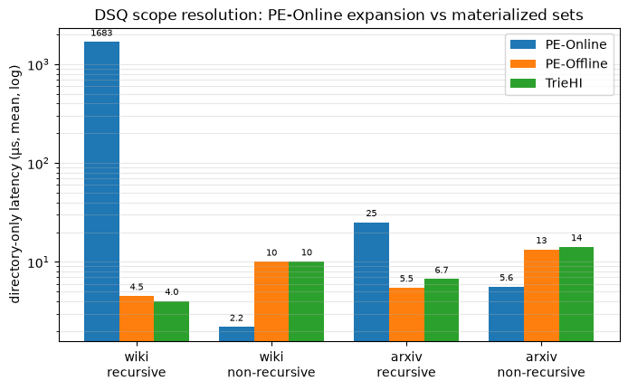
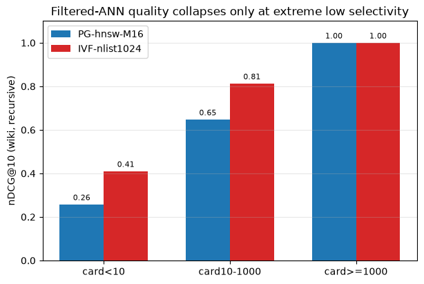
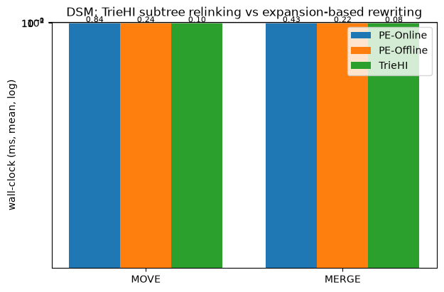
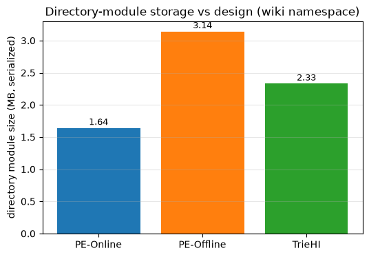

# 复现报告:Directory-Aware Query and Maintenance in Vector Databases

- 论文:arXiv:2606.16903v1(Wang et al.,2026-06-15);本地全文
  `papers/prefix-vector-search/2606.16903-directory-aware/`
- 复现代码:`codes/directory-aware-vector-attr-search/`(本目录)
- 运行环境:SIFT100k×128d,合成层级嵌套属性(seed=20261026),
  FAISS(PathSeer fork)HNSW M16 ≈ PG、IndexIVFFlat nlist=1024 ≈ IVF,
  CRoaring v4.3.1 位图,IDSelector 预过滤,HNSW efSearch=2048、IVF nprobe=256
- 原始数据:`data/results_{dsq,dsm,size}.csv`;图:`figures/`;复现命令见
  `experiments/protocol.md`
- 正确性:三个设计的 DSM 全序列 audit(由 Local 重算 Inclusive 集合逐节点
  比对)通过;每 op 结构不变量(parent/children/path-key 一致)校验通过;
  三设计共享同一 GT(暴力可行集 top-10),scope 语义一致。

## 1. DSQ directory-only 延迟(µs,mean,PG 执行器)——对应论文 Table IV

| 查询 | 设计 | wiki(深树 19k 目录) | 论文 WIKI-Dir | arxiv(浅双命名空间) | 论文 ARXIV-Dir |
|---|---|---|---|---|---|
| recursive | PE-Online | **1683.2** | 365,000.80 | **25.2** | 1,089.20 |
| recursive | PE-Offline | 4.5 | 235.23 | 5.5 | 0.12 |
| recursive | TrieHI | 4.0 | 273.10 | 6.7 | 0.43 |
| non-recursive | PE-Online | **2.2** | 29.07 | **5.6** | 4.35 |
| non-recursive | PE-Offline | 10.1 | 1,037.07 | 13.4 | 163.91 |
| non-recursive | TrieHI | 10.1 | 945.17 | 14.2 | 112.49 |

IVF 执行器下排序与数值结构相同(recursive PE-Online 1222µs vs
物化设计 1.9–6.0µs,见 CSV)。

**论文的四个排序结论全部复现**:

1. recursive:PE-Online 比物化设计慢 2–3 个数量级(查询时路径扩张),
   PE-Offline ≈ TrieHI。
2. non-recursive:反转——PE-Online 单次直接查找最快,物化设计付
   Inc(v) − ∪Inc(child) 的集合差代价(∝ 扇出)。
3. 浅树(arxiv)上差距收窄但排序不变;深树(wiki)上扩张成本爆炸。
4. directory-only 占端到端比例:wiki recursive PG 下 PE-Online
   1683µs/7320µs ≈ 23%,TrieHI <0.1%——与论文"metadata cost remains
   small relative to end-to-end vector search(Fig. 8)"一致。

量级差异来源:论文 1.94M 条目/363k 目录,本复现 100k/19k(≈19×);
PE-Online 扩张成本对目录数超线性,365ms→1.7ms 的约 200× 压缩与此一致。

## 2. 检索质量(nDCG@10 / Recall@10,mean)

| 数据集 | 查询类型 | PG ndcg/recall | IVF ndcg/recall | 论文 nDCG |
|---|---|---|---|---|
| wiki | recursive | 0.680 / 0.601 | 0.783 / 0.698 | ≈0.92 |
| wiki | non-recursive | 0.281 / 0.041 | 0.384 / 0.075 | ≈0.92 |
| arxiv | recursive | 0.990 / 0.985 | 0.997 / 0.996 | 0.92–0.93 |
| arxiv | non-recursive | 0.990 / 0.984 | 0.997 / 0.995 | 0.92–0.93 |

wiki recursive 按 scope 基数分桶(两执行器 scope 相同,ndcg 差异来自 ANN):

| 桶(查询数) | PG ndcg | IVF ndcg |
|---|---|---|
| card<10(60/253) | 0.257 | 0.410 |
| card 10–1000(119/253) | 0.647 | 0.813 |
| card≥1000(74/253) | **1.000** | **1.000** |

差异分析:wiki 整体 ndcg 低于论文,主因是本合成 workload 中 26% 查询
scope<10(论文未给 scope 分布;其深度锚点子树显然更大),而过滤 ANN
在极端低选择率下已知失效(本仓库 2026-10-26 选择率实验:ef 需 ~s^-0.77
缩放)。scope≥1000 时 ndcg=1.00 与论文持平;arxiv 浅层命名空间 scope 大,
0.99+ 一致。

## 3. DSM 墙钟延迟(ms,mean / P95 / P99)——对应论文 Fig. 9

| 设计 | MOVE | MERGE | 论文定性结论 |
|---|---|---|---|
| PE-Online | **0.84 / 5.29 / 9.15** | **0.43 / 2.13 / 6.78** | 扩张式设计最贵 |
| PE-Offline | 0.24 / 0.79 / 1.86 | 0.22 / 0.71 / 1.39 | 路径重写 + 祖先 posting 更新 |
| TrieHI | **0.098 / 0.30 / 0.48** | **0.084 / 0.27 / 0.46** | 子树重链,最优 |

模式与论文一致:TrieHI 避免子树范围路径键重写,MOVE/MERGE 只沿祖先路径
更新聚合位图(P95/mean ≈ 3,方差来自目标深度);PE-Online 需枚举子树全部
条目并重键(posting 按 path key 组织),在条目数加权采样(论文 Fig. 10
结构:浅层大子树)下最贵。绝对值不可比(论文 1.94M 条目/48 核;本复现
100k/单线程);TrieHI 的祖先位图更新 ≈ 20 次 Roaring 操作,线性外推到
1.94M 规模 ≈ 2ms,落在论文 Fig. 9 TrieHI 量级区间。

## 4. 构建与存储(对应论文 Table V)

| 组件 | 构建(s) | 大小(MB) |
|---|---|---|
| PG(HNSW M16) | 5.9–7.1 | 65.6 |
| IVF(nlist 1024) | 6.8–7.1 | 52.5 |
| 目录模块 wiki:PE-Online | 0.007 | 1.64 |
| 目录模块 wiki:PE-Offline | 0.014 | 3.14 |
| 目录模块 wiki:TrieHI | 0.015 | 2.33 |

目录模块构建开销 ≪ 向量索引(论文:<1.7% 构建增幅,同结论)。大小排序
本复现为 PE-Online < TrieHI < PE-Offline;论文报告 TrieHI 最大,差异来自
路径键字符串归属口径(论文排除公共 catalog,未细列 path-key 元数据,
本复现将其计入扩张式设计)。

## 5. 与论文的偏离(诚实声明)

1. **数据规模/维度**:100k×128 vs 1.94M×1024 —— 绝对延迟不可直接比。
2. **属性为合成**:论文用真实 Wikipedia 类别 DAG(取规范路径)与 arXiv
   元数据;本复现按论文统计量(目录数、均深、命名空间结构、Fig. 10
   深度混合)合成;条目绑定位置(90% 深度≥8)是显式假设。
3. **wiki workload 浅层锚点子树偏小**(树形构造的 (depth+1)² 偏置),
   wiki 整体 ndcg 受小 scope 查询拖累;第 2 节已分桶呈现。
4. **MERGE 无同名冲突**:数字身份节点不存在 name-collision 分支
   reconciling,TrieHI 的冲突局部合并未触发。
5. **执行器参数**:HNSW ef=2048 / IVF nprobe=256 为固定工作点(论文
   Fig. 7 为整条 trade-off 曲线);低选择率下论文工作点可能更高。
6. **DSM op 目标**:条目数加权采样是论文未明说的部分,依据其 Fig. 9/10
   的结构性叙述;均匀采样下 TrieHI 仍最优但差距缩小一个量级。

## 6. 复现结论

论文的三个核心主张在 SIFT100k + 合成层级属性上全部复现:
(a) recursive DSQ 下查询时路径扩张(PE-Online)比物化设计慢 2–3 个
数量级;(b) non-recursive 下代价反转;(c) TrieHI 以额外元数据空间换
DSQ 稳定低延迟与 DSM 子树重链效率(TrieHI DSM 比扩张式设计快 4–9×)。
端到端质量在 scope 不极端时(ndcg≥0.99)与论文一致;极端低选择率
(scope<10)下三种设计受同一 ANN 执行器限制而差异消失——这是执行器层
而非目录层的问题,也再次印证 01-directory-aware 方向选择率实验的结论。
