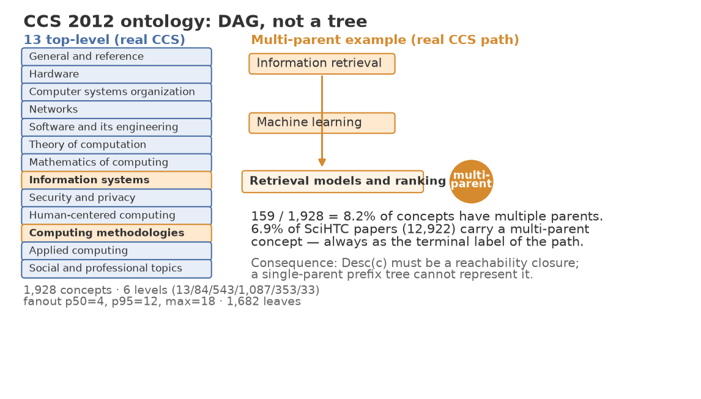
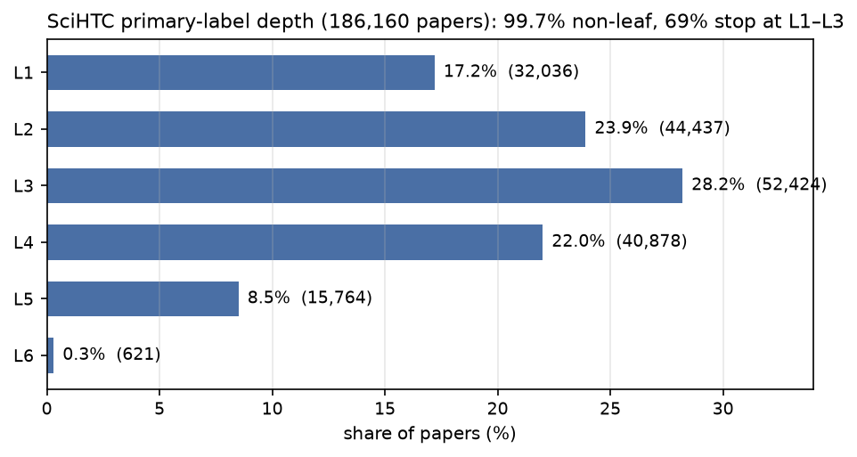

# CCS Concepts 背景与真实数据事实（2026-10-27）

用途：把研究问题背景从合成层级属性切换到 ACM CCS 真实分类体系。本文档只记录**已核实**的事实（本地解析/下载），未核实处明确标注。

## 1. CCS 是什么

ACM Computing Classification System（CCS）是 ACM 用于组织、索引和检索计算机科学文献的分层分类体系（2012 版取代 1998 版）。作者投稿时从 <https://dl.acm.org/ccs> 选择概念并标注相关度（High/Medium/Low），生成的 CCSXML 插入摘要与关键词之间，用于文献检索与审稿人匹配。

它与我们的问题定义（层级 scope 内的向量 top-k）天然对应：**概念树 = 目录树，论文 = 向量 + 概念绑定，CCS 概念查询 = DSQ**。但有一个决定性的结构差异，见 §2。

## 2. 本体结构：CCS 2012 是 DAG，不是树（实测）

来源：SciHTC 仓库内保存的 `dl.acm.org/ccs/ccs_flat.cfm` 页面（`HierarchyTree/CCS 2012.html`，438 KB；ACM 官方站点直连 403，本地镜像可用）。解析脚本见下。

| 指标 | 实测 |
|---|---|
| li 节点实例 | 2,113 |
| 唯一概念 ID | **1,928** |
| **多父概念（DAG 边）** | **159 个（8.2%）**，同一 id 在扁平列表中重复出现 |
| 层级 | 6 层：L1 13 / L2 84 / L3 543 / L4 1,087 / L5 353 / L6 33 |
| 顶级类目 | 13 个（General and reference … Social and professional topics），与 ACM 标准一致 |
| 有子节点的概念 | 412；扇出 p50=4、p95=12、max=18 |
| 叶子 | 1,682 |

**结论**：官方 HOWTO 称 "six-level tree"，但本体是 **DAG**（约 8% 概念有多个父）。这直接修正了我们此前所有实验的前提（合成树/单亲前缀树）：

- `Inc(v) = Local(v) ∪ ⋃_{child} Inc(child)` 的单亲递推失效，必须改为**可达闭包**；祖先链变成祖先集合（DAG 下可大于最大深度）。
- TrieHI 的"路径遍历 + 聚合集访问"在 DAG 下需要多路径聚合（同一对象经多条路径到达同一祖先，需去重）。
- PE-Online/Offline 的"子树 key 枚举" = DAG 后代集合枚举；祖先物化的标签数 = 可达祖先数（可能远大于树深）。
- **NodeANN 的分区互斥性破坏**：对象可同时属于多个节点（多父路径上每层都是它的 scope），要么复制进多个节点索引（存储 × 路径数），要么只存直接概念、查询时枚举后代（退回扇出）。
- 标签编码（方案 E）：标签基数 = 2 × 概念数 ≈ 3,856（**这个规模反而落在 Filtered-DiskANN 的"数千标签"范围内**，与 WIKI 的 83 万形成鲜明对比）。

## 3. SciHTC 数据集（真实 CCS 论文标注）

出处：Sadat & Caragea, EMNLP 2022, "Hierarchical Multi-Label Classification of Scientific Documents"（arXiv:2211.02810）。仓库 `github.com/msadat3/SciHTC`。

| 项 | 事实 |
|---|---|
| 论文数 | **186,160**（train 148,928 / test 18,616 / dev 18,616；README 写 184,160 与文件行数不符，以文件为准） |
| 类别数 | 1,233 个 CCS 类别（作者实际标注用到的），本体共 1,928 概念 |
| 公开内容 | ACM paper ID + 层级类别路径（CSV，全部 | 6 层与仅 | 2 层两份） |
| 需申请内容 | 标题/摘要/关键词（邮件申请，或按 ACM proceedings + 官方脚本重建） |
| 标注格式 | `id,Category`，Category = `CCS->L1->L2->...->Ln`；**每论文一条路径**，"多标签" = 路径上每层都是一个标签（与我们的祖先继承语义一致） |
| 数据瑕疵 | **17,223 行（9.3%）用 `~` 破坏层级**（如 `Applied computing~Agriculture`，作者自定义细分不在 CCS 树中）；官方策略是截断到一致前缀。按此处理后得到 830 个路径概念（官方报 1,233 类别，口径不同，未核实） |
| README 笔误 | README 写 184,160 篇，但 train/dev/test 文件合计 **186,160** 篇（论文摘要亦为 186,160）；以文件为准 |

## 4. 真实标签分布（实测，train+dev+test 全量 186,160 篇）

| 主标签深度 | 论文数 | 占比 |
|---|---|---|
| L1（顶级） | 32,036 | 17.2% |
| L2 | 44,437 | 23.9% |
| L3 | 52,424 | 28.2% |
| L4 | 40,878 | 22.0% |
| L5 | 15,764 | 8.5% |
| L6（叶子层） | 621 | 0.3% |

- **主标签非叶比例 = 99.7%**（几乎全部论文的主标签停在中间节点）。
- 每论文标签数（按"路径上每层都是标签"计）：均值 2.82。
- 用到的（层,类别）标签对 1,671 个；终点类别 1,602 个（覆盖本体的 83%）。
- 热门终点：Human computer interaction (HCI) 9,823、Human-centered computing 8,761（L1！）、Information systems applications 3,883、Information retrieval 3,722、Data mining 2,609。
- **多父（DAG）概念的实际影响**：159 个多父概念中，**12,922 篇论文（6.9%）的标签路径包含至少一个多父概念，且全部出现在路径终点**。热门：Virtual reality 1,259、Information extraction 1,061、Computer supported cooperative work 953、Digital libraries and archives 880、Parallel programming languages 789、Mathematical optimization 737。含义：DAG 语义下这 6.9% 的论文应同时出现在其所有父概念的后代 scope 中，而 SciHTC 只保存了作者选的一条路径——**查询结果集会因此出现约 7% 的归属差异**，需要在转 fixture 时显式处理。

**与合成假设的对比（重大偏离）**：

| 维度 | 合成 CCS 形状 fixture（prep_ccs.py / gen_workload.py） | 真实 SciHTC |
|---|---|---|
| 结构 | 单亲树（depth 5–6，branching 4） | **DAG**（8.2% 多父）、6 层、扇出 p50=4 |
| 绑定深度 | 90% 在深节点（≥depth 8/14） | **69% 在 L1–L3**（浅节点） |
| 主标签是否叶子 | 多数在深叶附近 | **99.7% 非叶** |
| 每对象标签数 | 1（单绑定） | 2.82（路径节点数） |
| 规模 | 100k–1M 对象 | 186,160 论文（无向量，需自建 embedding） |

这两条（DAG、浅绑定）会**显著改变测量结论**：真实 CCS 上递归 scope 更大更稠密、目录树更浅、多父引起的重复计入更明显——此前合成数据上"深锚小 scope 导致低 recall / PE-Online 大展开"的现象不会原样出现。

## 5. 对四个方案的具体影响

| 方案 | 在 CCS DAG 下的变化 |
|---|---|
| PE-Online | 递归 = DAG 后代集合枚举（多父导致 key 重复需去重）；树浅，展开成本预计远小于 WIKI |
| PE-Offline | 祖先物化条数 = 可达祖先数 ≈ 路径深度（CCS 路径 ≤6，**反而比 WIKI 的 13 小**） |
| TrieHI | `Inc(v)` 需 DAG 闭包；DSM MOVE 一棵子树时要处理"多父对象"的归属（对象可能同时在其他父下） |
| NodeANN | 对象按路径复制进多个 rec scope → 索引副本数 = 路径深度（2.82 平均）；分区互斥不再成立 |
| 方案 E（标签编码） | 标签基数 ≈ 3,856（3,856 落入 Filtered-DiskANN 数千标签范围）；每点标签数 3.8（路径+1）——**规模匹配度远好于 WIKI** |

## 6. 数据与复现

- CCS 本体解析：`/tmp/SciHTC/HierarchyTree/CCS 2012.html`（可复制到 `data/` 或由 SciHTC 仓库获取）
- SciHTC labels：`gdown --folder 1uRh5A-GpFRxA_QLzgN_D-y8G5j6JpZPJ` → `IDs_and_categories/*.csv`（公开）
- 论文文本（标题/摘要/关键词）：需邮件申请或 ACM proceedings 重建——**当前缺口**
- 向量：需自建 embedding（本地无 GPU；186k 篇摘要 × 1024d 用 CPU 可跑但耗时，或用更小模型）

## 7. 待办

1. 将 CCS DAG 转成我们的 fixture 格式（tree/bindings/workload），**保留多父**（当前 repro 的 Tree 只支持单父，需扩展或加多父适配层）。**已部分完成**：`scripts/build_scihtc_fixture.py` 用标签路径建树（**830 节点**、6 层；初版误把 `~` 段当独立概念产生 834 个假节点，已修正），26 个概念的冲突父被折叠（记录在 meta.json）。
2. 统计 SciHTC 中**多父概念的实际使用频率**（已完成：12,922 篇 / 6.9%）。
3. 论文文本获取 → embedding → 真实 CCS 端到端实验（见 §8）。
4. 合成 fixture 增加 DAG + 浅绑定选项，与真实分布对齐。

## 8. 数据获取与文本重建（实操）

### 8.1 SciHTC 文本（标题/摘要/关键词）

已实测三条路径：

| 路径 | 做法 | 状态 |
|---|---|---|
| **A. 邮件申请（推荐）** | 写信给 `msadat3@uic.edu` / `sadat.mobashir@gmail.com` / `cornelia@uic.edu`，提供姓名、单位、当前职位，说明研究用途 | 未执行（需人工发信）；作者在 README 明确提供此通道 |
| **B. ACM proceedings 重建（官方脚本）** | 向 ACM 申请研究用途的 proceedings 数据，然后：`python ExtractData.py --proceedings_loc <ACM proceedings 目录> --output_csv_loc ExtractedData.csv` → `python Get_splitwise_title_abstract_keywords.py --extracted_data_loc ExtractedData.csv --directory_for_splitwise_ids_and_categories IDs_and_categories --output_directory out/` | 依赖 ACM 授权，未执行 |
| **C. 公开元数据重建（实测受阻）** | 假设 ACM ID = DOI suffix → `10.1145/{id}` → OpenAlex/Crossref 取摘要 | **实测失败**：3 个样本 ID（1808918/3079388/225078）在 OpenAlex、Crossref 均 404；Semantic Scholar 无 `ACM:` 外部 ID 支持且限流；ACM DL 全站 403。**结论：ACM ID ≠ DOI suffix，公开重建先需 ACM ID↔DOI 映射表，该映射只能从 ACM 侧获得——因此路径 A/B 是唯一可行通道。** |

**拿到文本后的替换步骤**（管线已就绪）：`bge-m3`（与 WIKI 一致）或 `mxb-ai-embed-large-v1` 编码 186,160 篇摘要 → 1024d，写 `data/scihtc/base.f32` + 查询向量 `test.f32` → `--dim 1024` 重跑 `--mode all --executor all3`，所有图/表自动更新。当前用 64d 随机占位向量跑通的是**延迟/结构/维护**数字，质量指标无意义（已在报告标注）。

### 8.2 WIKI-Dir 全量向量（7.96 GB，未完成）

- 官方文件页：<https://drive.google.com/file/d/1PBmCKaUmEYc1BGU_TBcICRaIqbc3xRuQ/view>
- 命令：`gdown 1PBmCKaUmEYc1BGU_TBcICRaIqbc3xRuQ -O data/real_fixtures/wiki/corpus_vectors.fvecs`
- 现状：Drive 触发"too many users" 24h 配额，已得 4.22 GB（1,029,778 条完整记录，`corpus_vectors.partial` 保留）
- 恢复：配额恢复后重跑上述命令（`gdown -c` 对此大文件**无效**，只能完整重下，约 45–75 min）；或浏览器打开文件页手动下载（同样受配额）
- 复用残片：`N=$(( $(stat -c%s partial) / 4100 )); head -c $((N*4100)) partial > usable.fvecs`（4100 B = 1024d fvecs 单记录，含 4 B 维头）
- 影响：目录解析/DSM 已用全量 1.94M 目录完成；只有 **ANN 端到端**用 1M 子采样（scope 稀 5–7 倍，绝对 recall 不可对齐论文，相对排序有效）
