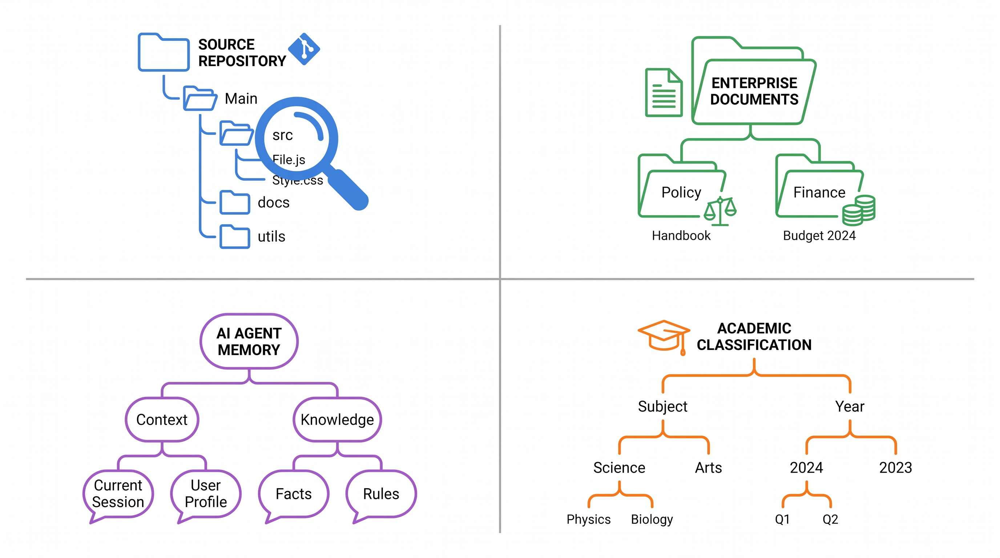
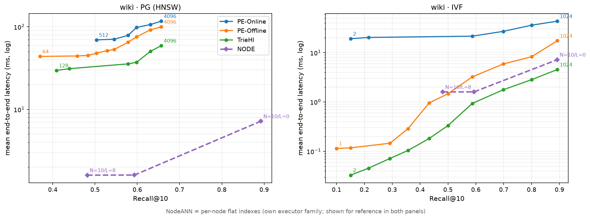
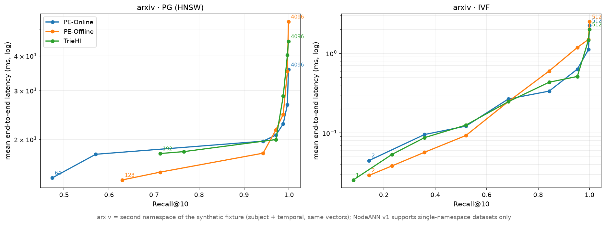
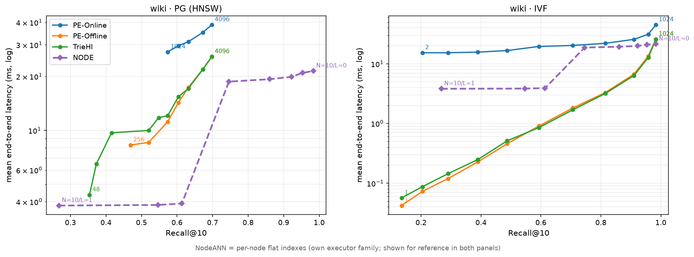
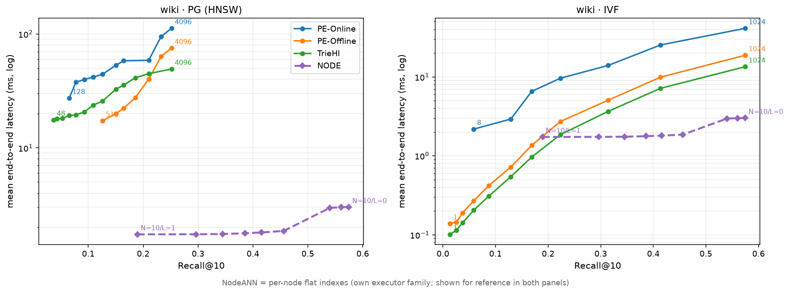
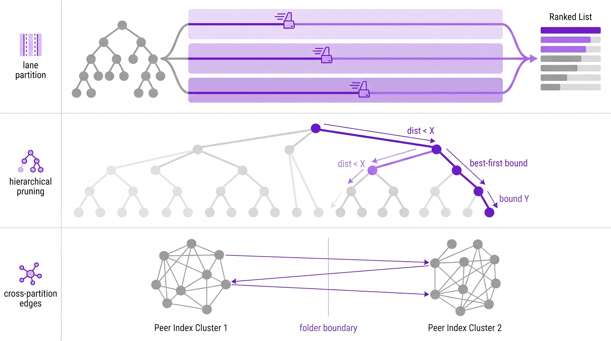

# 分层属性向量混合搜索：问题定义、方案对比与优化路线

日期：2026-10-27。范围：`researches/nested-attr-vector-search/01-directory-aware-acceleration/` 的 TrieHI 复现、选择率测量与属性分区索引 baseline。数据与图均来自本地实测，未核实处单独标注。

**当前结论边界**：下文§4.1–4.7保留历史记录，不支持“NodeANN总是更快”或“目录解析是唯一瓶颈”的概括。完整WIKI两类基线已重跑，见§4.8及[完整报告](2026-10-28-exps/report.md)：局部全HNSW递归macro recall=0.999559、6.839 ms；全列表IVF达到recall=1、25.126 ms。默认threshold=0保持不变，Flat仅作对照。已修复转换脚本把int位模式数值转换的问题，并确认旧`data/real/test.f32`受影响；另修复457行约束对456条向量的越界，以及NODE双重scope解析。旧ANN质量/延迟不可与新结果直接连线；未逐一核查的历史实验不推断污染范围，向量无关的目录/DSM记录不自动失效。

---

## 1. 研究问题

### 1.1 形式化定义

数据：向量集合 $D=\{x_i\in\mathbb{R}^d\}$，每个对象绑定一个**目录节点** $h(x_i)\in V$（前缀树节点，非叶可绑定），节点 $v$ 的递归 scope 为子树全体成员：

$$
S_{\text{rec}}(v)=\{\,x \mid h(x)\in \mathrm{Desc}(v)\,\},\qquad
S_{\text{nrec}}(v)=\{\,x \mid h(x)=v\,\}.
$$

查询：$(q, v, \text{rec})$，返回 scope 内按距离 $d(q,\cdot)$ 最近的 $k$ 个对象。

**优化目标**（四维同时约束）：① recall@k 对齐 scope 内精确 top-k；② 端到端延迟（含 scope 解析）；③ 构建/存储开销；④ 结构可维护性——MOVE/MERGE 后三种表示必须解析出同一节点集与成员集（语义等价）。

### 1.2 与相邻问题的边界

- **不是 vector join**：单查询、top-k 输出、无 pair 语义；与 A 类几何向量连接不混同。
- **不是普通 filtered ANN**：谓词是**拓扑的**（祖先/后代/子树），不是 flat 标量；scope 解析有独立成本可测（directory-only latency）。
- 目录 scope 层独立于 ANN 布局：同一 scope 可喂给 PG（图索引）或 IVF（分区倒排）。

### 1.3 三类目录表示（论文空间）

| 表示 | 存储 | 递归查询 | 非递归查询 | MOVE |
|---|---|---|---|---|
| PE-Online | 每 entry 1 条父路径 posting | 查询时枚举子树 key + posting OR | 1 次 path 查找 | 子树 key 重映射 O(m_u) |
| PE-Offline | 每 entry t 条祖先 posting | 1 次祖先 key 查找 | 全集 ∖ 子集差 | O(m_u) 键重映射 + O(t) 次祖先集合操作 |
| TrieHI | trie + 每节点 inclusive 位图 | 路径遍历 + 1 次聚合集访问 | 局部集合差 | 子树重挂 + 祖先聚合维护；当前实现还遍历后代更新 depth |

### 1.4 应用场景

| 场景 | 分层结构 | scope 查询示例 |
|---|---|---|
| 代码库语义检索 | `/src/core/payment.py` 前缀即 scope | "在 `/src/core/` 子树内找相似实现" |
| 企业文档管理 | HR/Policies、Finance、Legal/Archive | "HR 全部政策（含历史归档）中与 query 最相关的 10 篇" |
| Agent 记忆（OpenViking） | `viking://resources/...`、memories/skills | 先定位用户/会话 scope，再 scope 内语义检索 |
| 学术论文检索 | arXiv subject（`/cs/AI/`）+ temporal（`/2024/05/`）双命名空间 | "2024 年 5 月的 cs.AI 论文里最相关 10 篇" |
| 电商品类 | 品类树 × 属性 facet | "手机 > 拍照旗舰 子树内相似商品" |
| **ACM CCS 论文检索** | CCS 2012 本体（**DAG**，1,928 概念/6 层，8.2% 多父） | "Information systems → Information retrieval 子树内与 query 最相关的 10 篇论文"；SciHTC 提供 186,160 篇真实标注 |

CCS 背景的实测事实（本体 DAG 结构、SciHTC 标签分布、6.9% 多父归属、与合成假设的偏离）见 [`2026-10-27-ccs-background-and-data.md`](2026-10-27-ccs-background-and-data.md)。关键影响：CCS 是 DAG 而非树，四方案均需适配多父语义；真实标注 99.7% 落在非叶节点、69% 停在 L1–L3（与合成数据的深绑定假设相反）。

---

## 2. 两类基线方案

所有方案按"过滤发生在哪一层"分为两类：

| 类别 | 机制 | 成员 | 过滤位置 | 目录层成本 |
|---|---|---|---|---|
| **类 A：全局 ANN + 属性过滤** | 一个 HNSW 或 IVF 索引覆盖全部 $N$ 个对象；目录层解析 scope 为候选 ID 集，交给全局 ANN 过滤结果资格 | **PE-Online**：完整路径字符串键，递归枚举后代键并集；**PE-Offline**：扁平路径键上的祖先集合物化；**TrieHI**：原生树节点与聚合 ID 集合 | `IDSelector` / `sel` 限制结果资格；不能据此推断不合格节点一定不参与图遍历 | PE-Online 枚举；PE-Offline/TrieHI 聚合集取用 |
| **类 B：节点树 + 局部 ANN** | 每个含条目的节点维护局部 ANN；枚举候选节点，各搜 top-k 后按距离合并全局 top-k | **NodeANN**：默认 `--node-hnsw-threshold 0`，所有非空节点用 HNSW；Flat/混合仅作对照 | 候选节点天然限定条目范围，无全局 ID 过滤 | 子树候选节点枚举及局部搜索调度 |

**维护语义的差别（MOVE：$u \to w$）**：PE-Online 的目录身份是完整路径字符串，必须枚举移动子树的 $m_u$ 个目录键并重映射；不能把它当作可整体移动的原生树节点。PE-Offline 同样要做子树键重映射，并从旧祖先集合移除、向新祖先集合加入子树成员。这里 $O(t)$ 仅表示受影响祖先的集合操作次数，不含位图大小、复制及差/并运算成本；键重映射的 $O(m_u)$ 也不计字符串长度成本。TrieHI 可重挂子树而无需改写所有后代路径键，但仍需维护新旧祖先聚合集。当前公共 `Tree::relink` 还遍历后代更新 `depth`，因此 TrieHI 和 NodeANN 的整个 MOVE 实现都不能宣称 $O(1)$；NodeANN 的局部索引随节点保留，不需因重挂重建。以上设计语义参照[论文相应说明（第 5 页）](https://www.alphaxiv.org/abs/2606.16903?page=5)，实现成本与论文的结构操作描述须区分。

### 2.1 类 A：三种目录表示 × 全局执行器（PG / IVF）

- **PE-Online**：只存每个 entry 的直接父路径 posting；递归查询时用辅助目录索引枚举子树路径键，逐键取 posting 并集。存储最小，查询随子树目录基数 $m_q$ 线性增长。
- **PE-Offline**：摄入时物化每个 entry 的全部祖先路径 posting；递归 = 单键查找，非递归 = 全集减直接子集。存储 $O(n \cdot \bar d)$。MOVE 包含子树路径键重映射与新旧祖先集合维护；$O(t)$ 是集合操作次数而非总时间，实际成本还依赖位图规模。
- **TrieHI**：目录拓扑保存为原生前缀树，节点持 segment/children/parent/inclusive-IDs（Roaring）；不变量 $\mathrm{Inc}(v)=\mathrm{Local}(v)\cup\bigcup_{c}\mathrm{Inc}(c)$。递归 = 路径遍历 + 1 次聚合集访问；MOVE = 重挂 + 新旧祖先聚合更新。

### 2.2 类 B：NodeANN（节点树 + 每节点局部索引）

- 构建：每个非空节点一个局部索引，保存向量副本与全局 ID 映射；条目数 > `--node-hnsw-threshold` 时用 HNSW，否则用 Flat，默认 0 = 所有非空节点用 HNSW。Flat 与混合配置是对照，不替代用户要求的局部 ANN 基线。
- 查询：递归 = 枚举锚点子树中所有含 item 的节点，各搜 top-k，再按距离合并全局 top-k；非递归只搜锚节点。实现可用每节点 top-N 参数扫描，N≥k 且候选节点完整时不因局部结果截断漏掉全局 top-k；局部 ANN 自身仍可能近似。`--node-limit` 按质心距离截断候选节点，会额外引入候选召回损失，应与全候选基线分开报告。
- 目录解析为子树节点枚举，不构造全局候选位图；MOVE 保留局部索引，但公共树重挂仍有后代 depth 更新成本，见上文。

### 2.5 方案 E：目录 → 单标签过滤 ANNS 的归约

目录范围查询可以归约为标准的单标签过滤 ANNS：把对象绑定的目录节点换成它的**递归范围标签**与**非递归精确标签**。设 $h(x)=u$：

$$
F_x=\{(\mathrm{rec},a): a\in \mathrm{Anc}(u)\cup\{u\}\}\ \cup\ \{(\mathrm{nrec},u)\}.
$$

则 $x\in S_{\mathrm{rec}}(v)\iff(\mathrm{rec},v)\in F_x$，$x\in S_{\mathrm{nrec}}(v)\iff(\mathrm{nrec},v)\in F_x$（`rec`/`nrec` 前缀防止两种语义互撞）。注意我们的 $S_{\mathrm{rec}}$ 含 $v$ 自身绑定（$\mathrm{Inc}(v)$ 含 $\mathrm{Local}(v)$），所以递归标签沿祖先链**含自身**。

**等价性（本项目的观察）**：对任何**谓词无关**后端（HNSW / IVF / ACORN / NaviX / FAISS 的 FilteredHNSW），标签 $(\mathrm{rec},v)$ 的倒排点集 $\equiv$ PE-Offline 的 $\mathrm{Inc}(v)$ 位图；$(\mathrm{nrec},v)$ 的点集 $\equiv\mathrm{Local}(v)$。证明：$(\mathrm{rec},v)\in F_x \iff h(x)\in\mathrm{Desc}(v)\cup\{v\}$，即 PE-Offline 的祖先物化定义。∎

由此得到两个直接推论：

1. **标签展开的存储与 PE-Offline 同构**：$O(n\cdot\overline{d})$ 条标签 $\equiv$ 祖先 posting 物化。wiki 真实数据 $\overline{d}\approx 13$、1.94M 对象 → ≈2500 万条标签项。
2. **查询阶段没有增量**：标签编码 + 谓词无关后端的查询结果就是已测过的 PE-Offline 行（同一 scope 位图、同一 HNSW/IVF 搜索）。**方案 E 的全部潜在增量在图构建阶段——标签感知剪枝**（FilteredVamana 的 FilteredRobustPrune、StitchedVamana 的每标签子图），这才是需要新后端才能验证的部分。

**规模错配（关键挑战，已实测）**：Filtered-DiskANN 论文的实验规模是"数千种过滤标签、每点关联数十至数百个标签"。用 `scripts/tag_scale_check.py` 从现有 fixture 直接核算：

| 数据集 | 目录节点 | 有绑定节点 | 标签基数（rec+nrec） | 每对象标签数 | 标签总条目 |
|---|---|---|---|---|---|
| WIKI-Dir 真实 | 468,031 | **363,467** | **831,498** | 15.58（rec 13.58+1） | 28.3 M |
| SIFT100k 合成 | 19,000 | 18,889 | 37,889 | 16.45 | 1.5 M |
| ARXIV subject | 168 | 159 | 327 | 5.22 | 24.1 M（多绑定） |
| ARXIV temporal | 432 | 397 | 829 | 5.00 | 11.1 M |

结论：**每对象标签数（5–16）落在论文的"数十"范围内，但 WIKI 的标签基数（83 万）超论文规模两个数量级**；ARXIV（327/829 标签）完全落在论文范围内。由此：
- **StitchedVamana 在 WIKI 不可行**（46.8 万 rec 子图）；在 ARXIV 可行（168/432 子图），可直接对比。
- **FilteredVamana 在 WIKI 的剪枝质量待验证**：每标签平均仅 ~4 个对象（1.94M/468k），标签共现极稀疏，FilteredRobustPrune 能否选出"过滤后仍连通"的边是开放问题。

**数据口径澄清**：WIKI trie 的 468,031 节点中有绑定的恰好 **363,467** 个——与论文报告的 "363,467 directories" 精确一致；差集是仅作路径前缀存在的中间节点（PE-Online/Offline 的 path_key 需要，TrieHI 可折叠）。此前记录为"目录数多 28.7%"的偏离应更正为**口径差异**而非结构差异。

**维护维度（决定性对比）**：MOVE 一棵子树时，标签编码需要重写子树内**每个对象**的祖先链标签（$O(n_{\text{sub}}\cdot d)$），并重剪受影响的图边；而：

| 方案 | MOVE 开销 | 是否触对象 |
|---|---|---|
| PE-Online / PE-Offline | $O(m_u)$ 目录 key 重映射 | 否 |
| TrieHI | $O(t)$ 祖先位图更新 | 否 |
| NodeANN | $O(1)$ 指针重挂（索引随节点走） | 否 |
| **标签编码 + FilteredVamana** | $O(n_{\text{sub}}\cdot d)$ 标签重写 + 边重剪 | **是** |

**取舍轴**：用户最后指出的对偶成立——「展开祖先标签（查询单标签、更新贵）」vs「只存直接绑定、查询时拆子树多节点合并（更新便宜、查询扇出）」；**后者正是 NodeANN baseline**。两者间的取舍是更新成本与查询扇出的交换，本方向的实验矩阵应把两者放在同一 scope 语义与同一 GT 下对比。

**近似性边界**：标签编码 + FilteredVamana 仍是 recall@k 近似（不保证精确 top-k）；NodeANN v1（每节点 Flat）是精确的。若要求严格精确，只能 scope 内精确扫描或 NodeANN-Flat。

**实现计划（待批准）**：本地 PathSeer fork 只有 `IndexACORNFlat` / `IndexFilteredHNSW`（查询期 bool 过滤，非标签感知）/ `IndexNaviX`，**没有 FilteredVamana/StitchedVamana**。要验证方案 E 需引入 Microsoft DiskANN，并用现有 `wiki_tree.txt`+bindings 直接导出 rec/nrec 标签表（导出脚本纯数据转换）。

---

## 3. 实验设置

**历史主结果所用向量数据集（不代表两类基线已按统一配置重跑）**

| 数据集 | 规模 | 目录结构 | 查询 | 完整性 |
|---|---|---|---|---|
| SIFT100k 合成 | 100k×128d | wiki 合成树 19k 目录均深 13.4 + subject/temporal | 500 + 1000 | ✓ 完整 |
| SIFT1M 合成属性 | 1M×128d | 同上（规则/seed 不变，仅放大条目） | 500 + 1000 | ✓ 完整 |
| MNIST | 60k×784d | 同上合成树 | 500 + 1000 | ✓ 完整（ann-benchmarks） |
| Fashion-MNIST | 60k×784d | 同上 | 500 + 1000 | ✓ 完整 |
| NYTimes-256 | 290k×256d（L2 归一化） | 同上 | 500 + 1000 | ✓ 完整 |
| COCO-i2i-512 | 113,287×512d（L2 归一化） | 同上 | 500 + 1000 | ✓ 完整 |
| GloVe-100 | 1,000,000×100d（L2 归一化） | 同上 | 500 + 1000 | ✓ 完整 |

**历史受限数据与当前可用性（旧记录保留）**

| 数据集 | 规模 | 限制 |
|---|---|---|
| WIKI-Dir 全量 | 1,941,679×1024d | 历史ANN曾缺全量向量；现7,960,883,900 bytes完整到齐，已完成全量两类基线，见§4.8。真实树468,031节点中363,467有直接绑定，与论文有绑定目录口径一致 |
| WIKI-Dir 1M | 1M 子采样×1024d | 历史 ANN 端到端用子采样（scope 稀 5–7 倍），保留作历史记录，不能替代新全量实验或直接对照论文绝对 recall |
| ARXIV-Dir 全量 | 2,763,543×1024d | 目录解析完整（subject 168 + temporal 432 与论文一致）；**语料向量发布方未提供**，ANN 不可跑 |
| SciHTC（CCS） | 186,160×64d 占位 | 标签/结构真实；**文本需申请**，向量为随机占位，质量指标无意义，仅延迟/结构/维护有效 |

执行器：HNSW（M16, efSearch 可扫描）≈ 论文 PG；IVF（nlist=1024, nprobe 可扫描）；NodeANN（每节点索引，`--node-hnsw-threshold` 控制 Flat/HNSW 混合，默认 0 = 全 HNSW）。GT：每查询 scope 内暴力 top-10。固定单线程、固定 seed、每点只测一次（运行间方差 DSQ ±10%，PE-Online 大子树 MOVE 方差更大，已记录）。

---

## 4. 结果

### 4.1 目录解析延迟（Table IV 对应，µs mean）

| 数据集 | 类型 | PE-Online | PE-Offline | TrieHI | 论文（WIKI / ARXIV） |
|---|---|---|---|---|---|
| WIKI 全量 1.94M | recursive | **1964.9** | 2.57 | 3.22 | 365000 / — |
| WIKI 全量 | non-recursive | **0.95** | 44.2 | 50.1 | 29.07 / — |
| ARXIV 全量 2.76M | recursive | **852.2** | 8.93 | 9.66 | — / 1089.2 |
| ARXIV 全量 | non-recursive | **6.27** | 30.6 | 31.4 | — / 4.35 |

排序在历史记录的 4/4 组与论文一致。绝对值小于论文（目录结构差异：468k vs 363k 节点、浅层展开集小一个量级）。PE-Online 的递归解析随子树展开增大，但目录层数据本身不能证明它决定所有端到端延迟；还需结合向量搜索与调度的分项计时。

### 4.2 DSM（Fig 9 对应，ms mean，2000 ops）

| 运行 | MOVE：PE-Online / PE-Offline / TrieHI | MERGE |
|---|---|---|
| WIKI 全量 1.94M | 38.1 / 14.9 / **2.75** | 0.077 / 0.431 / 0.120 |
| WIKI 1M 子采样 | 17.1 / 5.90 / 2.38 | 0.039 / 0.129 / 0.095 |
| SIFT1M 合成 | 7.87 / 1.25 / **1.14** | 5.11 / 1.42 / 1.28 |

TrieHI 的子树重链在真实深树（max depth 31）上稳定最优；PE-Online 的 MOVE 随子树 entry 数增长且方差大。

### 4.3 端到端质量-延迟（帕累托，加密超参数网格）

每数据集一张图（1×2：PG / IVF 两个执行器，横轴 Recall@10、纵轴延迟对数轴；PG 扫 ef 15 档、IVF 扫 nprobe 11 档；NodeANN 叠加为紫色虚线，双轴 limit×N 共 14 点，首尾点标注参数值）：

读图要点：
- 三设计在同一执行器参数下 recall 逐点相同（scope 语义等价、同一 GT），曲线按 y 分层——**目录表示只移动延迟轴，不改变质量**。
- 真实 1M：PE-Online 在 PG 子图呈高位平台（目录展开 0.6–2.4 ms 固定成本压制 recall 收益）；TrieHI/PE-Offline 曲线在其下方贯穿 recall 全区间。
- **NODE（紫色虚线）呈现效率-精度 trade-off**（它自带执行器、与 PG/IVF 无关，叠加在两面板作参考）：低端（limit=1–64）recall 0.19–0.61、延迟 1.7–3.9 ms；全候选（limit=0）跳到 recall 0.98、21.7 ms（SIFT1M）。中段平坦源于截断需算全部候选的质心距离（见 §4.5 末条）。
- SIFT100k 与 SIFT1M 的 NODE 曲线位置差异说明：**曲线的"平台高度"由目录枚举成本决定**（100k 0.5 ms / 1M 3 ms），与数据规模成正比。

### 4.4 目录结构复杂度（Fig 10 对应，真实 WIKI 全量树）

depth-1 锚点平均展开 ≈10,800 个子目录（论文同位置 236,903/363k 规模比例更高）——PE-Online 与 NodeANN 的递归成本都源于此。

### 4.5 NodeANN 三数据集测量（完整）

| 数据集 | 方案（最佳全局执行器） | recursive：nDCG@10 / recall@10 / e2e | non-recursive e2e |
|---|---|---|---|
| SIFT100k | TrieHI + PG | 0.673 / 0.597 / 12.8 ms | 12.8 ms |
| SIFT100k | **NodeANN-Flat** | **1.000 / 0.892 / 8.4 ms** | **0.004 ms** |
| SIFT1M | TrieHI + PG | 0.679 / 0.628 / 48.9 ms | 47.4 ms |
| SIFT1M | **NodeANN-Flat** | **1.000 / 0.983 / 68.7 ms** | **0.012 ms** |
| WIKI-Dir 1M 真实 | TrieHI + IVF | 0.546 / 0.314 / 3.68 ms | 1.26 ms |
| WIKI-Dir 1M 真实 | **NodeANN-Flat** | **1.000 / 0.575 / 4.49 ms** | **0.005 ms** |

- **质量（待核查）**：历史记录中 NodeANN-Flat nDCG=1.0、三设计 0.37–0.68。Flat 在完整候选、每节点返回至少 k 项且距离实现一致时可作精确对照，但历史 recall 与 nDCG 的组合及转换距离尚需核查，不能仅凭 nDCG=1.0 宣称本轮已验证精确质量。
- **非递归**：NodeANN 比全局 ANN 方案快 **100–3800 倍**（4.9 µs–12 µs vs 1.26–47 ms）——单节点 scope 无需全局索引遍历。
- **递归**：100k 上最快（8.4 vs 12.8 ms）；SIFT1M 上慢于 TrieHI（68.7 vs 48.9 ms，19k 目录/1M 条目导致每查询枚举数千节点 + 37.7 ms 目录开销）；wiki1m 上与 TrieHI-IVF 接近（4.49 vs 3.68 ms）但比 PG 方案快 7 倍。**递归延迟由"候选节点数 × 每节点搜索调用开销"主导**，这正是 P1/P4 优化的靶点。
- 帕累托图形态（SIFT1M，`figures_sift1m/fig_repro_pareto_recall_latency.png`）：wiki-PG 子图中只有 NodeANN 能进入 recall>0.7 区间（代价 ~20 ms 平台）；wiki-IVF 子图中三设计已能低延迟达到高 recall，NodeANN 呈现固定目录开销形成的水平线。
- **NodeANN 的效率-精度双轴**：`--noden-list`（每节点 top-N，精度轴）+ `--node-limit-list`（按质心距离截断候选节点数，效率轴）。实测 trade-off（SIFT1M 递归）：limit=1 → recall 0.268 / 3.8 ms；limit=64 → 0.614 / 3.9 ms；limit=0（全候选）→ 0.983 / 21.7 ms。**中段平坦是剪枝元数据成本**：截断需计算全部候选节点到查询的质心距离（$O(|\mathrm{cand}|\cdot d)$），与逐节点搜索同量级，抵消了搜索节省——这直接验证了 P4 必须用亚线性 proxy（量化质心/PQ 码）而不是精确质心扫描。100k 与 wiki1m 的曲线同形态（wiki1m：0.189/1.73 ms → 0.575/3.19 ms）。

### 4.6 多数据集验证（完整向量，wiki 命名空间，单跑）

五个 ann-benchmarks 数据集共用同一合成属性树（19k 目录、均深 13.4、500 查询），只换向量：

| 数据集 | NodeANN（thr=64）recall / dir / e2e | TrieHI+IVF recall / e2e | TrieHI+PG e2e / ndcg |
|---|---|---|---|
| MNIST 60k×784 | 0.762 / 1,798 µs / **11.0 ms** | 0.560 / **2.15 ms** | 62.2 ms / 0.612 |
| Fashion-MNIST 60k×784 | 0.762 / 1,798 / 11.3 | 0.599 / **2.00** | 57.7 / 0.582 |
| NYTimes 290k×256 | 0.834 / 6,561 / 19.4 | 0.558 / **4.26** | 36.9 / 0.101 |
| COCO-i2i 113k×512 | 0.854 / 3,030 / 13.3 | 0.594 / **4.24** | 79.1 / 0.559 |
| GloVe-100 1M×100 | 0.983 / 16,674 / 189 | 0.731 / **6.63** | 37.0 / 0.657 |

**历史配置下的观察（不能泛化到两类基线）**：
- 表中 NodeANN（thr=64）的记录 recall 高于所列全局方案，但各执行器参数、近似程度及历史距离质量未统一核查，不能据此认定质量普遍更高。
- 所列五组 NodeANN 端到端均慢于 TrieHI+IVF；相对 TrieHI+PG，前四组更快，但 GloVe 为 189 ms 对 37.0 ms，反而更慢。“所有数据集都优于 PG”不成立。
- 目录计时 1.8–16.7 ms 只是端到端 11–189 ms 的一部分，不能当作唯一瓶颈。目录枚举、局部搜索调用、向量计算和合并均可能贡献成本，且历史 dir 计时边界需核对后再作归因。
- §4.5 的 Flat 与本节 thr=64 不是默认 threshold=0 的全 HNSW 基线；这些混合配置历史结果不能推出“NodeANN 优于图索引、劣于倒排”的普遍结论，也不能据此断言 HNSW 对不合格遍历节点的处理机制。

### 4.7 NodeANN 的 HNSW 阈值（`--node-hnsw-threshold`）

实现：节点条目数 > threshold 时用 `IndexHNSWFlat(M16)`，否则 `IndexFlatL2`；默认 0 = 全部 HNSW（按要求）。

**实测（两轮扫描）**：

| 网格 | thr=0（全 HNSW） | 最优 Flat/混合 | 结论 |
|---|---|---|---|
| SIFT100k（每节点 5.3 条） | 1,255 ms，ndcg 1.0 | thr≥64（全 Flat）**8.4 ms** | 全 HNSW 慢 **149×** |
| CCS/SciHTC（每节点 242 条） | 89.5 ms，ndcg 0.999 | thr=∞（全 Flat）**0.080 ms**，ndcg 1.0 | 全 HNSW 慢 **1,113×**；混合 thr=512 仍 6.5 ms（81×） |

CCS 扫描明细（recursive，hsw/flat 节点数随阈值）：

| thr | HNSW/Flat 节点 | ndcg | e2e |
|---|---|---|---|
| 0 | 768 / 0 | 0.9991 | 89.5 ms |
| 32 | 514 / 254 | 0.9988 | 59.9 |
| 64 | 387 / 381 | 0.9990 | 35.4 |
| 128 | 262 / 506 | 0.9994 | 10.5 |
| 256 | 174 / 594 | 0.9989 | 9.7 |
| 512 | 82 / 686 | 0.9995 | 6.5 |
| ∞ | 0 / 768 | **1.0000** | **0.080** |

**结论边界**：这两轮历史扫描不能外推为节点HNSW的普遍规律；CCS随机占位向量也不支持真实语义质量结论。§4.8完整WIKI在修正转换、NODE计量和越界后，局部HNSW比Flat约慢1.59倍，而不是旧记录的数百倍。默认继续保持threshold=0；Flat/混合仅作对照。旧ANN质量绝对值及计时边界按本文开头声明处理。

### 4.8 完整 WIKI：两类基线修正后重跑

原始向量1,941,679×1024，456条有效查询（227 recursive、229 non-recursive，其中41个空scope）；真实目录树配合固定seed的**合成查询锚点**，不是发布方真实过滤约束。单线程串行，每配置运行一次。macro仅对非空查询平均`hit/min(10,scope_card)`；global为hit总数/GT pair总数，不能用历史`hit/10`替代。

| 方案（recursive） | macro recall | global pair recall | mean e2e ms |
|---|---:|---:|---:|
| A TrieHI + 全局HNSW ef2048 | 0.212384 | 0.308634 | 20.091 |
| A TrieHI + 全局IVF np256 | 0.467083 | 0.547247 | 6.770 |
| **B 节点树 + 局部HNSW thr0/ef64** | **0.999559** | **0.999320** | **6.839** |
| 局部Flat精确对照 | 1.000000 | 1.000000 | 4.305 |
| A TrieHI + 全局IVF np1024 | 1.000000 | 1.000000 | 25.126 |

三目录表示在固定全局执行器参数下命中数完全相同；PE-Online/Offline完整行、非递归、p95、QPS、构建与RSS见[当轮报告](2026-10-28-exps/report.md)。局部HNSW递归枚举仅93.279µs（1.36%端到端），其余主要是搜索/合并；不能沿用旧“目录枚举主导”判断。non-recursive局部HNSW recall=1，平均5.329µs；全列表IVF+TrieHI recall=1，8.207ms，但workload中位scope仅2，不能外推到大scope。

本轮只跑DSQ，没有新增MOVE/MERGE结果。现有prototype以数值node id取posting并维护模拟路径字符串，不是完整生产字符串键字典；目录表示绝对延迟不与论文逐项等价。全部原始数据、输入hash及命令保存在[启动日实验目录](2026-10-27-exps/)，旧CSV未覆盖。

---

## 5. 优化路线（待审批，未实验）

来源：`agent://NodeAnnOptPaths` 调研（本地 29 篇索引 + 2024–2026 web 检索），共 5 方向 11 条；此处只列推荐 top-3 与两条备选。

### 推荐 #1：Lane 责任划分 + top-N 合并的召回证书（P1）

- **机制**：Coordination-Free Lane Partitioning（arXiv:2511.04221）的确定性候选责任划分。
- **改法**：把"每节点各搜 top-N 再合并"改为"每 lane 输出其责任集内精确 top-N" → 合并即全集精确 top-K（v1 Flat 已自动成立，可直接给出**精确性证明**）。N<K 时给出反例与"最小 N"的界；换近似图索引后，责任划分给出可陈述的召回下界。
- **收益**：top-N 旋钮从经验值变成带证书参数；理论增量是 ACORN/StitchedVamana/湖仓方案都没有的。实现只改合并器。
- **风险**：低。注意 arXiv:2608.05441（IBM 2026-08）已做 per-file ANN + 合并——必须把"目录层级 + 递归 scope + MOVE 动态"作为差异化主轴。

### 推荐 #2：层级下降路由器（质心下界 + 分支定界）（P4）

- **机制**：NaviX（VLDB 2026 adaptive-g/l）+ VADER（声明式召回）+ RaBitQ 类距离下界。
- **改法**：每目录节点维护质心/条目数；查询自顶向下用"查询到子树质心的下界距离"排序，按还需多少候选决定进入哪些子树，整支剪掉不可能贡献 top-K 的子树；early-stop 阈值按 workload 学习。
- **收益**：直接打在 1M 递归 37.7 ms 的目录枚举上（预期降至与 TrieHI 位图同量级或更低）。
- **风险**：中。Curator 有构建期子树过滤（非查询期路由）；需引用对比。实验可在现有 WIKI 1M fixture 上直接做。

### 推荐 #3：MOVE 语义下的分区图动态维护（P8）

- **机制**：CleANN（arXiv:2507.19802）局内有界度修复 + FreshDiskANN 短边冻结/懒惰重建。
- **改法**：分区内图索引增量修复；跨分区边只做**懒惰失效**（查询期校验 + 批量重建），给 MOVE/INSERT/DELETE 摊销界。NodeANN 的"索引随节点走"在 MOVE 下已是零重建，这是天然优势的兑现。
- **收益**：DSM 是 TrieHI 已测、Filtered-DiskANN/ACORN 完全没覆盖的场景；与本仓库已有 MOVE 测量直接衔接。
- **风险**：中低。

### 备选

- **P3 多分区 top-N 的数学界限**（我们推导）：v1 精确性证明 + 近似化后的 union 召回界；与 P1 合并做更自然。
- **P6 跨节点稀疏叠加图**：把 ACORN 的全局跨边收敛到"目录父子边界"，图规模 O(n·R)→边界规模；需证明边界边 ≪ 全局边的空间优势。撞车风险中（ACORN/UNG/iRangeGraph 组合感）。

### 撞车警报（必须正视）

| 工作 | 同构点 | 我们的差异 |
|---|---|---|
| arXiv:2608.05441（IBM 2026-08） | per-file ANN + 协调器合并 top-k | 目录层级语义、递归 scope、MOVE 动态、召回证书 |
| Filtered-DiskANN StitchedVamana（WWW'23） | 每标签独立图 | 层级前缀闭包分区（非标签子集）、DSM |
| MA-NSW（FANNS survey 引用） | 逐属性组合多索引 | 同上；需显式作为 related work |
| NaviX（VLDB'26） | 全局/局部双模式 | 层级下降 + 下界剪枝 |

---

## 6. 下一步（建议顺序）

1. **补完 NodeANN 对比数据**（纯跑数，无代码改动）：WIKI 1M 的 DSQ 段（`--mode dsq --executor all3`）、SIFT1M 加密 scan。
2. **方案 E 的标签表导出与规模核算**（纯数据转换，无新后端）：从 `wiki_tree.txt` + bindings 导出 rec/nrec 标签，统计标签基数（预计 ≈2×目录数）、每点标签数（≈深度+1）、标签总条目（≈$n\cdot d$）。**仅这一步就能判定 StitchedVamana 是否可行**（46.8 万子图）。
3. **引入 Microsoft DiskANN** 实现 FilteredVamana/StitchedVamana，在 100k 与 wiki1M 上跑方案 E（同 scope 语义、同 GT、同查询），记录 recall@k / QPS / 构建 / 内存 / MOVE 后标签重写量。
4. **实现 P1**（合并器 + 精确性证明 + N<K 反例）→ 论文级理论节。
5. **实现 P4**（质心 + 下界 + 分支定界）→ 攻 1M 递归目录开销。
6. **P8**（MOVE 协议 + 摊销界）→ DSM 差异化章节（对比标签编码的 $O(n_{\text{sub}}d)$ 重写）。
7. 新颖性再排查：以"层级语义 + 递归 scope + MOVE"为关键词检索 2026 下半年的分层 filtered ANN 工作；重点覆盖 FilteredVamana/StitchedVamana 与 arXiv:2608.05441。

## 附：数据与可复现

- [TrieHI 复现协议](2026-10-26-triehi-reproduction/2026-10-26-triehi-repro-protocol.md)
- 实验记录：[100k](2026-10-26-triehi-reproduction/2026-10-26-triehi-repro-results.md)、[Fig 7–12 + 全量真实数据 + SIFT1M](2026-10-26-triehi-reproduction/2026-10-26-figures-7to12-completion.md)
- NodeANN 代码：`codes/directory-aware-vector-attr-search/src/repro.cpp`（`--executor node|all3`，`--noden-list`）
- [论文解析](paper-notes-2606.16903.md)
- [示意图生成脚本](scripts/grsai_draw.py)（grsai API，4 张概念图，key 存 `~/.config/grsai.key`）
