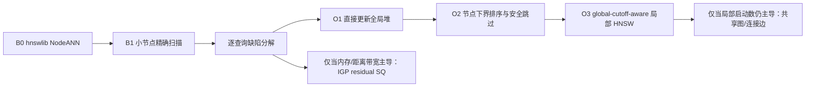

# 从 NodeANN 出发的 hnswlib 索引与搜索计划（审核稿）

日期：2026-10-29。状态：**设计与实验协议，未实现、未运行新基线。** 本文取代 2026-10-28 的 FAISS-HNSW/HLG-first 方案作为当前主计划；历史数字保留，但不再用于新后端的性能比较。

## 1. 已冻结的五项决策

1. 精确扫描比旧实现快，**不能据此把全局精确扫描改成主方案**；只允许在单个直接绑定节点很小时精确扫描。
2. 检索索引不再使用 FAISS：HNSW 统一用 hnswlib；如果使用量化，只实现 IGP 的 VQ + 低比特 residual SQ；FAISS 仅用于离线 k-means。
3. 相同功能模块必须共享实现：所有原始 FP32 squared-L2 距离统一调用 hnswlib 内部 `L2Space::get_dist_func()`，不得各写一套标量/SIMD 内核。
4. 主力数据集为真实 WIKI 与 SIFT1M；SIFT1M 生成不同属性深度、节点负载平衡程度的单绑定层级属性。
5. 旧基线依赖 FAISS HNSW/Flat/IVF，不能沿用其延迟作为新方案基线；所有活动基线必须在统一 hnswlib 后端下重跑。

## 2. 当前问题定义

每个对象 $x$ 绑定到一个直接属性节点 $h(x)$。查询给出向量 $q$、锚点 $u$、recursive 标志与 $k=10$：

- recursive：合法集合是 $u$ 的整棵子树内对象；
- non-recursive：合法集合仅是直接绑定到 $u$ 的对象。

NodeANN 为每个非空直接节点 $v$ 的局部集合 $L(v)=\{x:h(x)=v\}$ 建一个局部索引。recursive 查询枚举 $u$ 子树中的非空节点，分别搜索，再合并全局 top-k。

现有 WIKI 的结构事实仍有效：1,941,679 个对象、468,031 个属性节点、363,467 个直接非空节点，平均每个直接非空节点 5.34 个对象。旧 FAISS NodeANN 的延迟、构建和 recall 只能作为定位线索，不能当 hnswlib 结果。

## 3. 统一后端与公平性合同

### 3.1 hnswlib 版本与构建

- 固定 revision：`ca426729609b3221563047ceb269cc1213e0d376`（仓库另一复现模块已使用该 revision）。
- 依赖以固定源码 revision 引入，正式产物记录 revision、编译器、`-O3 -march=native`、CPU ISA、线程数和 seed。
- WIKI 与 SIFT1M 的搜索均单线程；构建线程数单列，不能把多线程构建时间与单线程构建混为查询加速。
- 当前工作区没有 hnswlib headers；实现前需先取得并固定该依赖，不能依赖机器上的未知版本。

### 3.2 原始向量距离的唯一实现

建立共享 `RawL2Space`：

```cpp
hnswlib::L2Space space(dim);
auto distance = space.get_dist_func();
auto distance_param = space.get_dist_func_param();
```

以下位置全部传入同一 `L2Space` 或调用其 `distance`：

- hnswlib 构图和查询；
- 小节点精确扫描；
- exact ground truth；
- 节点 centroid/radius 的 query-to-centroid 与 point-to-centroid 距离；
- 将来若重启 HLG，MST 权重、代表点选择、连接边搜索；
- IGP 压缩候选的 raw FP32 精排。

SIFT d=128 与 WIKI d=1024 都能进入固定 revision 的 16-float SIMD 路径；这只是公共距离模块，不是贡献。

结果排序统一为 `(distance, global_id)`；空 scope 返回十个 `-1`。GT 也用同一个距离函数重建，旧 NumPy/FAISS GT 只可做 ID 交叉核对，不再定义新实验的 tie 语义。

### 3.3 FAISS 的唯一例外

FAISS 只允许执行离线 k-means 训练。可使用其 Kmeans/Clustering 内部 assignment 实现，但：

- 不保存或查询任何 FAISS HNSW、Flat、IVF、PQ、SQ 索引；
- k-means 训练时间、assignment 时间、码本和 seed 单列；
- 在线 query-to-centroid 距离仍走共享 hnswlib `RawL2Space`；
- FAISS k-means 产物只是 IGP codec 参数，不是检索后端。

### 3.4 IGP 量化合同（后置，不进入第一轮）

若 FP32 NodeANN 诊断后需要量化：使用共享 coarse centroid、每向量 VQ ID、1/2/4/8-bit residual SQ。首个正确性版本把 code 重建成 FP32，再调用 `RawL2Space`；不先写独立 ADC/SIMD scorer。若后续增加 packed scorer，所有量化臂必须共享同一 scorer，并与“重建 + RawL2Space”逐对象核对误差和排序；raw rerank 始终走 `RawL2Space`。

## 4. Step 0：重新建立 NodeANN 基线

### 4.1 B0：纯 hnswlib NodeANN

对每个非空 $L(v)$ 建 `HierarchicalNSW<float>`，初始参数 M=16、efConstruction=200、固定 seed；查询每个候选节点返回 `min(k,|L(v)|)`，再合并 global top-k。efSearch 扫描形成 recall–latency 曲线，不只报 ef=64。

B0 的角色是复现 NodeANN 的算法，不是预期最强实现。尤其 $|L(v)|<M$ 的大量局部图会暴露固定对象/调用开销。

### 4.2 B1：允许的小节点精确扫描（强 NodeANN 基线）

若 $|L(v)|\le T_{scan}(d)$，直接用 `RawL2Space` 扫描该节点；否则用 hnswlib HNSW。该分支按**局部节点大小**决定，是用户明确允许的单节点实现选择，不是按 query scope、选择率或数据集切换整体索引。

$T_{scan}(d)$ 不在测试查询上调：

1. 对 d=128、1024 分别生成固定大小 $n\in\{1,2,4,8,16,32,64,128,256,512\}$ 的局部集合；
2. 比较 shared-distance exact scan 与 hnswlib search 的 warm median/P95，同时检查 recall；
3. 取扫描在时间和质量上不劣于 HNSW 的最大 $n$，冻结为该维度的阈值；
4. SIFT 的所有层级变体共用 d=128 的阈值，WIKI 使用 d=1024 的阈值。

B1 是之后所有算法候选必须击败的强基线。全局 exact scope scan 不参与主方案竞争，只保留为 GT 生成器和诊断上界。

## 5. Step 1：先测 NodeANN 缺陷，不预设 HLG 是答案

每条查询必须输出以下计数和时间：

| 类别 | 字段 |
|---|---|
| 目录 | anchor depth、scope cardinality、候选非空节点数 |
| 局部执行 | scan 节点数/HNSW 节点数、两类对象数、距离计算数、HNSW hops |
| 合并 | 局部返回数、global heap offer/pop 数 |
| 延迟 | 目录枚举、small-node scan、HNSW、merge、总延迟 |
| 质量 | macro recall、global pair recall、每 query 命中；局部候选遗漏与 merge 遗漏分开 |
| 资源 | build wall/CPU、序列化 bytes、峰值 RSS、raw vectors、graph、ID maps、centroid/radius、scratch 分账 |

要检验的缺陷，而不是先宣布结论：

- **D1 小图固定开销**：时延是否由局部索引调用次数主导，而非距离计算数主导？
- **D2 目录分区缺少几何收益**：不同节点大小下，HNSW 比 shared-distance scan 的交叉点在哪里？
- **D3 merge 放大**：每节点返回 k 个候选是否造成 `candidate_nodes × k` 的可观成本？
- **D4 局部近似遗漏**：总 recall 损失是否都来自局部 HNSW，还是 ID/tie/merge 也有错误？
- **D5 大节点尾部**：small-node scan 消除大量小图后，剩余时间是否集中在少数大局部节点？
- **D6 全局缺少共享导航**：候选节点数很大时，是否必须启动几百/几千个局部搜索？

只有 D6 在 B1 后仍主导，才进入共享图/连接边方向；否则先优化实测主导项。

## 6. Step 2：从 B1 一次只加一个机制



### O1：小节点扫描直接更新 global heap（工程强基线）

小节点不先生成 local top-k；每个精确距离直接与 query-global top-k heap 比较。它消除局部 heap 与二次 merge，但不减少距离计算。该机制本身不作为创新，只保证 B1 足够强。

### O2：节点级精确 lower bound（第一个算法候选）

每个直接节点存 centroid $c_v$ 与 covering radius $r_v=\max_{x\in L(v)}\|x-c_v\|$。查询下界：

$$LB_v=\max(0,\|q-c_v\|-r_v)^2.$$

按 $LB_v$ 从小到大处理节点；global heap 已有 k 个真实距离且 $LB_v>\tau$ 时，安全跳过整个节点。所有距离仍用 `RawL2Space`。这与此前对 925,829-item 大块的 0% 剪枝不是同一粒度；直接节点平均仅 5.34 点，必须重新测，不能沿用旧否证，也不能预先声称有效。

消融：`order only`（只排序不跳过）与 `order + safe skip` 分开；报告 centroid 距离开销、跳过节点/对象比例和净延迟。若下界计算成本超过节省，O2 关闭。

### O3：query-global cutoff-aware 局部 HNSW（第二个算法候选）

按 O2 顺序启动仍未被安全排除的大节点。自定义 hnswlib layer search 接收当前全局第 k 距离 $\tau$，将其作为局部候选上界/早停信息，但不把“入口距离 > τ”误当成安全无结果。该机制是近似搜索改动；必须分别报告：

- 固定相同 ef 时相对 B1 的距离计算数、延迟、recall；
- 固定相同 recall 时的延迟；
- 关闭 O2 skip，仅保留排序/外部 cutoff 的独立贡献。

### 共享图/层级连接边（条件性后续，不再作为起点）

只有当 B1/O1–O3 后仍由“启动很多局部索引”主导，才测试一张全局 hnswlib HNSW 和层级连接边。旧 HLG 基于 FAISS 邻接且 MST/search 使用 double 标量距离，不符合新公平性合同；旧图、旧连接边、G3 时延均不能复用。理论上的 $n-1$ 边数和连通性命题可保留，但所有结构、召回、构建与维护实验必须重做。

## 7. 数据集计划

### 7.1 WIKI

- 1,941,679 × 1024 原始发布浮点，不归一化；真实目录树与单绑定。
- 保留现有 456 条 query vectors 与 456 条固定约束；重新用 `RawL2Space` 生成 GT/hash。
- 旧 FAISS 数字全部标为 historical-only。

### 7.2 SIFT1M 层级属性族

向量固定为标准 SIFT1M 1,000,000 × 128，不归一化。每个对象单绑定。固定 4,096 个叶子，借不同分支因子改变深度，同时尽量保持叶子数一致：

| ID | 分支因子 | 最大深度 | 叶子 | 总节点 |
|---|---:|---:|---:|---:|
| D4 | 8 | 4 | 4,096 | 4,681 |
| D6 | 4 | 6 | 4,096 | 5,461 |
| D12 | 2 | 12 | 4,096 | 8,191 |

每种树做两种节点负载：

- `balanced`：叶子权重均匀；
- `skewed`：叶子权重按固定随机排列后的 Zipf($\alpha=1.2$)。

`balanced/skewed` 不是只看生成参数命名；每个 manifest 必须记录直接绑定数与子树基数的 mean、P50/P95/P99/max、CV、Gini、空节点比例和熵。实验按实际统计量解释，不能把未达到预期偏斜程度的样本继续标成 skewed。

绑定规则固定：80% 对象绑定叶子；20% 绑定其祖先，祖先深度在 `[1,D-1]` 均匀取值。这样 recursive 与 non-recursive 均有非空内部节点。主矩阵共 3×2=6 个变体，共享同一份 base/test，不复制向量文件，只保存 tree/binding/workload/GT manifest。

首轮绑定与向量几何独立，以隔离“深度/负载平衡”的影响；真实 WIKI 负责覆盖现实属性–几何相关性。若首轮出现明显交互，再追加 geometry-correlated SIFT 变体，不能在主矩阵前混入第三个因素。

工作负载使用固定 1,000 个 test vectors；anchor 按 normalized depth 桶与 scope-card 桶分层抽样，recursive/non-recursive 各半。所有六个变体保持查询向量序列一致，并记录每个变体实际 scope 分布；不同 scope 分布不能只报一个总均值。

## 8. 必须重跑的活动基线

| ID | 目录表示 | 向量执行器 | 作用 |
|---|---|---|---|
| B0 | Node 枚举 | 每非空节点 hnswlib HNSW | 原始 NodeANN 算法复现 |
| B1 | Node 枚举 | 小节点 RawL2 scan + 大节点 hnswlib HNSW | 强 NodeANN 基线、主比较对象 |
| B2a–c | PE-Online / PE-Offline / TrieHI | 同一全局 hnswlib HNSW + 同一 filter functor | 目录表示基线；三者必须命中相同候选结果，只允许目录解析时间不同 |
| B3 | Node 枚举 | 所有节点 RawL2 scan | **诊断 oracle**：定位局部 HNSW 质量损失，不进入性能前沿 |

不再运行 FAISS Flat/IVF/HNSW 作为活动基线。B3 不是 FAISS Flat 索引，也不是候选主方案，只用 shared distance 验证 top-k 分解与召回归因。

所有 ANN 基线扫 efSearch，不只取一个工作点；比较 recall 0.99/0.995/0.999/1.0 能达到的点。正式主张以相同 recall、相同数据、相同线程、相同距离模块为前提。

## 9. Harness 与实验段重置

旧 `autoresearch_benchmark.py` 硬编码 FAISS build、FAISS `NODE` 和 NumPy GT；旧段已达迭代上限。后端和 GT 语义均改变，必须开启新的 experiment segment，不能修改旧段后继续把结果串在 run14 后面。

新 harness 必须冻结：

- hnswlib revision、build flags、seed、M、efConstruction；
- WIKI/SIFT base/test/tree/binding/workload/GT hashes；
- `RawL2Space` 距离实现身份；
- 单线程搜索，三次独立进程，mean/P50/P95/P99 与 MAD；
- build wall/CPU、peak RSS、serialized bytes；
- 每 query 的 scope、候选节点、distance calls、hops、merge ops 和分阶段时间。

质量门槛继续使用 recursive macro/global ≥0.999、non-recursive recall=1；build ≤180 s、peak RSS ≤24 GiB、WIKI non-recursive ≤0.025 ms 也保留。若 hnswlib 构建超时，应报告“不满足门槛”，不能悄悄放宽或只报 query time。

## 10. 阶段门与停止条件

| 阶段 | 通过条件 | 不通过时 |
|---|---|---|
| P0 距离一致性 | 所有 raw distance callsites 都经 `RawL2Space`；GT 与执行器 ties 一致 | 不跑性能 |
| P1 B0/B1 | WIKI + 6 个 SIFT 变体都有完整曲线和资源账 | 不讨论新方案优劣 |
| P2 缺陷诊断 | 能按 D1–D6 给出时间与遗漏归因 | 不直接跳到 HLG |
| P3 O2 | 相同 recall 下净加速，且 centroid 开销计入 | 否则关闭 node-bound 路线 |
| P4 O3 | 相同 recall 下优于 B1/O1；提升在 WIKI 与至少两种 SIFT 深度上出现 | 否则关闭 cutoff 路线 |
| P5 共享图 | 仅在 D6 仍主导时启动；同 recall 优于 B1 | 否则不重建 HLG |
| Q 量化 | 仅在内存/距离带宽主导时启动；IGP codec 同召回改善时间或 RSS | 否则保留 FP32 |

## 11. 实施顺序（审核通过后）

1. 引入并固定 hnswlib；建立共享 `RawL2Space` 和距离一致性测试。
2. 新建独立 runner/harness，不在旧 FAISS runner 上继续叠加分支。
3. 实现 B0、B1、B3 和逐查询计数；小样本 smoke 验证 local-top-k 合并等价于 scope exact top-k。
4. 生成 SIFT1M 六个层级 manifest/workload/GT；核查深度、节点负载、scope 分布与 hash。
5. 重跑 WIKI + SIFT1M 基线曲线，形成 D1–D6 诊断。
6. 依据主导缺陷依次实现 O1、O2、O3；每次只改变一个机制。
7. 只有阶段门触发时，才实现 IGP residual SQ 或 hnswlib 共享图/连接边。

这套顺序的核心是：**先把 NodeANN 在统一后端下测明白，再决定要改局部搜索、跨节点调度、量化，还是共享图；不从预设答案倒推问题。**
