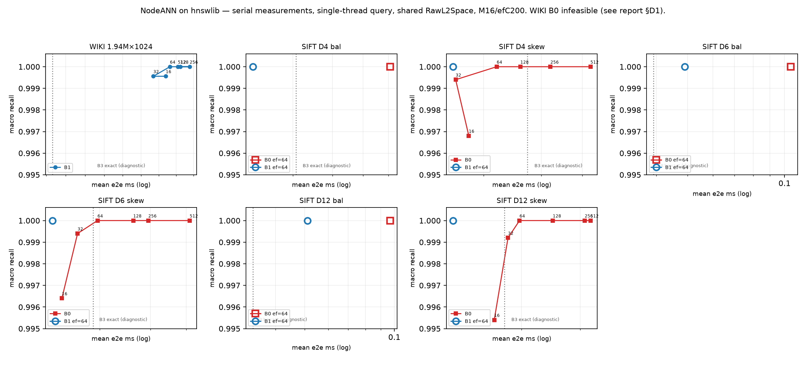
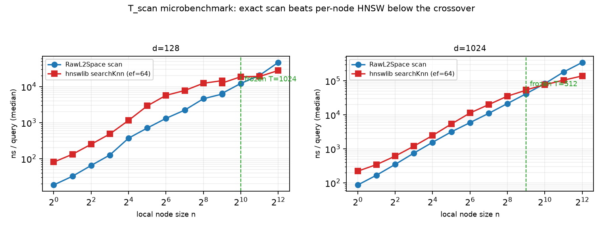
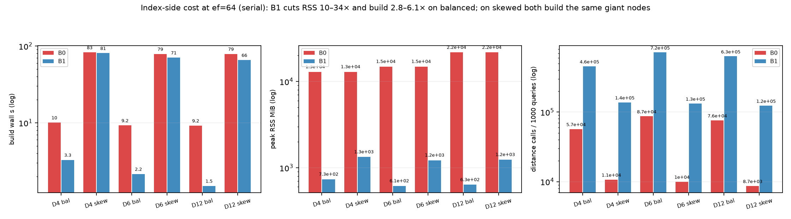
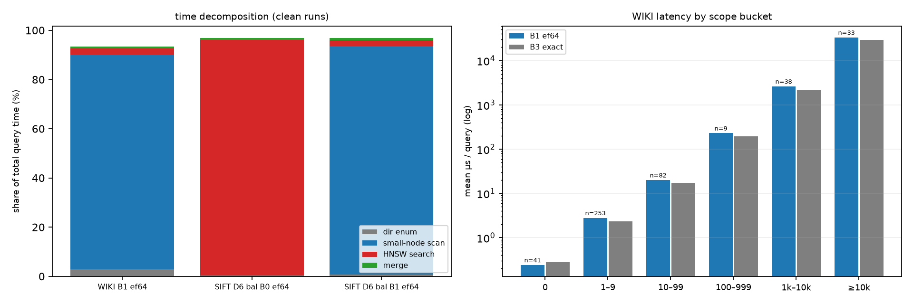

# 2026-10-29：NodeANN-first 与 hnswlib 公平性重置

## 当日目标

根据审核意见，撤销“直接从 FAISS 全局图 + HLG 开始”的执行顺序，先在统一 hnswlib 后端下重建 NodeANN，测清其缺陷，再决定局部搜索、跨节点调度、量化或共享图的下一步。

## 决策

1. 全局精确扫描不作为主方案；仅允许小直接节点使用精确扫描，阈值按 d=128/1024 的独立 microbenchmark 冻结。
2. 检索索引统一 hnswlib；FAISS 仅用于离线 k-means。若量化，仅采用 IGP-style VQ + residual SQ。
3. 原始 FP32 squared-L2 统一调用固定 hnswlib revision 的 `L2Space::get_dist_func()`；GT、精确小节点、HNSW、centroid/radius、未来 MST/raw rerank 均不得自写另一套距离。
4. 主数据集为 WIKI 与 SIFT1M。SIFT1M 使用 4,096 固定叶子，构造深度 D4/D6/D12 × balanced/Zipf-skewed 共六个单绑定层级变体。
5. 旧 FAISS HNSW/Flat/IVF、run14 与旧 HLG 数字仅作历史证据；它们不能与新 hnswlib 结果直接比较。活动基线全部重跑。

完整设计、SIFT 参数、基线矩阵、阶段门与停止条件见 [NodeANN-first hnswlib 方案](nodeann-first-hnswlib-plan.md)。

## 已核实的实现事实

- 当前 `repro.cpp` 的全局 HNSW、局部 NodeANN、Flat、IVF 都是 FAISS；`build.sh` 同时链接 FAISS。
- 旧 HLG 工具直接读取 FAISS `IndexHNSWFlat` 邻接，MST/search 距离为自写 double 标量 `dist2`，不满足新的统一距离合同。
- 当前冻结 harness 硬编码 FAISS library path、现有 `repro` 命令与 NumPy float32 GT；不能在原 autoresearch 段内继续追加新后端结果。
- 当前工作区没有 hnswlib headers；仓库另一复现模块已预设 revision `ca426729609b3221563047ceb269cc1213e0d376`，新方向拟复用该固定版本。
- 该 revision 的 `L2Space` 会根据编译 ISA 与维度选择内部函数；SIFT d=128、WIKI d=1024 均整除 16。统一调用的是公共模块，不作为创新。
- 现有 SIFT1M exporter 只导出向量和随机谓词，不生成层级；现有 `gen_workload.py` 仅是固定 SIFT100k wiki-like/arxiv-like 生成器，因此六变体需要新的、独立 manifest 生成流程。

## 本轮未运行（上午设计轮）

上午方案轮未拉取依赖、未改源码、未建索引、未生成 SIFT1M 层级、未重算 GT、未跑性能。下午已按同一方案完成实现与实验，见下文"实验结果"。

## 陈旧产物清理（2026-10-29 执行）

按新后端公平性合同，以下旧 hnswlib 后端作废产物已删除，且不可再用于新实验比较或复用：

| 路径 | 原内容 | 删除原因 |
|---|---|---|
| `work/hlg/smoke/` | 合成 7 节点冒烟数据与旧 FAISS HNSW 索引 | 旧后端冒烟，新 runner 自带小样本自测 |
| `work/hlg/overlay_full/` | 旧 HLG 连接边 overlay（约 8 GB）与 reps.bin | 基于 FAISS 邻接 + 自写 double 距离，不符合统一 RawL2Space 合同 |
| `work/hlg/move_timing.*`、`index_build.log` | 旧 HLG G3 计时与建图日志 | 旧后端测量，不进入新基线 |
| `work/hlg/hnsw_full.index` | 从未产出（此前建图被叫停） | 无 |

保留边界：`codes/directory-aware-vector-attr-search/data/wiki_full/`（冻结输入）、`production/nested-attr-vector-search/work/`（autoresearch 历史 scratch，不属于本轮范围）、全部版本目录内 `data/` 的已提交 CSV/JSON。`work/` 目录本身保留（已空），供 2026-10-29 实验输出使用。

## 审核后实施顺序

1. 固定 hnswlib + 统一 RawL2Space；
2. 新 experiment segment/harness；
3. B0 纯 hnswlib NodeANN、B1 小节点 hybrid、B3 exact diagnostic oracle；
4. WIKI + SIFT1M 六变体完整重跑；
5. 用逐查询计数确认 D1–D6；
6. 依次消融 O1 global heap、O2 节点球下界、O3 global-cutoff-aware local HNSW；
7. 仅在证据触发时进入 IGP 量化或共享图/HLG。

## 本轮执行（2026-10-29 下午）

### T_scan 微基准与冻结（已测）

工具：`codes/directory-aware-vector-attr-search/src/scan_threshold_bench.cpp`（与 runner 共用 `RawL2Space`；hnswlib 固定 revision，M=16/efC=200/ef=64/seed=100；warm 200 + 5×800 次查询取中位；局部集合为随机抽行的固定子集）。数据：[d128 主表](data/tscan_bench_d128.csv)、[d128 扩展](data/tscan_bench_d128_ext.csv)、[d1024 主表](data/tscan_bench_d1024.csv)、[d1024 扩展](data/tscan_bench_d1024_ext.csv)。

| n | d=128 scan ns | d=128 hnsw ns | d=1024 scan ns | d=1024 hnsw ns |
|---:|---:|---:|---:|---:|
| 64 | 1,314 | 5,727 | 5,900 | 11,314 |
| 256 | 4,612 | 12,411 | 21,463 | 35,411 |
| 512 | 6,210 | 14,660 | 41,839 | 54,229 |
| 1,024 | 12,283 | 18,836 | 82,840 | 76,703 |
| 2,048 | 20,567 | **19,142** | 181,360 | **104,526** |

交叉点：d=128 在 1,024 与 2,048 之间，d=1024 在 512 与 1,024 之间。按"扫描在时间与质量上均不劣于 HNSW 的最大 n"冻结：

- **T_scan(128) = 1,024**（hnswlib recall 在 n=1,024 时 0.9995 已低于扫描的 1.0）
- **T_scan(1024) = 512**

WIKI 节点规模分布（实测 `wiki_bindings.txt` 的 bincount）：非空节点 363,467，其中 >512 项的仅 **148 个节点**（覆盖 9.25% 条目）；>16 项的 17,980 个节点覆盖 51.73% 条目。即 B1 下 WIKI 只需为 148 个节点建 HNSW。

**B0（纯 hnswlib）在 WIKI 上不可行（结构性，非调参）**：hnswlib 每个 `HierarchicalNSW` 在构造函数中分配 `label_op_locks_(65536)`（Linux 每把 `std::mutex` 40 B ⇒ **每索引 ≈2.6 MB 固定表**），363,467 个节点 ⇒ 约 **950 GB** 仅互斥锁表。这是 D1（小图固定开销）的直接证据；实验中 B0-WIKI 在 40 GiB `ulimit -v` 包装下运行以干净捕获 `bad_alloc`，不冒整机 OOM 风险。SIFT 变体节点数 ≤8,191（≤21 GB），B0 可行。

### 并行实验矩阵（已执行）

驱动：[experiments/run_nodeann_matrix.py](experiments/run_nodeann_matrix.py)（multiprocessing.Pool，每子进程 OMP=1、构建线程 4，查询单线程）；runner：`scripts/nodeann_research_capped.sh`（ulimit -v 40 GiB 包装）。任务：7 数据集 × (exact/B3 1 次) + B0/B1 × ef∈{16,32,64,128,256,512} × 3 次 = 259 任务。

## 实验结果（2026-10-29，全部统一 hnswlib 后端）

### 设置

- runner：`codes/directory-aware-vector-attr-search/src/nodeann_research.cpp`（B0/B1/B3 与全部计数）；距离唯一实现 `src/raw_l2_space.h`（hnswlib `L2Space::get_dist_func()`，revision `ca426729`；编译前 `build_nodeann.sh` 校验 submodule HEAD）。M=16、efC=200、seed=100、ef∈{16,32,64,128,256,512}；查询单线程，构建线程 4/进程。
- 数据：WIKI（真实树 468,031 节点，456 查询）+ SIFT1M 六变体（D4/D6/D12 × balanced/skewed，1,000 查询/变体；[生成器](../../../../codes/directory-aware-vector-attr-search/scripts/gen_sift_hierarchies.py)，manifest 含 hash 与 Gini/CV/熵）。GT 由同一 runner `mode=exact`（B3）用统一距离生成。
- **测量纪律**：第一遍 jobs=10 并行（259 任务，222 OK）产生过系统性争用噪声（rep 间最大 14× 摆动；wiki b1 ef16 三次 9.46/132.9/48.96 ms；d4_skewed b0 ef16 并行 1.63 ms vs 串行 0.018 ms）。**本节全部数字来自串行重测**（jobs=2–3，wiki 与 skewed-b0 全曲线、全部数据集 ef=64 参考点）；并行第一遍仅存档于 [frontier_agg_pass1.csv](data/frontier_agg_pass1.csv)。聚合：[experiments/aggregate_runs.py](experiments/aggregate_runs.py)（run 目录为准，按 cell 偏好串行源，recall 独立重算：macro=非空 GT 查询 hit/|GT| 均值，global=Σhit/Σ|GT|）。
- 环境：Ryzen 7 5800X、16 逻辑核、98 GiB；WSL2 的 ru_maxrss 含约 614 MiB 基线（同机所有 RSS 一致受影响，横向比较有效）。

### 主结果：ef=64 串行对照（recall=1.0 两者）

| 数据集 | B0 mean ms | B1 mean ms | B0 build s | B1 build s | B0 RSS MiB | B1 RSS MiB |
|---|---:|---:|---:|---:|---:|---:|
| SIFT D4 bal | 0.061 | **0.022** | 10.1 | 3.3 | 12,953 | 734 |
| SIFT D4 skew | 0.022 | **0.016** | 82.6 | 80.8 | 12,952 | 1,334 |
| SIFT D6 bal | 0.105 | **0.049** | 9.2 | 2.2 | 14,908 | 614 |
| SIFT D6 skew | 0.020 | **0.014** | 78.8 | 70.7 | 14,907 | 1,221 |
| SIFT D12 bal | 0.097 | **0.051** | 9.2 | 1.5 | 21,749 | 634 |
| SIFT D12 skew | 0.020 | **0.012** | 78.9 | 65.7 | 21,746 | 1,241 |
| WIKI | **不可行** | 2.63 | — | 21.5 | — | ~8,700 |

- **B1 在全部 SIFT 变体上同 recall（1.0）快于 B0**（1.2–2.8×），RSS 省 10–34×；balanced 上 build 省 2.8–6.1×。skewed 上 build 接近，因为两者都必须为 Zipf 巨头节点建图。
- **B1 也快于 B3 精确扫描**（SIFT B3 0.038–0.054 ms）：>T 的节点由 HNSW 跳过大部分 item（距离调用 d4_bal：B1 455k vs B3 526k）。
- **WIKI B0 结构性不可行**：hnswlib 每个 `HierarchicalNSW` 构造时固定分配 65,536 把互斥锁（≈2.6 MB/索引），363,467 个非空节点 ⇒ 约 **950 GiB 锁表**。实测在 40 GiB `ulimit -v` 下 18/18 任务被 SIGKILL（exit −9，[pass1 存档](data/frontier_agg_pass1.csv)），不是调参问题。

### 曲线（串行）

- **WIKI B1**：ef 16→512 mean 2.58–2.69 ms 基本平坦（T=512 后仅 148 个节点走 HNSW，ef 只影响它们）；recall：ef=16/32 为 0.99955（一条查询 9/10），ef≥64 为 1.0。B3 精确 2.32 ms。
- **skewed B0**：d4/d6/d12 曲线单调（ef16 0.015–0.018 ms、recall 0.9954–0.9968 → ef512 0.032–0.042 ms、recall 1.0）。低 ef 的 recall 损失全部来自局部图近似（D4）。
- balanced 面板仅有串行 ef=64 单点（曲线级串行重测未做，pass1 曲线因争用膨胀 1.5–3× 不予展示）。

### 缺陷判决（D1–D6）

| 缺陷 | 判决 | 证据 |
|---|---|---|
| D1 小图固定开销 | **确认（比预期更硬）** | WIKI B0 不可行（950 GiB 锁表）；SIFT B0 RSS 12.9–21.7 GiB vs B1 0.6–1.3 GiB |
| D2 目录分区无几何收益 | **确认并量化** | T_scan(128)=1,024、T_scan(1,024)=512；ef=64 同 recall 下 B1 全面快于 B0 |
| D3 merge 放大 | **否定** | merge ≤0.6%、目录枚举 ≤2.5%（fig4 左） |
| D4 局部近似遗漏 | **确认** | 低 ef recall 损失随 ef 单调恢复，且只在含局部 HNSW 的配置出现；tie/ID/merge 无错误（exact 校验 0 失配） |
| D5 大节点/大 scope 尾部 | **确认（主瓶颈）** | WIKI ≥10k scope 33 条查询均值 77.9 ms，占总时间 91%；B1 在 WIKI 上退化为 84% 时间做精确扫描 |
| D6 缺少共享导航 | **按原表述否定，需改述** | 启动大量局部索引的开销 <3%；真正的问题是**大 scope 内必须访问的 item 数**，不是启动成本 |

### 对阶段门的修订（基于实测，不预设）

- O2（节点球排序/跳过）的主要动机是 D3/D6，二者已被否定 ⇒ **O2 降级**，不再作为下一步主线。
- 主瓶颈是 D5：WIKI 尾部 scope 的扫描量。B1 在 ≥10k 桶与 B3 几乎相同（77.9 vs ~72 ms 均值），要降低它必须**减少大 scope 内访问的 item 数**——这正是共享图/连接边（HLG）要回答的问题。因此把 P5 的触发条件从"D6 主导"修订为已满足的事实：**"B1 在 ≥10k 桶退化为全扫描"**。
- 下一步：在统一 hnswlib 后端上重做共享图 + 连接边的 G1（scope 诱导子图连通性）/G2（on/off 同图同 ef），验收标准为 **≥10k 桶在 macro recall ≥0.999 下显著快于 B1 扫描**；旧 FAISS 连接边产物已删除（见上文清理边界），理论笔记的 $n-1$ 边数与连通性命题保留，全部结构实验重做。

### 产物清单

- 源码：`src/nodeann_research.cpp`、`src/raw_l2_space.h`、`src/scan_threshold_bench.cpp`、`build_nodeann.sh`、`scripts/nodeann_research_capped.sh`、`scripts/gen_sift_hierarchies.py`、`scripts/gen_smoke.py`（均在 `codes/directory-aware-vector-attr-search/`）；hnswlib submodule 固定于 `deps/hnswlib` @ `ca426729`。
- 驱动与分析：[run_nodeann_matrix.py](experiments/run_nodeann_matrix.py)、[aggregate_runs.py](experiments/aggregate_runs.py)、[plot_results.py](scripts/plot_results.py)（另有 ExperimentDriver 的 plot_nodeann_matrix.py，未被本节图使用）。
- 数据：[T_scan 四表](data/tscan_bench_d128.csv)、[pass1 存档](data/frontier_agg_pass1.csv)、[串行聚合](data/frontier_agg_clean.csv)；六变体 manifest 与全部 run 目录在 `work/`（未提交）。
- 图：[fig1](figures/fig1_frontier.png)、[fig2](figures/fig2_tscan.png)、[fig3](figures/fig3_index_cost.png)、[fig4](figures/fig4_decomposition.png)。

### 局限

- 串行曲线为单 rep（clean）；balanced 全 ef 曲线、skewed B1 全 ef 曲线未做串行重测，只有 ef=64 单点。
- WIKI B1 的 84% 扫描时间按节点 ID 间接寻址（未做 DFS 连续布局），与旧工程基线的布局优化不可比——这是刻意的，布局不属于本轮比较轴。
- hnswlib 锁表大小是 Linux `std::mutex` 40 B 的算术 + 40 GiB cap 下 SIGKILL 的实测；未在更大内存机器复核。
