# Laminar Edge Sharing: 层级属性向量检索的共享索引

**目标 venue：SIGMOD / VLDB / ICDE。语言：中文正文，保留英文术语。状态：系统稿（2026-10-20）。**

**证据标注约定**：每个数值后标注 `[已测]`（本地实验产物可复核）、`[估算]`（由已测分量推导，未独立测量）或 `[待测]`（设计已给出、尚无实测）。  
**图**：`figures/` 下所有图由 `production/nested-attr-vector-search/src/plot_paper_figures.py` 与 `plot_architecture.py` 从已测数据生成，可重跑。

---

## 1. Introduction

本文研究的任务是**层级属性过滤的单查询向量 top-$k$ 近邻检索**（hierarchy-filtered approximate nearest-neighbor search），而不是 vector join：给定查询向量 $q$、目录节点 $u$ 和 $k$，系统只返回满足目录条件的数据库向量中距离 $q$ 最近的对象。RAG 的知识目录、电商类目和 ACM CCS 都提供了层级谓词的实例；ACM CCS 只是语义示例，本文实际评测使用 SIFT 向量和**合成 CCS 形状标签**，没有真实 CCS 论文向量与标签的结果。对象可有多个直接标签；“节点下所有对象”与“直接标在节点上的对象”是不同的过滤谓词，均须在向量距离排序之前确定可行集。

与本项目的 vector join 主线相比，这是一项 **B 类“可迁移借鉴”的 filtered ANN 研究**，而非直接支持 vector join 的 join 算法：它没有两张输入表、pair 枚举或全局 top-$k$ pair 语义。可能的迁移点是未来在“每个左表对象以某一目录作用域检索右表邻居”的逐对象 join 执行器里复用子树边切片；由此得到的仍是每查询对象的 $k$ 个近邻，不能未经重定义就声称解决阈值连接或全局 top-$k$ pairs。

现有 filtered ANN 的取舍为这一任务提供了清晰的比较坐标。尤其 Directory-Aware Query and Maintenance in Vector Databases [9, §II-C] 已定义 recursive/non-recursive 目录向量查询，**是查询语义上最接近本文的既有工作**，不能只列为泛泛相关研究；其 PE-ONLINE、PE-OFFLINE 与 TRIEHI 改造的是候选集合的目录索引，而非 ANN 边。ACORN 在图搜索中使用谓词子图遍历 [1]；过滤感知图及其执行器可借助标签专用边和基数估计降低搜索代价 [2,5]；少量匹配对象直接精确评分、大量对象图搜索的决策也早见于生产系统的查询规划。另一端，为每个递归作用域物化图可以避免在线谓词判断，却重复存放邻接边。我们的 85 节点合成层级中，逐作用域图观测到 7,602,554 条有向 level-0 边，其中 3,658,543 条有向边互异 `[已测]`。这个重复率引出本文的具体问题：**在目录候选解析已有方案之外，能否共享重复导航边，并在限定子树时仍只访问合格边？** 它不意味着现有方法必然“死锁”，也不意味着空间随树大小指数增长。

LES（Laminar Edge Sharing，本文命名）为每条有向边计算其两个端点**同时符合递归谓词**的树节点集合，把边放在该集合的所有最深极小节点；这些位置构成本文定义的“边归属节点集”，不是向量检索领域已有的理论术语。DFS 先序下，一个递归作用域的这些归属位置构成连续激活值范围。查询在每个已访问对象的邻接表上二分定位该范围，然后只展开范围内的邻居。**层状的是目录节点对应的树区间，而非多标签对象的作用域集合**：两个互不为祖先的节点也可因为一个对象带两个标签而拥有交叠对象集。共享边解决邻接存储冗余，不自动保证 HNSW 图的连通性或 top-$k$ 精确性。

当前可执行原型仅共享 level-0 邻接，保留每作用域原有的上层图和入口；它测的是 Subtree 查询，不实现布尔作用域编译和完整 Exact 图路径。Exact 小集合由 **Posting-based Filtered Scan（PFS，倒排候选精确扫描）**这一独立基线处理，不能把 PFS 的吞吐记到 LES。实验还区分旧的逐边激活布局 **LES-Plain** 与新的游程索引布局 **LES-Run**；二者只是同一 LES 机制的存储变体。§2 的 Preliminaries 统一解释其余基线、谓词及 ANN 术语。

本文贡献是：（1）定义层级谓词下的**过滤向量 top-$k$**任务及可核对的精确 oracle；（2）给出有向导航边对单个 Subtree 谓词的归属与切片等价条件，并指出多标签对象及 Exact 谓词的边界；（3）实现共享 level-0 邻接与激活 run index，报告空间—搜索时间权衡；（4）在五个现有向量负载（SIFT 25k/50k/100k、MNIST 25k、Fashion-MNIST 25k）的合成层级上，将 LES 与逐作用域图、过滤图、精确扫描及 TRIEHI 目录层在同一协议下比较。结果为**混合结论**：LES 相对重复向量的 PSG 省空间（0.62×–0.18×），但同召回吞吐低 1.65–3.59×；共享向量后，同空间对照显示 LES-v3 在中等召回与 r95 门槛不落后，r98 与更大空间预算下落后；LES-v3（E0 + per-run varint + 自适应 beam）把索引压到 53.3 MB；严格交错测量下 r95 40,687、r98 25,589 QPS。与同空间（53.6 MB）的共享 PSG M12 相比，LES 在 r95 门槛快 1.18×、在约 0.963 召回快 1.06×，但在 r98 慢 1.18×；共享 PSG M16 多 17% 空间，在 r95/r98 上分别快 1.20×/1.45×。因此 **LES 不是被严格支配的方案**，而是更小空间下的中等召回工作点。全量 S1 邻接字典因唯一率 0.985、空间 82.99 MB 不可行，未实现。跨 11 个稠密语料，LES 只在 glove100/glove200/nytimes 上反超，其余 8 个落后，原生度量语料在 M16 对照下仍落后。Directory-Aware 的目录解析在同一 ANN 图上未超出运行噪声。后续章节中任何多层共享、布尔过滤或更新路径都作为未实现研究假设，不计入上述贡献。

---

## 2. Preliminaries and Problem Definition

### 2.1 向量、属性及导航图

遵循过滤向量检索的标准设定 [1, §3.1；2, §3.1]，数据集 $\mathcal D=\{(i,x_i,L_i)\}_{i=1}^{n}$ 中每个对象有唯一 id $i$、向量 $x_i\in\mathbb R^d$ 与结构化属性；本文的结构化属性是有根树 $T=(V,E_T,r)$ 上的**直接标签集合** $L_i\subseteq V$。距离函数 $\delta:\mathbb R^d\times\mathbb R^d\to\mathbb R_{\ge0}$ 决定向量排序；本文实验取原始 float32 向量的平方欧氏距离 $\delta(q,x_i)=\sum_{t=1}^{d}(q_t-x_{i,t})^2$，$d=128$。平方欧氏距离用于**排序**而非度量空间的三角不等式：后者只能对开方后的欧氏距离使用。图搜索的 u8 舍入距离与 oracle 的 float32 距离是两个数值实现，只有输入恰好能用 u8 无损表达时两者才一致。

定义 $\operatorname{Anc}^{+}(v)$、$\operatorname{Desc}^{+}(v)$ 为包括 $v$ 自身的祖先和后代，$A_i=\bigcup_{v\in L_i}\operatorname{Anc}^{+}(v)$ 为对象的祖先闭包。一个对象可以直接标在不相交分支或祖先—后代的多个节点。这里的树是**标签拓扑**，不是向量的空间划分：标签相近不等于向量距离小。DFS preorder 给节点赋序号 $\operatorname{tin}(u)$ 和 $\operatorname{tout}(u)$，树节点构成的子树对应连续区间 $I(u)=[\operatorname{tin}(u),\operatorname{tout}(u)]$；区间的层状性质不适用于带多标签对象的可行集合。$U\subseteq V$ 为反链（antichain）当任意两个不同节点互不为祖先，反链节点区间互不相交，但一个对象仍可属于多个区间指向的查询作用域。

图式 ANN 索引的有向邻接 $N_\ell(i)$ 表示对象 $i$ 在第 $\ell$ 层可扩展到的 id；这是磁盘/内存中的**有向邻接条目**，不预设反向条目必然存在。HNSW [12] 在高层从入口导航，再在 level-0 上使用候选集合（由搜索参数 `ef` 控制）执行近邻搜索。对节点 $u$ 独立构建的图记作 $G_u$，其第 $\ell$ 层有向边集记作 $E^\ell(G_u)$、保存的入口记作 $\mathrm{entry}_u$；只有满足相应谓词的对象进入该图。本文的原型**保留逐作用域上层图和入口，仅共享 level-0 有向邻接**，故不把共享后的图称作与某个原始 HNSW 完全等价。CSR（compressed sparse row）以 `offsets` 定位每对象连续的邻居 id；本文另外按边的树节点归属排序，同一激活节点的连续条目可以用 run index 表示。以上 HNSW、CSR、DFS、inverted postings 都是现有技术，不是 LES 自定义理论名词。

### 2.2 层级过滤 ANN 的查询与正确性

ACORN 把查询表述为向量及结构化谓词 $(x_q,p_q)$，先以 $p_q$ 选择合格向量，再在其中求 $k$ 个近邻 [1, §3.1]；Filtered-DiskANN 的基本查询对标签集合采用“至少共享一个标签”的 OR 语义 [2, §3.1]；Directory-Aware 明确区分 recursive 与 non-recursive 目录向量查询 [9, §II-C]。我们**不移植它们的查询保证**，只在同一 filtered ANN 框架里把谓词限定为两种树语义：$Q=(q,U,m,k)$，其中 $q\in\mathbb R^d$、$U\subseteq V$ 为非空反链、$m\in\{\mathrm{Subtree},\mathrm{Exact}\}$、$k>0$。原 Directory-Aware 的条目有一个 logical parent directory [9, §IV-A]；本文的 $|L_i|$ 可以大于 1，因此两项任务**单目录特例同构，多标签扩展不自动等价**。定义
$$
F_{\rm Subtree}(U)=\{i:\exists u\in U,\ L_i\cap\operatorname{Desc}^{+}(u)\ne\varnothing\}
=\{i:\exists u\in U,\ u\in A_i\},\qquad
F_{\rm Exact}(U)=\{i:L_i\cap U\ne\varnothing\}.
$$
其中 Subtree 包含节点本身及后代的直接标签，Exact **只**包含直接标在所选节点的对象；$U=\{u\}$ 是单节点查询。两者对多节点查询均按集合**并**而非 AND 解释，并且一个多标签对象只返回一次。可行集成员资格是**硬约束**，不能将出作用域结果用提高 Recall@k 来抵消。选择率（filter selectivity）定义为 $s(Q)=|F_m(U)|/n$，是合格对象占全部索引对象的比例，而不是返回结果数占 $k$ 的比例 [1, §3.1]。

令 $\operatorname{rank}_q(i)=(\delta(q,x_i),i)$ 按距离优先、id 次序打破平局。过滤精确答案为
$$
G(Q)=\operatorname{first}_{\min(k,|F_m(U)|)}
\big(\operatorname{sort}_{\operatorname{rank}_q} F_m(U)\big).
$$
过滤 ANN 允许 $R(Q)$ 漏掉真近邻，但要求每个返回 id 均属于 $F_m(U)$、彼此不重复，且 $|R(Q)|\le k$。若 API 承诺 $|F_m(U)|<k$ 时返回**全部**可行对象，则必须从 postings 扫描补足；当前 LES 图原型尚无此保证。语义上这是**逐查询** top-$k$，不是给定两表输出所有相似对或全局 top-$k$ pairs 的 vector join。

实验采用 float32 平方欧氏扫描构造 $G(Q)$（`prep_ccs.py:245-254`）；已有 CSV 的 Recall@10 是 $\frac1{|\mathcal Q|}\sum_{Q\in\mathcal Q}|R(Q)\cap G(Q)|/10$，其生成器将每查询可行集大小限定为至少 64，因此分母固定为 10。空集、不足 $k$ 的新负载必须另报可行数、填充率并使用非零查询的 $\min(k,|F_m(U)|)$ 分母；query-average recall 与按所有查询真值数加权的 global recall 不能混称。QPS 是查询循环每秒完成的查询数，延迟 p95、索引完整字节、底图构建与 LES 归并构建分别统计。样本 Recall@10 等于 1 不是逐查询无遗漏或图连通的理论保证。

### 2.3 可复现的比较方法与索引成本

为避免将实验脚本里的数字代号当作方案名，本文定义以下**描述性简称**，不声称扫描、分区建图或位图过滤是本文提出的算法：

| 论文简称及全称 | 核心行为 | 可复核的实现/适用范围 |
|---|---|---|
| **PFS** (*Posting-based Filtered Scan*，倒排候选精确扫描) | 用标签 posting/已解析的候选 id 集确定 $F_m(U)$，逐候选计算距离并取 top-$k$ | Subtree 与 Exact 分别测试；真实查询若需合并多 posting，解析成本须另计；既有 CSV `B0_*` |
| **PSG** (*Per-Scope Graph*，逐作用域物化图) | 对各 Subtree 可行集分别构造 HNSW；查询直接在对应图上导航 | 当前只测 Subtree，不能将未构造的 Exact 图当作已测；既有 CSV `B4_per_scope` |
| **BF-HNSW** (*Bitmap-Filtered HNSW*，位图过滤 HNSW) | FAISS `IndexHNSWFlat` 使用 IDSelectorBitmap 过滤候选 | 查询前生成的位图时间单独计，不等于完整端到端延迟；既有 CSV `filtered_hnsw` |
| **PE-ONLINE / PE-OFFLINE / TRIEHI** [9] | 分别为查询时展开直接 posting、写入时物化祖先 posting、trie 节点存储 inclusive bitmap 的目录**元数据**方案 | 已有本地目录层复现；均需外接 ANN 执行器，不能直接取代图/扫描的 QPS |
| **TRIEHI+HNSW** | §5.6 的组合基线：查询时用 inclusive bitmap 解析候选，再调用同一份 BF-HNSW 图 | 仅静态 Subtree；不含路径字符串、DSM 与 OpenViking 集成 |
| **PathSeer (fixed $M_{exp}$)** | `deps/PathSeer` 的 `IndexPathSeerFlat`，固定扩张度而非自动虚拟开销边界 | 不是完整 PathSeer 配方；只作为固定配置对照 |
| **ACORN** | 原论文定义的谓词无关 HNSW 变体 [1] | 本文仅测试占位 metadata 和单个主标签 metadata 两种**改造配置**，不称完整 ACORN 复现 |
| **LES-Plain / LES-Run** | 本文 **LES** (*Laminar Edge Sharing*) 的逐边 u16 激活值 / 逐对象激活 run 索引布局 | 仅 Subtree 的 level-0 共享，上层逐作用域保留；两布局测于不同运行 |

PFS 在已获取去重候选集合后评分的成本为 $O(|F_m(U)|d)$，另需 top-$k$ 选择及可能的多 posting 合并；PSG 的有向边条目数为 $\sum_{u\in V}|E^0(G_u)|$，并有逐作用域上层和向量的存储成本；BF-HNSW 的在线谓词检查、LES 的 run 二分和邻居扩展都由**实际访问量**决定，不能仅以 $s(Q)$ 给出统一 $O(\log n)$ 查询上界。LES 的共享边计数在 §4 按“唯一有向边—最深归属节点对”刻画，且不能直接等同完整索引字节数。图 4–11 用这些简称标出实测工作点；原始 CSV 保留旧字段值以维持溯源，**名称切换不改变算法或历史测量**。

**PFS 不等于 PE-ONLINE，PSG 也不等于 PE-OFFLINE。** 前二者分别规定向量评分方式及图是否逐作用域物化；后二者只决定谓词候选 id 如何生成 [9, §III]。TRIEHI（trie-based hierarchical index）同样只把目录解析成候选位图，再由外部 PG/IVF 做向量排序 [9, §II-A；IV-A]。图索引、候选位图与执行器均计入索引空间和在线成本时，才构成对 LES 的端到端比较。

H1 是 85 节点、4 叉深度 3 的合成树及 1000 条混合 Subtree 查询；H2 是 1365 节点、4 叉深度 5 的**合成 CCS 形状树**，把 1–5 个直接标签分配给 SIFT100k（128 维）向量，生成 1000 条 Subtree 与独立的 1000 条 Exact 查询。H2 中间节点主标签概率 0.25、叶频率生成代码中的 Zipf 指数 1.1（`prep_ccs.py:117`；旧统计 JSON 的 `zipf_exp=0.9` 与实际采样代码不符）；Exact 可行集 p50/p95/max 为 126/396/6973，Subtree 为 10334/49305/86699 `[已测]`（`ccs-stats.json`）。没有真实 CCS 论文向量或真实 CCS 标签的检索结果；H1 主基准运行的是 PSG 而非 LES。

---

## 3. The LES System

### 3.1 从目录谓词到邻接范围

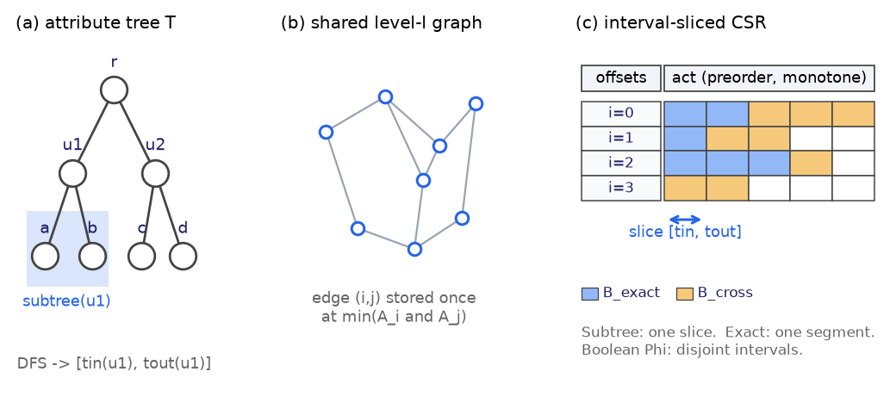

**图 1** 目录树、向量邻接与连续内存的概念关系。图中的直属/跨层色块是候选布局示意；目前实际实现是**一个按归属位置排序的共享 level-0 邻接数组**，并非两套完整 Exact/Subtree 图。图像帮助说明位置索引，不构成多标签对象集合彼此不交的证据。

先看一个微型 CCS 例子。树根 $r$ 有子节点 $A$（Information systems）与 $B$（Computing methodologies）；$A$ 下有 $A_1$（Data management）、$A_2$（Information retrieval），$A_2$ 下有 $A_{2.1}$（Retrieval models）、$A_{2.2}$（Evaluation）。三篇论文分别标为 $L_{p_1}=\{A_{2.1}\}$、$L_{p_2}=\{A_1,A_{2.1}\}$、$L_{p_3}=\{A_{2.2},B\}$；令它们的向量为 $x_1,x_2,x_3$。对 $(q,\{A_2\},\mathrm{Subtree},2)$，三篇均合格，但结果必须取三者中按 $d_2(q,x_i)$ 排名前二，而不是仅列出目录成员；对 $(q,\{A_2\},\mathrm{Exact},2)$，可行集为空；对 $(q,\{A_{2.1}\},\mathrm{Exact},2)$，只对 $p_1,p_2$ 比距离。$p_3$ 同时属于 $B$ 与 $A_2$ 的递归作用域，直观展示了“树区间不交”不等于“对象集合不交”。

对象的祖先闭包满足 $A_{p_1}=\{r,A,A_2,A_{2.1}\}$、$A_{p_2}=\{r,A,A_1,A_2,A_{2.1}\}$、$A_{p_3}=\{r,A,B,A_2,A_{2.2}\}$。假设候选底图中存在有向边 $p_1\to p_2$，其两端在 $\{r,A,A_2,A_{2.1}\}$ 中同时符合 Subtree 谓词，边存放于 $A_{2.1}$ 的归属位置。故在 $A_2$、$A$ 和 $r$ 的区间切片中都可见；在 $A_1$ 下不可见，因为 $p_1$ 不合格。边 $p_1\to p_3$ 的归属位置是 $A_2$：它服务 $A_2,A,r$，却不会在叶 $A_{2.1}$ 单独出现。向量近邻排名仍由搜索时 $q$ 与邻居向量的距离决定，树只决定**哪条边能被导航**。

**定义 1（本文的边归属位置）** 令 $E^0=\bigcup_{u\in V}E^0(G_u)$ 为各个 Subtree 基础图的 level-0 **有向边并集**。对 $e=(i\to j)\in E^0$，记 $C_e=A_i\cap A_j$，把边关联到 $C_e$ 中所有**最深节点** $M_e$，即不再有真后代属于 $C_e$ 的节点。多标签时 $|M_e|$ 可大于一；“最深”仅相对于树的祖先偏序，不是欧氏空间里的边界、前沿或最近邻。只对已存在于 $E^0$ 的边做归属：它不是一个从对象集自动构造出更好 ANN 图的过程，也不保证每个 $G_u$ 的原始邻接完全相同。§4 的结论只表明由 $E^0$ 诱导的**合法端点边**的切片资格，不能把“资格”偷换为“与每个独立作用域的基础图邻接相等”。

构建流程如下；以每对象的祖先位图计算交，再检查交集中是否还有合格子节点。它不生成 Exact 专用边：当前 `dflag` 仅在边当前归属位置同时是两个端点的直接标签时置位，这不等同于存储 $L_i\cap L_j$ 的所有位置。

```text
Algorithm 1: BUILD-LEVEL0-SLICES(T, {L_i}, {G_u})
1  DFS(T) -> tin, tout;  A_i <- ancestors of every label in L_i
2  for each directed (i -> j) in the union of G_u.level0:
3      C <- A_i intersection A_j
4      for v in C without a child in C: emit (i, tin(v), j)
5  sort and deduplicate emitted (source, activation, target)
6  for each source i: write neighbors ordered by activation
7      write one (edge_start, activation) per maximal equal-activation run
8  retain G_u's own upper levels and entry point (not shared)
```

查询 $(q,\{u\},\mathrm{Subtree},k)$ 先使用 $G_u$ 的**原有入口**及上层导航；到了 level-0，对当前点 $i$，在它的 run 索引中二分找到激活值落在 $[\mathrm{tin}(u),\mathrm{tout}(u)]$ 的首尾 run，换成 `nbr` 的连续下标范围。距离计算、visited 标记、`ef` 候选队列及 top-$k$ 提取沿用普通图搜索。反链并查询逐节点搜索再按 id 去重，全局按距离排序。高层和 level-0 由不同来源组成，不能据此宣称层间路径性质未变；HNSW 的质量必须以召回与连通性实测。

```text
Algorithm 2: SEARCH-SUBTREE(q, U, k, ef)
1  candidates <- empty
2  for each u in antichain U:
3      entry <- saved entry of G_u; descend its saved upper layers
4      beam <- best-first at level 0, initialized with entry
5      on expanding i:
6          [a,b) <- edge range selected by lower_bound(tin(u)),
7                    upper_bound(tout(u)) over i's activation runs
8          for t in [a,b): score nbr[t] and update beam/visited
9      append beam results to candidates
10 deduplicate candidates by object id; sort by (distance, id)
11 return first k discovered objects; record whether count < k
```

当前实现的返回值是**发现的**最多 $k$ 个对象；当可行集小于 $k$ 时，不能凭 beam 耗尽断言已发现全部，严格接口需要倒排扫描补足（待实现）。Exact 语义不能借用上述区间：节点 $u$ 下的继承成员可能未直接标 $u$。PFS 的 Exact 路径是直接标签倒排 + 精确扫描的**独立基线**；原型中的 `exact_edges` / `exact_strict` 是用于定位 Exact 图路径失效原因的诊断模式，不是通过正确性约束的服务路径。基数阈值选扫描还是图搜索属于既有 filtered-ANN planner 模式；本实验尚未标定 LES 上的可用切换点。

### 3.2 物理布局、空间与研究边界

普通 CSR 对象 $i$ 的邻居在 `nbr[offsets[i]:offsets[i+1]]` 中连续存放；`dist16` 及诊断用的 `dflag` 与邻居对齐。旧格式为每条边存一个 u16 激活值。新的**逐对象游程索引**用 `run_offsets[i]:run_offsets[i+1]` 指向此对象的 run 列表；每个 run 保存 `run_start`（该 run 第一条边在全局 `nbr` 中的下标，u32）和 `run_act`（归属节点 DFS 序，u16）。若上下界二分所得首末 run 分别为 $a,b$，邻接切片就是 `[run_start[a],run_start[b])`；末 run 不存在时使用 `offsets[i+1]`。因此除两个二分和已访问节点的邻居访问外，不必逐边再读取激活值。邻居 id 是间接访存，**并非“整个查询无随机访存”**。所有 run 值在对象内部单调，且每条边按同样顺序排列。

H2 构建产生 13,387,704 个桶条目、1,015,143 个 run `[已测]`。u16 激活数组为 26,775,408 B；新格式的 `run_offsets`、`run_start`、`run_act` 合计 6,490,862 B，约为旧激活索引的 0.242 倍 `[已测]`；它**不是**原先“3.05 MB、8.8×”的未实现三字节/run 估算。这个收益仅针对激活索引字段，不等同完整索引压缩比，也不能把重新运行的吞吐与不同次数的旧运行当作同参数精确加速比。具体结果见 §5。

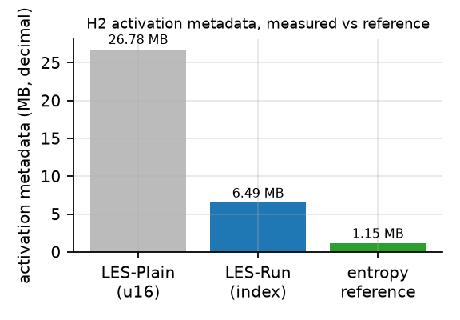

**图 2** 相同 H2 桶上，逐边 u16 激活值与实际实现的 run 索引字节数；零阶熵只是激活值序列的信息量参考，不是支持随机访问的完整索引下界。

我们也验证了一个未采纳的想法：按树节点构造局部码本能否利用向量分布收缩。在 H1 样本上，以作用域均值定义的最大覆盖半径相对根的比值，深度 0/1/2/3 的平均为 1.000/1.042/1.131/1.207 `[已测]`。该统计**没有支持**“更深类目在向量空间更紧”的假设；不能外推为所有距离或数据集上局部量化无效。新增层级、动态图标签修改、多 taxonomy 组合仍需独立设计和评测，目前没有对应的工程实现或理论保证。

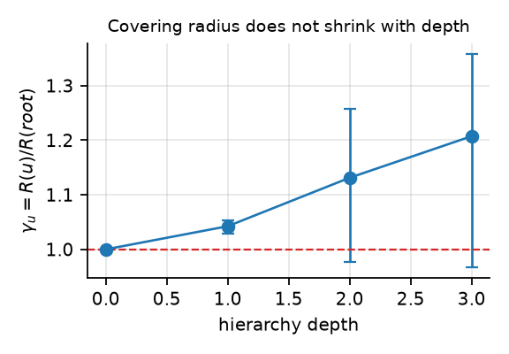

**图 3** H1 覆盖半径比；误差条和样本数以实际绘图数据为准。目录深度本身不是向量紧致性的保证。

---

## 4. Correctness and Analysis

### 4.1 一个有限定对象的切片命题

**命题 1（单节点递归谓词的边资格）** 固定基础图有向边并集 $E^0$ 和节点 $u$。对 $e=(i\to j)\in E^0$，用定义 1 的归属节点集 $M_e$ 写入共享数组。则
$$
e\text{ 的两个端点均在 }F_{\mathrm{Subtree}}(\{u\})
\quad\Longleftrightarrow\quad
\exists v\in M_e:\ \operatorname{tin}(u)\le\operatorname{tin}(v)\le\operatorname{tout}(u).
$$
*证明* 两端可行当且仅当 $u\in A_i\cap A_j=C_e$。$C_e$ 在树的祖先偏序下向上封闭：对其中任意 $u$，沿向下且仍留在 $C_e$ 的路径可到达至少一个无更深成员的 $v\in M_e$。故 $u\in C_e$ 等价于某个 $v\in M_e$ 是 $u$ 的后代。DFS 先序使后一个条件等价于 $\operatorname{tin}(v)$ 落在 $u$ 的子树区间。反方向若某 $v\in M_e$ 在区间内，因为 $v\in C_e$ 且 $C_e$ 向上封闭，其祖先 $u$ 也在 $C_e$。∎

命题只关于**边端点是否符合过滤谓词**，不是近邻可达性、召回、时间复杂度，也不是“切片与每个物化图完全相同”。例如一条仅存在于 $G_r$、且端点同时属于叶 $v$ 的边会在 $v$ 的共享切片中出现，即使原本 $G_v$ 不含它；该边合法，却改变了邻接度和搜索路径。反链并查询逐节点搜索时，同一边或同一对象还可经多个节点出现，合并结果必须去重。

**Exact 的独立前提。** 对同一条 $e=(i\to j)$，直接标签谓词在 $u$ 下的端点资格当且仅当 $u\in L_i\cap L_j$；这个集合不向上封闭。例如两个对象都直接标了祖先 $a$ 和后代 $b$，只把边放到“最深共同标签” $b$，在 Exact$(a)$ 查询中就无法读到。一个正确的 Exact 边桶必须存全部共同直接标签，且要保证其入口和邻接搜索不返回继承成员。**当前构建器只计算递归归属，不生成这样的独立 Exact 桶**；`dflag` 位和结果后置过滤不满足前提。Exact 图实验仅用于暴露这一边界，不能作为已实现 Exact 算法的正确性证明。

### 4.2 空间和导航条件

若每个有向边—归属位置对只存一条，递归桶的理论条目数是 $N_{\mathrm{rec}}=\sum_{e\in E^0}|M_e|$，因此 $N_{\mathrm{rec}}\ge |E^0|$。在“每条边仅凭其归属节点是否落在子树区间被检索、且不允许不合格端点”这一**限定模型**下，每个最深归属节点 $v$ 都需要至少一个位于该子树内的合法存放位置；$v$ 的真后代不在 $C_e$，因此该位置只能是 $v$。这给出了该表示模型内的必要位置集，不是任何可能的 ANN 索引的全局最小存储下界。

H1 旧分析产物记录 7,602,554 条观测有向边、3,658,543 条互异有向边；另一项两段统计给出 1,966,214 + 1,856,024 = 3,822,238 条，而同一文件 `bucket_entries` 为 3,822,159，**存在 79 条的口径差**。在重新统一计数定义之前，两段统计只能作为独立分析，不把 3,822,238 写成严格的 $N_{\mathrm{rec}}$ 实例。H2 新构建器则实际输出 13,387,704 个存储条目。节省边条目并不意味着节省整个索引的同等比例：每作用域上层结构、向量、距离与激活 run 索引仍占空间。

共享仅在 level-0：每个作用域保留原有上层图及入口，但这种拼接改变了 level-0 的度分布和可达路径，不能推导 HNSW 的对数查询界。尤其当 Exact 图仅保留少量直接成员或以 `dflag` 跳过边时，节点可能无法经图连到目标；后置过滤只能修正输出合法性，无法修复未访问对象。对这种负载精确扫描是有保证的参照路径；将来若支持图执行，必须分别验证每作用域入口资格、连通分量、过滤后召回、空结果及不足 $k$ 的处理。

---

## 5. Experimental Evaluation

### 5.1 设置

SIFT100k（128 维，float32 平方欧氏距离 oracle；图实现将数据舍入为 u8），单线程查询，Intel Core i5-12600KF。H2 主对照为 ACORN（两种 metadata 编码）、BF-HNSW（FAISS HNSW + bitmap selector）、PFS（倒排候选精确扫描）和 PSG（逐作用域物化 HNSW）；§5.6 的五个补充负载另加 TRIEHI 目录层与固定配置的原生 IndexPathSeerFlat。Subtree 的 1000 条查询共享同一 oracle；Exact 的 1000 条查询是另一工作负载。LES-Plain 工作点来自逐边 u16 激活的旧布局；LES-Run 为另一次构建及测量。历史 CSV 中“104 MB”与当前旧索引目录按文件字节加总的 144.31 MB 不符，不能沿用前者做空间压缩比。

### 5.2 RQ1：吞吐—召回权衡

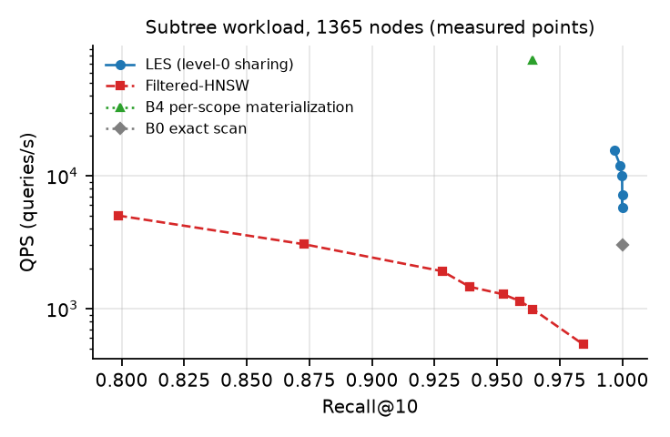

**图 4** Subtree 工作负载（1365 节点）上的实测点。横轴 Recall@10，纵轴 QPS（对数）。LES-Plain 的五个点对应 ef = 32/48/64/96/128；BF-HNSW 两点为 ef = 384/512；PSG 为单点（ef=21）。

| 方法 | ef | QPS | Recall@10 | p95 | 索引 | 构建 | 状态 |
|---|---:|---:|---:|---:|---:|---:|---|
| PFS（Subtree） | – | 3,008 | 1.0000 | 1.16 ms | 51 MB | 0 | 已测 |
| PSG（Subtree） | 21 | 74,706 | 0.9641 | 28.4 µs | 194 MB | 57 s（单线程） | 已测 |
| BF-HNSW | 384 | 1,282 | 0.9524 | 1.07 ms | 75 MB | 4.8 s（多线程） | 已测 |
| BF-HNSW | 512 | 991 | 0.9642 | 1.53 ms | 75 MB | 5.0 s | 已测 |
| ACORN（占位 metadata） | 1024 | 394 | 0.8479 | 3.85 ms | 70 MB | 0.8 s | 已测 |
| ACORN（主标签单标） | 512 | 620 | 0.8395 | 2.48 ms | 70 MB | 0.9 s | 已测 |
| LES-Plain | 32 | 15,694 | 0.9967 | 0.17 ms | 144.31 MB（当前文件重计） | 4.5 s（只含归并） | 已测，分次测量 |
| LES-Plain | 48 | 11,908 | 0.9992 | 0.23 ms | 同上 | 同上 | 已测，分次测量 |
| LES-Plain | 64 | 9,940 | 0.9999 | 0.23 ms | 同上 | 同上 | 已测，分次测量 |
| LES-Plain | 96 | 7,210 | 1.0000 | – | 同上 | 同上 | 已测，分次测量 |
| LES-Plain | 128 | 5,764 | 1.0000 | – | 同上 | 同上 | 已测，分次测量 |
| LES-Run | 32 | 12,898 | 0.9967 | 待测 | 124.03 MB（当前文件重计） | 5.42 s（只含归并，本次） | 已测，独立运行 |

**读法** 按 Recall@10 ≥ 0.95 的门槛，LES-Plain、PSG、BF-HNSW 都达标，但它们实际召回点不同，不等价于同召回公平比较。LES-Plain 的 QPS 为 PSG 的 0.21×；比 BF-HNSW 的 1,282 QPS 高，但后者的存储仍较小。LES-Run 减少约 20.28 MB 目录字节；两次查询运行没有交错重测或统计置信区间，12,898 对 15,694 **不能解释为编码导致的精确吞吐退化**。

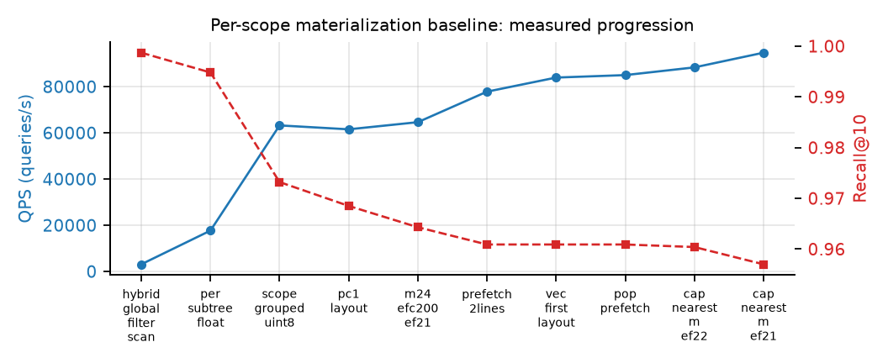

**图 5** PSG 在 85 节点负载上的实测优化轨迹（10 个阶段）。左轴 QPS，右轴 Recall@10。该轨迹说明 PSG 的高吞吐来自作用域分组执行、u8 带宽压缩与紧凑块布局，而不是来自任何层级共享——这既是它的优势，也是它空间开销的来源。

### 5.3 RQ2：空间与构建成本

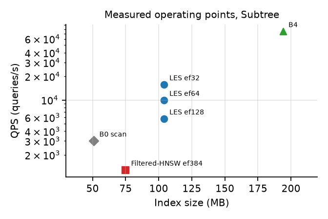

**图 6** Subtree 已测工作点的 QPS—索引字节关系；LES-Plain 空间按当前完整文件重计为 144.31 MB，LES-Run 为 124.03 MB。PSG 和其他基线的体积沿用各自实验报告口径，文件构成尚未完全对齐，图只供趋势观察。

| 指标 | 数值 | 状态 |
|---|---:|---|
| H1 观测 level-0 有向边 | 7,602,554 | 已测 |
| H1 唯一有向边 | 3,658,543（重复 51.9%） | 已测 |
| H1 旧两段统计 | 3,822,238（与同文件 `bucket_entries`=3,822,159 相差 79） | 已测，口径待统一 |
| H2 旧逐边激活文件 | 26,775,408 B | 已测 |
| H2 新 run 激活索引文件合计 | 6,490,862 B（节约 20,284,546 B） | 已测 |
| H2 旧 LES 当前目录字节 | 144,313,905 B | 已测 |
| H2 新 LES 当前目录字节 | 124,029,359 B | 已测 |
| 完整索引空间优势（同一体积口径和召回门槛） | 待对齐 PSG 文件组成及查询点 | 待测 |
| 共享上层图与动态更新 | 当前实现没有；不给空间或查询保证 | 待测 |

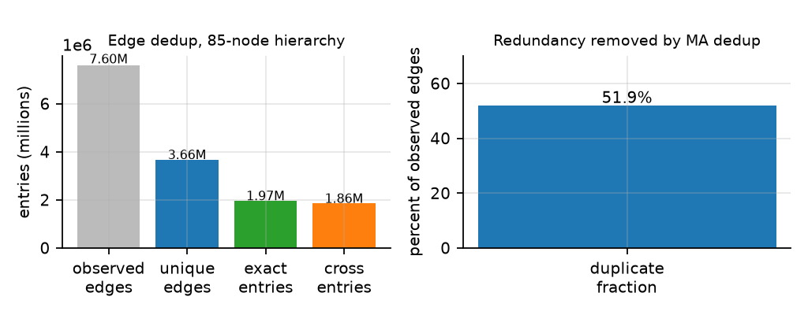

**图 7** H1 的**离线**边分析：观测 7.60M、互异有向边 3.66M；分析器的两段统计分别是 1.97M/1.86M，二者与 `bucket_entries` 相差 79。两段不是当前 C++ 构建器里已验证的两个完整 Exact/Subtree 索引。

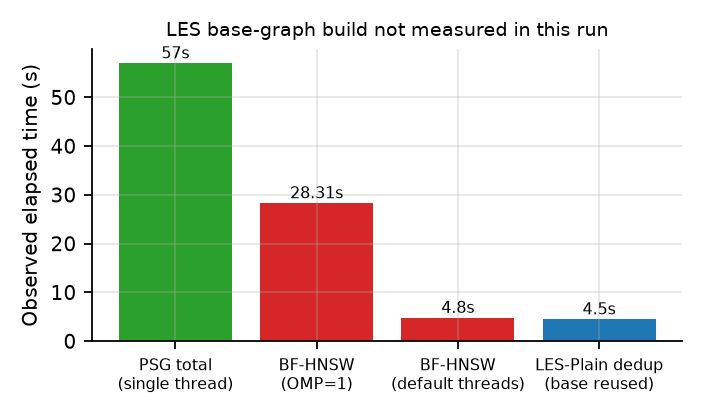

**图 8** 构建耗时**分开**报告：PSG 57 s、BF-HNSW 两种线程设置 28.31/4.8 s、LES-Plain 已复用其自身原有基础图后的归并 4.5 s `[已测]`。LES-Run 归并的本次 wall time 5.42 s `[已测]`（单次运行）。LES 的完整构建时间必须为 $T_{\rm base\ graph}+T_{\rm LES\ dedup}$，但该 LES 基础图的构建时间并未在同一次实验中测量；**不能把另一方法的 28.31 s 强加到 LES 再与 PSG 的 57 s 求加速比**。

### 5.4 RQ3：敏感性与正确性计数

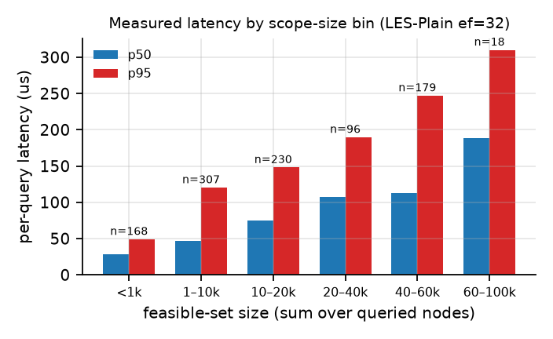

**图 9** 单次运行（ef=32，1000 条 Subtree 查询）上，每查询延迟与可行集规模的关系。柱上 n 为该桶查询数。可行集规模取各查询节点子树大小之和（上界，未扣除跨子树重叠）。整体 QPS 12,273（单次重复），p50 67.3 µs、p95 186.8 µs `[已测]`；§5.2 表中的 15,694 QPS 来自多次重复取优，两者不可混用。

本批查询的规模桶 p50 延迟从 28.1 µs 增至 188.9 µs，约 6.7 倍 `[已测]`。线性扫描复杂度为 $O(|F|d)$，但没有在相同规模桶上逐点计时，因此不能把上述图读成“相对扫描下降了两个数量级”的实测结论；要对齐还需按工作负载结构及实际去重后的可行集大小配对测量。

**Exact 语义：图搜索的实测边界。** 直属语义下的共享边搜索在小作用域上既慢又不完整，这是本文最重要的设计约束：

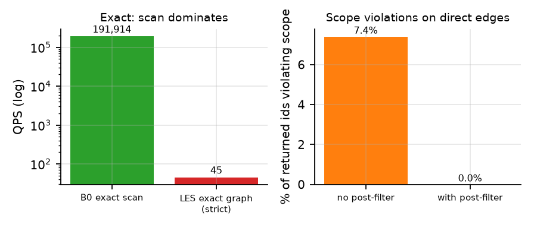

**图 10** 左：Exact 语义下倒排扫描与共享图搜索的实测 QPS（对数轴）。右：不过滤时返回结果中违反作用域的比例。两次图搜索均为单次运行、ef=32、1000 条查询。

| Exact 方法 | QPS | Recall@10 | p50 | p95 | 违规率 | 填满 $k$ 的查询 | 状态 |
|---|---:|---:|---:|---:|---:|---:|---|
| PFS（Exact） | **191,914** | **1.0000** | 11.3 µs | – | 0 | 1000/1000 | 已测，独立基线 |
| 旧原型 Exact 边诊断（无后置过滤） | 37,310 | 0.9221 | 21.6 µs | 51.3 µs | **7.4%**（739/9,991） | 999/1000 | 已测，非正确实现 |
| 旧原型 Exact 边诊断（标签后置过滤） | 45,078 | 0.9269 | 19.2 µs | 45.3 µs | **0**（0/9,410） | 941/1000 | 已测，未填满 |

QPS 由 `QUERY_SECONDS` 以 $1000/\mathrm{seconds}$ 计算；以前把毫秒总和当秒，误写为 37/45 QPS 和“慢四千倍”，现已纠正。此处 PFS 约为后置过滤诊断路径的 4.26 倍，且前者满足本批样本的返回数约束，后者未满足。7.4% 违规由诊断路径的图入口、边归属/过滤规则共同造成，不能将其解释为一个已验证的“渗流阈值”，也不能据此宣称所有 Exact 类目都不能使用图。

- 旧 Subtree 原型在 ef≥96 的样本上 Recall@10=1.0000 `[已测]`，**不能**从有限查询的 1.0 反推邻接完整或全部实例上的正确性；切片资格由 §4.1 的证明给出。
- 对旧 ef=32 Subtree 的 1000 条查询回读标签，10,000 个结果作用域违规数为 0，均填满 $k$ `[已测]`；它不证明小于 $k$ 的作用域也能完整返回。
- ACORN 两种所测 metadata 编码均未达到 0.95 召回；该结果只适用于此编码、参数和负载，不评价完整 ACORN 设计的理论能力。
- 多层共享、完整 Exact 图与切换阈值、布尔交差、动态图更新、1M 规模、真实 CCS 数据都没有可计入结论的端到端实测 `[待测]`。

### 5.5 RQ4：Directory-Aware 的目录层基线

现有复现已经实现 [9] 的 **PE-ONLINE、PE-OFFLINE、TRIEHI 三种目录表示**，分别在 85/1365 节点合成树上解析候选 id，并另行测试 MOVE/MERGE（`2026-10-20-exps/experiments/directory-aware-reproduction.md`）。这些目录层计时只覆盖 bitmap 查询，没有执行距离计算、PG/IVF 搜索、top-$k$ 选择或 Recall@10；复现使用普通 64-bit 位图而非原论文的 Roaring。它们的时间不得画进图 4 的 QPS–Recall，不能与 LES 的 12,898 或 15,694 QPS 直接相除。端到端对照见 §5.6：TRIEHI 的候选解析接到同一 ANN 图上后只占查询时间不足 2%。

| 数据及 recursive DSQ 目录层均值（µs） | PE-ONLINE | PE-OFFLINE | TRIEHI | 证据与含义 |
|---|---:|---:|---:|---|
| H1，85 节点 | 3.92 | 0.47 | 0.39 | `[已测]`，仅目录候选解析 |
| H2，1365 节点 | 97.20 | 1.23 | 0.76 | `[已测]`，仅目录候选解析 |
| H2，目录索引 + **同一向量 ANN 执行器**的 end-to-end QPS / Recall@10 | – | – | 见 §5.6 | `[已测]`：TRIEHI 与同图 BF-HNSW 召回逐位相同，解析开销未超出运行噪声 |

就单目录对象而言，recursive DSQ 与 Subtree、non-recursive DSQ 与 Exact 的对象集一致 [9, §II-C]；H2 每对象却可能有 1–5 个直接标签。若 $L_i=\{u,v\}$ 且 $v$ 是 $u$ 的孩子，则 $i\in F_{\rm Exact}(\{u\})$，但原论文的 $\mathrm{Inc}(u)\setminus\bigcup_{c\in\mathrm{Child}(u)}\mathrm{Inc}(c)$ 会将 $i$ 删除。现有目录复现的 PE-OFFLINE/TRIEHI Exact 路径沿用这个单所属目录差集，**未核对多标签 Exact 结果**；相关历史 non-recursive 延迟不作为有效 Exact 基线。适配时必须保留直接标签 postings $\mathrm{Local}(u)=\{i:u\in L_i\}$，用它计算 Exact，递归的 $\mathrm{Inc}(u)$ 用于 Subtree。对于目录 MOVE/MERGE，多标签对象可能同时经移动分支和未移动分支属于同一祖先，直接删除整个位图子集同样需要额外的交叠处理；已有维护计时不证明多标签正确性。

端到端对照已补：在 sift25k/50k/100k、mnist25k、fashion-mnist25k 五个评估点上，让 **TRIEHI 的 inclusive bitmap 在查询计时内现场解析 $U$**，再调用**同一份序列化 BF-HNSW 图**（相同 M=32、efC=200、ef=384）。五个点的候选集与 oracle 位图逐查询相等（1000/1000），Recall@10 与 BF-HNSW 逐位相同；QPS 变化为 −3.7%～+8.6%（每查询时间 −8.0%～+3.8%），落在两次重复的运行噪声内 `[已测]`。目录构建本身是一次性 3.1–13.5 ms。目录元数据为 4.27–17.07 MB（1365 节点 inclusive bitmap）。因此在**静态、单谓词 Subtree** 负载上，候选解析不是瓶颈：Directory-Aware 的目录层优化与 LES 的 ANN 边共享作用于不同层，不能互相替代；TRIEHI 的维护优势与 LES 的更新能力仍需另立实验。Exact、路径字符串解析、DSM 与 OpenViking 集成均未纳入该对照。

### 5.6 RQ5：五个现有负载的补充评估

为检验 H2 上的方向是否依赖该向量集合与规模，补充五个评估点：SIFT 前 25k/50k/100k、MNIST 前 25k、Fashion-MNIST 前 25k。**三个 SIFT 点是同一语料的前缀嵌套子集，不是三个独立数据集**；五个点的层级标签与查询仍由同一合成生成器产生（1365 节点、seed 20261021），因此结论只关于“向量分布 + 合成层级”，不是真实 CCS 标注。所有向量取值为 $[0,255]$ 整数，u8 与 float32 的平方 L2 排序无损一致。查询同为 1000 条 Subtree、k=10、单线程、2 次重复取最好；原始数据与命令见 `2026-10-20-exps/experiments/five-l2-benchmark.md`。

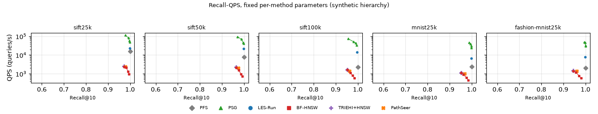

**图 11** 五个评估点的 Recall–QPS 实测曲线：横轴 Recall@10，纵轴 QPS（对数）；PSG/LES/BF-HNSW 的折线只连接各自扫描到的 ef 工作点，不做插值；PFS、TRIEHI+HNSW、PathSeer 为单点。TRIEHI+HNSW 与 BF-HNSW 共图同参，故两点重合（结果一致，不是漏画）。

| 数据点 | PFS（精确） | PSG ef21 | LES ef32 | BF-HNSW ef384 | TRIEHI+HNSW |
|---|---:|---:|---:|---:|---:|
| sift25k | 1.0000 / 16,054 | 0.9784 / 113,003 | 0.9992 / 22,569 | 0.9730 / 2,355 | 0.9730 / 2,558 |
| sift50k | 1.0000 / 7,829 | 0.9714 / 95,347 | 0.9984 / 21,243 | 0.9654 / 2,191 | 0.9654 / 2,230 |
| sift100k | 1.0000 / 2,222 | 0.9564 / 74,304 | 0.9970 / 14,471 | 0.9534 / 1,654 | 0.9534 / 1,644 |
| mnist25k | 1.0000 / 2,343 | 0.9882 / 45,944 | 0.9996 / 6,751 | 0.9524 / 1,154 | 0.9524 / 1,112 |
| fashion-mnist25k | 1.0000 / 2,002 | 0.9953 / 48,790 | 0.9995 / 7,824 | 0.9442 / 1,375 | 0.9442 / 1,456 |

表中每格为 Recall@10 / QPS `[已测]`；所有行的作用域违规与重复 id 均为 0。BF-HNSW 与 TRIEHI+HNSW 在 2–8% 查询上返回不足 10 个结果，LES、PSG、PFS 全部填满。

| 数据点 | 索引口径 | PSG | LES | BF-HNSW |
|---|---|---:|---:|---:|
| sift25k | 各自实现磁盘字节 | 48.7 MB | 31.5 MB | 19.6 MB |
| sift50k | 同上 | 97.4 MB | 61.7 MB | 39.2 MB |
| sift100k | 同上 | 199.8 MB | 124.1 MB | 78.4 MB |
| mnist25k | 同上 | 218.5 MB | 43.8 MB | 85.2 MB |
| fashion-mnist25k | 同上 | 218.6 MB | 39.4 MB | 85.2 MB |

空间方向稳定：LES 目录在五个点上都小于**重复向量版本**的 PSG（0.62×（SIFT100k）至 0.18×（Fashion-MNIST）），但在 SIFT 上大于 **float32** 的 BF-HNSW 序列化索引（1.6×），因为 LES 目录还包含 u8 向量与逐作用域上层。该比较仍不是同内存预算：PSG 的 `c_*.bin` 逐作用域复制局部向量，BF-HNSW 存 float32 全量向量，LES 存 u8 全量向量加共享边。

**空间构成决定了这个比较的性质。** 把 sift100k 的 PSG 度数降到 M=6/12/16，索引为 160.5/173.2/182.0 MB；字节随 M 的斜率约 2.2 MB/M、截距约 146.8 MB，即约 147 MB 是逐作用域重复的 u8 向量。M=6 即使 ef=32 也只有 0.821 召回，所以重复向量版本在 160 MB 以下达不到 r95。

进一步实现**共享向量 PSG**（`GRAPH_SHARE_VECTORS=1`：u8 向量只存一份 `base_u8.bin`，逐作用域文件只存链接；默认关闭）：共享 M=16 索引 62.3 MB，ef=24 时 Recall 0.9494 / 53,256 QPS，ef=48 时 0.9840 / 36,180 QPS，ef=64 时 0.9904 / 30,031 QPS；共享 M=12 索引 53.6 MB，ef=48 时 0.9717 / 40,321 QPS。共享 M=16 与重复向量 M=16 在 ef=24/32 的召回完全相同（0.9494/0.9673），说明布局改动不改变搜索语义 `[已测]`。对**同一张图**做离线转换（保留链接、去掉块内向量、写一份 `base_u8.bin`）后，62.34 MB 索引与 182.0 MB 原索引在 1000 条查询上返回**逐位相同**的结果，ef=24/32 的 QPS 为 60,538/48,833。对照 LES（124.1 MB，r95 25,179，r98 18,142）：共享 M=16 只用 **0.50× 空间**，**当次运行**中 r95 快 **2.12×**、r98 快 **1.99×**（跨 run 绝对 QPS 波动见 §5.8 的同会话重测）。因此 LES 的“更省空间”主要来自 PSG 重复向量；共享向量 PSG 在 62.3 MB（比 LES 大）下更快，但**不能据此称 LES 被严格支配**。严格交错测量与同空间对照（§5.8）显示：在约 53.5 MB 的同空间预算下，LES-v3 在中等召回（约 0.96）反而略快，PSG-M12 只在 r98 领先；PSG-M16 以多约 17% 空间换取 r95/r98 的吞吐优势。

固定工作点的召回不同，故对五个点都补扫搜索宽度（PSG ef = 21/32/48/64，LES ef = 8/12/16/24/48，BF-HNSW ef = 384/512/768/1024）。同召回对照 `[已测]`：

| 数据点 | 对照 | Recall@10 | QPS | 吞吐比 |
|---|---|---:|---:|---:|
| sift25k | PSG ef32 / LES ef16 | 0.9920 / 0.9913 | 84,131 / 51,123 | 1.65× |
| sift50k | PSG ef32 / LES ef16 | 0.9878 / 0.9871 | 69,750 / 39,037 | 1.79× |
| sift100k | PSG ef32 / LES ef16 | 0.9801 / 0.9802 | 51,904 / 18,142 | 2.86× |
| sift100k | PSG ef48 / LES ef24 | 0.9912 / 0.9925 | 43,096 / 13,658 | 3.16× |
| mnist25k | PSG ef32 / LES ef16 | 0.9953 / 0.9959 | 39,028 / 10,865 | 3.59× |
| fashion-mnist25k | PSG ef21 / LES ef12 | 0.9953 / 0.9953 | 48,790 / 17,811 | 2.74× |

按固定召回门槛取各方法最快的**实测**点（不插值）：

| 数据点 | 门槛 | PSG | LES | BF-HNSW |
|---|---|---:|---:|---:|
| sift25k | r95 / r98 | 113,003 / 84,131 | 61,767 / 61,767 | 2,355 / 2,162 |
| sift50k | r95 / r98 | 95,347 / 69,750 | 47,574 / 39,037 | 2,191 / 968 |
| sift100k | r95 / r98 | 74,304 / 51,904 | 25,179 / 18,142 | 1,654 / 602 |
| mnist25k | r95 / r98 | 45,944 / 45,944 | 16,559 / 16,559 | 1,154 / 440 |
| fashion-mnist25k | r95 / r98 | 48,790 / 48,790 | 17,811 / 17,811 | 1,206 / 584 |

**这是一个对当前 LES 实现不利的结果，应当如实报告**：同召回下 PSG 快 1.65–3.59×，LES 只以更小索引为代价；LES 在窄 beam（ef=8）上 Recall 降至 0.82，说明共享并图度数更高、候选扩张更分散，需要更大的 ef 才能达到相同召回。它修正了 H2 旧表中“LES QPS 高于 BF-HNSW”容易被误读为整体更快的印象：在固定 ef 下 LES 的召回更高，同召回时并不占优。共同点也确实存在：PFS 的精确扫描在 100k 规模或 784 维时降到 2.0–2.3k QPS，图方法仍是必要路径；PSG 与 LES 均把 BF-HNSW 的 0.95 附近召回提高到 0.97–0.999。

**度数不是唯一原因。** 为检验共享并图的度数膨胀（均值约 19 → 37）能否解释差距，在 sift100k 上测试两类裁剪（`les_build --max-degree` / `--max-bucket-degree`，默认关闭）：全局按距离保留 top-24 会把 Recall 打到 0.33–0.40、只有 710/1000 查询填满，因为被删边在祖先作用域中仍承担连接；按 $(source, activation)$ 桶保留 top-16 可维持 0.989 召回，并把 r95 吞吐从 25,179 提到 29,973（+19%）、索引从 124.1 MB 降到 104.5 MB，但仍只有 PSG 的 0.40×。因此差距主要来自跨作用域并图的访问局部性与路径冗余，而非单纯度数。

**LES-v2：删除死权重并对齐边预算。** 进一步做三项可控优化 `[已测]`：底图从 M=24 降到 16（与共享 PSG 同边预算）；删除 `dist16` 与 `dflag`（三角剪枝实测命中 0/618,585，`dflag` 只服务诊断，二者约 40 MB）；按桶限制到 16 条边。索引从 124.1 MB 降到 **73.6 MB（无桶限）/69.0 MB（桶限）**；r95 从 25,179 提升到 **35,084**（+39%），r98 从 18,142 提升到 **23,504**（+30%）。但共享 PSG 仍为 53,256/36,180 QPS、62.3 MB：LES-v2 在 r95/r98 上是其 $0.66\times$/$0.65\times$，空间是 $1.11$–$1.18\times$，差距由 $2.1\times$ 缩到约 $1.5\times$，仍未翻盘。剩余可解释瓶颈是邻居 id 为全局 u32（PSG 用逐作用域局部 u16）且每次扩展多两次 run 二分；要再逼近，需按激活桶保存局部 id 映射，这会把表示推向“每作用域局部编号”，削弱 LES 单份全局邻接的简洁性。旧索引在新查询程序下仍返回 0.9729，回归通过；LES-v2 的 5,000 个结果无违规、全部填满 $k$。

这些五个点只改变“向量集合与规模”，没有改变层级分布或查询选择率，也没有加入真实目录；因此它们不能替代真实 CCS 标签、Exact 负载或动态更新实验，也不能与 PathSeer 原文六个数据集上的 SOTA 数字直接比较 `[待测]`。

**SOTA 判定**：以上证据仍不支持 SOTA 主张。LES-v2 把同召回差距从 $2.1\times$ 缩到约 $1.5\times$、空间从 $2\times$ 压到 $1.1\times$，但共享向量 PSG 在 sift100k 上仍以 **0.50× LES 空间**快 $2.12\times$（r95）；与 PathSeer、Filtered-DiskANN、iRangeGraph 等文献方法又缺少同数据、同调参、同内存预算、完整配方的对照。LES 当前的贡献是可核对的“边归属—区间切片”表示、空间刻画与可复现的优化路径，而不是性能领先。

### 5.7 RQ6：全部稠密语料上的方向

为回答“是否所有数据集都落后”，在 11 个稠密语料、$n=25$k、统一 1000 条 Subtree 查询上比较 LES-v2 与共享向量 PSG（均 M=16）。SIFT/MNIST/Fashion 保持原生 u8 平方 L2；glove、COCO、NYTimes、Last.fm 原生是 angular/dot 且含负值，统一做 min–max 量化到 $[0,255]$ 后用平方 L2 评测，**这只是同口径的内部比较，不是它们的原生度量**；kosarak/movielens 是 1-D 稀疏 jaccard，无法作为稠密图输入，排除。

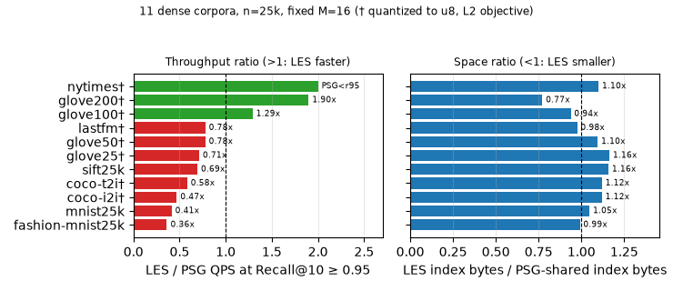

**图 12** 11 个稠密语料上 LES-v2 相对共享 PSG 的吞吐比（r95）与空间比；† 为量化语料。吞吐比 $>1$ 表示 LES 更快，空间比 $<1$ 表示 LES 更小；nytimes 上 PSG 即使 ef=512 也只到 0.891 召回，故标为 PSG<r95。

| 语料（维数） | PSG r95 QPS (ef) | LES r95 QPS (ef) | LES/PSG | 空间比 |
|---|---:|---:|---:|---:|
| sift25k (128) | 113,283 (24) | 78,404 (12) | 0.69 | 1.16 |
| mnist25k (784) | 40,526 (16) | 16,716 (12) | 0.41 | 1.05 |
| fashion-mnist25k (784) | 62,935 (16) | 22,798 (12) | 0.36 | 0.99 |
| glove25† (25) | 113,131 (24) | 80,480 (12) | 0.71 | 1.16 |
| glove50† (50) | 58,390 (48) | 45,383 (24) | 0.78 | 1.10 |
| glove100† (100) | 25,400 (128) | **32,783 (32)** | **1.29** | **0.94** |
| glove200† (200) | 29,000 (128) | **55,058 (12)** | **1.90** | **0.77** |
| coco-i2i† (512) | 55,777 (16) | 26,148 (12) | 0.47 | 1.12 |
| coco-t2i† (512) | 13,642 (128) | 7,926 (48) | 0.58 | 1.12 |
| nytimes† (256) | 0.891 召回上限 (512) | **10,306 (64)** | 达标 | 1.10 |
| lastfm† (65) | 164,721 (24) | 128,080 (12) | 0.78 | 0.98 |

因此结论不是“所有都差”，而是**分化**：11 个语料中 LES-v2 在 glove100、glove200、nytimes 上同召回更快（且前两者索引更小），lastfm 在 r98 上为 $1.17\times$；其余 8 个在 r95 上落后 $0.36$–$0.78\times$。所有**原生度量**语料（SIFT/MNIST/Fashion）都落后，反超只出现在量化后的 angular/dot 语料，说明它更像“高维、量化几何下并图密度反而有利”的局部现象，而不是普遍优势。该现象值得单独定位（例如按维数与选择率分层），但不足以支撑 SOTA。原始数据：`data/all_datasets_20261020.csv`、`data/all_datasets_ext_20261020.csv`、汇总 `data/all_datasets_20261020_summary.csv`。

### 5.8 RQ7：受过滤 ANN 文献启发的 LES-v3

通过 alphaXiv 检索 2026 年的过滤 ANN 工作，抽出三条与当前瓶颈相关的机制：JAG 用“向量 + 属性”联合度量构造按选择率分层的导航边 [13]；Fiber-Navigable Search 把过滤后的子图视为 fiber，并用 anchor atlas 在停滞处重入可行区域 [14]；Uemura 等给边打属性标签、区分始终可走的 $\perp$ 边与条件边 [15]；BOA/PathSeer 则按查询自适应 beam 宽度 [5,16]。其中可直接落地的是**边标签压缩**与**自适应 beam**；fiber anchor 与 JAG 联合构图留作后续。

**E0：不改变边集的执行优化。** 把每次 scope 搜索新建的两个 `priority_queue` 换成查询线程内复用、保留 capacity 的 `vector + push_heap/pop_heap`；level-0 入口复用 upper descent 已算出的距离。比较器、平局规则与停止条件不变。u32/varint、固定/自适应下输出与原实现**逐位相同**（5,000 个 id 全等）；单次运行 fixed ef12 从 29.1 ms 降到 23.5 ms（−19.5%），adaptive ef24 从 36.2 ms 降到 35.6 ms。

**LES-v3 改动一：per-run delta-varint 邻接。** 同一 activation run 内的目标 id 已按升序排列，因此按 run 做 delta 编码、varint 存储是无损的；查询顺序解码，不需要随机访问。索引从 LES-v2 的 73.6 MB 降到 **53.3 MB**（低于共享 PSG 的 62.3 MB），同一 ef 下返回结果与原始 u32 布局**逐位相同**，全部 1,010,797 个 run 解码后逐条比对无差异。

**LES-v3 改动二：按作用域基数自适应 beam。** 用构建期写入的 `counts.bin`（每节点可行对象数）选择 $ef_q$：可行集 $<500$ 时 $ef/2$，$<10000$ 时 $2ef/3$，否则 $ef$。sift100k 上 `--adaptive --ef 24` 得 Recall 0.9807 / 27,666 QPS，较固定 ef=24 的 22,646 QPS 提升 **22%**。

**严格配对测量。** 两种引擎都改为 `original` 查询顺序；PSG 的 `scope` 分组在同一图上快约 13%（20.9→18.2 ms），因此原顺序对 PSG 是保守选择。7 个交错 block、单线程、每 block 每配置一次，取中位数与 IQR（`data/five_l2_strict_blocks_20261020.csv`）：

| 方法（sift100k） | 索引 | r95：Recall / QPS | r98：Recall / QPS |
|---|---:|---:|---:|
| LES-v3（E0，固定/自适应） | 53.3 MB | 0.9506 / **40,687** | 0.9807 / 25,589 |
| 共享 PSG M12 | 53.6 MB | 0.9717 / 34,506 | 0.9813 / **30,289** |
| 共享 PSG M16 | 62.3 MB | 0.9673 / 48,987 | 0.9840 / 37,021 |
| 共享 PSG M16 + adaptive | 62.3 MB | 0.9559 / 51,957 | 0.9876 / 32,800 |

**同空间对照给出分化结论**：在约 53.5 MB 预算下，LES 在 r95 门槛（0.9506 vs 0.9717，阈值口径）快 $1.18\times$；在更接近的召回 0.963 附近（LES ef14 0.9625 / 34,699 vs PSG-M12 ef40 0.9638 / 32,707）快 $1.06\times$；但在 r98 上 PSG-M12 快 $1.18\times$。共享 PSG M16 多约 **17% 空间**，在 r95/r98 上分别快 $1.20\times$/$1.45\times$。因此 **LES 不再是被严格支配的方案**：它以更小空间占据中等召回工作点，只是在 r98 与更大空间预算下落后。

**S1 静态分析（未实现查询引擎）。** 对 M16 底图的每个 $(u,\text{local source})$ 提取有序全局邻接并做 exact interning：$N_{\rm ref}=1,034,631$，唯一列表 1,019,476（唯一率 **0.985**），平均长度 12.8。字节构成：引用 4.14 MB、offsets 8.16 MB、targets 52.11 MB、gid 4.14 MB、upper 1.61 MB、base_u8 12.80 MB，合计 **82.99 MB**，高于共享 PSG 的 62.34 MB 与 LES-v3 的 53.27 MB。按计划中的空间门槛，全量字典**不实现**；该负结果说明逐作用域邻接几乎不可跨 scope 复用，S1 路线到此为止。

**其余负结果**：邻居向量预取使固定 ef24 从 45.2 ms 退化到 56.3 ms，已移除；把 $<1000$ 可行集的查询改走精确扫描无收益（31.0 ms vs 30.4 ms）。

剩余瓶颈仍是并集切片在每个被访问节点上扫描的边数多于 PSG 的 16 条局部邻接；局部 id 字典已因唯一率过高被否决。下一步只剩两个有依据的方向：JAG 式联合构图/fiber anchor，或对高召回区间单独使用更大空间预算。

---

## 6. Related Work and Terminology Audit

本文定位在**属性过滤向量 ANN**，不是向量—向量 join、semantic join、目录枚举或纯集合检索。通用术语包括 HNSW、filtered ANN、top-$k$、Recall@k、CSR、DFS preorder、run-length encoding、inverted list；论文只给“边归属位置”和 LES 起名，以便指向 §3 的一项明确存储机制。其他词应服从领域既有定义，而不能借用跨领域术语暗示已得到新的定理：

| 草稿称谓 | 来源/性质 | 在本文中的准确说法 |
|---|---|---|
| *laminar* | 组合优化的标准概念，要求集合两两不交或包含 [11]；树的**节点子树区间**层状 | 多标签对象的 $F_{\rm Subtree}(u)$ 可能交叠，绝不称“层状对象集”；保留 LES 作为本文机制名称并解释限定 |
| Minimal Activation Frontier / MAF | 本文旧稿自造缩写；“frontier”易误导成几何搜索边界 | 直接用“边归属节点集” $M_e$，可有多个最深节点 |
| Scope Algebra | 把普通集合并、交、差包装成新理论；且多标签对象不服从区间差集 | “作用域谓词与可行对象集”；删除区间布尔闭包定理 |
| Virtual Layer-0 Entry Binding、HALA | 入口保存和层高采样是图索引实现细节；当前不共享上层 | “保留每作用域原入口和上层图”；不主张新分层机制 |
| Hybrid Switch / Adaptive Dual-Mode Engine | 查询优化器按基数在扫描/图搜索之间选路的已有实践；见 Qdrant 查询规划 [10] | “待标定的扫描—图选择”，不是 LES 已实现的成果 |
| Zero-Predicate Overhead | 不精确，切片仍需二分、候选管理及距离计算 | “单 Subtree 的邻接展开不需逐候选标签测试” |
| percolation threshold | 统计物理/随机图借用；未在本图上测得相变点 | “稀疏作用域的导航连通性风险”，不给阈值 |
| Pareto frontier / 最优存储 | 需要完整工作曲线/限定竞争算法，不是数个工作点即可证明 | “已测工作点”/“限定表示模型内的必要归属位置” |

ACORN 明确研究结构化谓词下的向量 ANN 并在查询图遍历时处理谓词 [1]；Filtered-DiskANN 与其他过滤图研究在构建或搜索中利用标签 [2]；直接评分少量候选与图搜索大量候选之间的选择，在生产系统中已有明确的查询规划策略 [10]，因此不应成为本文新颖性主张。**Directory-Aware [9] 是本问题最直接的前序**：它定义 recursive/non-recursive DSQ，比较在线/离线目录路径展开与 TRIEHI，支持目录维护，并把候选集合交给独立向量执行器 [9, §II–IV]。LSSG 研究标签集合的结构，iRangeGraph 针对范围过滤构建元素图 [3,8]。本文需要检验的增量是：对**同一批具体有向 ANN 边**，按两端点共有的祖先闭包最深节点共享 level-0 存储，而不只优化目录候选解析；须与“TRIEHI + 相同 ANN 后端”比较完整索引字节、QPS、召回和连通性。它不是首次支持 Exact/Subtree，也尚无动态维护优势证据。

| 比较对象 | 向量查询和谓词 | 本文需要对齐的实际差异 |
|---|---|---|
| PSG | 相同 Subtree ANN 任务 | 边/向量重复存储换取更小的在线邻接，必须同召回门槛比较 |
| ACORN / BF-HNSW | 向量 ANN + 过滤 | 本文离线利用**固定树**的边激活关系；现有通用过滤能力更广 |
| Directory-Aware：PE-ONLINE / PE-OFFLINE / TRIEHI [9] | 单目录 recursive/non-recursive DSQ；TRIEHI 另支持 MOVE/MERGE | 目录级 bitmap / path index，**不共享 ANN 边**；§5.5–5.6 已测静态 Subtree 同后端端到端（解析开销 <2%），多标签 Exact 与 DSM 待测 |
| iRangeGraph / LSSG | 分别是范围、标签集合过滤 ANN | 需对齐各自构图、查询限制和代码后比较，不能仅凭谓词不同宣称优越 |
| 本文 LES 原型 | Subtree 过滤向量 ANN；Exact 仅有独立扫描基线 | level-0 有向边跨祖先作用域共享；上层仍逐作用域保留 |

## 7. Conclusion

本文的问题是**给定查询向量与目录谓词的过滤 top-$k$ 向量搜索**。Directory-Aware [9] 已解决原始单目录场景的候选范围解析及结构维护，是必须纳入的同题基线；现已补上 TRIEHI 目录层 + 同一 BF-HNSW 图的端到端对照：候选解析开销落在运行噪声内（−8%～+4% 查询时间），不是瓶颈。H1 的物化图有较多重复有向边；H2 的 Subtree 原型可共享 level-0 邻接，LES-Plain 索引目录 144.31 MB / 15,694 QPS / Recall@10 0.9967，LES-Run 索引目录 124.03 MB / 单次测量 12,898 QPS / Recall@10 0.9967 `[已测]`；这些运行没有同召回曲线与严格配对计时。Exact 的独立 PFS 扫描在该合成负载上有效，但不能记到 LES。可信投稿仍需补齐同内存预算、构建资源对齐、真实层级标签，以及 Exact 与动态更新的端到端对照。

五个补充评估点（SIFT 25k/50k/100k、MNIST 25k、Fashion-MNIST 25k，均为合成层级）给出分化结论：LES 相对重复向量的 PSG 索引更小（0.62×–0.18×），但同召回下 PSG 快 1.65–3.59×。共享向量后，同空间对照（约 53.5 MB）显示 LES-v3 在 r95 门槛快 1.18×、在约 0.963 召回快 1.06×，但在 r98 慢 1.18×；共享 PSG M16 以多 17% 空间在 r95/r98 上快 1.20×/1.45×。**LES 不再是被严格支配的方案**：它以更小空间占据中等召回工作点。E0（堆复用、入口距离复用）输出逐位不变、fixed ef12 时间降 19.5%；per-run varint 把索引从 73.6 压到 53.3 MB；自适应 beam 在 ef24 下把 r98 QPS 提高 22%。全量 S1 邻接字典唯一率 0.985、部署 82.99 MB，按空间门槛否决；邻居预取与“小作用域走扫描”的混合规划也均无收益。剩余方向是 JAG 式联合构图/fiber anchor，或对高召回区间使用更大空间预算。精确 PFS 扫描在 100k 规模降到 2,222 QPS，图搜索仍是必要路径；BF-HNSW 在 0.94–0.97 召回区间，TRIEHI 目录层不改变其召回，增加 4.27–17.07 MB 元数据，查询开销未超出运行噪声。跨 11 个稠密语料并非全败：LES-v2 在 glove100（$1.29\times$）、glove200（$1.90\times$）与 nytimes（PSG 达不到 r95）上反超，lastfm 在 r98 为 $1.17\times$；但 8 个语料在 r95 落后，原生 L2 语料在 M16 对照下仍落后。该分化值得按维数/选择率进一步定位，但不足以改变“当前不是 SOTA”的判断。

---

## References

[1] Patel et al. [ACORN: Performant and Predicate-Agnostic Search Over Vector Embeddings and Structured Data](https://doi.org/10.1145/3654923). PACMMOD 2(3), Art.120, SIGMOD 2024.  
[2] Gollapudi et al. [Filtered-DiskANN: Graph Algorithms for Approximate Nearest Neighbor Search with Filters](https://doi.org/10.1145/3543507.3583552). WWW 2023.  
[3] Wang et al. LSSG: Label Set Stratification Graph for Filtered ANN. arXiv:2609.15058, 2026.  
[4] Jin et al. Curator: Efficient Indexing for Multi-Attribute Vector Search. PACMMOD 4(1), SIGMOD 2026.  
[5] Li et al. [PathSeer: Adaptive Neighbor Handling for Efficient Filtered ANN Search](https://doi.org/10.1145/3802098). PACMMOD 4(3), Art.221, SIGMOD 2026.  
[6] Ait Aomar et al. RWalks: Random Walks as Attribute Diffusers for Filtered Vector Search. PACMMOD 3(3), Art.212, SIGMOD 2025.  
[7] Yang et al. ELI: Elastic Index Selection for Label-Hybrid AKNN. PVLDB 19(4):617–630, VLDB 2026.  
[8] Xu et al. iRangeGraph: Element-Oriented Graph for Range-Filtered ANN. PACMMOD 2(6), Art.239, SIGMOD 2025.  
[9] Wang et al. [Directory-Aware Query and Maintenance in Vector Databases](https://arxiv.org/abs/2606.16903). arXiv:2606.16903v1, 2026.
[10] Qdrant Documentation. [Filtering in Vector Search: When to Use What](https://qdrant.tech/documentation/search-patterns/vector-search-filtering/), §Let the Query Planner Choose, accessed 2026-10-20.
[11] Fife and Oxley. [Laminar Matroids](https://arxiv.org/abs/1606.08354), 2016, Abstract (laminar family 的集合定义).
[12] Malkov and Yashunin. [Efficient and Robust Approximate Nearest Neighbor Search Using Hierarchical Navigable Small World Graphs](https://doi.org/10.1109/TPAMI.2018.2889473). IEEE TPAMI 42(4):824–836, 2020; online 2018.
[13] JAG: Joint Attribute Graphs for Filtered Nearest Neighbor Search. arXiv:2602.10258, 2026.
[14] Fiber-Navigable Search: A Geometric Approach to Filtered ANN. arXiv:2604.00102, 2026.
[15] Uemura et al. Simple and Fast Algorithm for Graph-based Filtered Approximate Nearest Neighbor Search. arXiv:2607.24173, 2026.
[16] BOA: Beamwidth Online Adaptation for Filtered-ANNS on a GPU. arXiv:2609.16175, 2026.

---

## 附录 A：命题与实现状态

| 内容 | 可证明或可执行的范围 | 状态 |
|---|---|---|
| §4.1 单节点 Subtree 的端点资格 | 固定有向边并集；不保证 ANN 搜索召回或原图邻接相等 | 已证明 |
| Exact 的所有共同直接标签位置 | 必要条件；当前构建器未产生完整 Exact 边桶 | 待实现 |
| 多节点反链并 | 分节点搜索、按 id 去重；多标签可重叠 | 已实现 |
| 布尔交差的“区间编译定理” | 多标签反例推翻，删除 | 不成立 |
| 完整 top-$k$（可行集不足 $k$） | 需要扫描补足；原型未实现 | 待测 |
| 上层共享、更新、多树组合 | 当前没有对应索引或实验 | 待测 |

## 附录 B：作图数据

QPS–Recall（Subtree，1365 节点，已测）：

```
方法,ef,qps,recall_at_10
PFS,–,3008,1.0000
PSG,21,74706,0.9641
BF-HNSW,384,1282,0.9524
BF-HNSW,512,991,0.9642
LES-Plain,32,15694,0.9967
LES-Plain,48,11908,0.9992
LES-Plain,64,9940,0.9999
LES-Plain,96,7210,1.0000
LES-Plain,128,5764,1.0000
LES-Run,32,12898,0.9967
```

QPS–空间（H2 Subtree；不同方法的文件口径尚未统一）：

```
方法,qps,报告或重计目录MB,来源
PFS,3008,51,历史记录
PSG,74706,194,历史记录
BF-HNSW,1282,75,历史记录
LES-Plain,15694,144.314,当前目录字节重计
LES-Run,12898,124.029,当前目录字节重计
```

激活元数据（H2，同一组边）：

```
编码,旧逐边u16,新run索引,零阶熵参考
字节,26775408,6490862,约1148000
```

覆盖半径比（85 节点，已测）：

```
深度,0,1,2,3
γ均值,1.000,1.042,1.131,1.207
```

延迟—规模（LES ef=32，单次运行，已测）：

```
可行集规模桶,<1k,1–10k,10–20k,20–40k,40–60k,60–100k
p50 (us),28.1,46.6,74.5,107.2,113.0,188.9
p95 (us),49.1,120.3,148.1,189.8,247.1,310.0
查询数,168,307,230,96,179,18
```

Exact 模式对照（1000 条查询，ef=32，已测）：

```
方法,QPS,Recall@10,违规率,填满k
PFS,191914,1.0000,0.0,1000/1000
旧原型 exact_edges 诊断,37310,0.9221,0.074,999/1000
旧原型 exact_strict 诊断,45078,0.9269,0.000,941/1000
```

五个补充负载（合成 1365 节点层级；每格 Recall@10/QPS；复现见 `2026-10-20-exps/experiments/five-l2-benchmark.md`）：

```
数据点,PFS,PSG ef21,LES ef32,BF-HNSW ef384,TRIEHI+HNSW
sift25k,1.0000/16054,0.9784/113003,0.9992/22569,0.9730/2355,0.9730/2558
sift50k,1.0000/7829,0.9714/95347,0.9984/21243,0.9654/2191,0.9654/2230
sift100k,1.0000/2222,0.9564/74304,0.9970/14471,0.9534/1654,0.9534/1644
mnist25k,1.0000/2343,0.9882/45944,0.9996/6751,0.9524/1154,0.9524/1112
fashion-mnist25k,1.0000/2002,0.9953/48790,0.9995/7824,0.9442/1375,0.9442/1456
```

同召回对照（五点，最终扫描）：

```
数据点,PSG ef/Recall/QPS,LES ef/Recall/QPS
sift25k,32/0.9920/84131,16/0.9913/51123
sift50k,32/0.9878/69750,16/0.9871/39037
sift100k,32/0.9801/51904,16/0.9802/18142
sift100k,48/0.9912/43096,24/0.9925/13658
mnist25k,32/0.9953/39028,16/0.9959/10865
fashion-mnist25k,21/0.9953/48790,12/0.9953/17811
```

r95 / r98 门槛吞吐（实测点取最快，不插值）：

```
数据点,PSG r95/r98,LES r95/r98,BF-HNSW r95/r98
sift25k,113003/84131,61767/61767,2355/2162
sift50k,95347/69750,47574/39037,2191/968
sift100k,74304/51904,25179/18142,1654/602
mnist25k,45944/45944,16559/16559,1154/440
fashion-mnist25k,48790/48790,17811/17811,1206/584
```

度数裁剪诊断（sift100k）：

```
变体,ef,Recall@10,QPS,填满k,索引MB
无裁剪,16,0.9802,18142,1000,124.1
全局top24,32,0.4027,29670,710,44.9
每桶top8,32,0.9775,20436,1000,78.7
每桶top16,24,0.9884,15955,1000,104.5
每桶top24,16,0.9787,27392,1000,116.5
```

PSG 空间—召回扫描（sift100k，索引字节随 M 的截距约 146.8 MB）：

```
M,索引MB,ef,Recall@10,QPS
6,160.5,32,0.8212,70355
12,173.2,32,0.9488,42570
16,182.0,32,0.9673,52740
24,199.8,32,0.9970,14471
```

共享向量 PSG（sift100k，`GRAPH_SHARE_VECTORS=1`）：

```
M,索引MB,ef,Recall@10,QPS
12,53.6,32,0.9487,49094
12,53.6,48,0.9717,40321
16,62.3,24,0.9494,53256
16,62.3,48,0.9840,36180
16,62.3,64,0.9904,30031
```

LES-v2（sift100k，M=16 底图，删除 `dist16`/`dflag`，桶限可选）：

```
变体,索引MB,ef,Recall@10,QPS
无桶限,73.6,12,0.9506,35084
无桶限,73.6,24,0.9880,22103
桶限16,69.0,16,0.9691,29571
桶限16,69.0,24,0.9861,23504
```
