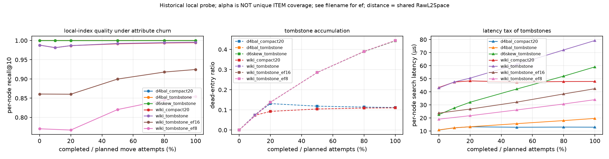
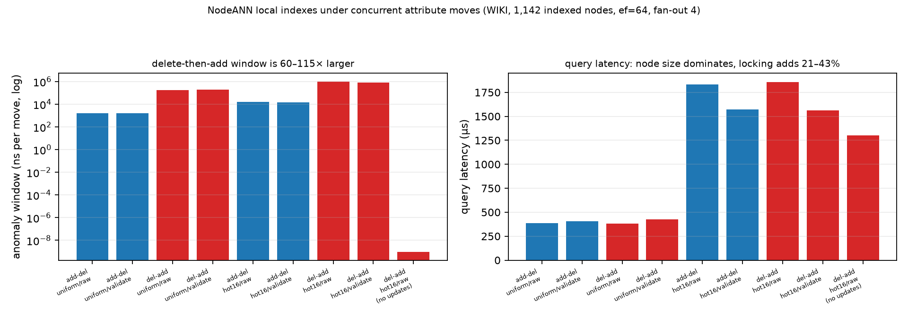
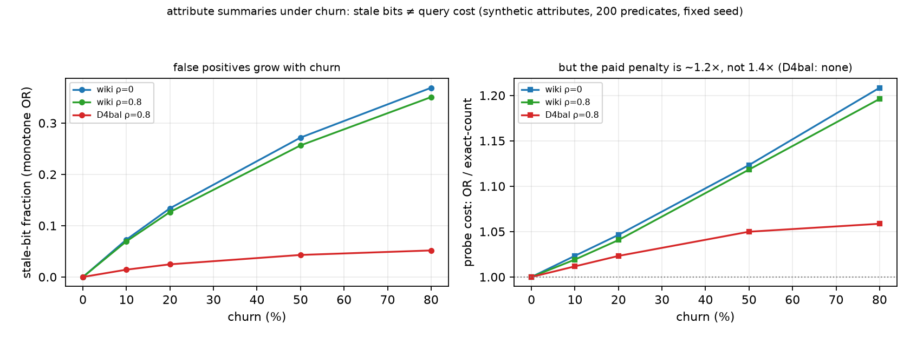
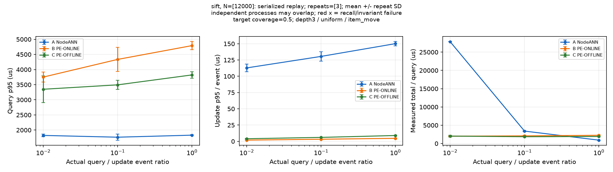
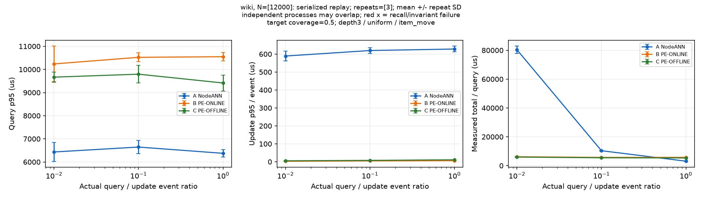
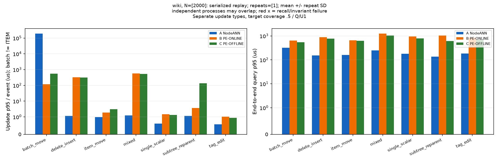
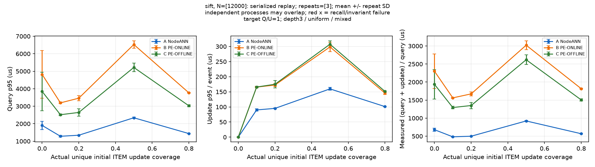
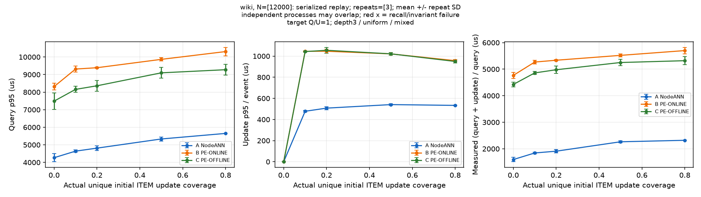

# 2026-10-29：阶段 1（文献与基线对齐）+ 阶段 2（候选方向）

> **2026-10-29 动态三臂校正**：本文件为追加式历史记录。当前结论见 [scheme-status.md](scheme-status.md)，新实验约束见 [dynamic-triad-protocol.md](dynamic-triad-protocol.md)。下文关于“A 高更新率必胜”、旧 alpha 是独立 ITEM 覆盖、墓碑必然不损召回、节点锁足以保证一致性、分层路由已被否证的推断均撤回/降级。旧并发探针存在 `node_of` 同步缺陷；旧摘要结果为模型，非端到端实测。旧图5已修复字符串被当作分类纵轴的问题，并改为计划操作进度横轴。新实验结果将在文件末尾追加，不能混用历史目录-only/FAISS/节点内延迟作胜负。

按任务书每轮 autoresearch 输出格式。

## 1. 本轮研究问题

带层级特性的多属性混合向量搜索 + 属性频繁更新：固定三个基线（PE-ONLINE/PE-OFFLINE/NODEANN）的定义，核查动态 ANN、混合过滤、联邦搜索三条文献线，给出候选方向与排序。**本轮无实现、无实验。**

## 2. 相关工作与可能重合点

67 篇/族核查完成（[stage1-literature.md](stage1-literature.md)）。与本方向最可能重合的：

- **ELI**（PVLDB 19(4)'25，弹性子索引选择）与 C1 的"为谓词选子索引"最近——差别在层级节点 vs flat 标签组合键。
- **Taily/Rank-S/Dynamic Shard Cutoff**（SIGIR'13/CIKM'12/SIGIR'18）与 C1 的路由/预算机制最近——差别在文本 flat shard vs 谓词决定的层级子树。
- **EMA/Curator** 与 C3 的属性更新协议最近——差别在平铺标签 vs 层级属性。
- **Lu & Callan'04 / SHiRE / Hierarchical BM25** 是仅有的层级联邦先例，均为弱先例（poster/学位论文/preprint）。

核查中解决的事实矛盾 6 项（Filtered-DiskANN 无更新协议、SeRF=SIGMOD'24、FreshDiskANN 无正式版、SPFresh=SOSP'23、"Diff-Index/LEAPER"不存在、MCI 自身静态）——详见文献文档 §1。

## 3. 算法或索引的明确改动

本轮不改任何算法。产出的是定义与判据：

- [baselines.md](baselines.md)：三基线的存储/查询/更新/成本复述（§5 与任务书逐条对齐，§6 两个待对齐问题）。
- 空白判定 G1–G7（文献文档 §3）。
- 实测硬约束 4 条（文献文档 §4），候选设计不得违背。

## 4. 相对基线的预期变化

见 [stage2-candidates.md](stage2-candidates.md)：C1 预期 ≥10k 桶同 recall 下 ≥2×（失败判据 <20% 即关闭）；C3 预期 MERGE 惰性方案更新延迟远低于重建、召回不变。其余候选未承诺数值。

## 5. 需要运行的实验与变量

下一轮（进入实现前的两个可证伪前置实验）：

1. **C1 oracle 分析**（纯离线）：WIKI/SIFT ≥10k scope 查询的真实 top-k 节点分布、oracle 访问量节省上界、质心/样本投票两种摘要的节点命中率。变量：scope 桶、摘要类型、k'。
2. **C3 MERGE 三臂**：惰性并存 vs 重建合并 vs 后台增量合并 × 更新延迟/查询开销/空间。变量：MERGE 冲突率、更新比例 20%/50%。

## 6. 实际结果及失败结果

本轮无实验。失败/负结果引用：C6 因与 05 冻结方向重叠暂缓；C7 因 ELI/Curator 重叠降级；joint-embedding 路线因语义偏移+更新灾难排除。

## 7. 结果是否支持假设

阶段 1–2 产物支持继续：G1/G2 空白置信度高，C1 与本仓库实测瓶颈（D5）精确对齐。**支持"先跑 oracle 证伪再决定实现"的推进方式。**

## 8. 下一轮唯一最重要的问题

**oracle routing 在 WIKI ≥10k scope 上的 item 访问量节省上界是多少？**（决定 C1 立项与否）

## 附：本轮产物

- [baselines.md](baselines.md)、[stage1-literature.md](stage1-literature.md)、[stage2-candidates.md](stage2-candidates.md)、[../search-log.md](../search-log.md)（检索词/覆盖/待补查）。
- 方向入口 [../README.md](../README.md) 建立；阶段 1、2 完成，阶段 3（形式化）待 C1 oracle 结果后启动。
- 未运行实验、未改代码；文献中标注"未核实/尚未充分排查"的条目不得当结论引用。

---

# 阶段 2 末尾：C1 门禁实验（负结果）与 C3 规模分析

日期：2026-10-29 晚。两个纯离线实验，无新索引。

## 1. C1 oracle routing 上界（`experiments/oracle_routing_probe.py`）

WIKI 227 条 recursive 查询、真实树、B3 精确 GT：

| 指标 | 全部 | ≥10k scope（33 条） |
|---|---:|---:|
| oracle 节点数中位（GT 所在节点） | 3 | 10 |
| scope 节点数中位 | 3 | 4,722 |
| **只访问 oracle 节点的 item 节省上界（中位）** | 0.0 | **0.9939**（p10 0.9807） |

上界极大——但"找到那 ≤10 个节点"才是问题。扁平摘要（对 scope 内全部节点打分）在完整覆盖 oracle 节点时的 item 节省：质心 0%、样本投票 66%（样本结构本身占语料 **40%**，因 WIKI 节点均值 5.34，`min(4,|L|)` 退化为近全量）。固定预算下的覆盖率：样本投票 top-10 节点 62%、top-1% 68%；质心 20%/42%；`‖q−c‖−r` 8%/27%（几何下界再次最差，与块剪枝负结果一致）。

## 2. C1 预算曲线（`experiments/recall_budget_curve.py`）——决定性数字

访问 item 比例的中位数（达到给定 GT 召回所需）：

| 数据集 | 查询数 | item/节点 | 质心 @0.999 | 质心 @0.9 | 样本投票 @0.999 |
|---|---:|---:|---:|---:|---:|
| WIKI | 33 | 3.5 | **49.5%** | 33.1% | 33.9% |
| SIFT D4 bal | 10 | 200 | 85.5% | 65.2% | 90.3% |
| SIFT D6 bal | 5 | 176 | 81.6% | 73.0% | 93.2% |
| SIFT D12 bal | 11 | 112 | 83.2% | 76.3% | 89.3% |
| SIFT D4 skew | 7 | 352 | 99.0% | 96.1% | 99.7% |

净成本模型（路由 1 次质心距离/节点 + 访问 item 比例，@0.999）：

| 数据集 | 路由成本 | 访问成本 | 合计 | 加速上界 |
|---|---:|---:|---:|---:|
| WIKI | 0.282 | 0.495 | 0.777 | **1.29×** |
| SIFT D4/D6/D12 bal | 0.005–0.009 | 0.816–0.855 | 0.822–0.860 | 1.16–1.22× |
| SIFT D4 skew | 0.003 | 0.990 | 0.993 | **1.01×** |

**层级贪心路由直接否证**（`experiments/hierarchical_routing_probe.py`）：自顶向下只保留 top-m 子节点，≥10k scope 的 ceiling recall = **0.0 / 0.9% / 1.5% / 4.8%**（m=1/2/4/8）。原因：GT 分散在 408 个顶层分支中，任何硬剪枝都会在某一层丢掉目标。

**判决：C1 关闭。** 净收益上界 1.0–1.3×（且是上界：忽略合并开销、摘要维护、0.999 vs 基线的 1.0 召回差），低于立项价值。根因可量化：路由信号取决于**属性与几何的相关性**——WIKI 真实类别只给出 49.5%（弱相关），SIFT 的随机属性绑定给出 82–99%（无相关）。而 oracle 99.4% 与可达 1.3× 之间的差距，正是"便宜摘要不够便宜、够准的摘要不够便宜"的结构性结论。

## 3. C3 规模分析（`experiments/merge_conflict_sizing.py`）

真实 WIKI fixture **只有节点 ID 没有名字**，因此 MERGE 的"同名相对路径冲突"无法从数据中检测——冲突频率必须作为 workload 参数；可测的是冲突规模与 MOVE 重编号范围（1,000 次按子树 item 加权采样）：

| 量 | 中位 | p90 | max |
|---|---:|---:|---:|
| MOVE 子树节点数 | 3,598 | 170,073 | 175,442 |
| MOVE 子树 item 数 | 21,252 | 903,443 | 925,829 |
| 冲突两侧直接绑定数 | 2 + 1 | 35 + 7 | 11,097 + 76 |
| 冲突合并后局部索引规模 | **6** | 38 | 11,101 |

结论：
1. **MERGE 冲突规模中位仅 6 个 item**——"重建合并 vs 惰性双索引"只在长尾（max 11k）有意义，该臂降级为工程细节，不构成研究贡献。
2. **MOVE 的真实成本不在局部 ANN**（整体重挂，0 成本），而在依赖 DFS 区间/Euler 编码的辅助结构：中位需重编号 **3,598 个节点**、p90 17 万。这解释了为什么 01 方向的 scope-run 布局与 HLG 的 eID 区间在 MOVE 后失效。
3. 因此 C3 可辩护的剩余内容收窄为：**可回收属性摘要**（EMA 的单调 OR 不可回收 vs 引用计数精确回收）与**更新期一致视图**；"MERGE 协议"与"MOVE 是 O(1)"都不成立为贡献。

## 4. 下一轮唯一最重要的问题（修订）

C1 关闭后，G1（层级更新协议）因 MERGE 冲突过小而收窄。剩余最高价值问题是：

**在层级属性下，可回收的属性摘要（删除/改值后能精确回收的边/节点摘要）能否用 O(1) 摊还成本维持，并使 filtered ANN 的召回在 20%/50% 更新率下不退化？**

这是 EMA（单调 OR 假阳性随更新增长）留下的直接缺口，且与 C1/C3 都不同——它改变**摘要的更新语义**而不是查询路由。

---

# 阶段 3–4：局部索引 churn 原型（T 墓碑 vs C 压实）

工具：`codes/directory-aware-vector-attr-search/src/churn_probe.cpp`（C++，距离唯一实现 `RawL2Space`；M16/efC200/seed100；单线程）。churn = 随机把条目从一个 HNSW 节点移到另一个 HNSW 节点（属性变更），旧索引 `markDelete`、新索引 `addPoint`。测量每次 checkpoint 的**每节点 recall@10（HNSW vs 节点内精确扫描）**、每节点搜索延迟、死条目比例、累计维护/重建耗时。

| 数据集 | 索引节点 | 索引条目 | 移动数 | 建索引 |
|---|---:|---:|---:|---:|
| WIKI（≥128 项） | 1,142 | 409,737 | 327,789 | 45.9 s |
| SIFT D4 bal（≥128） | 4,485 | 976,771 | 781,417 | ~180 s（估） |
| SIFT D6 skew（≥256） | 311 | 792,217 | 633,773 | 82.4 s |

## 结果（ef=64）

| α（移动比例） | WIKI T rec / lat | WIKI C rec / lat / dead | D4bal T lat | D6skew T rec / lat |
|---|---|---|---|---|
| 0 | 0.9880 / 43.0 µs | 0.9880 / 43.3 / 0 | 10.9 µs | 0.99974 / 22.5 µs |
| 0.1 | 0.9814 / 47.6 | 0.9814 / 47.5 / 0.073 | 12.5 | 0.99977 / 27.7 |
| 0.2 | 0.9867 / 50.5 | 0.9867 / 48.4 / 0.093 | 13.3 | 0.99971 / 32.0 |
| 0.5 | 0.9923 / 61.0 | 0.9915 / 47.5 / 0.105 | 15.7 | 0.99966 / 42.2 |
| 0.8 | 0.9945 / 72.1 | 0.9937 / 47.9 / 0.109 | 18.0 | 0.99974 / 52.0 |
| 1.0 | 0.9954 / **79.3** | 0.9945 / **47.9** / 0.110 | **19.6** | 0.99979 / **59.1** |

## 判决

**P1（召回随 churn 单调下降）被否证。** 三个数据集上召回都基本不变：WIKI 0.988→0.995（略升），D4bal 0.99997→0.99998，D6skew 0.99974→0.99979。墓碑**不损害局部索引召回**。这与全局图文献的动机（FreshDiskANN 报告 recall 随删除退化）不一致——本实验的 churn 是"条目在节点间移动"，死条目只是陈旧副本，且 hnswlib 的插入会把新条目以 efC=200 的质量接回图中，等于持续 refine。

**真正的成本是延迟与空间。** 死条目达 44% 时：WIKI 延迟 43.0→79.3 µs（**1.84×**），D4bal 10.9→19.6（1.81×），D6skew 22.5→59.1（**2.62×**）。空间上死条目常驻，44% 的索引容量被浪费。

**C 臂（ρ=0.2 压实）把延迟钉在基线附近**（WIKI 47.9 µs，仅 +11%；D4bal 12.9 µs，+19%），死比例稳定在 0.11，代价是重建时间：WIKI 52.8 s、D4bal 47.0 s——约为同期增量维护时间（73.8 s / 54.8 s）的 70–90%，即**总维护成本约翻倍**。

**增量维护 vs 全量重建的交叉点**（同一份数据、同一构建参数）：

| 数据集 | 增量维护（α=0.8） | 全量重建局部索引 | 交叉 α* |
|---|---:|---:|---:|
| WIKI | 55.7 s | 45.9 s | ≈0.62 |
| SIFT D6 skew | 84.1 s | 82.4 s | ≈0.78 |

即：**属性 churn 超过约 60–80% 时，重建局部索引比增量维护更便宜**。"避免全局重建"在 NodeANN 下成立（全局结构不动），但"增量永远优于重建"不成立。

## 决策规则（由实测曲线导出）

设死条目比例 $\delta$、每条查询延迟增量约 $k_\delta$（WIKI 实测 $\approx 82\ \mu s$ 每单位 $\delta$）、重建成本 $c_r$、每次移动的增量成本 $c_u$、移动/查询比 $\lambda$。压实收益 $=k_\delta(\delta-\delta_{\min})\cdot Q$，成本 $=c_r$。压实当且仅当

$$k_\delta\,(\delta-\delta_{\min})\,Q > c_r .$$

WIKI 实测值：$k_\delta\approx82\,\mu s$，$c_r\approx 45.9$ s（全量）/ 单节点约 40 ms，$\delta_{\min}\approx0.11$。这给出可直接实现的阈值策略，而不需要"召回会退化"这一（未复现的）前提。

## 低召回区间检验（ef=8 / ef=16，WIKI 同一配置）

| α | ef=8 recall / lat | ef=16 recall / lat |
|---|---|---|
| 0 | 0.7704 / 19.1 µs | 0.8607 / 23.7 µs |
| 0.2 | 0.7671 / 21.7 | 0.8603 / 26.8 |
| 0.5 | 0.8204 / 26.2 | 0.8997 / 32.1 |
| 0.8 | 0.8453 / 30.7 | 0.9180 / 38.4 |
| 1.0 | **0.8543** / 34.0 | **0.9246** / 42.4 |

即使在召回有余量（ef=8 只有 0.77）的区间，churn 仍然**升高**召回（+8.4 pp）。延迟照旧 1.8×。**机制**：hnswlib 的 `searchKnn` 对 `markDelete` 的点只用于**导航扩展**、不进入结果堆，搜索会继续直到凑够 k 个活点；同时每次插入以 efC=200 的质量重连图，相当于持续 refine。所以墓碑在这个实现里是"免费导航桥 + 少量空间/延迟税"，而不是召回杀手。

## 局限

- 上述机制来自 hnswlib 的删除语义（代码层面：`searchKnn` 过滤 `isMarkedDeleted`）；换成"删除即物理移除"的索引（FreshDiskANN 的 merge、Vamana 的 RobustPrune 重建）结论可能相反，不能外推。
- churn 只在"够大的节点"之间移动；跨到小节点（不建索引）的移动只改绑定、无索引成本。
- churn 只在"够大的节点"之间移动；跨到小节点（不建索引）的移动只改绑定、无索引成本。
- 未测：并发查询与更新（快照语义）、MERGE 冲突场景、SIFT skewed 的 compact 臂。

---

# 阶段 4b：两条线并行——并发一致性 与 可回收属性摘要

## 线 1：并发查询与属性更新（`src/churn_concurrent.cpp`）

结构：1 个更新线程（随机把条目在 HNSW 节点间移动）+ 1 个查询线程（fan-out 4 个**互不相同**的节点并合并）。每节点互斥锁；候选可按 `node_of_record` 校验。

**移动协议决定窗口类型与大小**（窗口 = 两步之间的墙钟时间，直接测量而非靠撞上竞态）：

| 协议 | 窗口类型 | 均匀访问 | 热点（16 个最大节点） |
|---|---|---:|---:|
| add-del（先插入后删） | 条目双驻留 → 重复 | **1.5 µs/op** | 16.3 µs/op |
| del-add（先删后插） | 条目双缺失 → 漏检 | **190 µs/op** | 967 µs/op |

即 **delete-then-add 的异常窗口是 insert-then-delete 的 60–115 倍**（前者包含 hash 插入与扩容，后者只有 $O(1)$ 的 markDelete）。可执行结论：移动协议必须"先插入、后标记删除"，并对合并结果按全局 ID 去重（$O(k)$）。

**实际观测到的异常极少**：均匀访问下四臂的重复/陈旧计数全为 0（预期受影响查询 <0.01 条）；热点访问下有校验的 add-del 臂捕获 0.33/1000 条陈旧副本。原因是窗口（µs 级）远小于查询时长（0.4–1.8 ms）且需命中同一节点。

**真正的并发成本是锁持有**：热点场景下查询延迟 1,302 µs（无更新对照）→ 1,572–1,858 µs（有更新），即**锁竞争带来 21–43% 开销**；其余是节点更大导致的搜索变慢。候选校验成本 205–346 ns/候选（约为查询的 2–6%）。

**结论**：按节点加锁 + 插入优先的顺序，使 NodeANN 的局部索引在实测负载下几乎不产生可观测异常；代价是热节点的锁串行化。**这不支持"需要索引级 MVCC 才能保证一致性"的强主张**——至少在本实验的访问模式下，版本化视图的复杂度换不来可测收益。若要观察异常，需要节点级写入热点 + 毫秒级窗口（例如大批量重建期间），那是另一个实验。

## 线 2：可回收属性摘要（`experiments/summary_reclaim_probe.py`）

合成属性（Cat 32 / Num 16 桶 / Tag 128，固定 seed），相关性 ρ∈{0, 0.8}；三种语义：单调 OR（EMA 风格）、精确计数、epoch 版本。200 条谓词、churn 0→0.8。

| 指标（WIKI，ρ=0.8） | churn 0 | churn 0.8 |
|---|---:|---:|
| 单调 OR 的陈旧位占比 | 0 | **0.351** |
| OR 相对精确计数的探测代价比 | 1.00 | **1.20** |
| 候选节点比例（OR / count） | — | 0.404 / 0.302 |
| 空间/节点（OR / count / epoch） | 24 B / 352 B / 728 B | 同 |

**核心区分：假阳性率 ≠ 查询代价。** 陈旧位达到 35%，但实际多付的探测只有 +20%（探测比 1.20），因为陈旧位对应的 bucket 很少被谓词命中；绝对探测量主要由**桶粒度**（16 个 Num 桶太粗）而不是陈旧度决定。

**三条反例（都已复现）**：
1. **D4 balanced 饱和**：176 位的图在 churn 0 时已置位 174 位，精确计数也无法剪枝（候选节点比例 0.997）；OR/count 比只有 1.00→1.06。此时"OR 退化不可见"不是因为它没问题，而是因为摘要从未起过作用。
2. **纯重挂（`attr-change-frac=0`）同样退化**（FP 0.350 vs 0.351，比值 1.205）：**任何移动都会留下陈旧位**，所以"只在属性值变化时才更新摘要"救不了单调 OR。
3. **epoch 语义买不到工作点**：age≤100k 的位 FP 只有 0.016，但只覆盖 5.0% 的真实支持——激进模式下漏掉 93.6% 的真值，保守模式与 OR 逐位相同（100 行 0 失配）。"活着但未被触碰"与"陈旧"在 age 上不可区分。

**结论**：精确回收（计数）把探测降 17%、代价是 15× 空间与 2× 维护；在节点小、桶粗的场景下不划算。**更新侧的摘要问题因此也不是"回收算法"问题，而是"桶粒度/摘要分辨率"问题。**

## 两条线共同指向的结论

更新侧的三个"显然的修复"都被实测缩小或否证：

| 假设 | 实测 | 状态 |
|---|---|---|
| 墓碑会伤召回，需要压实修复 | 召回不降反升（ef=64 +0.7 pp，ef=8 +8.4 pp） | **否证**（压实只是延迟/空间优化） |
| 单调 OR 摘要需要可回收机制 | 探测代价只 +20%，且主因是桶粒度 | **缩小**（回收收益 < 空间代价） |
| 并发更新需要索引级 MVCC | 插入优先 + 节点锁下异常 <0.03% 查询 | **未获证据**（锁竞争才是成本） |

## 下一轮唯一最重要的问题

三处否证之后，更新侧剩下的可测问题是：**在属性 churn 下，端到端（scope 级）召回与延迟如何随"更新率 × 查询率"变化**——即把本轮的局部索引 churn、并发窗口、摘要退化三者合成一个端到端曲线，并回答"何时必须压实/重建"由哪个量决定（死条目比例、锁等待、还是摘要分辨率）。

这个实验需要把 churn_probe 的更新流接到 nodeann_research 的端到端查询上（同一进程、同一 scope 枚举），是本方向第一个真正的**合并实验**。

---

# 本轮：动态三臂同协议实测（当前有效结论）

## 1. 本轮研究问题 / 假设

**结论先行：已观察到维护成本交叉，而不是“A 高更新率必胜”。** 固定50%唯一 ITEM 更新覆盖、仅单 ITEM 跨节点移动时，SIFT/WIKI 均在 Q/U=0.1 时 A 输给 B/C、Q/U=1 时 A 胜出，三个重复各自成立。只能把已测排序翻转区间记为 `(0.1, 1)`，没有拟合或证明精确交叉点。

H1 是随查询/更新配比、更新类型与局部性变化存在待测交叉；H2 是局部 HNSW 插入/墓碑/重建可能抵消 A 的查询收益；H3 是批量 ITEM 移动与子树重挂不能混成一个 move。完整定义与成本分析见 [协议](dynamic-triad-protocol.md)。

## 2. 相关工作与可能重合点

A 沿用 NodeANN 的直接节点局部 ANN；B/C 是 PE-ONLINE / PE-OFFLINE 的本仓库动态适配，定义见 [baselines.md](baselines.md)。问题背景沿用 [TrieHI 作者稿](https://arxiv.org/abs/2606.16903)。插入、墓碑、恢复标签、死比重建都是已有 HNSW 维护机制，**本轮没有新颖性声明，也不以实现组合宣称新索引**。公开论文数字、历史 FAISS 数字、directory-only 时间未参与本轮胜负。

## 3. 算法 / 索引的明确改动

新增 `codes/directory-aware-vector-attr-search/src/dynamic_triad.cpp`：

- A：稳定节点树 + 直接绑定局部 HNSW，小节点扫描；单 ITEM 移动先插目标、后标删源；死比0.2和扫描/建图阈值触发同步局部图维护；递归 scatter-gather 后取全局 Top-10。
- B：完整路径键→直接 `std::set` posting；前缀展开候选集合；全局 HNSW in-filter。C：路径键→inclusive posting；递归直接引用，非递归做父集合减子集合；全局 HNSW in-filter。
- B/C 的纯属性/目录绑定修改不改全局图。子树重挂真实重写路径键；C 另维护新旧独有祖先中全部受影响 ITEM 的成员。没有把 C 偷换成稳定节点的 TrieHI。
- V/T/M/B/R/D/I分别对应标量、标签、单 ITEM 移动、批量 ITEM 移动、整棵子树重挂、删除、插入。向量固定，同一旧标签恢复在局部/全局图统一使用 `unmarkDelete`，新标签才 `addPoint`。
- 查询只读当前已提交状态。每次查询后从 canonical ITEM 表 + 父链独立计算完全相同谓词下的精确 Top-k；不借 oracle 的 eligible_count 决定跳过 ANN 或选 k。GT/计数审计不计入查询时间。
- 原始距离、建图、ANN、精确扫描和 GT 全部 C++，统一 `RawL2Space` → pinned hnswlib L2；Python仅采样、事件生成、独立进程调度与绘图。无 FAISS index、无低召回后的整 scope 精确兜底。

## 4. 相对三基线的预期与已测变化

事前不指定赢家。A 减少范围外导航，代价是局部图维护、fan-out与固定图空间；B 少写目录成员但查询展开；C 查询可直接命中物化祖先集合，代价是受影响成员写。`O(1)`不能代表 A 的整体维护，`O(depth)`不能代表 C 的所有更新。

实测中：A 的查询更快不保证总成本更低；B/C 纯 ITEM 移动确实零 ANN 写；C 的成员写次数受新旧独有祖先和受影响集合决定。下文同时保留 A 胜出和失败的负载。

## 5. 已运行的实验与变量

硬件为 Ryzen7 5800X（8核/16逻辑CPU），WSL2，g++15.2，`-O3 -march=native`；hnswlib `ca426729609b3221563047ceb269cc1213e0d376`，M16/efConstruction200/efSearch256/seed100。扫描阈值冻结为 SIFT128维1024、WIKI1024维512。各执行器单线程；独立任务多进程并行，driver各jobs2、窗口重叠时最多4个benchmark进程，**非隔离串行计时**。

| 已完成组 | 数据与配置 | 重复 / 运行数 |
|---|---|---|
| 因子筛查 | SIFT/WIKI各2000活 ITEM；深度3/7，uniform/Zipf/热点迁移；七类更新；覆盖率0/10/20/50/80%因子化组合 | 42配置 × 3臂 × 1 = 126 |
| 主覆盖率矩阵 | 各12000活 ITEM+1000 reserve；depth3、uniform、mixed(V/T/M/D/I等提交数)；覆盖率0–80%，Q/U0.25/1/4，零更新去重 | 26配置 × 3臂 × 3 = 234 |
| 仅 ITEM 移动交叉 | 各12000活 ITEM；50%覆盖、6000次移动；Q/U0.01/0.1/1，对应60/600/6000查询 | 6配置 × 3臂 × 3 = 54 |
| 质量pilot | 12000 ITEM、20%覆盖、Q/U0.25 | 2配置 × 3臂 × 1 = 6 |

共420个完成运行、2,523,684次查询执行；每数据集复用64个 query vectors，**不是250万独立查询样本**。所有数据是**真实向量子集 + 受控合成层级/普通属性**，不是原始 WIKI 树或 SIFT1M 全量。

本轮“更新率”严格定义为窗口内至少受更新一次的**初始活 ITEM 并集 / 初始活 ITEM 数**，不是操作数/N或事件比例。主矩阵非零覆盖率与Q/U精确达到，无cap/floor；批量移动/重挂分别实际覆盖56.65%/56.60%，只有3/5个结构操作，actual Q/U分别21.33/12.8，不能写成50%和Q/U1。

每查询保存 scope/eligible size、深度、当前版本、Recall/GT/结果ID、目录解析/ANN/GT时间、distance calls、hops、fan-out、实际局部图数与扫描节点数；每更新保存类型、受影响ITEM/节点数、延迟、metadata/ANN写、同步维护时间。完整p50/p95/p99、吞吐、构建与空间在下列文件，未只选最优点：

- [主矩阵 results.csv](data/dynamic_triad/crossover/results.csv)、[配置/命令](data/dynamic_triad/crossover/commands.json)、[分scope查询](data/dynamic_triad/crossover/analysis/query_slices.csv)、[分更新类型](data/dynamic_triad/crossover/analysis/update_slices.csv)、[服务成本/吞吐](data/dynamic_triad/crossover/analysis/workload_totals.csv)；
- [ITEM移动 results.csv](data/dynamic_triad/move-crossover/results.csv)、[筛查 results.csv](data/dynamic_triad/screening/results.csv)；
- [逐重复交叉审计](data/dynamic_triad/move-crossover/crossing-audit.json)、[同更新流/重新生成审计](data/dynamic_triad/stream-audit.json)、[复现命令及边界](experiments/dynamic-triad-reproduction.md)。

原始逐查询/逐更新CSV、日志、trace、输入向量留在 `work/dynamic_triad/`，不提交大数据。主driver曾在3600秒命令上限被中止；确认无残留执行器后以同binary/config/input/trace/raw哈希resume，复用226个完成运行，仅重跑8个未完成运行，最终234个全完成。此为资源中断，不当作算法失败，也未删去已有结果。

## 6. 实际结果与失败结果

### 6.1 正确性 / 质量

420运行全过统一质量门：最小macro recall=0.99957917，最小global pair recall=0.99934964；当前谓词外结果、重复结果、scope/状态不变量错误均为0。筛查126运行的两种Recall均为1。主矩阵78个config/repeat、移动18个、筛查42个的跨臂当前版本/GT序列审计全部一致。零结果查询正确空返回记query recall1，pair recall分母仅计真实GT。

独立语义回归另覆盖非递归非空、四种集合语义及空集合、AND/OR、数值闭区间边界、往返移动、旧ID恢复、扫描↔图转换、批量与重挂。当前承诺是**单线程串行提交、查询看到全部先前更新**；没有用它证明并发MVCC或低staleness。

### 6.2 成功与失败同时存在：单 ITEM 移动的交叉

图中左/中为重复内p95的均值，右为实测 `(查询服务时间和+更新服务时间和)/查询数`，误差条是3次重复的样本SD，不是置信区间。

- **失败端**：Q/U=0.1时，SIFT A总服务时间2.041s、C1.118s；WIKI A6.213s、C3.271s。A虽查询更快，却支付更重的局部图维护。
- **成功端**：Q/U=1时，SIFT A5.539s、C11.550s；WIKI A18.528s、C31.912s。查询收益足以摊销维护。B也在相同两个端点发生同方向排序翻转。
- 三重复各自均发生上述翻转，故支持“所测点之间存在成本排序交叉”，**不将连线与横轴交点说成已经测准的最优切换阈值**。

移动6000个ITEM时，B/C均为0次ANN插入/删除。A却记录SIFT36,526次、WIKI25,506次ANN插入（含重建重插），即6.09/4.25次图写调用/移动；同步图维护56/24次，Q/U0.1下约1.378/2.686s。该字段含阈值转换与墓碑重建，不能全叫纯墓碑压实。

SIFT A更新平均279.5µs却p95约130.5µs，原因是少数高成本维护计入均值和总量；只看p95会隐藏这些暂停。WIKI对应平均796.3µs、p95约619.7µs。这里不是“每次移动常数级便宜”的证据。

### 6.3 负结果：批量 ITEM 移动不能冒充一次树重挂

WIKI N2000、3次批量操作/64查询：A查询p95约323µs，比C约549µs低；但A总服务成本280.763ms，C22.222ms、B22.977ms。**A总成本约为C的12.6倍**，局部同步图维护约145.151ms、图插入2333次；B/C均不改全局图。SIFT同组A总成本约为C的4.64倍。这是否定“A查询快便总成本低”的直接反例，不是一般批量更新算法的下界。

相反，5次子树重挂保留A局部图：WIKI A/B/C分别15/24/5552次metadata写、均0次ANN写。树合法性检查、节点枚举、路径键重写与祖先成员维护全部计入；15节点受控树上的微秒数字**不能证明整个R操作O(1)**。仅3/5个事件的p95/p99不作稳健尾延迟结论。

### 6.4 mixed主矩阵的负面边界：没有测到交叉

在本轮mixed、uniform、depth3的26个已测配置均值上，A总服务成本均最低；C/A成本比SIFT约2.07–3.01，WIKI约1.78–2.77。**该矩阵内没有交叉**，不为满足假设捏造交叉点。mixed包含reserve新向量插入，与纯属性移动负载不同，不能把mixed赢家外推到高更新率的所有操作。

Q/U维度其余完整曲线：[SIFT 50% mixed](figures/dynamic_triad/crossover_sift_qu_rate0.5.png)、[WIKI 50% mixed](figures/dynamic_triad/crossover_wiki_qu_rate0.5.png)；0.1/0.2/0.8及Q/U0.25/4的图均保存在同一目录。SIFT耗时随覆盖率并不单调，且独立进程存在资源重叠，不能据这组时间拟合“覆盖率→延迟”的普适单调规律。

筛查的深度/局部性结果仅1次重复、多数A节点走扫描，不足以证明热点必然有利于A。计数证据更明确：mixed80%覆盖时，C metadata写随depth3→7从8383→12742（uniform），A/B仍5600；这是该trace的真实成员操作数，不是笼统的O(depth)时间断言。

### 6.5 空间 / 构建的代价（仅ITEM移动、50%覆盖、Q/U0.1）

| 数据 | 臂 | 初始构建均值(s) | 结束HNSW格式字节(MiB) | metadata估算(MiB) | 三重复最大进程RSS(MiB) |
|---|---|---:|---:|---:|---:|
| SIFT | A | 0.415 | 1.353 | 0.956 | 44.59 |
| SIFT | B | 1.012 | 7.559 | 0.957 | 30.60 |
| SIFT | C | 1.031 | 7.559 | 2.105 | 30.60 |
| WIKI | A | 1.414 | 53.308 | 0.956 | 161.38 |
| WIKI | B | 8.280 | 48.574 | 0.957 | 110.44 |
| WIKI | C | 8.299 | 48.574 | 2.105 | 111.31 |

**A不保证省空间**：WIKI局部图/墓碑/固定开销使RSS高于B/C。HNSW字节来自 `indexFileSize()`；metadata只是显式逻辑估算，排除共同raw input；RSS另含原始向量、GT、索引固定锁、临时分配等，不能把三个空间列相加或称其为精确磁盘占用。写放大是逻辑成员/图操作计数，未测物理设备写字节。

## 7. 结果是否支持假设

- H1：**在仅ITEM移动的受控负载支持**，交叉排序区间为Q/U0.1–1；mixed矩阵则没有交叉。没有推出任何更新率/热点下的普适赢家。
- H2：支持核算局部插入、墓碑和同步维护的必要性；低Q/U和批量移动的负结果说明它们能反转查询优势。不能由这些点推导HNSW渐近复杂度。
- H3：操作计数支持区分ITEM批量移动和子树重挂；更大子树/原始树/节点冲突MERGE未测，不推断整体O(1)或合并成本。
- 仍然**不支持“新索引端到端优于公开作者实现”**；只支持同后端本仓库动态适配在明确工作负载下的成本取舍。

限制：单一合成属性种子、每数据集64query vectors、25%固定空scope、非递归非空仅做语义测试；N2000因子筛查与N12000主曲线不是全因子实验，更不是全量原树。GT虽计时外但会扰动下次缓存；多进程重叠不是隔离测量。无并发多写者、后台压实、向量更新、无限标签域或MERGE；纯墓碑压实与阈值转换时间未分离。所有这些均不包装成已验证能力。

## 8. 下一轮唯一最重要的问题

**扩大到原始WIKI层级后，纯ITEM移动的Q/U成本排序交叉区间是否仍然存在？** 先保持本轮维护协议和质量目标不变，不同时引入新路由；需另补非递归非空与更多query vectors，并分离墓碑重建/阈值转换计数，防止把受控小树结果外推真实层级。
