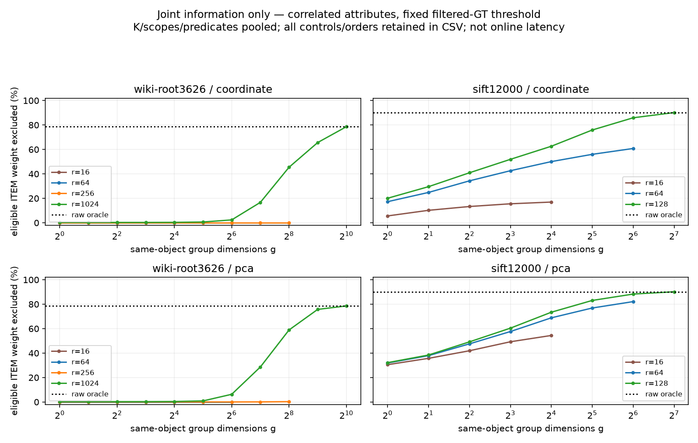

# 第2轮：联合信息诊断与投影损失归因

## 结论

**修正上一轮的因果解释：WIKI并非只因各维取不同对象见证才失败。相同64维表示中，已经取同一对象的完整联合投影最小距离，仍排除0；该投影距离本身就丢失了阈值所需的信息。** 增大普通cell/tuple的精度无法超过这个表示的投影距离oracle。此结论限定本数据、阈值、两basis，不是所有64维编码或ANN都无效。

SIFT存在低阶联合信息，但很多收益在不过滤B上也存在；不能把它全归给F。联合tuple/PQ/VA、几何约束mindist、projection+residual-height又均有直接前序。因此本轮依旧**不放行新在线索引**，不退回动态维护调参。

## 1. 本轮研究问题/假设

将“raw oracle强、独立轴弱”拆成两个可检验原因：投影预算r损失，以及同对象绑定组大小g损失；进一步区分联合几何信息和F新增信息。若r64,g64也弱，就不能仅靠64维中更精细的联合占用结构填补鸿沟；若小g明显加强且超出不过滤界，才有下一步取得机制的机会。

[事前协议](joint-information-protocol.md)在首跑前保存；[完整推导/两族结构/前序/复杂度/并发与失败反例](joint-certificate-analysis.md)供核查。没有事后改阈值或改属性来追正结果。

## 2. 相关工作与重合点

两名只读研究代理并行查原文，父代理核读核心正文并保存三篇完整reader文本：

| 工作 | 与当前候选最接近的已有能力 | 核读定位 |
|---|---|---|
| [IMI journal2015](https://doi.org/10.1109/TPAMI.2014.2361319) | 联合product-cell、tuple posting、空cell、多序列枚举 | §2–4，PDF3–6；不是CVPR2012同版本 |
| [CNN SSTD2001](https://doi.org/10.1007/3-540-47724-1_14) | 约束∩MBR上的更强mindist；过滤后上界witness失效需修正 | §4.2 pp264–268、§5 |
| [Simplex2017](https://doi.org/10.1007/978-3-319-68474-1_7) | 投影坐标＋残余高度上下界，表扫描/重索引 | 实际读arXiv1707.08370v1 §4.2/6 |

VA-file首次取得原文镜像转录，VA+取得UCSB原始PS关键段；两者来源/版本风险及链接在推导文档，未把镜像OCR视为无误原PDF。Omni仅摘要/书目、正文提取失败；Ptolemaic/Hilbert是相关原文线索，不伪称全部全文已归档精读。总库本轮新增3条、2条researcher_synthesis边，当前39条/33边。

特别需要收窄故事：**“过滤条件收紧几何界”这个抽象本身至少已有2001直接实例。** 任意属性F与几何范围不同，但新合同不自动变成新结构。若未来使用量化仍遵守IGP要求；本轮只读PQ/IMI，不实施它们。

## 3. 明确改动

无在线索引改动；增加两个离线信息oracle：

- 分组同对象：L_{r,g}=Σ_G min_{x∈B∩F} ||U_G(q−x)||²。固定r，g按1、2、4…r嵌套合并；g1是首轮gap，gr是完整投影最小距离。
- 径向lift：完整投影距离加正交余空间范数差平方，再对同对象取min；r0为径向，rd退化完整空间。这是已有simplex式收缩，不认领新意。

每种界同时计算wholeB与conditional(B∩F)，都在相同F的同一阈值比较。空块资格排除不计几何收益，wholeB命中资格外对象只会使界更松，不影响对照安全性。

## 4. 相对基线的预期变化

本轮不预设超越NodeANN。信息oracle需要扫描对象，不能作为已实现的查询计划；本轮只有信息曲线，没有PE-ONLINE/PE-OFFLINE/NodeANN新时延、Recall或更新结果。

即使采用局部HNSW找近似min，它返回的也可能是true min上界；不能替换安全下界并剪枝。近似路线仍可研究，但必须单独定义覆盖/Recall，而不能借当前安全证书的数学式掩盖漏召回。

## 5. 实际实验设置

完全沿用首轮冻结场景：WIKI11869×1024、SIFT12000×128，各8条旧query、k10，K32/96，coordinate/PCA，root/broad/narrow，scope-only及三普通谓词，相关/同单元tuple打乱控制。候选数逐块保持与旧场景一致。

- r：WIKI16/64/256/1024，SIFT16/64/128；lift另加0。
- g：所有不超过r的2次幂；contiguous与固定seed-permuted两种顺序，主合计不重复混算。
- 过滤GT半径与共同scope半径都保留。主报告只用filtered_topk；共同半径不是在线filtered停止tau。
- 旧C++统一距离矩阵按输入SHA及矩阵SHA复用，**本轮没有新调用190952次raw距离**。
- WIKI/SIFT两独立进程实际并行；run2各约98.0s/16.8s是离线作业wall，不是隔离性能测量或ANN时延。

run2共173568条诊断记录，仍只有16个源query向量；9216个重合g1 case的候选数/排除数/raw-oracle权重与首轮逐项核对通过。所有r/g/order/basis/control配置都保存。

## 6. 实际结果及失败

### 6.1 联合强度曲线

图为相关控制、contiguous分组；两basis分别画出，K/scope/三普通谓词按eligible权重合计。完整随机控制、permuted及scope拆分见CSV，不用此图声称最好分组；不是Recall曲线。

### 6.2 固定64维，联合信息与F信息分开

下面为两basis/K/scope/三普通谓词的相关控制合计，阈值为同F精确第10距离；数值是eligible权重排除比例。whole是**同种联合界**而非旧whole-box。

| 数据 | wholeB完整64维联合界 | 条件完整64维联合界 | F额外贡献 | raw块最小距离oracle |
|---|---:|---:|---:|---:|
| WIKI | 0.00% | 0.00% | 0.00pp | 78.68% |
| SIFT | 60.93% | 71.46% | 10.53pp | 90.16% |

WIKI打乱控制、两分组顺序也为0；“同对象联合距离也为0排除”说明至少包含投影损失，而非只是多见证松弛。这里指的是块排除比例，不是投影距离数值为0。

SIFT联合信息确实强，但大部分排除在wholeB上已有。应同时对照已有联合几何索引，不可把从独立gap到完整联合的全部提升说成条件过滤贡献。

### 6.3 要保留多少原始信息？

WIKI完整联合投影的r256排除仅0.1395%，条件radial-lift256为0.6142%；二者都远低于raw oracle。完整r1024后，g64排除4.33%、g128为22.67%、g256为52.16%、g512为70.69%，到同对象1024维约78.57%。在已测两basis和这些分组中，有效信息不是很小的独立坐标组合即可保留。

不能将full-d oracle的数值接近上限说成有效压缩：它已经需要原空间级信息与对象访问。其78.57%与raw的78.68%差异保留，不能为图贴合关闭guard；本轮保守数值收缩可以牺牲边界附近排除。

径向lift64在WIKI相关/打乱均为0；SIFT相关/打乱为72.04%/72.23%，比对应完整投影min仅小幅加强。它丢掉余空间方向，也有直接前序，不构成新表示。

### 6.4 成本和失败记录

这些min全部由扫描对象取得。当前离线全维平方差形成后，每case min reduction输入为C(r/g)个组标量，lift为C个预计算标量；此前的投影/组内求和、wholeB计算、F与raw核验都不在该输入计数中，**不能据此把大g说成在线便宜**。在线若重新形成组距离，仍需Θ(Cr)坐标工作；full-d更接近原filtered NN本身。

run1曾把group的C*r坐标项与lift的C个预计算标量放进同一feature_terms列；它们不是可比较成本。保留[measurement-note](data/joint-information-run1/measurement-note.json)，run2改为含义一致的min_reduction_values并完整重跑。分析核对**全部173568条信息记录不变**，只排除改名的工作计数字段。没有用两个run当独立统计重复。

数学smoke实际验证不同见证反例、嵌套单调及径向收缩/full-d退化；全部已测非空块相对共同FP32矩阵未发现界违规/错误剪枝。**仍没有任意输入浮点安全证明**。raw squared-L2也不能直接代入metric triangle/Ptolemy式。

主数据：[run2](data/joint-information-run2/)、[分析audit](data/joint-information-run2/analysis/audit.json)、[pooled](data/joint-information-run2/analysis/pooled.csv)、[完整grid](data/joint-information-run2/analysis/grid.csv)。原始逐query CSV采用gzip无损保存，不删除零增益、permuted或失败run。

## 7. 假设是否被支持、阶段门

- **“主要是64维里的不同对象见证问题”不被支持。** 完整64维联合oracle仍无排除，继续精细化其普通cell/tuple不能突破该投影距离上限。
- **“SIFT有低阶联合信息”得到支持。** 但它不是F独有，而且没有廉价取得/独立新意证据。
- **“范数余量足以恢复WIKI丢失信息”不被支持。** 相同64维lift也无排除，256仍弱；不能推广成所有pivot选择都失败。
- **机制门未通过。** 两族结构均有直接前序，没有提出避免普通tuple枚举/eligible扫描的一项新操作。不实施在线C++索引、不改HNSW、不跑ANN大网格、不恢复维护路线。

局限保留：仅一seed、16条旧query、静态初始快照、合成普通属性、K变化同时改变属性生成；全case是描述性诊断而非独立样本显著性结论。没有更新/空间整体实测或NodeANN端到端对照。原问题允许ANN，安全正交下界族的失败不否证概率/近似覆盖或其他表示。

## 8. 下一轮唯一最重要的问题

**在明确的编码、访问和更新预算下，是否存在超出既有VA/PQ/simplex的共享表示，能保留原空间阈值附近所需的余空间方向区分，并且不靠eligible扫描取得条件联合证据？**

若仍只有同一64维投影的cell细分，或把联合min交给ANN后当安全下界，就停止该具体方案。先提出新增信息/操作及直接前序差异，再决定是否诊断；不把“需要新表示”写成已经发明表示。

本轮新增三篇全文、两个机制比较边、两次并行诊断及计数修正，更新了当日报告和上游入口；VA/VA+原始PDF归档、Omni正文及更广动态条件查询前序仍待补。

目前新增的候选排除信息在SIFT中成立，但WIKI这套64维联合投影及径向lift均无法排除raw oracle能够排除的块。取得当前联合min需扫描/归约合格对象并支付投影、共享结构、F处理和维护成本，动态部分未实测，所以仍没有新索引在线优越性结论。
