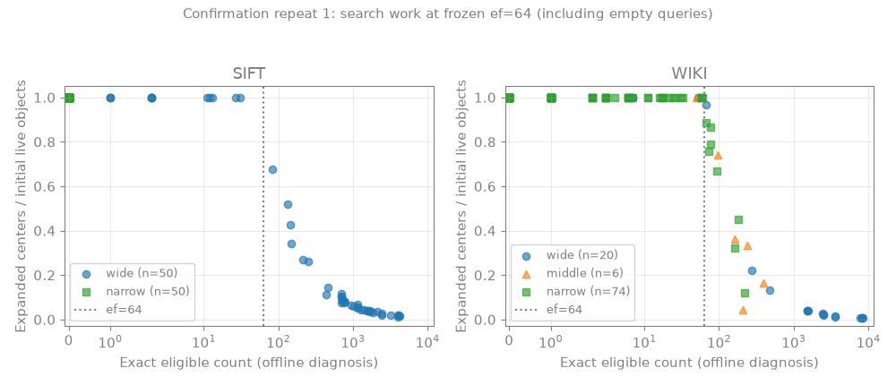

# 谓词可寻址邻域：候选取得成功，NodeANN端到端目标失败

**结论：正确实现的小原型在相同候选与搜索内核下显著快于普通二跳，但同质量下仍慢于真实NodeANN；没有放行E3。** 不增加proxy、不回到几何界、不换算法追正结果。WQR收尾独立，本报告不声称已修复或闭合WQR生命周期。

## 1. 本轮问题与事前预测

按研究端冻结的 [2456849任务书](https://github.com/RainyTom/Agent-Vector-Database/blob/2456849/researches/nested-attr-vector-search/2026-10-30-exps/next-neighborhood-plan.md) 实施：能否把逐边展开再过滤，改为直接访问精确资格下的扩展邻域，并在相同召回下快于正常NodeANN和普通二跳？

事前 [协议](neighborhood-protocol.md) 规定先E1候选取得，再E2端到端，只有查询收益成立才E3。优先宽scope＋多属性AND，同时保留窄scope/弱过滤；允许增加内存。没有在看到结果后修改图、数据、谓词分布、预算网格或搜索停止条件。

## 2. 相关工作与重合边界

二跳扩展、bitmap及压缩邻接不是新贡献。任务书已明确ACORN等直接前序；本轮检验的是“相同扩展邻域的谓词可寻址取得”是否有独立成本增量，而不是把这些组件改名。进一步的压缩邻接、图数据库谓词遍历及ACORN正文查重由研究端并行负责，本轮没有新增论文条目或作“首次”主张。

B→C是机制对照，A→C才是主要性能目标。即使C相对B更快，也不能替代正常NodeANN对照，不能由本轮结果推导公开系统排名。

## 3. 明确改动、数据结构和搜索合同

源码：

- [邻域索引与共享搜索](../../../../codes/directory-aware-vector-attr-search/src/neighborhood_index.h)
- [精确page/point资格](../../../../codes/directory-aware-vector-attr-search/src/neighborhood_filter.h)
- [实际执行器与smoke](../../../../codes/directory-aware-vector-attr-search/src/neighborhood_research.cpp)
- [公共RawL2Space](../../../../codes/directory-aware-vector-attr-search/src/raw_l2_space.h)
- [真实NodeANN](../../../../codes/directory-aware-vector-attr-search/src/dynamic_triad.cpp)，使用 `--arm A --scan-threshold 512`，不是将PE-OFFLINE改称NodeANN。

每个中心v存 `E2(v)=union(N(w), w in N(v)) - {v}` 的去重稳定对象ID。ID按256对象/page划分；≤16个对象存8-bit offset，其余存256-bit bitmap，页目录按page ID排序。每个页容器40B，包含类型、页号与稀疏/稠密union；内存按实际vector容量计，不把它当成免费结构。

资格严格为 `Live AND Scope AND Extra`；Extra仅在启用字段之间作AND/OR，完整谓词由同一个对象见证。scope覆盖内部节点直接owner；numeric仅lo/hi同时−1才禁用；四种tag语义及空tag分别处理。

- **A**：直接目录节点的局部HNSW；递归查询访问目标及后代，合并Top-k。直接小节点≤512保留正常精确扫描，这是用户允许的基线行为，不是对大scope偷偷改执行计划。
- **B**：从相同全局图逐边取得二跳ID，中心内去重，使用点资格缓存过滤，按稳定ID排序后送入共同前沿。没有故意强制B逐点构造整页。
- **C**：索引页与本查询精确资格page相交，按同样顺序取得同样合法二跳ID；跨中心复用本次查询的资格page。

两者都先处理原一跳边，保留不合格点导航；没有删边、代理距离、安全下界、GT路由、隐式重试或整scope在线向量扫描。查询距离、构建距离及GT均调用公共hnswlib FP32 squared-L2。C++执行所有在线操作；Python仅调度与离线分析。

B/C是同一个有界图搜索，近似性仍来自图与停止条件。观测Recall=1不是任意输入的精确保证。C不改变B候选覆盖或前沿；它减少取得/资格工作，而不是凭空增加比二跳更多的几何信息。

符号成本：设 `D(v)=sum_{w in N(v)} |N(w)|`、`H(v)=|E2(v)|`、`P(v)`为非空邻域页数。B每个展开中心需O(D(v))邻接读取/去重、O(H(v) log H(v))排序和O(H(v))缓存资格访问；C需O(P(v))页定位/相交及合法ID枚举，另付首次资格page构造。常驻空间为O(sum_v P(v))容器，外加资格bitplanes、图和查询workspace。属性/目录更新理论上不依赖E2；图变更的反向依赖维护**本轮未实施或测量**，不能宣称其更新复杂度已获实证。

## 4. 相对基线的事前预期

A有目录缩小几何搜索范围的优势；B/C共享全局导航，可能在宽scope强过滤下减少绕行。C相对B应少读二跳邻接、少去重/排序和重复资格检查；两者候选一致时应有相同距离数与前沿。预计C多付空间和构建成本；动态维护可能抵消收益，必须等E2过门后才测，不能提前当作0。

## 5. 实际实验与变量

- **WIKI**：已有root-3626完整原始子树，11869活对象、1024维、151目录节点；不是全WIKI。
- **SIFT**：已有深度3合成层级，12000初始活对象＋1000 reserve ID、128维；不是SIFT1M全量实验。
- 每数据集按时间顺序取源轨迹前200条Q，保留字面谓词，固定初始attrs/tree/bindings，**不执行源更新**；不是动态replay。全部源SHA与路径见 [manifest](data/neighborhood-run1/manifest.json)。
- WIKI有200个不同qidx；SIFT有64个。按不同qidx的排序秩奇偶分组：校准/确认各100条；SIFT各32个qidx，WIKI各100个。它们来自旧query，不是新独立测试集；同一qidx没有跨参数选择/确认分组。
- SIFT原字面选择存在分布缺口：校准没有窄scope，确认没有middle；确认的50条窄scope全部空GT。没有重新生成有利查询来补齐。WIKI确认80非空/20空，SIFT确认50非空/50空。
- E1覆盖全部200条/数据集、每条前8个真实展开中心。E1用于候选集合核对与取得诊断，不作预算选择或最终ANN胜负。
- E2每臂ef只取64/256/1024；M=16、efConstruction=200、seed=100，k=10。18个校准运行全部保留；每臂选通过校准质量门且均值最快的预算，均为64，然后确认3次串行轮换，共18次确认。总36次E2运行，不把它们说成36种算法。
- 非空macro和pair均≥0.999；非法/重复/状态错误均0；空GT结果正确单列。GT在每次ANN计时后由独立parent-walk和标量资格计算，不咨询资格索引。
- 机器为Ryzen 7 5800X、WSL2、g++15.2.0；固定hnswlib revision，两程序相同编译级别，查询/构建均单worker。没有隔离其他系统负载或宣称统计显著性。

## 6. 实际结果、失败与代价

### 6.1 正确性和机制一致性

- smoke：6773次对象资格核对、104个中心候选核对，B/C路径/结果/距离数相同，错误0。
- E1：每数据集1600个中心，候选集合与顺序不一致0；B/C canonical graph SHA相同。
- E2：[完整审计](data/neighborhood-run1/audit/audit.json) 比较1200对相同预算/查询记录，结果ID、GT ID、一跳访问、扩展数、visited检查、合法二跳取得数和真实距离数均一致。36次运行协议错误0。
- 全部确认运行：非空macro=1、pair=1，非法/重复/状态错误0，空GT正确；不是以降低Recall换时间。

### 6.2 E1：候选取得机制有正结果

下表为一次查询8个中心的完整候选取得均值，包含资格与结果拷贝，不是端到端ANN；200条Q/数据集，无重复计为独立新query。

| 数据集 | B取得μs | C取得μs | B/C加速 | B资格μs | C资格μs |
|---|---:|---:|---:|---:|---:|
| SIFT | 97.780 | 74.034 | 1.32× | 29.696 | 60.301 |
| WIKI | 165.993 | 71.496 | 2.32× | 62.796 | 58.780 |

SIFT冷资格page本身更贵，但避免邻接枚举/中心内去重排序后，取得总时间仍下降。不能说所有组成阶段都更快。原始逐Q及分层：[E1目录](data/neighborhood-run1/e1/)、[汇总](data/neighborhood-run1/audit/e1-summary.csv)。

### 6.3 E2：快于B，但没有快于正常NodeANN

主表**只比较非空确认查询**。每格为3次重复各自统计量的平均，不是将三个重复合池计算分位数；单位μs。WIKI每次80条，SIFT每次50条；完整空/非空/所有查询另存 [population CSV](data/neighborhood-run1/audit/confirmation-populations.csv)。

| 数据集 | 臂 | mean | p50 | p95 | p99 |
|---|---|---:|---:|---:|---:|
| SIFT | A NodeANN | 361.719 | 297.587 | 647.812 | 739.526 |
| SIFT | B普通二跳 | 32939.649 | 10121.010 | 97422.558 | 101022.602 |
| SIFT | C邻域页 | 4233.465 | 1496.574 | 11949.892 | 13281.354 |
| WIKI | A NodeANN | 554.046 | 14.016 | 2345.560 | 2630.739 |
| WIKI | B普通二跳 | 125444.162 | 162366.682 | 172513.238 | 177840.037 |
| WIKI | C邻域页 | 13508.721 | 16241.448 | 19065.517 | 20756.067 |

在同样通过质量门的非空查询上，C相对B约快 **7.78×/9.29×**，但相对A分别慢 **11.70×/24.38×**。不是“只有距离次数下降、时间没降”，而是**取得机制有时间收益，主要端到端目标仍失败**。

优先场景也失败：确认集宽scope＋≥2启用字段AND，SIFT22条、WIKI8条，均非空；C/A均值比为 **16.13/6.12**。窄scope在WIKI更差；SIFT窄scope全空，不能给出非空质量胜负。全部分组、重复与缺项在 [population aggregates](data/neighborhood-run1/audit/population-aggregates.json) 和 [原分析](data/neighborhood-run1/analysis/report.json)。

下图是**校准集**全部冻结预算的非空时延，不是上表确认集的重复呈现；没有删掉较慢预算。18个校准配置本轮均通过质量门。

### 6.4 为什么C/B收益没有变成C/A收益？

确认重复1的非空查询工作量均值：

| 数据集 | A距离数 | B=C距离数 | B=C展开中心 | B二跳邻接ID读取 | C页容器访问 | C准备资格页 |
|---|---:|---:|---:|---:|---:|---:|
| SIFT | 3710.54 | 5945.66 | 3934.38 | 1559315.90 | 182034.54 | 47 |
| WIKI | 1461.83 | 10761.23 | 8913.65 | 5126346.23 | 413245.90 | 47 |

C避免了大量二跳邻接读取和排序/过滤，但没有减少共享搜索内核实际访问的几何状态。WIKI每个非空查询平均仍展开约75%的活对象；C在两个数据集均准备全部47个含初始活对象的资格page，lazy并没有少准备活数据资格。SIFT还有4个只含reserve/尾部的潜在页，不计为已准备。

C二跳资格首次构造均值仅SIFT87.03μs/WIKI53.04μs，而二跳取得总计仍为2828.16/7372.82μs，说明不是单独优化资格构造就能填补NodeANN差距。该资格列是二跳取得子集，未计一跳资格，不能当作完整directory resolution latency。

全部空GT查询的B/C均展开所有活对象：SIFT12000、WIKI11869。它们会放大总体失败幅度，但排除空GT后C依然显著慢于A。不能用空GT正确率稀释Recall或只展示总体极端倍数。

下图仅使用确认重复1的100条实际query，点可能重叠；横轴精确合格数仅作离线归因，不进入在线搜索。稀疏资格时保留的不合格导航和既定停止条件导致大量扩展，是本原型实际观测到的主要限制。

### 6.5 构建与空间没有隐藏为免费

确认重复1的实际数据；MB=10^6B。图列统一采用hnswlib序列化尺寸，**不是完整resident内存**；RSS是整个进程高水位，不能拿图字节与RSS直接比。

| 数据集 | 臂 | 构建s | 图MB | 邻域页MB | 进程峰值RSS MB |
|---|---|---:|---:|---:|---:|
| SIFT | A | 0.409 | 6.340 | 0 | 41.902 |
| SIFT | B | 0.963 | 7.926 | 0 | 23.949 |
| SIFT | C | 1.070 | 7.926 | 22.459 | 46.719 |
| WIKI | A | 1.149 | 21.877 | 0 | 85.168 |
| WIKI | B | 4.917 | 50.378 | 0 | 110.260 |
| WIKI | C | 5.055 | 50.378 | 22.296 | 132.682 |

C邻域额外构建SIFT0.115s、WIKI0.164s。B/C额外导出的资格/workspace/ID映射容量为635527/598684B；NodeANN另有元数据估计，原summary保留，不能把表中图列冒充全部索引空间。

B/C图内各持有一份初始活向量payload，构建后释放输入base数组；没有给每个E2邻域复制向量。峰值RSS仍包含构建期间输入与图同时存在及allocator高水位。A保留原始向量供小节点扫描，并为大节点另存HNSW payload，这一实际差异反映在进程峰值而非被删除。

本轮没有磁盘索引持久化、稳态RSS、图插删重建峰值或后台维护资源测量；不能声称完整动态空间/维护成本已过门。全部重复的原始成本见 [costs](data/neighborhood-run1/audit/confirmation-costs.json)。内存增加本身不是本轮淘汰原因，查询目标失败才是。

### 6.6 保留的失败与没有运行的项目

- 没有观测到正确性smoke或正式运行的资格/状态错误；不虚构失败前后记录。
- 失败配置不仅包括慢预算，也包括所有C相对A的确认结果；36次运行、原始stdout/stderr、逐query和配置SHA全部保留在 [runs](data/neighborhood-run1/runs/)。
- 首版主题SVG在独立预览不可读；旧SVG保留为渲染失败，正式PNG由同一实测记录生成并实际打开核验。移除SVG生成路径后重放当前离线分析，12份统计CSV/JSON与原输出逐字节一致。
- **E3未放行、没有运行或假装实现动态维护。** [门判据记录](data/neighborhood-run1/audit/e3-decision.json) 同时检查完整非空及优先场景；没有把属性更新写成no-op，也没有窗口外维护、债务0或更新O(1)主张。
- 未增加proxy、分区、学习器、二跳深度、参数网格或新的提前停止来追正结果。

## 7. 是否支持假设

支持：同图同候选条件下，页索引及查询内联合资格复用减少了普通二跳取得成本，并产生稳定的C/B端到端收益。

不支持：当前共享图＋页索引在同质量下超越正常NodeANN，甚至优先宽scope多属性AND亦未达到。状态应标记为**正确实现且质量达标，但相对主基线全查询成本不划算**，不是尚未实现、状态错误或ANN质量不足。

不能从本轮推出：新颖性成立、动态维护便宜、完整SIFT1M/WIKI胜出、所有谓词可寻址邻域索引都失败。200条旧query、一个静态快照/seed、分组缺口和未隔离系统环境限制推广；未完成的新颖性查重仍由研究端保留。

## 8. 下一轮唯一最重要的问题

**在保留不合格导航、精确硬资格和同质量的合同下，怎样才能让实际展开的几何状态显著少于当前B/C，而不只是更便宜地取得相同候选？**

本轮不临时设计替代算法或继续扩规模。研究端据完整负结果决定是否继续该共享图路线；当前不能把C/B取得收益包装成已完成NodeANN端到端目标。

## 上游阅读与复现

1. 本报告和 [事前协议](neighborhood-protocol.md)。
2. [复现/构建/计时边界](experiments/neighborhood-reproduction.md)。
3. [manifest](data/neighborhood-run1/manifest.json)、[全部分析](data/neighborhood-run1/analysis/report.json)、[独立对照审计](data/neighborhood-run1/audit/audit.json)。
4. [每次重复的所有空/非空/profile结果](data/neighborhood-run1/audit/confirmation-populations.csv)、[工作量](data/neighborhood-run1/audit/confirmation-work.json)、[原始36次运行](data/neighborhood-run1/runs/)。
5. 上列C++源码、[调度器](experiments/neighborhood_experiment.py)、[分析](experiments/neighborhood_analyze.py)、[审计](experiments/neighborhood_audit.py)、[PNG生成](experiments/neighborhood_figures.py)。

本轮新增该方向的C++小原型、E1/E2实测与图、全部失败和E3不放行记录；不覆盖此前几何诊断和WQR历史，不新增未经核读的论文记录。大向量、编译二进制及依赖目录不上传。
