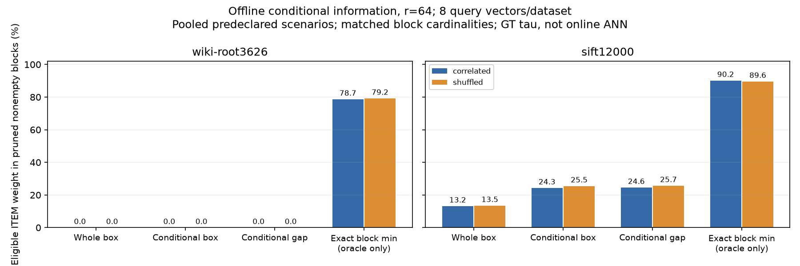
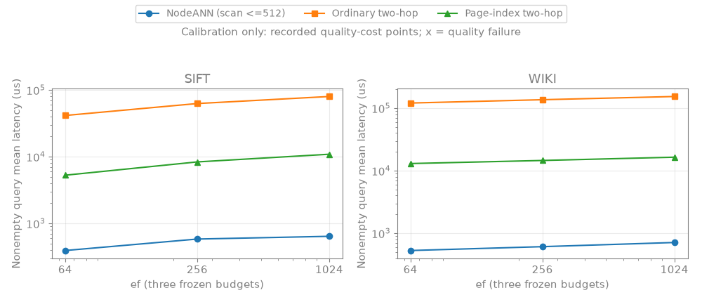
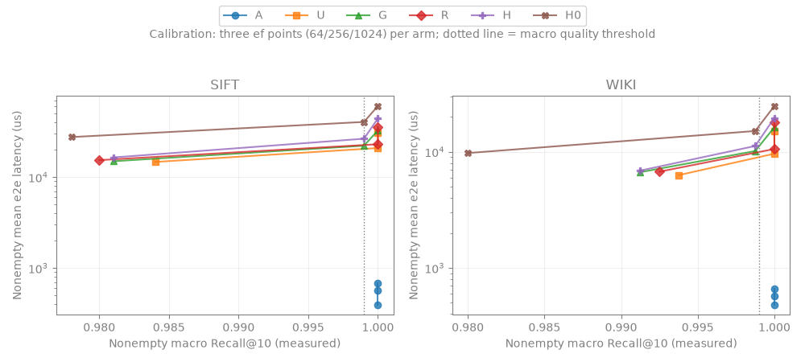

# 条件几何证书：首轮真实数据的信息门与取得成本

## 结论

**不进入在线C++索引原型。** 当前共享排序上的条件extrema/gap有BSI/wavelet直接前序，稀疏残差覆盖有L2AP前序；本轮没有提出通过机制门的新结构。真实诊断进一步表明：WIKI的独立坐标界极弱，SIFT有额外排除信息，但当前逐次membership取得方式昂贵，且人为属性相关控制未带来明显特有优势。不能将这些结果写成新索引胜出，也不能泛化为所有条件证书不可行。

本文按8项autoresearch口径记录，源码/事前约束见 [协议](conditional-geometry-protocol.md)、[机制及前序审读](mechanism-assessment.md)。没有回退到owner/place、维护阈值或大scope精确扫描作为主算法。

## 1. 本轮问题/假设

过滤F不仅删除对象，是否还能在同一个几何块B内增加可计算的原L2排除信息？区分三件事：

- 条件信息的理想强度；
- 共享结构取得该信息的实际元数据工作；
- 结构是否超出最近前序，而不是给普通极值/bitmap操作换名。

事前预测不指定正结果；若WIKI/SIFT的理想条件界都弱，停止这一摘要族；若信息有效但取得太贵，问题落在共享表示/证书生成。即使有效，机制门不过也不实施新索引。

## 2. 相关工作及重合点

核读原文后新增BSI算术、Rinfret学位论文、wavelet条件查询、动态sequence、L2AP、Seismic六条全文记录；按自身问题分类，总库36条、关系31条。新关系全为researcher_synthesis，不冒称作者引用。

- [BSI](https://doi.org/10.1145/375663.375669)的逐位选择，以及[2002学位论文§6.1](https://www.cs.umb.edu/~poneil/DenisRinfretThesis.pdf)明确的Boolean potential answers，直接限制“F上共享extrema”新意。
- [wavelet](https://doi.org/10.1016/j.tcs.2011.12.002)已有range quantile/next-value/交集；不是任意临时F都可免费映射成区间。
- [L2AP](https://doi.org/10.1109/ICDE.2014.6816700)已有部分倒排覆盖/prefix残差界；[Seismic](https://doi.org/10.1145/3626772.3657769)已有几何posting/max摘要，实用截断为近似。
- Curator v3已有共享几何树、虚拟谓词索引及延迟构造，且有更新。与条件安全界有差别，但仅“共享树+F”不足立项。

BioVSS真实机制和不可迁移处已核：Hausdorff而非MaxSim，count/OR不保持成员绑定，理论依赖归一化/碰撞模型/强分离；新尺度审读保存为日期化报告。VA-file原始扫描正文仍未成功核读，范围查询闭包未穷尽；不宣称查重覆盖全领域。

## 3. 算法/索引明确改动

没有修改现行NodeANN或HNSW。A候选仅作两种经典证书诊断：

1. 条件box：同对象S=B∩F的各投影min/max；
2. 条件gap：q两侧完备前驱/后继给δ_j=min_{x∈S}|(Ux)_j−(Uq)_j|，sumδ_j²为下界。

实际共享排序只存稳定投影值与对象ID；端点/双向探测使用当前F的membership，不读取oracle极值。理想界另用枚举获得以核对，空块的资格排除不算几何新增剪枝。联合witness松弛反例S={(0,1),(1,0)},q=0在smoke实际检查：gap下界0，真实最小平方距离1。

B候选为dense稀疏表示/条件残差覆盖，但没有新覆盖机制，暂停独立实现。A的box/gap是一个候选族的变体，不把它们包装成两项贡献。

离线C++辅助程序仅调用统一 `raw_l2_space.h` 输出完整距离矩阵；不是ANN索引或在线证书原型。Python只做允许的离线信息与排序探测，不据Python时延报C++加速。

## 4. 相对基线的预期变化

整块box是信息对照，不替换NodeANN主基线；理想条件box/gap与真实块最小距离是逐级oracle对照，不是已实现系统。

- 可能减少非空块/eligible完整距离，但必须加上F处理、证书、投影、排序空间和更新成本。
- 不预测ANN Recall、QPS或更新吞吐改善；没有修改图frontier，不能声称减少同等数量的导航访问。
- 下界只排除结果贡献；在线必须已有k个合法结果才能使用当前tau，本轮用GT仅测离线上限。

## 5. 实际设置和变量

WIKI为完整root3626原始子树11869×1024，151目录；SIFT为既有动态staging前12000初始活向量×128、合成目录，排除1000 reserve。各取历史已经看过的前8个query向量；不是新独立测试集。宽/窄scope按规模接近25%/5%选，实际：

| 数据 | root ITEM | broad ITEM | narrow ITEM |
|---|---:|---:|---:|
| WIKI | 11869 | 3034 | 551 |
| SIFT | 12000 | 2800 | 1200 |

固定FAISS k-means K32/96、10 iterations、seed20261030、单线程，仅作块分配；不建FAISS数据查询索引。投影为高方差原坐标/PCA，r16/64/d。无归一化、无量化。PCA64解释样本方差WIKI52.92%、SIFT93.59%，不是近邻质量保证。

合成category/numeric来自每(block,owner)单元内前两高方差坐标rank；过滤为scope-only、eq7、eq7 AND hi6、eq7 OR hi6。随机控制在同单元内打乱整属性元组，严格保留每block/scope/复合谓词的eligible数。实际改元组比例WIKI约88.1–92.4%、SIFT约88.5–95.6%；不宣称完全独立随机，单元间关联仍保留。

**K32/96各自按块生成属性，是两种场景，不是固定属性只改K的因果消融。** 主比较始终固定同场景的B/q/F后比较界；pooled结果仅为预登记场景的描述性合计。

主阈值为相同F的精确第10 FP32 squared-L2；另用同q/scope无普通过滤的第10距离作相关/随机共用半径控制。后者只是radius-empty信息，不能作filtered top-k在线阈值。

run2有9216条诊断记录、192次cold证书取得、384次gap成本观测；只有16个源query向量。原L2矩阵共190952次真实共享内核调用，另有4次已知0/25矩阵smoke。没有ANN性能调用、更新实验或Recall曲线。

## 6. 实际结果及失败

### 6.1 哪些以前排除不了的候选可以排除？

图是GT阈值下、非空块eligible权重的排除比例；最后两根为扫描完整距离才能知道的真实块最小值oracle，不能视为免费索引。空块不计增益；pooled包含两K/两basis/三scope/三普通谓词，各配置均保留。

额外信息分解如下，分母均为eligible ITEM权重，**不是Recall或加速比**：

| 数据/属性控制，r64 | 条件box相对整块额外排除 | gap在条件box外再排除 |
|---|---:|---:|
| WIKI，相关 | 0% | 0% |
| WIKI，打乱 | 0% | 0% |
| SIFT，相关 | 11.10% | 0.28% |
| SIFT，打乱 | 12.01% | 0.20% |

WIKI的r16同样为0；升到完整1024维，相关/打乱只排除约0.266%/0.270%，**全部来自单eligible对象块**，多对象块仍0。不能把近似完整距离的单对象退化当高效新界。真实块距离oracle却可排除约78.7%/79.2%，暴露独立坐标摘要的强松弛，不证明整个条件证书方向无机会。

SIFT full128条件box新增12.59%/13.31%，gap再增0.33%/0.35%；gap单独超越box的量很小。r16/64/full、每K/basis/scope/predicate完整结果保存在grid/scopes CSV，未只留最佳点。SIFT确有过滤后几何信息，但不构成新颖性或在线收益证据。

### 6.2 固定同半径后，是否是相关属性独有？

共用scope半径时，SIFT r64 box新增14.29%/14.16%；gap相对整块总新增约14.598%/14.591%，几乎相同。该小样本不支持“人为相关性机制带来独特额外收益”的故事；它仍支持条件子集可比整块界更紧。不能从单个相关性构造泛化到所有真实属性。

### 6.3 取得这些信息付出多少？

64维排序数组：WIKI9115392B、SIFT9216000B，另计block map、U、F索引与工作区。SIFT原始向量只有6144000B，排序数组自身已经是其1.5倍；WIKI排序数组为原始向量约18.75%。PCA64矩阵另需64d×8B；query另有64d个投影乘加量级，不能藏入免费预处理。

成本只实际采前2个query，加入三scope/三普通谓词共18 case/每K/basis/control。相同case下，以端点/双向探测逻辑读取字节除以额外避免的原始向量字节，SIFT全部组合范围为**23.34–110.50倍**；WIKI额外避免量0，分母为0而不是收益无穷。

这是**ID/布尔membership/FP64坐标的逻辑引用模型**，不是DRAM流量、不是C++时延、不能推出慢多少倍。缓存、压缩位图、BSI/wavelet可能改变取得成本，但本轮没实现/计时它们；不能把这个负结果外推为所有取得方法不划算。F的dense处理和额外投影/构建/更新也未计入该比值，故它更不是完整在线成本优势。

完整 [indexed-cost-summary](data/conditional-geometry-run2/analysis/indexed-cost-summary.csv) 与 [matched work](data/conditional-geometry-run2/analysis/indexed-work.csv) 保留零增益case；Python取得时间仅作该离线实现观测。

### 6.4 正确性、修正与保留失败

- observed false-pruned blocks=0，bound次序检查通过；逐个非空块相对统一FP32真实最小距离核对，PCA Gram上界/guard生效。**样本零违规不构成任意输入浮点认证。**
- indexed64极值/gap与枚举oracle完全一致；相关/随机每块每scope候选数相同。原始query全部C≥10，没有靠大量空GT冲高比例。
- run1的predicate_python_s只计scope mask AND，普通比较发生在计时外；保留 [measurement-note](data/conditional-geometry-run1/measurement-note.json)。修正后原设置完整跑run2，9216条信息记录和384条非计时取得工作量逐项相同。不把两次当独立统计重复，不覆盖旧数据。
- FAISS Python binding最初缺失，按允许的k-means组件安装faiss-cpu1.12.0后运行；没有替换ANN后端。原工具 `tools/research_index.py` 不存在，本轮用逐页JSONL/端点/SHA核验，未伪称调用它。

主证据：[run2 audit](data/conditional-geometry-run2/audit.json)、[analysis audit](data/conditional-geometry-run2/analysis/audit.json)、[provenance](data/conditional-geometry-run2/provenance.json)、[全部grid/成本](data/conditional-geometry-run2/analysis/)。复现见 [experiments/reproduction.md](experiments/reproduction.md)。

## 7. 是否支持假设/是否放行

- **信息层有限支持**：SIFT条件界能排除整块界不能排除的非空候选；WIKI这一独立坐标族没有实用信息增益。
- **成本层不支持当前取得方式**：额外探测多，SIFT附加空间也大；不能只报距离次数下降。
- **机制层不支持独立贡献**：条件extrema/successor、Boolean同对象选择及稀疏残差已有直接前序；还没有新增共享表示/覆盖操作。
- 因此不实现在线C++候选原型，不跑ANN大矩阵，不改HNSW队列，不转回维护调参。NodeANN仍保留为后续主性能基线，并非要求先复现全部外部系统。

局限：一个seed、两个小输入、每数据8条旧query、初始静态快照、合成普通属性；kmeans/属性构造及随机化仍有场景依赖。没有NodeANN端到端增益、读写一致性、真实更新/插删开销、独立测试或持久化结论。

## 8. 下一轮唯一最重要的问题

**能否给出一种超出经典独立坐标extrema/gap的可共享联合证据，在不枚举eligible的同时填补WIKI“oracle强、廉价界弱”的信息鸿沟，并比BSI/wavelet/range查询直接实例少做明确的一类工作？**

这仍是未解决的结构问题，不是已命名的新索引；若只能给普通range emptiness换名或再调阈值，就停止该独立主张。保留当前负结果，不把一组box失败升格为整个几何证书领域不可能。

### 本轮最终两句话

1. 条件box在本SIFT场景额外排除约11–12%的eligible权重，但WIKI64维没有新增排除；这是经典子集几何信息的实际诊断，不是已经发明新覆盖机制。
2. 当前64维共享排序需约9.1–9.2MB额外数组及投影/F处理，逐次探测的逻辑读取远超额外避免的向量字节；动态维护未实测，因此目前不支持在线收益或新索引主张。

## 9. 同日第2轮追加：联合证据与投影损失

首轮§8提出的问题已进行小型判别，见[联合报告/图](joint-certificate-report.md)、[结构/前序/成本](joint-certificate-analysis.md)、[事前协议](joint-information-protocol.md)、[复现及失败修正](experiments/joint-reproduction.md)。历史首轮段落/数字不覆盖。

**归因修正：**WIKI相同64维表示的同对象完整联合min也无排除，不能把raw oracle与独立轴界差距都解释为不同对象见证；投影丢失同样关键。SIFT联合界较强，但wholeB联合界已能做很多排除，不能将全部归为F贡献。两族有VA/PQ/simplex/CNN直接前序，未放行在线索引，也不否证其他表示或ANN近似机制。

本轮实际两进程并行、两run保留173568逐case信息记录（仍只有16源query）；run1的工作计数定义不一致被修正，run2全部信息结果与之相同。GT复用先前C++矩阵而非重复声称新raw调用，没有PE/NodeANN端到端或更新新实验。当前文献库39条/33边，三份新全文及结构/SHA审计见data/joint-literature-audit.json。

## 10. 同日第3轮追加：谓词可寻址邻域E1/E2

按研究端2456849合同改为共享图上的精确资格二跳取得，不再沿低维证书或增加WQR proxy。**候选取得机制有正结果，但同质量下未超越真实NodeANN；E3没有放行。** 完整结论、非空/空查询分离、优先场景、空间、构建与失败见 [邻域报告](neighborhood-report.md)，[复现](experiments/neighborhood-reproduction.md)，[逐query与审计](data/neighborhood-run1/audit/)；历史几何报告保留，不当作现行路线。

实现/搜索为C++、公共RawL2Space；NodeANN使用真正的dynamic_triad arm A/scan512。E1检查3200个真实中心候选；E2保存18次校准＋18次确认，B/C的1200对结果及导航/距离记录相同。原属性快照和query字面语义未重造，源更新有意不执行；不是动态replay、不是完整SIFT1M/WIKI，也没有动态维护收益主张。

下图为全部校准预算，确认集结果和完整分位数在邻域报告；正式PNG已实际打开检查。首版不可移植主题SVG的失败保留在原analysis目录，不作为结果图。

[资格规模与实际扩展图](data/neighborhood-run1/figures/qualification-vs-expansion.png) 显示稀疏资格时仍大量展开；下一轮应由研究端判断是否继续该共享图路线，本轮不临时替换算法追正结果。

## 11. 同日第4轮追加：7654f1e closure六臂static

按研究端实现接入502753c原WIKI/SIFT和动态trace，未改核心、候选池、停止规则或质量阈值。完整 [服务器报告](../../2026-10-30-exps/closure-server-report.md)、[复现](../../2026-10-30-exps/experiments/closure-server-reproduction.md)、[72次原runs小聚合](../../2026-10-30-exps/data/closure-server-run1/static/runs.json)、[全部失败诊断](../../2026-10-30-exps/data/closure-server-run1/failure-diagnostics.json) 已保存。

结论：H改变了有效编译邻接，但同ef实际expanded几乎不变；WIKI确认质量未过门，不能报同质量胜负；SIFT质量通过但样本内效率失败，且非空仅16个不同qidx，覆盖不足单列。两个原脚本dynamic_admitted均false，因此未运行真实dynamic或维护包络，没有把未测维护成本写0。递归限制采样错误0；direct差异不套用该定理。

下图为全部校准预算；确认集均值/分位数及同ef控制见完整报告，旧NPI/inline-GT时间不混入本轮结果。

## 12. 同日第5轮追加：ef15/20固定小预算

按用户纠偏，正常查询预算改为k附近的efSearch=15/20；算法、候选池、骨架、停止规则、scope与质量定义均未改。完整 [小预算报告](../../2026-10-30-exps/closure-small-ef-report.md)、[复现](../../2026-10-30-exps/experiments/closure-small-ef-reproduction.md)、[48次原始结果与聚合](../../2026-10-30-exps/data/closure-small-ef-run1/) 已保存；5fc1be3全部结果保留。

结论：A的macro 0.995～1.000、均值0.280～0.412ms；H仅0.934～0.953、5.716～12.007ms。同预算H慢14～41倍且Recall更低，小预算下没有有竞争力的质量—时间点。H/R同ef的expanded仍几乎相同；`E<ef`强制全scope占非空查询20.0%～51.9%、占总展开76.9%～84.8%（3627条强制行零违反）；U同样慢，编译占e2e 79.8%～89.3%，说明主要成本在每展开源的池编译与强制遍历，不是LCA独有。

旧CSV归因（只读）在同一提交：`termination-attribution-7654f1e.json`，`all_forced_property_checks_pass=true`。本轮无Dynamic、无维护包络、无扩大N；更新与维护成本仍记未测。

