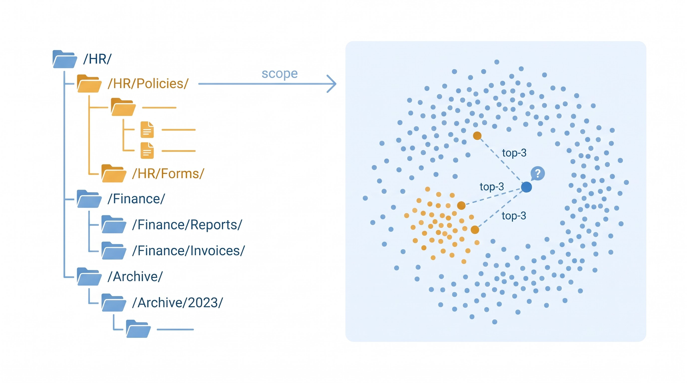
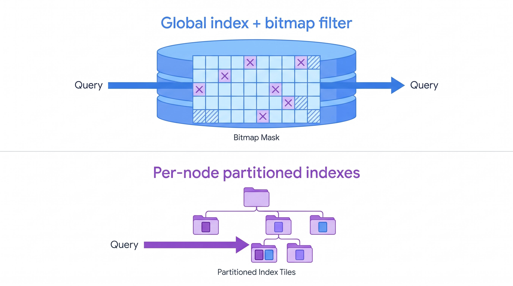
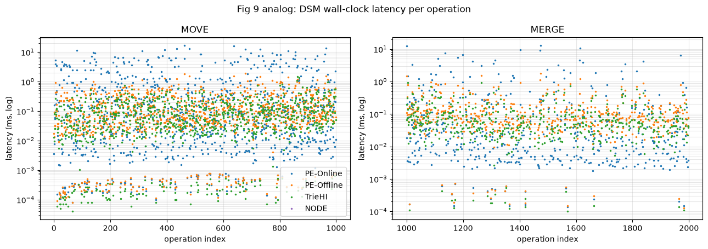
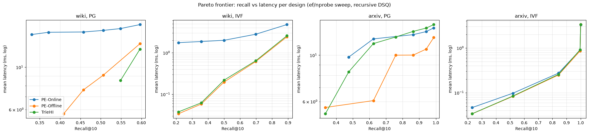
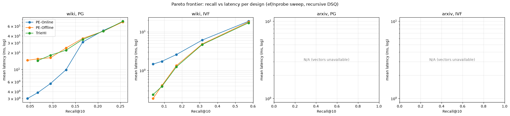
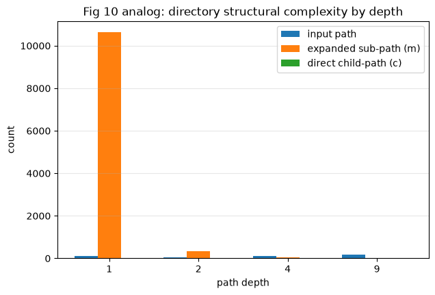

# 分层属性向量混合搜索：问题定义、方案对比与优化路线

日期：2026-10-27。范围：`researches/nested-attr-vector-search/` 全部已完成工作（TrieHI 复现 + 选择率测量 + 属性分区索引 baseline）。数据与图均来自本地实测，未核实处单独标注。

**一句话结论**：目录 scope 解析层是端到端延迟的决定性变量（全局 ANN 方案在 query-time 展开时慢 2–3 个数量级）；新引入的**属性分区索引（NodeANN）**在同一 scope 语义下以精确质量（nDCG=1.0）完成检索，非递归查询快 3 个数量级、100k 递归端到端最快，但在 1M 深树递归上受"每节点搜索调用数"拖累（28–38 ms 目录开销）——这正是下一步优化的靶点。

---

## 1. 研究问题

### 1.1 形式化定义

数据：向量集合 $D=\{x_i\in\mathbb{R}^d\}$，每个对象绑定一个**目录节点** $h(x_i)\in V$（前缀树节点，非叶可绑定），节点 $v$ 的递归 scope 为子树全体成员：

$$
S_{\text{rec}}(v)=\{\,x \mid h(x)\in \mathrm{Desc}(v)\,\},\qquad
S_{\text{nrec}}(v)=\{\,x \mid h(x)=v\,\}.
$$

查询：$(q, v, \text{rec})$，返回 scope 内按距离 $d(q,\cdot)$ 最近的 $k$ 个对象。

**优化目标**（四维同时约束）：① recall@k 对齐 scope 内精确 top-k；② 端到端延迟（含 scope 解析）；③ 构建/存储开销；④ 结构可维护性——MOVE/MERGE 后三种表示必须解析出同一节点集与成员集（语义等价）。

### 1.2 与相邻问题的边界

- **不是 vector join**：单查询、top-k 输出、无 pair 语义；与 A 类几何向量连接不混同。
- **不是普通 filtered ANN**：谓词是**拓扑的**（祖先/后代/子树），不是 flat 标量；scope 解析有独立成本可测（directory-only latency）。
- 目录 scope 层独立于 ANN 布局：同一 scope 可喂给 PG（图索引）或 IVF（分区倒排）。

### 1.3 三类目录表示（论文空间）

| 表示 | 存储 | 递归查询 | 非递归查询 | MOVE |
|---|---|---|---|---|
| PE-Online | 每 entry 1 条父路径 posting | 查询时枚举子树 key + posting OR | 1 次 path 查找 | 子树 key 重映射 O(m_u) |
| PE-Offline | 每 entry t 条祖先 posting | 1 次祖先 key 查找 | 全集 ∖ 子集差 | O(m_u) 重映射 + O(t) 祖先更新 |
| TrieHI | trie + 每节点 inclusive 位图 | 路径遍历 + 1 次聚合集访问 | 局域网差集 | 子树重链 + 祖先位图更新 O(t) |

### 1.4 应用场景

| 场景 | 分层结构 | scope 查询示例 |
|---|---|---|
| 代码库语义检索 | `/src/core/payment.py` 前缀即 scope | "在 `/src/core/` 子树内找相似实现" |
| 企业文档管理 | HR/Policies、Finance、Legal/Archive | "HR 全部政策（含历史归档）中与 query 最相关的 10 篇" |
| Agent 记忆（OpenViking） | `viking://resources/...`、memories/skills | 先定位用户/会话 scope，再 scope 内语义检索 |
| 学术论文检索 | arXiv subject（`/cs/AI/`）+ temporal（`/2024/05/`）双命名空间 | "2024 年 5 月的 cs.AI 论文里最相关 10 篇" |
| 电商品类 | 品类树 × 属性 facet | "手机 > 拍照旗舰 子树内相似商品" |
| **ACM CCS 论文检索** | CCS 2012 本体（**DAG**，1,928 概念/6 层，8.2% 多父） | "Information systems → Information retrieval 子树内与 query 最相关的 10 篇论文"；SciHTC 提供 186,160 篇真实标注 |

CCS 背景的实测事实（本体 DAG 结构、SciHTC 标签分布、6.9% 多父归属、与合成假设的偏离）见 [`2026-10-27-ccs-background-and-data.md`](2026-10-27-ccs-background-and-data.md)。关键影响：CCS 是 DAG 而非树，四方案均需适配多父语义；真实标注 99.7% 落在非叶节点、69% 停在 L1–L3（与合成数据的深绑定假设相反）。

---

## 2. baseline：属性分区索引（NodeANN）

与前三者的本质区别：前三者都是「**全局 ANN 索引 + scope 位图过滤**」（目录层只产出候选 ID 集，ANN 在整个数据集上遍历并跳过不合格节点）；NodeANN 是「**每目录节点独立 ANN 索引**」——item 按绑定节点分区，查询只进入候选节点的索引。

- 构建：每节点一个 Flat 索引（v1 暴力），存向量副本 + 全局 ID 映射；空节点不建。
- 查询：递归 = 锚点子树中所有**含 item 的节点**，各搜 top-N，按距离全局合并 top-K；非递归 = 锚节点索引一次 top-N（N 是效率-精度旋钮）。
- 目录解析成本 = 子树节点枚举（无位图构造）；MOVE = 纯指针重挂（索引随节点走，零重建）。

### 2.5 方案 E：目录 → 单标签过滤 ANNS 的归约

目录范围查询可以归约为标准的单标签过滤 ANNS：把对象绑定的目录节点换成它的**递归范围标签**与**非递归精确标签**。设 $h(x)=u$：

$$
F_x=\{(\mathrm{rec},a): a\in \mathrm{Anc}(u)\cup\{u\}\}\ \cup\ \{(\mathrm{nrec},u)\}.
$$

则 $x\in S_{\mathrm{rec}}(v)\iff(\mathrm{rec},v)\in F_x$，$x\in S_{\mathrm{nrec}}(v)\iff(\mathrm{nrec},v)\in F_x$（`rec`/`nrec` 前缀防止两种语义互撞）。注意我们的 $S_{\mathrm{rec}}$ 含 $v$ 自身绑定（$\mathrm{Inc}(v)$ 含 $\mathrm{Local}(v)$），所以递归标签沿祖先链**含自身**。

**等价性（本项目的观察）**：对任何**谓词无关**后端（HNSW / IVF / ACORN / NaviX / FAISS 的 FilteredHNSW），标签 $(\mathrm{rec},v)$ 的倒排点集 $\equiv$ PE-Offline 的 $\mathrm{Inc}(v)$ 位图；$(\mathrm{nrec},v)$ 的点集 $\equiv\mathrm{Local}(v)$。证明：$(\mathrm{rec},v)\in F_x \iff h(x)\in\mathrm{Desc}(v)\cup\{v\}$，即 PE-Offline 的祖先物化定义。∎

由此得到两个直接推论：

1. **标签展开的存储与 PE-Offline 同构**：$O(n\cdot\overline{d})$ 条标签 $\equiv$ 祖先 posting 物化。wiki 真实数据 $\overline{d}\approx 13$、1.94M 对象 → ≈2500 万条标签项。
2. **查询阶段没有增量**：标签编码 + 谓词无关后端的查询结果就是已测过的 PE-Offline 行（同一 scope 位图、同一 HNSW/IVF 搜索）。**方案 E 的全部潜在增量在图构建阶段——标签感知剪枝**（FilteredVamana 的 FilteredRobustPrune、StitchedVamana 的每标签子图），这才是需要新后端才能验证的部分。

**规模错配（关键挑战，已实测）**：Filtered-DiskANN 论文的实验规模是"数千种过滤标签、每点关联数十至数百个标签"。用 `scripts/tag_scale_check.py` 从现有 fixture 直接核算：

| 数据集 | 目录节点 | 有绑定节点 | 标签基数（rec+nrec） | 每对象标签数 | 标签总条目 |
|---|---|---|---|---|---|
| WIKI-Dir 真实 | 468,031 | **363,467** | **831,498** | 15.58（rec 13.58+1） | 28.3 M |
| SIFT100k 合成 | 19,000 | 18,889 | 37,889 | 16.45 | 1.5 M |
| ARXIV subject | 168 | 159 | 327 | 5.22 | 24.1 M（多绑定） |
| ARXIV temporal | 432 | 397 | 829 | 5.00 | 11.1 M |

结论：**每对象标签数（5–16）落在论文的"数十"范围内，但 WIKI 的标签基数（83 万）超论文规模两个数量级**；ARXIV（327/829 标签）完全落在论文范围内。由此：
- **StitchedVamana 在 WIKI 不可行**（46.8 万 rec 子图）；在 ARXIV 可行（168/432 子图），可直接对比。
- **FilteredVamana 在 WIKI 的剪枝质量待验证**：每标签平均仅 ~4 个对象（1.94M/468k），标签共现极稀疏，FilteredRobustPrune 能否选出"过滤后仍连通"的边是开放问题。

**数据口径澄清**：WIKI trie 的 468,031 节点中有绑定的恰好 **363,467** 个——与论文报告的 "363,467 directories" 精确一致；差集是仅作路径前缀存在的中间节点（PE-Online/Offline 的 path_key 需要，TrieHI 可折叠）。此前记录为"目录数多 28.7%"的偏离应更正为**口径差异**而非结构差异。

**维护维度（决定性对比）**：MOVE 一棵子树时，标签编码需要重写子树内**每个对象**的祖先链标签（$O(n_{\text{sub}}\cdot d)$），并重剪受影响的图边；而：

| 方案 | MOVE 开销 | 是否触对象 |
|---|---|---|
| PE-Online / PE-Offline | $O(m_u)$ 目录 key 重映射 | 否 |
| TrieHI | $O(t)$ 祖先位图更新 | 否 |
| NodeANN | $O(1)$ 指针重挂（索引随节点走） | 否 |
| **标签编码 + FilteredVamana** | $O(n_{\text{sub}}\cdot d)$ 标签重写 + 边重剪 | **是** |

**取舍轴**：用户最后指出的对偶成立——「展开祖先标签（查询单标签、更新贵）」vs「只存直接绑定、查询时拆子树多节点合并（更新便宜、查询扇出）」；**后者正是 NodeANN baseline**。两者间的取舍是更新成本与查询扇出的交换，本方向的实验矩阵应把两者放在同一 scope 语义与同一 GT 下对比。

**近似性边界**：标签编码 + FilteredVamana 仍是 recall@k 近似（不保证精确 top-k）；NodeANN v1（每节点 Flat）是精确的。若要求严格精确，只能 scope 内精确扫描或 NodeANN-Flat。

**实现计划（待批准）**：本地 PathSeer fork 只有 `IndexACORNFlat` / `IndexFilteredHNSW`（查询期 bool 过滤，非标签感知）/ `IndexNaviX`，**没有 FilteredVamana/StitchedVamana**。要验证方案 E 需引入 Microsoft DiskANN，并用现有 `wiki_tree.txt`+bindings 直接导出 rec/nrec 标签表（导出脚本纯数据转换）。

---

## 3. 实验设置

| 数据集 | 规模 | 目录结构 | 查询 | 向量 |
|---|---|---|---|---|
| SIFT100k 合成 | 100k×128d | wiki 合成树 19k 目录均深 13.4 + subject/temporal | 500 + 1000 | ann-benchmarks SIFT |
| SIFT1M 合成属性 | 1M×128d | 同上（生成规则/seed 不变，仅放大条目） | 500 + 1000 | ann-benchmarks SIFT |
| WIKI-Dir 全量 | 1,941,679×1024d | 468,031 目录（论文 363,467；未做规范路径裁剪，偏离已记录） | 457 | bge-m3 |
| WIKI-Dir 1M | 1M 子采样×1024d | 同上全量树 | 457 | bge-m3（Drive 配额只取到 1,029,778 条） |
| ARXIV-Dir 全量 | 2,763,543×1024d | subject 168 + temporal 432 目录（与论文一致） | 2000（1000 真实 category 约束） | mxb-ai-embed-large-v1 |

执行器：HNSW（M16, efSearch 可扫描）≈ 论文 PG；IVF（nlist=1024, nprobe 可扫描）；NodeANN-Flat。GT：每查询 scope 内暴力 top-10。固定单线程、固定 seed、每点只测一次（运行间方差 DSQ ±10%，PE-Online 大子树 MOVE 方差更大，已记录）。

---

## 4. 结果

### 4.1 目录解析延迟（Table IV 对应，µs mean）

| 数据集 | 类型 | PE-Online | PE-Offline | TrieHI | 论文（WIKI / ARXIV） |
|---|---|---|---|---|---|
| WIKI 全量 1.94M | recursive | **1964.9** | 2.57 | 3.22 | 365000 / — |
| WIKI 全量 | non-recursive | **0.95** | 44.2 | 50.1 | 29.07 / — |
| ARXIV 全量 2.76M | recursive | **852.2** | 8.93 | 9.66 | — / 1089.2 |
| ARXIV 全量 | non-recursive | **6.27** | 30.6 | 31.4 | — / 4.35 |

排序在 4/4 组与论文一致。绝对值小于论文（目录结构差异：468k vs 363k 节点、浅层展开集小一个量级）。**PE-Online 的 recursive 是唯一随规模爆炸的设计**——这就是"目录解析层决定端到端"的直接证据。

### 4.2 DSM（Fig 9 对应，ms mean，2000 ops）

| 运行 | MOVE：PE-Online / PE-Offline / TrieHI | MERGE |
|---|---|---|
| WIKI 全量 1.94M | 38.1 / 14.9 / **2.75** | 0.077 / 0.431 / 0.120 |
| WIKI 1M 子采样 | 17.1 / 5.90 / 2.38 | 0.039 / 0.129 / 0.095 |
| SIFT1M 合成 | 7.87 / 1.25 / **1.14** | 5.11 / 1.42 / 1.28 |

TrieHI 的子树重链在真实深树（max depth 31）上稳定最优；PE-Online 的 MOVE 随子树 entry 数增长且方差大。

### 4.3 端到端质量-延迟（帕累托，加密超参数网格）

读图要点：
- 三设计在同一执行器参数下 recall 逐点相同（scope 语义等价、同一 GT），曲线按 y 分层——**目录表示只移动延迟轴，不改变质量**。
- 真实 1M：PE-Online 在 PG 子图呈高位平台（目录展开 0.6–2.4 ms 固定成本压制 recall 收益）；TrieHI/PE-Offline 曲线在其下方贯穿 recall 全区间。
- **NODE（紫线）出现在高 recall 区（0.85–0.98）**：它是精确方法（每节点暴力），recall 由 GT 覆盖度而非 ANN 近似决定；代价是 1M 深树递归的节点枚举 + 每节点搜索调用。

### 4.4 目录结构复杂度（Fig 10 对应，真实 WIKI 全量树）

depth-1 锚点平均展开 ≈10,800 个子目录（论文同位置 236,903/363k 规模比例更高）——PE-Online 与 NodeANN 的递归成本都源于此。

### 4.5 NodeANN 首轮测量（关键发现）

| 数据集/执行器 | 方案 | recursive：ndcg / recall / e2e | non-recursive：e2e |
|---|---|---|---|
| SIFT100k，PG | TrieHI | 0.673 / 0.597 / 12.8 ms | 12.8 ms |
| SIFT100k，PG | PE-Online | 0.673 / 0.597 / 14.5 ms | 13.2 ms |
| SIFT100k，**NODE-Flat** | NodeANN | **1.000 / 0.892 / 8.4 ms** | **0.004 ms** |
| SIFT1M，PG | TrieHI | 0.679 / 0.628 / 48.9 ms | 47.4 ms |
| SIFT1M，**NODE-Flat** | NodeANN | **1.000 / 0.983 / 68.7 ms** | **0.012 ms** |

- **质量**：NodeANN nDCG=1.0（精确），三设计 0.67–0.68（HNSW 近似 + 位图过滤在深锚小 scope 下召回塌陷）。
- **非递归**：NodeANN 比全局 ANN 方案快 **3 个数量级**（12 µs vs 47 ms）——scope 只有单节点时无需全局索引遍历。
- **递归**：100k 上 NodeANN 端到端最快（8.4 vs 12.8 ms）；1M 上被目录枚举（37.7 ms）+ 每节点搜索调用拖累反超（68.7 ms）。**这是优化重点，不是方案缺陷**。

---

## 5. 优化路线（待审批，未实验）

来源：`agent://NodeAnnOptPaths` 调研（本地 29 篇索引 + 2024–2026 web 检索），共 5 方向 11 条；此处只列推荐 top-3 与两条备选。

### 推荐 #1：Lane 责任划分 + top-N 合并的召回证书（P1）

- **机制**：Coordination-Free Lane Partitioning（arXiv:2511.04221）的确定性候选责任划分。
- **改法**：把"每节点各搜 top-N 再合并"改为"每 lane 输出其责任集内精确 top-N" → 合并即全集精确 top-K（v1 Flat 已自动成立，可直接给出**精确性证明**）。N<K 时给出反例与"最小 N"的界；换近似图索引后，责任划分给出可陈述的召回下界。
- **收益**：top-N 旋钮从经验值变成带证书参数；理论增量是 ACORN/StitchedVamana/湖仓方案都没有的。实现只改合并器。
- **风险**：低。注意 arXiv:2608.05441（IBM 2026-08）已做 per-file ANN + 合并——必须把"目录层级 + 递归 scope + MOVE 动态"作为差异化主轴。

### 推荐 #2：层级下降路由器（质心下界 + 分支定界）（P4）

- **机制**：NaviX（VLDB 2026 adaptive-g/l）+ VADER（声明式召回）+ RaBitQ 类距离下界。
- **改法**：每目录节点维护质心/条目数；查询自顶向下用"查询到子树质心的下界距离"排序，按还需多少候选决定进入哪些子树，整支剪掉不可能贡献 top-K 的子树；early-stop 阈值按 workload 学习。
- **收益**：直接打在 1M 递归 37.7 ms 的目录枚举上（预期降至与 TrieHI 位图同量级或更低）。
- **风险**：中。Curator 有构建期子树过滤（非查询期路由）；需引用对比。实验可在现有 WIKI 1M fixture 上直接做。

### 推荐 #3：MOVE 语义下的分区图动态维护（P8）

- **机制**：CleANN（arXiv:2507.19802）局内有界度修复 + FreshDiskANN 短边冻结/懒惰重建。
- **改法**：分区内图索引增量修复；跨分区边只做**懒惰失效**（查询期校验 + 批量重建），给 MOVE/INSERT/DELETE 摊销界。NodeANN 的"索引随节点走"在 MOVE 下已是零重建，这是天然优势的兑现。
- **收益**：DSM 是 TrieHI 已测、Filtered-DiskANN/ACORN 完全没覆盖的场景；与本仓库已有 MOVE 测量直接衔接。
- **风险**：中低。

### 备选

- **P3 多分区 top-N 的数学界限**（我们推导）：v1 精确性证明 + 近似化后的 union 召回界；与 P1 合并做更自然。
- **P6 跨节点稀疏叠加图**：把 ACORN 的全局跨边收敛到"目录父子边界"，图规模 O(n·R)→边界规模；需证明边界边 ≪ 全局边的空间优势。撞车风险中（ACORN/UNG/iRangeGraph 组合感）。

### 撞车警报（必须正视）

| 工作 | 同构点 | 我们的差异 |
|---|---|---|
| arXiv:2608.05441（IBM 2026-08） | per-file ANN + 协调器合并 top-k | 目录层级语义、递归 scope、MOVE 动态、召回证书 |
| Filtered-DiskANN StitchedVamana（WWW'23） | 每标签独立图 | 层级前缀闭包分区（非标签子集）、DSM |
| MA-NSW（FANNS survey 引用） | 逐属性组合多索引 | 同上；需显式作为 related work |
| NaviX（VLDB'26） | 全局/局部双模式 | 层级下降 + 下界剪枝 |

---

## 6. 下一步（建议顺序）

1. **补完 NodeANN 对比数据**（纯跑数，无代码改动）：WIKI 1M 的 DSQ 段（`--mode dsq --executor all3`）、SIFT1M 加密 scan。
2. **方案 E 的标签表导出与规模核算**（纯数据转换，无新后端）：从 `wiki_tree.txt` + bindings 导出 rec/nrec 标签，统计标签基数（预计 ≈2×目录数）、每点标签数（≈深度+1）、标签总条目（≈$n\cdot d$）。**仅这一步就能判定 StitchedVamana 是否可行**（46.8 万子图）。
3. **引入 Microsoft DiskANN** 实现 FilteredVamana/StitchedVamana，在 100k 与 wiki1M 上跑方案 E（同 scope 语义、同 GT、同查询），记录 recall@k / QPS / 构建 / 内存 / MOVE 后标签重写量。
4. **实现 P1**（合并器 + 精确性证明 + N<K 反例）→ 论文级理论节。
5. **实现 P4**（质心 + 下界 + 分支定界）→ 攻 1M 递归目录开销。
6. **P8**（MOVE 协议 + 摊销界）→ DSM 差异化章节（对比标签编码的 $O(n_{\text{sub}}d)$ 重写）。
7. 新颖性再排查：以"层级语义 + 递归 scope + MOVE"为关键词检索 2026 下半年的分层 filtered ANN 工作；重点覆盖 FilteredVamana/StitchedVamana 与 arXiv:2608.05441。

## 附：数据与可复现

- 协议：`01-directory-aware-acceleration/2026-10-26-triehi-reproduction/2026-10-26-triehi-repro-protocol.md`
- 实验记录：`2026-10-26-triehi-repro-results.md`（100k）、`2026-10-26-figures-7to12-completion.md`（Fig 7–12 + 全量真实数据 + SIFT1M）
- NodeANN 代码：`codes/directory-aware-vector-attr-search/src/repro.cpp`（`--executor node|all3`，`--noden-list`）
- 论文解析：`01-directory-aware-acceleration/paper-notes-2606.16903.md`
- 示意图生成：`scripts/grsai_draw.py`（grsai API，4 张概念图，key 存 `~/.config/grsai.key`）
