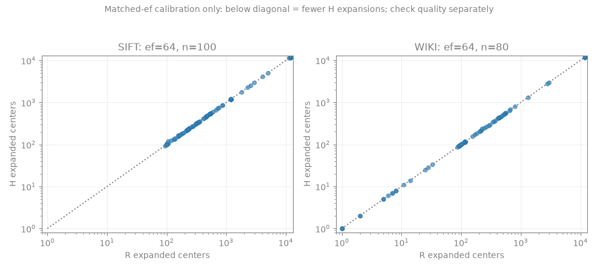

# 7654f1e真实数据实测：邻接改变，但未获得有效展开与端到端收益

**三项优先问题的答案：**

1. **H改变了真实候选池上的有效邻接。** WIKI/SIFT采样中H与R分别有270/601、265/400条source-query邻接列表不同；搜索实际使用同一个compile例程。这里指查询编译后消费的邻接，不是重写用于生成候选池的基础HNSW图。
2. **没有获得有量级的expanded下降。** 同ef=1024且校准质量均通过时，WIKI H/R平均展开2176.5625/2176.8125，SIFT均为4407.26；H虽显著少保留边，却基本没有少访问搜索状态。
3. **没有同质量快于真实NodeANN的证据。** WIKI H确认质量未过门；SIFT确认质量通过，但本样本非空均值为A的119.48倍，同时只有16个非空qidx，覆盖不足是另一项独立限制。两个数据集的原脚本均未放行dynamic，真实动态及维护包络未运行。

## 1. 本轮研究问题与假设

按冻结 [closure-server-plan.md](closure-server-plan.md) 检验子树闭包见证是否不仅改变邻接，还能改变真实展开，在同质量下快于正常NodeANN。预测及失败判据沿用研究端，不由服务器重新选路线。

权威源码为 `7654f1e79bef6ce3b1aaaffe399b6e17609c7da1`。在502753c分支基点仅导入closure源码、调度、现成回归及本地证据，不整分支合并旧实验CSV、论文索引或历史文档。核心、公共模块及调度依赖的Git blob均与指定提交相同，详见 [preflight](data/closure-server-run1/preflight.json)、[verification](data/closure-server-run1/verification.json)。

## 2. 相关工作与可能重合点

按任务书保留 [RNSG v2 §3](https://arxiv.org/html/2603.12913v2#S3) 的attribute-between/heredity直接前序边界。R只是相同候选池上的strict-between消融，不是完整作者系统复现；HNSW、几何遮挡、掩码、Euler/treap不单独作为创新。本轮没有重做文献查重、扩张新颖性主张或新增未经核读的论文记录。

递归子树的限制性质不涵盖内部目录direct集合，也不是有限ef召回或短路径保证。离线审计的采样上限不应被写成全真实图证明。

## 3. 实际算法/索引改动

**没有改动7654f1e的算法、核心实现或调度。** 未改候选池64、停止规则、质量阈值、scope、入口、N或属性快照；未增加proxy、二跳索引、学习器或维护调参。

实际运行以下既有实现：

- [closure_index.h](../../../codes/directory-aware-vector-attr-search/src/closure_index.h)：HNSW近邻池、64-bit几何见证、U/G/R/H/H0编译、共同前沿、全部更新和同步压实。
- [closure_order.h](../../../codes/directory-aware-vector-attr-search/src/closure_order.h)：enter/direct-end/exit、稳定对象token、当前rank、scope和cut/link。
- [closure_research.cpp](../../../codes/directory-aware-vector-attr-search/src/closure_research.cpp)：严格事件回放、独立canonical状态、GT生成/消费、机制审计和实际计数。
- [run_closure.py](../../../codes/directory-aware-vector-attr-search/scripts/run_closure.py)：原样串行轮换、冻结预算与自动阶段门。
- A仍为原 [dynamic_triad.cpp](../../../codes/directory-aware-vector-attr-search/src/dynamic_triad.cpp) 的 `--arm A --scan-threshold 512`。没有用PE-OFFLINE替代NodeANN，没有禁止正常小节点扫描来削弱它。

所有搜索、构建和GT均C++，公共FP32 squared-L2 `RawL2Space`、同一hnswlib revision。Python新增部分仅用于原始结果打包与绘图，不参与在线算法或放行。

## 4. 相对基线的预期变化

原预测为：H相对R/H0应改变实际展开，不仅减少同一批状态的候选取得；当前层级/谓词编译、构建、候选池、图和向量副本都收费。A/H各自选择相同质量下的正常参数，不强制A使用相同候选池或ef。

U用于判断未剪枝固定池是否已有scope内有效连接，G/R/H0用于隔离闭包及普通资格见证。H若只少边、不少展开，或需更高ef才能恢复质量，不足以支持目标贡献；更大内存本身不构成淘汰条件。

## 5. 实际实验设置与执行

- WIKI：502753c保留的root-3626完整原始子树，11869初始live、1024维、151节点；不是全WIKI。
- SIFT：原深度3层级，12000初始live＋1000 reserve、128维、15节点；没有扩大到SIFT1M。
- 数据、原动态trace及输入元数据SHA与502753c逐一相同，没有转换成私有输入格式。四个原路径、源码blob、机器/亲和性、起始load见preflight。
- 每数据集原轨迹前200条字面Q，静态仅用初始属性快照，源更新按合同不应用；qidx排序奇偶分组，校准和确认各100条。同一qidx不跨组，旧query不是新独立测试集。
- 默认六臂×ef=64/256/1024校准，再冻结每臂最低非空均值的合格预算，确认3次。共72次计时运行，另4次独立GT生成和2次机制审计，完整static流程实际耗时633.26秒。
- 两数据集冻结参数均为：A64，U256，G1024，R256，H1024，H0 1024。每个选择在确认之前写入selection.json，没有确认后重选。
- CPU2，串行、单worker，未并跑其他ANN任务。开始loadavg 0.0718/0.0576/0.0088，完成后采样为0.0347/0.4580/0.4258；不声称整机完全隔离或三次重复具有统计显著性。
- 计时查询消费同一C++预计算GT；全部72次记录的GT距离数、非法、重复和状态错误合计均0。GT、canonical扫描和IO在计时外，当前scope/邻接编译在e2e内。
- 现成3项CLI回归通过，覆盖真程序、共用GT、全部事件、坏GT拒绝与门控；这些小合成检查不是大数据维护性能证据。

## 6. 实际结果及失败

### 6.1 E1：机制确实激活，但注意审计范围

| 数据集 | source-query行 | 涉及query实例 | H≠R | H≠G | H≠H0 | recursive核对 | recursive错误 |
|---|---:|---:|---:|---:|---:|---:|---:|
| WIKI | 601 | 80 | 270 | 106 | 452 | 480 | 0 |
| SIFT | 400 | 50 | 265 | 231 | 383 | 400 | 0 |

这些是确认query上至多8个scope内源的离线编译，不是每条实际展开边的全量追踪，也不是独立源样本数。实际不同源为WIKI202、SIFT16，不能将1001行说成1001个独立顶点。

WIKI另有1条direct限制不一致，**不属于recursive定理，也不计实现错误**；没有通过改语义消除它。全scope逐ID资格核对通过。[完整机制汇总](data/closure-server-run1/static/mechanism.json)、[少量原始邻接实例](data/closure-server-run1/static/mechanism-examples.json)；完整audit CSV仍在work，路径/SHA已保存。

### 6.2 E2：同ef的边变化没有转成有量级的展开下降

以下均为**校准集非空、ef=1024**，H/R的macro及pair均为1，排除了冻结ef不同造成的混淆；非确认集胜负结论。

| 数据集 | R保留边/查询 | H保留边/查询 | R expanded | H expanded | R均值ms | H均值ms |
|---|---:|---:|---:|---:|---:|---:|
| WIKI | 115569.55 | 102359.89 | 2176.8125 | 2176.5625 | 17.867 | 19.572 |
| SIFT | 205327.17 | 184918.05 | 4407.26 | 4407.26 | 35.886 | 44.331 |

这些在线计数来自实际search调用的编译，不只是离线生成另一套没使用的邻接。**剪掉更多边，不等于少访问几何状态。** WIKI仅少0.25个平均展开，SIFT均值完全相同；不能将这个量级称为有效路由改进。相对H0的展开变化也很小，完整同ef64/256/1024对照均保留在 [matched-ef-calibration.json](data/closure-server-run1/static/matched-ef-calibration.json)。

保留边列为跨展开中心累计的候选池编译边，不包含共同次序骨架；骨架另记backbone_ids。compile_us是search/e2e的子项，不能与e2e再次相加；本文没有用扣掉编译的时间宣称加速。

下图是另一个预算ef64的逐query校准诊断，点可能重叠；该预算两数据的H/R都未过质量门，不能拿它的较低工作量当同质量收益。

### 6.3 冻结确认：六臂质量、时间与工作量

每格时间为3次确认各自非空均值的平均；单位ms。WIKI每次80非空/20空，SIFT每次50非空/50空。expanded只在同池臂之间比较；A的跨层ann_hops不冒充expanded。

| 数据集 | 臂/ef | macro / pair | 质量门 | e2e均值ms | expanded | 距离数 | compile均值ms |
|---|---|---|---|---:|---:|---:|---:|
| WIKI | A/64 | 1 / 1 | 通过 | 0.546 | — | 1461.83 | — |
| WIKI | U/256 | .996250 / .994434 | 未过 | 10.068 | 1443.45 | 2690.15 | 8.080 |
| WIKI | G/1024 | .998750 / .998145 | 未过 | 15.103 | 2011.33 | 2973.93 | 12.538 |
| WIKI | R/256 | .996250 / .994434 | 未过 | 11.082 | 1443.69 | 2577.98 | 9.098 |
| WIKI | H/1024 | .998750 / .998145 | 未过 | 17.473 | 2011.19 | 2980.01 | 14.916 |
| WIKI | H0/1024 | .998750 / .998145 | 未过 | 22.892 | 2012.04 | 2947.55 | 20.467 |
| SIFT | A/64 | 1 / 1 | 通过 | 0.355 | — | 3710.54 | — |
| SIFT | U/256 | 1 / 1 | 通过 | 21.262 | 2973.70 | 4390.72 | 18.742 |
| SIFT | G/1024 | 1 / 1 | 通过 | 35.991 | 4839.76 | 5515.56 | 32.231 |
| SIFT | R/256 | 1 / 1 | 通过 | 22.726 | 2973.66 | 4362.80 | 20.221 |
| SIFT | H/1024 | 1 / 1 | 通过 | 42.418 | 4839.96 | 5521.32 | 38.555 |
| SIFT | H0/1024 | 1 / 1 | 通过 | 49.927 | 4840.04 | 5510.36 | 46.513 |

**WIKI是质量泛化失败，不能把17.473/0.546写成已完成的同质量效率比。** 所有新臂校准都有合格点，但冻结后确认均未过门；没有用确认结果重选ef。H的唯一漏召回query为确认event18、qidx35、recursive root、scope11869、eligible8511；10个GT仅返回9个，三次均漏最近的ID8122。状态错误为0。U/R也有确认漏召回，不能据此唯一归因H见证；未补跑确认U1024，也未扩大网格。

**SIFT是本样本同质量效率负结果，另有覆盖不足。** H/A非空均值比119.4836；H编译占e2e约90.89%。全非空只有16个不同qidx，预设宽scope多属性AND有22个实例但仍仅16个qidx，不能说满足20个qidx的调度线。覆盖失败不是性能失败；这里同时观察到样本内速度失败，不能将其外推成足够覆盖下的普遍结论。

参数选择造成的H1024/R256不能直接解释为纯邻接作用；纯规则作用看§6.2。H相对H0较快也没有相应有量级展开下降，不能改写成路由状态显著减少。

完整每重复非空mean/p50/p95/p99、距离、展开、编译、资格工作见 [group-runs.json](data/closure-server-run1/static/group-runs.json)；三重复统计量汇总在 [confirmation.json](data/closure-server-run1/static/confirmation.json)。分位数按原脚本nearest-rank，不将重复查询合池成独立新样本。

### 6.4 全部参数点与质量失败均保留

72个计时配置中31个未达质量门：16个校准点，15个WIKI确认运行；没有因质量低删除时延或把macro四舍五入后忽略pair。特别是SIFT H/256校准macro约0.999，但pair=.9988345，仍正确判为未过。

[configurations](data/closure-server-run1/static/configurations.json)、[quality-failures](data/closure-server-run1/static/quality-failures.json)、[逐漏召回诊断](data/closure-server-run1/failure-diagnostics.json) 保存全部点。后者将相同重复的85条漏召回记录归组，保留repeat列表、原始路径、GT/返回/缺失ID；它们是近似漏召回，不是状态错误。

下图仅为校准集全部冻结预算，和上表确认集不同；每臂三点及宏质量参考线均保留，pair仍以JSON为准，不能只看图上macro是否过线。

### 6.5 构建、空间与没有运行的维护

确认重复0实测，MB=10^6B。结构估计边界不同，不把它们当等口径RSS；峰值是整个进程高水位。

| 数据集 | 臂 | 构建s | 其中H图s | 其中H池/见证s | 结构估计MB | 进程峰值RSS MB |
|---|---|---:|---:|---:|---:|---:|
| WIKI | A | 1.137 | — | — | 22.849 | 84.918 |
| WIKI | H | 14.146 | 4.813 | 9.328 | 67.127 | 123.744 |
| SIFT | A | 0.405 | — | — | 7.342 | 41.796 |
| SIFT | H | 2.437 | 0.926 | 1.505 | 26.604 | 38.646 |

H构建真实几何调用WIKI83,393,224、SIFT62,088,512，包含HNSW建图、近邻池与见证；这些未混入query距离。全部臂/重复的构建与内存均保存在配置和原summary，不只取最小值。

- H结构估计包含HNSW payload/图/锁/映射/visited容量、候选与见证、目录token和seen；不含借用Dataset、canonical验证元数据和暂态workspace。
- H仍持有原始输入向量＋HNSW payload副本，并非“一份向量”。原base分别为WIKI48,615,424B、SIFT6,656,000B；test分别为1,867,776B、32,768B，另有属性/parent及canonical元数据。HNSW按对象容量分配，SIFT reserve容量亦收费。
- A结构估计为既有metadata估计＋HNSW序列化尺寸，未包含全部图对象/锁/分配器及Dataset；RSS不扣去这些。不能由结构列比值推导真实内存加速或认定SIFT H一定比A占更多常驻内存。
- 进程RSS包含构建、查询、验证和分配器高水位，未额外测稳态RSS或真实重建双图峰值。源实现具备同步压实，但本轮真实维护未放行，不能用静态峰值冒充其峰值。
- **没有真实更新延迟、维护吞吐、压实成本、债务或staleness结果；这些是未测，不是0。** 已有更新实现和合成E0不替代真实窗口。内存未被作为放行失败原因。

### 6.6 自动阶段门与执行状态

[原result](data/closure-server-run1/static/wiki/result.json) / [SIFT result](data/closure-server-run1/static/sift/result.json)、[stage-decision](data/closure-server-run1/static/stage-decision.json)、[dynamic-stage](data/closure-server-run1/dynamic-stage.json) 保存原门控和独立解释。

- WIKI：A/H总体质量门失败；全非空80个qidx足够，但H未达Recall。宽scope AND只有8个qidx，另有覆盖不足。未放行。
- SIFT：A/H质量通过；两个预设组均仅16个qidx，覆盖不足，且本样本三次H/A均值比均远大于1，speed_groups为空。不能把覆盖项单独写成速度失败。未放行。
- 两者dynamic_admitted=false，因此原动态前缀与合成维护包络**均未执行**，没有绕过脚本、使用smoke或写no-op假结果。

## 7. 证据是否支持假设

支持：H/R以及H/H0编译邻接确有差异，递归限制性质在880条采样核对中无错误，普通资格影响边恢复不是完全no-op。

不支持：邻接变化带来有量级的expanded下降；相同质量下超越正常NodeANN；真实动态全成本收益。WIKI属于质量不足，SIFT属于样本内同质量成本不划算并伴独立覆盖不足。没有观测到C++语义/状态错误，也没有据实验负结果擅自修改算法。

不能声称“明显少展开只是编译抵消”：实际同ef展开几乎没变，同时compile确实昂贵。更准确的是**局部边缩减没有转成有效状态缩减，且在线编译增加了成本**。这不否证所有图过滤或子树闭包表示，也不建立新颖性/公开系统优越性。

## 8. 下一轮唯一最重要的问题

**在既定候选池、骨架和停止规则下，为什么已改变的闭包邻接仍几乎访问同一批数量的状态？** 现有证据尚不能把候选覆盖、骨架依赖与见证剪枝/停止的贡献完全分开；应由研究端根据这份负结果决定下一步。本轮不自行扩大池、调阈值、扩大N或转回二跳/WQR/维护优化。

## 阅读、复现与保存

1. [冻结任务书](closure-server-plan.md)、[实际构建与复现](experiments/closure-server-reproduction.md)。
2. [原manifest](data/closure-server-run1/static/manifest.json)、[72次runs](data/closure-server-run1/static/runs.json)、两数据集result/selection和字面trace。
3. [机制](data/closure-server-run1/static/mechanism.json)、[同ef对照](data/closure-server-run1/static/matched-ef-calibration.json)、[每重复分组结果](data/closure-server-run1/static/group-runs.json)、[全部失败](data/closure-server-run1/failure-diagnostics.json)。
4. [raw文件路径/大小/SHA](data/closure-server-run1/static/raw-inventory.json)、[完整性记录](data/closure-server-run1/static/packaging.json)。所有原始CSV/日志留 `work/closure/static-7654f1e-run1/`，不上传大raw；大向量、索引与编译二进制不提交。

新增的是7654f1e在原WIKI/SIFT上的完整static证据、小聚合、配置、SHA、图和门控解释；未更改核心方案、未增加未经授权的真实dynamic实验、未覆盖502753c及研究端历史。首版图的标签重叠仅作可视化修正，旧图保留，正式figures-v2已实际打开检查，未重跑性能来修图。
