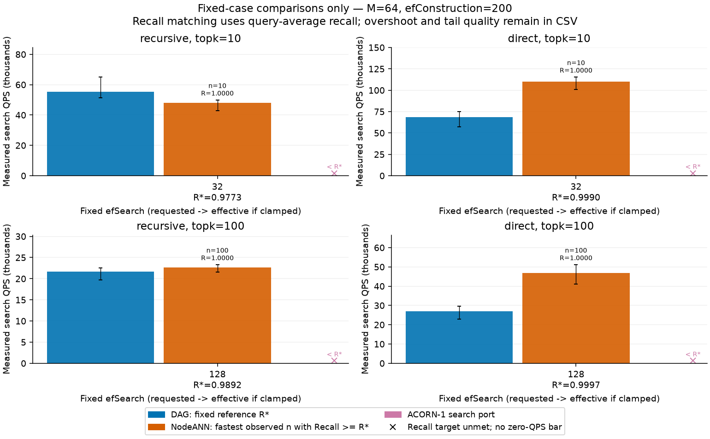

# 两组固定(topk, efSearch)：同质量约束下的QPS对比

## 1. 结论

只跑用户指定的两格：`k=10, efSearch=32` 与 `k=100, efSearch=128`。组内ef、k、构图、入口全部固定；不把不同ef连成曲线。

- **非递归两格、递归k=100格：NodeANN在达到本方案Recall时更快**，1.04–1.73倍。
- **递归k=10/ef32：本方案更快**，55.2k对48.1k QPS，但召回低2.3个点（0.9773对1.0），且最差查询仅0.40。
- 这两格中，达标的NodeANN点全部是**n=k**：本方案召回已接近饱和，任何更小的n都低于R*。因此本组数据没有给出“少取局部结果也同质量更快”的证据；中间n只是更快但质量更低的点。
- ACORN搜索移植与严格过滤在四格均**达不到**R*，最高召回仅0.16–0.27，不能拿其QPS作同质量比较。

本方案没有任何调度旋钮参与调参：每格一个固定点。NodeANN的n扫描是它的本地返回配额，不是我们的超参数。

## 2. 协议

| 项 | 设置 |
|---|---|
| 模式 | `recursive`、`direct` 分别建图、分别报告 |
| 查询 | 120 条（recursive 110非空/10空；direct 101/19），非held-out |
| base | SIFT前168,937×128 FP32；固定随机owner绑定，非真实SIFT语义 |
| 参数 | M=64、efConstruction=200；portal=8、反向桥16；底层容量128 |
| 固定格 | `(k=10,ef=32)`、`(k=100,ef=128)`；请求值=有效值 |
| NodeANN | 格内扫全部整数 n=1…k（k=100即1…100），各合格属性图用同一n，再取全局top-k |
| 计时 | 每点预热整批；10批次×每批16遍非空query；QPS=非空数×16/批次上中位秒 |
| 计入 | 图搜索、NodeANN归并、结果checksum消费；**不含** scope准备、GT、构建 |
| 校验 | 正常/计数返回ID一致；不合格查询距离恒0；GT在计时外缓存top-100并按k取边界 |

原生hnswlib宽度至少为返回数，因此四方案与每个n统一按`max(k,efSearch)`执行；本轮两格均`ef≥k`，请求值等于有效值。k=100时56/110（recursive）、56/101（direct）条query的合格数不足100，分母为`min(k,eligible)`，平均真值数68.4/66.1，欠填已计入损失。

总点数：每模式116点（DAG 2 + NodeANN 110 + ACORN 2 + 严格过滤 2），共232点、27840条逐query审计、2320个计时批次。

## 3. 同质量QPS对比

R*为本方案该格实测query-average Recall；NodeANN取同格内`Recall≥R*`的最快点。

| 模式 | (k,ef) | 本方案R* (min) | 本方案QPS | NodeANN 达标点 | Recall | QPS | NodeANN/本方案 |
|---|---|---|---:|---|---:|---:|---:|
| recursive | (10,32) | 0.977273 (0.40) | 55,194 | n=10 | 1.000000 | 48,090 | **0.87×** |
| recursive | (100,128) | 0.989182 (0.57) | 21,703 | n=100 | 1.000000 | 22,646 | **1.04×** |
| direct | (10,32) | 0.999010 (0.90) | 68,462 | n=10 | 1.000000 | 110,145 | **1.61×** |
| direct | (100,128) | 0.999703 (0.97) | 27,106 | n=100 | 1.000000 | 46,926 | **1.73×** |



图中每组只含同格数据；`x`标记表示该方案在本格任何已测配置下都未达到R*，不画零QPS柱。横轴下方给出R*，柱上给出达标NodeANN的n与实际Recall。

### 3.1 未达成同质量的方案

| 模式 | (k,ef) | ACORN最高Recall | 严格过滤最高Recall |
|---|---|---:|---:|
| recursive | (10,32) | 0.255487 | 0.037305 |
| recursive | (100,128) | 0.270602 | 0.042755 |
| direct | (10,32) | 0.163197 | 0.032504 |
| direct | (100,128) | 0.165758 | 0.037780 |

这些是其全部已测点中的最大值，不是同质量加速。ACORN臂是原生RNG HNSW上的ACORN-1搜索策略移植，非完整作者索引复现。

### 3.2 为什么n=k

本方案在四格的召回已分别达到0.977、0.989、0.999、0.9997，R*接近饱和。NodeANN降低n会先丢少数近距离结果，Recall随即低于R*；因此“达标最快点”只能是最大n。可复现核对：同格`pareto-points.csv`包含n=1…k全部已测点，`matched-comparison.csv`记录各格的maximum observed recall。

## 4. 实际工作量（非空均值）

| 模式 | (k,ef) | 方案 | 合格L2调用 | item资格 | owner资格 | 邻接条目 |
|---|---|---|---:|---:|---:|---:|
| recursive | (10,32) | 本方案 | 133.19 | 307.75 | 0 | 1069.14 |
| recursive | (10,32) | NodeANN n10 | 200.92 | 0 | 1929 | 未测 |
| recursive | (100,128) | 本方案 | 200.62 | 643.94 | 0 | 3236.39 |
| recursive | (100,128) | NodeANN n100 | 275.90 | 0 | 1929 | 未测 |
| direct | (10,32) | 本方案 | 101.63 | 319.71 | 0 | 1094.37 |
| direct | (10,32) | NodeANN n10 | 108.15 | 0 | 1929 | 未测 |
| direct | (100,128) | 本方案 | 142.18 | 714.05 | 0 | 3158.09 |
| direct | (100,128) | NodeANN n100 | 149.91 | 0 | 1929 | 未测 |

NodeANN外层只判owner后进整张合格局部图，故item资格为0；这不是没有过滤。native邻接未知留空，不填0。

递归k=10格本方案L2更少（133对201）却更慢，说明差异不能只用距离次数解释；候选堆、邻接读取、拒绝边的资格判断与缓存都是未隔离因素。非递归两格本方案L2亦更少而更慢，同属待拆解的开销，不是已完成的因果结论。

当前单图只导出局部HNSW的level-0，NodeANN保留完整原生层次。此比较**同时**改变图结构、层次与过滤方式，不能把差距归给任何单一机制。

### 4.1 递归10格最差查询

本方案在recursive (10,32) 有8条query未完全命中GT，最低Recall 0.40，而NodeANN同格全为1.0。平均0.9773不构成逐查询达标。

## 5. 重复运行波动

同一cell在先前九格探索（同binary逻辑、同数据）与本轮各测一次，Recall逐位相同（搜索确定性），QPS变化：recursive (10,32) −4.5%/(NodeANN −0.8%)、recursive (100,128) +3.7%/+3.5%、direct (10,32) +1.6%/+1.4%、direct (100,128) +1.5%/−2.7%。

因此小于约5%的QPS差异不应被解释为算法优劣；1.04×的递归k=100格属于该量级，不能当作稳定胜出。只测两个独立构建/两次运行，不提供置信区间。

## 6. 内存与范围边界

独立进程峰值RSS（含构建、GT、原生图副本及导出表示）：本方案2261 MiB、NodeANN 2202 MiB、ACORN 276 MiB、严格过滤 276 MiB。两者都保留768个原生小图，每图`label_op_locks_` payload约2.5 MiB（本机ABI），这是具体实现开销，非多图ANN算法必然需求。

同M不等于同服务字节；本报告不声明等内存公平比较。分层、倒排入口、b跳转与等预算剪枝仍是[设计文档](dag-layered-routing-design.md)中的候选，未在本轮实现或测量。

## 7. 复现与证据

```bash
bash autoresearch.sh
```

默认输出`work/dag-two-cases-m64/`。正式小数据在[data/dag-two-cases-m64](data/dag-two-cases-m64/)：

- [完整摘要](data/dag-two-cases-m64/analysis/summary.json)、[同质量对比CSV](data/dag-two-cases-m64/analysis/matched-comparison.csv)、[对比图](data/dag-two-cases-m64/analysis/fixed-k-ef-comparison.png)。
- 每方法`pareto-points.csv`（全部点，含n=1…k）、`pareto-queries.csv.gz`（无损压缩的逐query审计）、`pareto-batches.csv`（10批次原始耗时）、`index-parameters.json`、`process-resource.txt`。
- [执行元数据](data/dag-two-cases-m64/run-meta.json)、[压缩校验](data/dag-two-cases-m64/compression.json)、[已执行检查](data/dag-two-cases-m64/regression.txt)、[硬件](data/dag-two-cases-m64/hardware.json)、`build/*.d`与源码SHA。
- 协议与命令：[复现说明](experiments/dag-pareto-reproduction.md)；分析器：[analyze_dag_pareto.py](experiments/analyze_dag_pareto.py)。

旧九格/跨ef探索的原始点与源码快照保留在`data/dag-fixed-k-ef-m64/`、`data/dag-pareto-m64-efc200/`，其图已撤下，不作为交付对比。

局限：单一构建种子、人工随机owner、120条非held-out query、固定WSL硬件、仅搜索段QPS；未测真实标签AND、更大k、等服务字节或新分层机制。不声称普遍胜出，也未完成新颖性证明。
