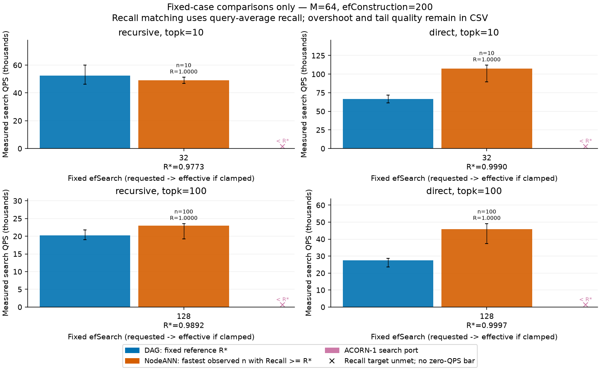
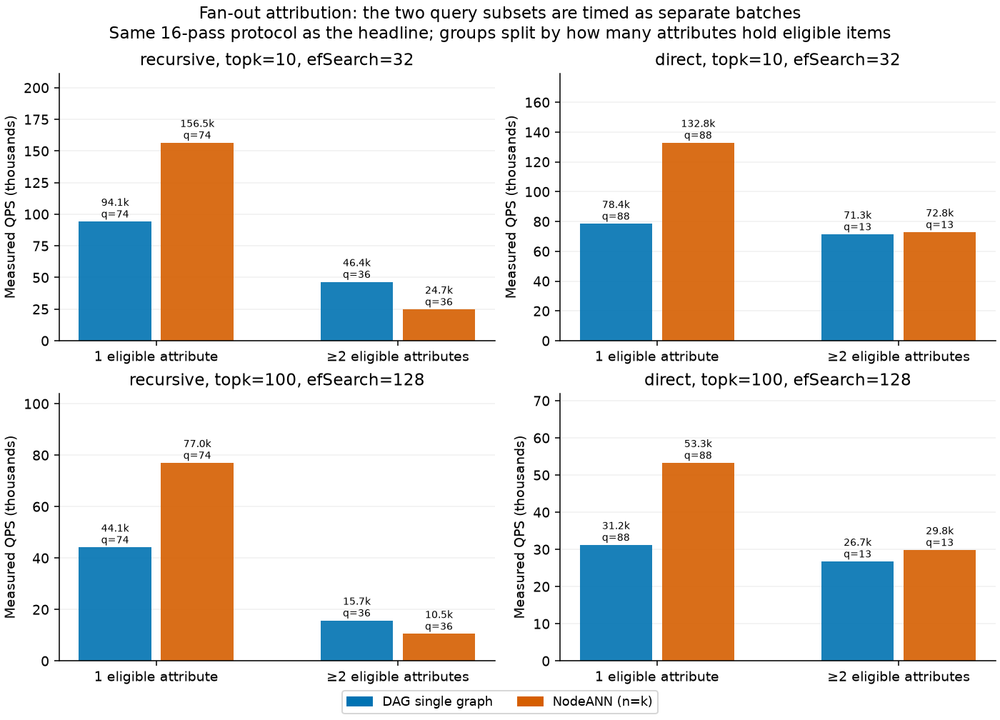

# 两组固定(topk, efSearch)：同质量约束下的QPS对比

## 1. 结论

只跑用户指定的两格：`k=10, efSearch=32` 与 `k=100, efSearch=128`。组内ef、k、构图、入口全部固定；不把不同ef连成曲线。

- **非递归两格、递归k=100格：NodeANN在达到本方案Recall时更快**：非递归1.61–1.73倍（两次运行稳定），递归k=100为1.04–1.13倍（同一binary漂移可达7%，只算平手到略优）。
- **递归k=10/ef32：本方案更快**，52.5–55.2k对48.1–49.1k QPS（0.87–0.94倍于NodeANN），但召回低2.3个点（0.9773对1.0），且最差查询仅0.40。
- **反转的原因不是“单图 vs 多图”，而是合格集能否装进一张属性图**：单属性查询时NodeANN只跑一张小图并稳定快约1.7倍（四格一致）；只有G≥2时它才做多图合并，递归的多属性查询上我们反超1.5–1.9倍（§3.0）。
- 这两格中，达标的NodeANN点全部是**n=k**：本方案召回已接近饱和，任何更小的n都低于R*。因此本组数据没有给出“少取局部结果也同质量更快”的证据；中间n只是更快但质量更低的点。
- ACORN搜索移植与严格过滤在四格均**达不到**R*，最高召回仅0.16–0.27，不能拿其QPS作同质量比较。

本方案没有任何调度旋钮参与调参：每格一个固定点。NodeANN的n扫描是它的本地返回配额，不是我们的超参数。

## 2. 协议

| 项 | 设置 |
|---|---|
| 模式 | `recursive`、`direct` 分别建图、分别报告 |
| 查询 | 120 条（recursive 110非空/10空；direct 101/19），非held-out |
| base | SIFT前168,937×128 FP32；固定随机owner绑定，非真实SIFT语义 |
| 参数 | M=64、efConstruction=200；portal=8、反向桥16；底层容量128 |
| 固定格 | `(k=10,ef=32)`、`(k=100,ef=128)`；请求值=有效值 |
| NodeANN | 格内扫全部整数 n=1…k（k=100即1…100），各合格属性图用同一n，再取全局top-k |
| 计时 | 每点预热整批；10批次×每批16遍非空query；QPS=非空数×16/批次上中位秒 |
| 计入 | 图搜索、NodeANN归并、结果checksum消费；**不含** scope准备、GT、构建 |
| 校验 | 正常/计数返回ID一致；不合格查询距离恒0；GT在计时外缓存top-100并按k取边界 |

原生hnswlib宽度至少为返回数，因此四方案与每个n统一按`max(k,efSearch)`执行；本轮两格均`ef≥k`，请求值等于有效值。k=100时56/110（recursive）、56/101（direct）条query的合格数不足100，分母为`min(k,eligible)`，平均真值数68.4/66.1，欠填已计入损失。

总点数：每模式116点（DAG 2 + NodeANN 110 + ACORN 2 + 严格过滤 2），共232点、27840条逐query审计、2320个计时批次。

## 3. 同质量QPS对比

R*为本方案该格实测query-average Recall；NodeANN取同格内`Recall≥R*`的最快点。下表并列两次独立运行（同binary、同数据、不同进程）：

| 模式 | (k,ef) | 本方案R* (min) | 本方案QPS 两次 | NodeANN 达标点 | NodeANN QPS 两次 | NodeANN/本方案 |
|---|---|---|---:|---|---:|---:|
| recursive | (10,32) | 0.977273 (0.40) | 55,194 / 52,499 | n=10 | 48,090 / 49,113 | **0.87–0.94×** |
| recursive | (100,128) | 0.989182 (0.57) | 21,703 / 20,235 | n=100 | 22,646 / 22,933 | **1.04–1.13×** |
| direct | (10,32) | 0.999010 (0.90) | 68,462 / 66,553 | n=10 | 110,145 / 107,363 | **1.61×** |
| direct | (100,128) | 0.999703 (0.97) | 27,106 / 27,502 | n=100 | 46,926 / 45,826 | **1.67–1.73×** |

同一binary的重复运行漂移最大7%（递归k=100本方案），因此1.04×不能称稳定胜出；direct的1.6–1.7×跨两次运行稳定。



图中每组只含同格数据；`x`标记表示该方案在本格任何已测配置下都未达到R*，不画零QPS柱。横轴下方给出R*，柱上给出达标NodeANN的n与实际Recall。

### 3.0 为什么 direct 反转、recursive 不反转

把同一格的查询按“合格item落在几个属性”拆成两组，**分别用同一16遍协议做批量计时**（`fanout-batches.csv`）：

| 模式 | (k,ef) | 子集 | 查询数 | 平均合格数 | 平均属性图数 | 本方案QPS | NodeANN QPS | NodeANN/本方案 |
|---|---|---|---:|---:|---:|---:|---:|---:|
| recursive | (10,32) | 1个属性 | 74 | 151 | 1.00 | 94,128 | 156,473 | 1.66× |
| recursive | (10,32) | ≥2个属性 | 36 | 932 | 5.08 | 46,428 | 24,711 | **0.53×** |
| recursive | (100,128) | 1个属性 | 74 | 151 | 1.00 | 44,105 | 76,965 | 1.75× |
| recursive | (100,128) | ≥2个属性 | 36 | 932 | 5.08 | 15,684 | 10,499 | **0.67×** |
| direct | (10,32) | 1个属性 | 88 | 219 | 1.00 | 78,435 | 132,817 | 1.69× |
| direct | (10,32) | ≥2个属性 | 13 | 352 | 2.46 | 71,327 | 72,782 | 1.02× |
| direct | (100,128) | 1个属性 | 88 | 219 | 1.00 | 31,190 | 53,257 | 1.71× |
| direct | (100,128) | ≥2个属性 | 13 | 352 | 2.46 | 26,723 | 29,818 | 1.12× |



三点结论：

1. **合格集只落在一个属性时，NodeANN 稳定快约1.7倍**，四格一致。此时它只跑一张小局部图，根本没有任何“多图合并”。
2. **递归的多属性查询（36/110，平均5.08张图、最多24张）才是历史观察成立的地方**：NodeANN 每多一张图就多一次独立遍历与归并，我们反超1.5–1.9倍。
3. **direct 只有13/101条多属性查询（平均2.46张，最多3张）**，其收益不足以抵消88条单属性查询上的1.7倍劣势；这就是 direct 整体反转的原因。

因此正确的轴不是“单图 vs 多图”，而是**合格集能否全部装进一张属性图**。我们的168k单图对所有属性共用，单属性查询时大部分邻接准入仍指向别的owner：`1 - distances/item_checks` 按**全体查询**计为56.7%（递归k=10）、68.8%（递归k=100）、68.2%（直接k=10）、80.1%（直接k=100）；单属性子集更高，为71.6%、81.1%、71.5%、81.8%。但被拒绝的比例不等于代价：§4.2 的剪枝消融把所有这类条目删除，单属性查询也只节省10.4–26.0%时间，剪枝后NodeANN仍快1.37–1.74×。NodeANN 在单属性查询时退化成一张小图，反而是“单图”那一侧；它只有在 G≥2 时才变成多图合并。

归因口径限制：子集批次的QPS不能用来还原整批（子集工作集更小，重组结果比整体高5–37%）。上表只用于同协议下的方向与倍数比较；整批结论以§3为准。

### 3.1 未达成同质量的方案

| 模式 | (k,ef) | ACORN最高Recall | 严格过滤最高Recall |
|---|---|---:|---:|
| recursive | (10,32) | 0.255487 | 0.037305 |
| recursive | (100,128) | 0.270602 | 0.042755 |
| direct | (10,32) | 0.163197 | 0.032504 |
| direct | (100,128) | 0.165758 | 0.037780 |

这些是其全部已测点中的最大值，不是同质量加速。ACORN臂是原生RNG HNSW上的ACORN-1搜索策略移植，非完整作者索引复现。

### 3.2 为什么n=k

本方案在四格的召回已分别达到0.977、0.989、0.999、0.9997，R*接近饱和。NodeANN降低n会先丢少数近距离结果，Recall随即低于R*；因此“达标最快点”只能是最大n。可复现核对：同格`pareto-points.csv`包含n=1…k全部已测点，`matched-comparison.csv`记录各格的maximum observed recall。

## 4. 实际工作量（非空均值）

| 模式 | (k,ef) | 方案 | 合格L2调用 | item资格 | owner资格 | 邻接条目 |
|---|---|---|---:|---:|---:|---:|
| recursive | (10,32) | 本方案 | 133.19 | 307.75 | 0 | 1069.14 |
| recursive | (10,32) | NodeANN n10 | 200.92 | 0 | 1929 | 未测 |
| recursive | (100,128) | 本方案 | 200.62 | 643.94 | 0 | 3236.39 |
| recursive | (100,128) | NodeANN n100 | 275.90 | 0 | 1929 | 未测 |
| direct | (10,32) | 本方案 | 101.63 | 319.71 | 0 | 1094.37 |
| direct | (10,32) | NodeANN n10 | 108.15 | 0 | 1929 | 未测 |
| direct | (100,128) | 本方案 | 142.18 | 714.05 | 0 | 3158.09 |
| direct | (100,128) | NodeANN n100 | 149.91 | 0 | 1929 | 未测 |

NodeANN外层只判owner后进整张合格局部图，故item资格为0；这不是没有过滤。native邻接未知留空，不填0。

递归k=10格本方案L2更少（133对201）却更慢，说明差异不能只用距离次数解释；单属性子集上71.6%（递归k=10）到81.8%（直接k=100）的准入被资格拒绝，但§4.2 表明把这些条目全部删掉只收回10.4–26.0%的时间，所以“读取与拒绝跨owner边”只是少数成本。候选堆、单小图+native层次导航、邻接局部性等剩余因素仍未分别隔离，不是已完成的因果分解。

当前单图只导出局部HNSW的level-0，NodeANN保留完整原生层次。此比较**同时**改变图结构、层次与过滤方式，不能把差距归给任何单一机制。

### 4.1 递归10格最差查询

本方案在recursive (10,32) 有8条query未完全命中GT，最低Recall 0.40，而NodeANN同格全为1.0。平均0.9773不构成逐查询达标。

### 4.2 跨owner边判废的代价：剪枝消融

§3.0/§4 只能说明“多少邻接准入被拒”，不能说明“拒绝对时间贡献多少”。本节按查询删掉全部不合格目标的邻接条目，入口表与所有合格邻接行逐字保留、顺序不变，再比较同一搜索执行器的耗时。遍历本来就在算距离前拒绝这类目标、且不把它标记为visited，所以剪枝图必须返回相同ID、相同距离与扩展次数；该等价性在每条query×每格上强制检查（含CSR布局交叉检查、hits与计时校验和），任一不符即中止且不写CSV。

这是诊断性反事实，不是可实施优化：每查询图副本的构建耗时单独测量并排除在计时外，为28.2–30.2 ms/query，比节省的1.2–6.8 µs高约四个数量级。

计时沿用§3.0协议（16遍/批×10轮取中位数，两臂每轮交替顺序）。归档run2对同一binary与输入的最慢约3倍（逐query距离数完全一致），因此另在本会话重跑dag_merge与nodeann参考，不用归档时间做比值。

| 模式 | (k,ef) | 子集 | 查询数 | 被删条目占已扩展邻接 | 节省（µs/query） | 节省比例 | 同会话NodeANN/本方案：剪枝前→剪枝后 |
|---|---|---|---:|---:|---:|---:|---:|
| recursive | (10,32) | 1个属性 | 74 | 19.4% | 1.76 | 16.5% | 1.83× → 1.37× |
| recursive | (10,32) | ≥2个属性 | 36 | 11.1% | 1.72 | 8.1% | 0.64× → 0.52× |
| recursive | (100,128) | 1个属性 | 74 | 16.8% | 2.91 | 12.0% | 1.87× → 1.59× |
| recursive | (100,128) | ≥2个属性 | 36 | 9.8% | 4.84 | 7.2% | 0.77× → 0.66× |
| direct | (10,32) | 1个属性 | 88 | 20.9% | 3.80 | 26.0% | 2.23× → 1.43× |
| direct | (10,32) | ≥2个属性 | 13 | 14.1% | 1.22 | 8.5% | 1.22× → 1.04× |
| direct | (100,128) | 1个属性 | 88 | 19.3% | 3.33 | 10.4% | 2.21× → 1.74× |
| direct | (100,128) | ≥2个属性 | 13 | 12.4% | 6.77 | 18.1% | 1.29× → 0.91× |

结论：

1. **拒绝条目多、代价小。** 单属性查询中17–21%的已扩展邻接条目指向不合格owner（拒绝比例按offer计更高），全部删除只省16.5%/12.0%（递归k=10/k=100）与26.0%/10.4%（直接k=10/k=100）。
2. **“跨owner边读取”不能解释§3的1.66–1.75×差距。** 即便把这些读取当作零成本，单属性查询上NodeANN仍快1.37–1.74×。§3.0原先把这部分列为反转原因属于过度归因，已按本节更正。
3. **差额包含布局与局部性，不只是谓词。** 删除条目同时缩短邻接行、减少随机owner加载并改善局部性，因此节省比例是“读入+资格判断+缓存”的合计，不能拆成纯谓词成本。
4. **剩余差距未分解。** direct 的≥2属性子集只有13条query（含18.1%与0.91×），不外推；单小图+native层次导航、候选堆、局部图规模等仍未分别隔离。

## 5. 重复运行波动

同一binary、同数据、不同进程共跑三次（九格探索一次 + 两格两次）。Recall逐位相同（搜索确定性）；QPS最大漂移：本方案 −6.8%（递归k=100），NodeANN +3.5%。四格的NodeANN/本方案比值分别落在 0.87–0.94、1.04–1.13、1.61、1.67–1.73。

所以**递归k=100的1.04–1.13×属于噪声量级**，只能说平手到略优；direct的1.6–1.7×稳定。只测少量独立运行，不提供置信区间，也没有做多次独立构建。

## 6. 内存与范围边界

独立进程峰值RSS（含构建、GT、原生图副本及导出表示）：本方案2261 MiB、NodeANN 2202 MiB、ACORN 276 MiB、严格过滤 276 MiB。两者都保留768个原生小图，每图`label_op_locks_` payload约2.5 MiB（本机ABI），这是具体实现开销，非多图ANN算法必然需求。

同M不等于同服务字节；本报告不声明等内存公平比较。分层、倒排入口、b跳转与等预算剪枝仍是[设计文档](dag-layered-routing-design.md)中的候选，未在本轮实现或测量。

## 7. 复现与证据

```bash
bash autoresearch.sh
```

默认输出`work/dag-two-cases-m64/`。两次独立运行分别归档：[run2（含拆分批次与本文图）](data/dag-two-cases-m64-run2/)、[run1（同协议，无拆分批次）](data/dag-two-cases-m64/)。

- [完整摘要](data/dag-two-cases-m64-run2/analysis/summary.json)、[同质量对比CSV](data/dag-two-cases-m64-run2/analysis/matched-comparison.csv)、[对比图](data/dag-two-cases-m64-run2/analysis/fixed-k-ef-comparison.png)、[按合格属性数拆分的QPS图](data/dag-two-cases-m64-run2/analysis/fanout-latency.png)。
- 每方法`pareto-points.csv`（全部点，含n=1…k）、`pareto-queries.csv.gz`（无损压缩的逐query审计）、`pareto-batches.csv`（10批次原始耗时）、`fanout-batches.csv`（两个查询子集的分子集批次）、`index-parameters.json`、`process-resource.txt`。
- [执行元数据](data/dag-two-cases-m64-run2/run-meta.json)、[压缩校验](data/dag-two-cases-m64-run2/compression.json)、[已执行检查](data/dag-two-cases-m64-run2/regression.txt)、[硬件](data/dag-two-cases-m64-run2/hardware.json)、`build/*.d`与源码SHA。
- 协议与命令：[复现说明](experiments/dag-pareto-reproduction.md)；分析器：[analyze_dag_pareto.py](experiments/analyze_dag_pareto.py)。

§4.2 的剪枝消融单独复现：

```bash
bash researches/nested-attr-vector-search/2026-11-02-exps/experiments/run_edge_prune.sh
```

- [逐query审计](data/edge-prune-m64/nq120-recursive/edge-prune-queries-recursive.csv)、[分组汇总](data/edge-prune-m64/nq120-recursive/edge-prune-summary-recursive.csv)、[每轮原始批次](data/edge-prune-m64/nq120-recursive/edge-prune-batches-recursive.csv)（direct 同名一套）。
- [反事实表](data/edge-prune-m64/analysis/gap-counterfactual.csv)、[拒绝比例表](data/edge-prune-m64/analysis/rejection-ratios.csv)、[同会话参考点](data/edge-prune-m64/envcheck/)、[运行元数据](data/edge-prune-m64/run-meta.json)。
- 实现与检查：[dag_composition_bench.cpp](experiments/dag_composition_bench.cpp) 的`edge-prune`模式、分析器[analyze_edge_prune.py](experiments/analyze_edge_prune.py)；回归[dag_composition_test.cpp](experiments/dag_composition_test.cpp)新增“剪枝是原子序列且结果/工作量不变”。
- 消融的所有等价性检查（结果ID、距离数、扩展数、CSR布局、hits、计时校验和）均在C++内强制，失败即中止；每查询剪枝图构建28.2–30.2 ms不进入任何计时。

旧九格/跨ef探索的原始点与源码快照保留在`data/dag-fixed-k-ef-m64/`、`data/dag-pareto-m64-efc200/`，其图已撤下，不作为交付对比。

局限：单一构建种子、人工随机owner、120条非held-out query、固定WSL硬件、仅搜索段QPS；未测真实标签AND、更大k、等服务字节或新分层机制。不声称普遍胜出，也未完成新颖性证明。
