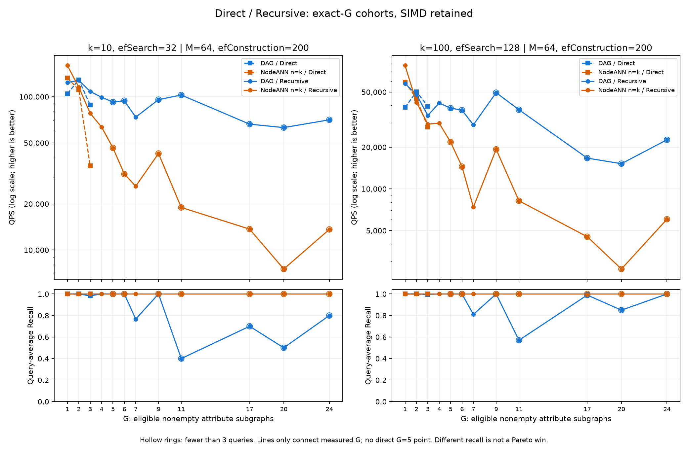

# Direct / Recursive：按非空属性子图数G比较效率

## 结论与图

保持SIMD，新增真实的**精确G分组批次计时**，不是用原有one/many均值插值。当前样本中，G=1两种查询均是NodeANN更快；G=2我们在两格均更快，且双方Recall=1。G≥3不少点更快但召回下降，不能作为等质量优胜。没有Direct G=5查询，不能画该点或从Recursive代替推断。



- 横轴：查询覆盖的非空直属属性局部图数G，按owner去重。
- 上排：QPS，对数纵轴，越高越好；左k10/efSearch32，右k100/efSearch128，不混ef。
- 下排：对应同批同组的query-average Recall，防止把漏答换来的速度当同质量收益。
- 蓝色我们、橙色NodeANN；方块虚线Direct、圆点实线Recursive。带外圈的点不足3条query。
- 只连接实际观测到的G，不外推缺失点；折线不是其他G上的预测模型。

**G不是我们启动的图搜索次数。** NodeANN对G张局部图分别搜索、归并；我们在一张合并图上启动一次共享搜索。G计数的是语义覆盖，不能称实际展开过G个owner：某些合格区域可能没有被搜索到。仅有一个非空属性子图的Recursive仍归G=1，不称“多图”。

## 1. 查询覆盖多少子图

两种语义分别沿用同120个原有query/scope配对；不为了凑G而另造查询。

| 查询语义 | 空结果G=0 | G=1 | G≥2 | 最大G | 非空查询平均G |
|---|---:|---:|---:|---:|---:|
| Direct | 19 | 88 | 13 | 3 | 1.1881 |
| Recursive | 10 | 74 | 36 | 24 | 2.3364 |

各G对应query数如下；空结果也保留记录，但不进入QPS/Recall分母：

| G | Direct条数 | Recursive条数 |
|---|---:|---:|
| 0 | 19 | 10 |
| 1 | 88 | 74 |
| 2 | 7 | 11 |
| 3 | 6 | 12 |
| 4 | 0 | 3 |
| 5 | 0 | 1 |
| 6 | 0 | 1 |
| 7 | 0 | 3 |
| 9 | 0 | 1 |
| 11 | 0 | 1 |
| 17 | 0 | 1 |
| 20 | 0 | 1 |
| 24 | 0 | 1 |

Direct只纳入查询明确命名的直属属性；Recursive纳入后代闭包并去重，且只计有直属item的属性局部图。空的属性节点不是非空局部图，多父共享后代不重复计图。同G不代表相同eligible item数、查询向量或搜索难度；原始汇总另存eligible_mean和距离calls。

## 2. 这批数据能说明什么

1. **G=1：没有速度优势。** Direct/Recursive、两个固定格都慢于NodeANN，双方Recall=1。
2. **G=2：有同质量的局部证据。** Direct两格速度比分别1.163×/1.116×，Recursive为1.110×/1.139×，双方Recall=1。但只有7/11条query，不将这批交叉位置写成普遍G阈值。
3. **G=3：速度优势不能脱离Recall看。** Direct两格Recall=0.983333/0.995；Recursive=0.983333/0.9975；NodeANN全为1。不能直接宣称同质量胜过。
4. **G=5只测到Recursive的一条query。** 该query两格双方Recall=1，我们速度比约1.991×/1.759×。没有Direct G=5数据，也不把一条query重复160次当160条独立query。
5. **大G时导航质量成为显著风险。** 例如Recursive G=11这一条query，k10/ef32 Recall只有0.4，k100/ef128为0.57；高QPS不能掩盖这些失败。不能从折线推出图数越多就一定更优。

这里的速度比是同组NodeANN延迟/我们延迟。图以QPS展示绝对效率，CSV保留所有精确数值；本页不再重复整张QPS表。

## 3. 设置、运行与校验

- SIFT前168,937×128 FP32，原有owner随机打散、DAG元数据和120个采样位置；未量化、未改变图/入口/准入规则。
- M=64、efConstruction=200；仅(10,32)、(100,128)。NodeANN局部n=k，不做额外n扫描，因此不是完整Pareto结论。
- 保持`-O3 -march=native -pthread`；启动时校验实际函数指针。四次程序运行均输出`kernel=AVX dim=128`。此前标量计划被最新要求取代，没有应用关闭SIMD的编译参数。
- 两方案分别编译、运行，使用独立私有hnswlib。复用同一数据、scope解析和精确GT；G分组、GT和构图不计入正常搜索时间。
- 按G分组，组顺序固定种子打乱；每组预热1遍，然后10轮，每轮完整组16遍；取第6个排序批次（上中位数）除以16与组大小，QPS=1e6/us_per_query。包含结果消费/校验和，不含诊断插桩。
- 每query正常/计数返回有序ID一致；资格、无重复、tie-aware GT核对通过，不合格距离calls=0；每个计时pass校验和必须等于审计输出。
- 新分析程序重新计算eligible/GT、分组数量、Recall、时间/QPS及独立include依赖；**960条query记录、600个批次审计PASS**。图已从实际输出生成并打开检查。
- 沿用既有DAG调用`min(ef,eligible)`后内部`max(k,ef)`，NodeANN原生每图请求ef；同ef不是总距离预算相等。图不宣称等内存服务预算。

复现：

```bash
bash researches/nested-attr-vector-search/2026-11-03-exps/experiments/run_dag_subgraph_efficiency.sh
```

[真实程序](experiments/dag_subgraph_efficiency.cpp)、[运行入口](experiments/run_dag_subgraph_efficiency.sh)、[分析绘图](experiments/analyze_dag_subgraph_efficiency.py)。

[全部原始证据](data/dag-subgraph-efficiency/)、[数量分布CSV](data/dag-subgraph-efficiency/analysis/scope-distribution.csv)、[QPS/Recall/距离汇总CSV](data/dag-subgraph-efficiency/analysis/summary.csv)、[速度比及质量标记](data/dag-subgraph-efficiency/analysis/ratios.csv)、[审计](data/dag-subgraph-efficiency/analysis/audit.json)。保存逐query、逐批、资源、编译参数、源码和输入SHA；不提交二进制、大数据或索引。

## 4. 限制与下一步

这是现有数据分层后的描述性比较，不是把同一查询控制为G=1…24的因果实验。每组重复访问形成组特定缓存状态，不能和旧one/many混合组时间直接拼接。两个方案跨进程运行，未做独立构建重复；高G多为单query，不能给总体置信区间。

下一步需要补真实Direct G=4/5及更多高G样本，并在相同Recall目标下扫描NodeANN局部n与我们的路由策略。尚未运行这些扩展，不画预测点、不填收益。当前优先处理高G漏答，而不是把低Recall高速点当已成功。
