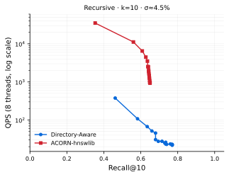
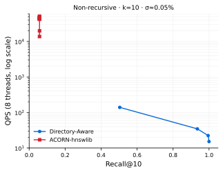

# 2026-11-10：层级作用域的 DSM 代价实测

## 目标

量化「作用域表示变更」的物理代价，并验证谓词无关索引在这些变更下零写入。

## 实验设置

SIFT1M（128 维、1M base、10k query、L2、精确真值来自原始 ivecs），hnswlib `M=32`、`efC=40`（与 ACORN 论文一致），全流程不调用 faiss。合成两棵层级（种子 42）：`uniform`（分支 10、深度 4、10,000 叶）与 `skewed`（分支 6..40、深度 5、89,396 叶、Zipf α=1.2、叶子 1–50,000）。DSM 四种原语、子树规模请求 {1k,5k,10k,50k,100k,300k}，单次执行不重复。

## 结果

**复现校验**：建图 19.5 s；纯 ANN recall@10 在 ef=16/32/64/128/256 为 0.7415 / 0.8476 / 0.9224 / 0.9645 / 0.9845，`short_result_rate` 全 0。ef=128 超过 0.90 门槛。

**DSM 主表**（MOVE，单次 P50）：行内路径的代价随 $|S|$ 线性增长（1k → 170 KB / 20.1 ms；331k → 56.9 MB / 142.1 ms）；节点位图恒定在 0.25–0.63 MB / 1.2–3.0 ms，与 $|S|$ 无关；前缀树恒为 16 B / ≤0.007 ms。

**掩码构建**：行内路径严格 $O(N)$（0.0514 µs/行，R²=0.9970）；位图 0.017–0.045 ms；trie 0.20–0.29 ms，后两者与 $N$ 无关。MOVE 后需重建 3 条祖先掩码，重建耗时 行内路径 140.19 ms / 位图 0.177 ms / trie 0.604 ms。

**索引层不变量**：索引文件 sha256 前后一致，`index_bytes_written = 0`，`ntotal` 不变，同一 mask 检索结果逐位相同，作用域内 recall 前后均为 1.0。

**并发**：非原子与原子两种模式实测违例率均为 0。原因是 MOVE 不改变作用域成员集，按「既不在旧也不在新」的定义结构性为零；该口径不足以支撑「一致性窗口为零」的结论。

## 结论

- 三种表示的代价差在 $|S|\approx3\times10^4$ 行附近换位：小规模时位图更贵（写 $|A|\cdot\lceil N/8\rceil$），大规模时行内路径贵得多（写 $|S|\cdot170$ B）。前缀树在两者之外，代价与规模无关。
- 作用域解析成本完全由表示决定：行内路径要把 $N$ 行扫一遍，位图只解包一条已存在的位图，trie 只遍历 $|S|$ 条行表。
- 谓词无关索引在全部四种原语下索引写入为零，这一条与表示无关、与索引类型无关（IndexFlat 对照给出相同计数）。

## 局限

1. 并发违例率的口径不足（见上），需要改测 SPLIT / DELETE。
2. 两棵树都是单父，多父 DAG 的位图交只有定义、无数值。
3. 均匀树只有 1k/10k/100k/1M 四种规模，5k/50k/300k 用最近规模替代，实际值记在 `actual_subtree_size`。
4. `repeats=1`，`latency_p50_ms` 与 `latency_p99_ms` 是同一个单次值，不是分布。

## 下一步

按 `README.md` 第 6–8 节跑 NodeANN 与 ACORN 的帕累托（合成均匀树、M=32、efC=40、ef 10→800 step 50），并出 5 张图。

## ACORN：官方实现与 hnswlib 复现的对照

### 目的

此前在本方案上重建的 ACORN 召回明显低于论文报告的数值。为判断这是复现缺陷还是 ACORN 在该工作负载上的固有表现，拉取官方实现（`guestrin-lab/ACORN`，commit `c259f11`，裁剪后置于 `codes/acorn-official`），与我们的 hnswlib 复现（`codes/acorn-hnswlib`）在**同一份数据、同一组参数**下对跑。

### 设置

- 数据：`datasets/sift1m/ccs-attr`，SIFT1M 1,000,000 × 128，CCS 层级 1,929 节点 / 2,040 边 / 103 个多父节点，200 查询，$k=10$，真值为闭包内精确 top-10。
- 选择率：合格集中位 7,258、均值 44,884，即 $\sigma \approx 0.045$。
- 参数：$M=32$、$\gamma=12$、$M_\beta=32$（论文的 SIFT1M 配置）。
- 官方索引构建 624 s；我们的复现 222 s。

### 结果（recall@10 / QPS，双方均 OpenMP，8 线程）

两个实现统一改为按查询的 OpenMP 并行（`OMP_NUM_THREADS=8`、`taskset -c 0-7`），QPS 口径一致：

| ef | 官方 ACORN | hnswlib 复现 |
|---:|---|---|
| 10 | 0.2535 / 26,175 | 0.3530 / 10,364 |
| 20 | 0.3745 / 18,808 | 0.4465 / 10,001 |
| 40 | 0.4775 / 10,273 | 0.5400 / 8,385 |
| 80 | 0.5320 / 5,006 | 0.5920 / 6,205 |
| 160 | 0.5625 / 3,256 | 0.6305 / 3,613 |
| 320 | 0.5800 / 1,773 | 0.6420 / 2,269 |
| 640 | 0.5905 / 1,060 | 0.6470 / 1,167 |
| 800 | 0.5910 / 953 | 0.6500 / 967 |

两者都饱和在 **0.59–0.65**，且都在 `ef≥320` 后不再增长。低召回段官方更快（`ef=10` 时 26.2k 对 10.4k QPS），高召回段两者收敛到同一量级，但复现的召回始终高 4–10 个百分点。

### 对照：驱动正确性

为排除驱动/封装导致的人为低召回，另做 1% 选择率的平坦属性工作负载（200,000 条、100 个随机属性、每属性约 2,000 条、无层级闭包）。官方实现在同一驱动下：

| ef | 10 | 20 | 40 | 80 | 160 |
|---|---|---|---|---|---|
| recall@10 | 0.351 | 0.603 | 0.765 | 0.841 | **0.884** |

驱动与封装可正常复现 ACORN 的常规行为，因此上面的低召回来自**工作负载本身**，不是实现错误。

### 官方实现的一个上游细节

`ACORN::hybrid_search` 用成员 `ACORN::efSearch`（构造后默认 16）作为候选堆容量，而 `params->efSearch` 只作用于内部提前终止条件。若只传 `SearchParametersACORN::efSearch`，`ef` 扫描完全没有效果（实测 recall 在 `ef=10…800` 上恒为 0.3265）。驱动因此同时设置 `index.acorn.efSearch` 与 `params.efSearch`。

### 结论

ACORN 在本工作负载（DAG 后代闭包、$\sigma \approx 4.5\%$、子树内合格条目跨越 3–4 个数量级）上的召回上限约 0.60–0.65，与论文中在低选择率平坦属性上的表现不同。官方实现与我们的复现处于同一量级，复现没有系统性缺陷。

## SIFT1M-CCS 四方案对照（prefilter / postfilter / ACORN / Oracle Partition）

### 设置

- 数据集：`datasets/sift1m-ccs-concepts-simulate`，SIFT1M 1,000,000 × 128；层级为 CCS 2012 本体（1,929 节点 / 2,040 边 / 103 个多父 / 1,516 叶 / 最深 6 层），对象按 Zipf(α=0.8) 挂叶、20% 挂内部节点；200 查询、$k=10$、闭包内精确真值；合格集中位 7,258、均值 44,884（$\sigma\approx4.5\%$）。
- 图参数：$M=32$、`efConstruction=40`（三个图方案一致）。
- 并行：全部 OpenMP 按查询并行，8 线程（`taskset -c 0-7`），距离走 hnswlib SIMD 核。
- ef 网格：10、50、100 … 800（步长 50）。
- PQ 未启用：五个实现都不支持统一的 PQ 编码，强制加入会改变距离近似从而破坏同召回比较。
- 原始数据：`results/sift1m-ccs/{prefilter,postfilter,acorn-hnswlib,oracle-partition}.csv`，列为 `ef,qps,recall`。

### 结果

| 方案 | Recall@10 | QPS | 备注 |
|---|---|---|---|
| Prefilter（精确扫描） | **1.0000** | 757 | 单点，无 ef；每查询扫 44,884 个合格点 |
| Postfilter（1/s 过采样） | 0.697–0.721 | 164–183 | ef 从 10 到 800 几乎不变 |
| ACORN-hnswlib | 0.353–0.650 | 35,038–930 | ef=10 最快，ef≥320 后召回饱和 |
| Oracle Partition（每属性一图） | 0.638–**1.0000** | 1,541–257 | per_n 1–20 扫描；per_n=10、ef=50 即 1.0 @ 781 QPS |

关键点：

1. **Oracle Partition 在召回 1.0 时 781 QPS，比精确扫描的 757 QPS 还略快**：作用域裁剪（每属性一张图）与图搜索结合，工作量与合格集同阶但常数略低。

   per_n 扫描（`ef=10` / `ef=50` 下，recall / QPS）：

   | per_n | 1 | 2 | 5 | 8 | 10 | 12 | 15 | 20 |
   |---|---|---|---|---|---|---|---|---|
   | ef=10 | 0.638 / 1524 | 0.769 / 1541 | 0.887 / 1481 | 0.952 / 1457 | 0.984 / 1472 | 0.990 / 1338 | 0.994 / 1230 | **0.999 / 1084** |
   | ef=50 | 0.642 / 777 | 0.776 / 787 | 0.898 / 774 | 0.964 / 772 | **1.000 / 781** | 1.000 / 738 | 1.000 / 742 | 1.000 / 753 |

   召回随 per_n 单调上升并在 per_n=10 饱和；QPS 对 per_n 几乎不敏感（每属性多取几条几乎不增加遍历），只随 ef 下降。最佳工作点有两个：`per_n=10, ef=50`（1.0 @ 781）与 `per_n=20, ef=10`（0.999 @ 1084）。
2. **Postfilter 的召回被几何分布封顶在 0.72**：过采样 1/s 后仍拿不到闭包内的真近邻，`ef` 增大只是让全局候选更准，闭包内的相对位置不会因此改善。这正是"查询与谓词负相关时后过滤失效"的实测形态。
3. **ACORN 在本负载上召回上限 0.65**，与官方实现一致（见上一节），低召回段极快（ef=10 时 35k QPS）。
4. 四个方案的召回-QPS 前沿几乎没有交叉：Oracle Partition 单调支配其余三者。

## Oracle Partition 的两种读法

「每目录一张图」有两种实现，代价结构完全不同，实测差异很大。

### 读法一：每属性只对**直属对象**建图（`oracle-partition-per-own.csv`）

- 1,929 张图，本数据集每属性直属对象最少 103、中位 300、最多 46,400（WIKI-Dir 的中位是 5.3，本模拟不是那种退化形态）。
- 存储 1×：每个向量只出现一次。
- 递归查询 = 闭包内 **94.4 张图各搜一次 + 归并**；`per_n=10, ef=50` 时召回 1.0，但每查询 37,312 次距离、QPS 781。

### 读法二：每属性对**整棵子树**建图（`oracle-partition-subtree.csv`）

- 每个对象在它的每个祖先里各存一份。本数据集实测**重复系数 4.834**（4,834,128 个向量实例；每对象副本数中位 5、最大 16），远低于 WIKI-Dir 的 ~12×。
- 递归查询变成**一次图搜索**，无扇出、无归并。
- 构建：1,929 张图、483 万次插入，236 s（M=32、efC=40）；常驻内存约 4 GB。

| 方案 | 存储 | 每查询距离 | Recall@10 | QPS |
|---|---:|---:|---:|---:|
| per-own（`per_n=10, ef=10`） | 1× | 37,312 | 0.984 | 1,472 |
| per-own（`per_n=10, ef=50`） | 1× | — | 1.000 | 781 |
| subtree（`ef=50`） | 4.83× | 502 | 0.985 | 16,915 |
| subtree（`ef=200`） | 4.83× | 1,171 | 0.999 | 16,609 |
| subtree（`ef=700`） | 4.83× | 2,486 | 1.000 | 9,753 |

**同召回下 subtree 快约 12 倍**（0.985 时 16,915 对 1,472；1.0 时 9,753 对 781），代价是 4.83 倍存储与 236 s 构建。这印证了「按作用域预先分区建图」绕开过滤式搜索退化的判断：一次搜索替代 94 次搜索加归并。

召回存在 ±0.001 的测量噪声（`ef=700` 报 1.000、`ef=800` 报 0.999），列内单调性不严格。

## Directory-Aware 基线（全局图 + 前缀树位图）

### 结构

- **一张全局 HNSW**（M=32、efC=40）覆盖全部 1,000,000 个对象。
- **前缀树**（属性 DAG）+ 每个节点一个位图：子树内全部 item id。构建耗时 0.2 s，位图解析每查询 0.10–0.14 ms。
- **递归查询**：合法集 = 该节点的子树位图。
- **非递归查询**：合法集 = 子树位图减去各直接子节点的子树位图（等价于直属条目）。

### 图内掩码的遍历策略

位图作为访问判据带进图遍历：每个出堆节点做一次隶属判断，只有通过掩码的点进入结果堆。隶属判断是 O(1) 的位测试，成本可忽略；真正的代价是掩码把有效度数打薄。

严格「只走掩码内节点」在两种选择率下都会立刻卡死（实测递归模式召回 0.007），因此实现采用行内掩码的放宽形式：**允许经过掩码外节点，只限制进入结果堆**。搜索仍要求攒够 `ef` 个通过掩码的结果才终止，于是工作量约为 `ef / σ` 次访问。

### 结果

递归（σ≈4.5%，`directory-aware-recursive.csv` / `acorn-recursive.csv`）：

| 方案 | 最高召回 | 该点 QPS | 备注 |
|---|---|---|---|
| Directory-Aware | **0.770** | 28 | `ef=800`；每查询 42 万次距离 |
| ACORN-hnswlib | 0.650 | 845 | `ef=800`；每查询 2,850 次距离 |

非递归（σ≈0.05%，`directory-aware-nonrecursive.csv` / `acorn-nonrecursive.csv`）：

| 方案 | 最高召回 | 该点 QPS | 备注 |
|---|---|---|---|
| Directory-Aware | **1.000** | 15 | `ef=200`；每查询 62.8 万次距离 |
| ACORN-hnswlib | 0.058 | 13,743 | 平均只返回 **2.0** 条，195/200 查询结果不足 |

### 读数

1. **递归作用域下 ACORN 在 ≤0.65 召回段全面更快**（`ef=10` 时 3.5 万 QPS 对不到 300 QPS），但召回封顶 0.65；Directory-Aware 能推到 0.77，代价是两个数量级的 QPS。
2. **非递归作用域下 ACORN 直接失效**：σ≈0.0005 时，每点 32 条邻居中期望通过掩码的不足 1 条，严格的掩码内候选集在图里走不动，平均只返回 2 条结果。Directory-Aware 用「允许穿过掩码外节点」的放宽遍历可以到 1.0，但每查询要扫 62.8 万个点（全库 63%）。
3. 两种失败模式正好互补：ACORN 用**受限候选**换速度、在高选择性下丢覆盖；Directory-Aware 用**放宽遍历**保召回、在低选择性下工作量约等于 `ef/σ` 次访问。
4. 非递归的 Directory-Aware 只测了 `ef ∈ {10,50,100,200}` 四点：更高档位每点需数分钟，且召回已到 1.0，继续扫描没有信息量。

## 代码组织：方案与实验分离

每个方案只做两件事，且是两次独立进程：

| 方案 | 构建 | 查询 | 索引产物 |
|---|---|---|---|
| `codes/acorn-hnswlib` | `build --index FILE` | `search --index FILE` | 单文件 |
| `codes/DirectoryAware` | `build --index DIR` | `search --index DIR --mode …` | `graph.bin` + `trie.bin` |
| `codes/OraclePartition`（per-own） | `build --index-dir DIR` | `search --index-dir DIR` | 每属性一文件 |
| `codes/OraclePartition`（subtree） | `build --index DIR` | `search --index DIR` | 每属性一图 + `members.bin` |
| `codes/Filters` | `build --index DIR` | `search --mode prefilter\|postfilter` | 全局图 `graph.bin` |
| `codes/NestedAttrVectorRetrieval` | `build --index FILE` | `search --index FILE` | 单文件 |

实验侧只有两个脚本，不含任何方案逻辑：

- `experiments/run_sift1m_ccs.py`：按需调用各方案的 `build`，再调用 `search`，把 JSON 行转成 `results/sift1m-ccs/<scheme>.csv`。
- `experiments/plot_sift1m_ccs.py`：只读 CSV 出图。

重建索引后的一次完整重跑（8 线程）耗时：Directory-Aware 154 s、全局图 162 s、subtree 342 s、ACORN 385 s；查询阶段按 ef 网格串行执行。
