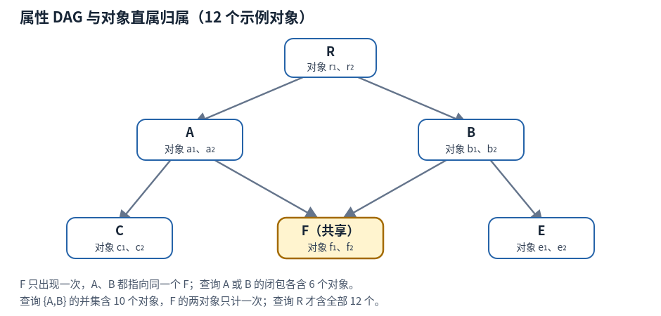
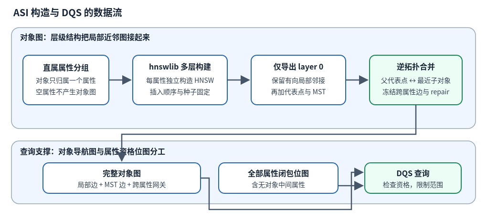
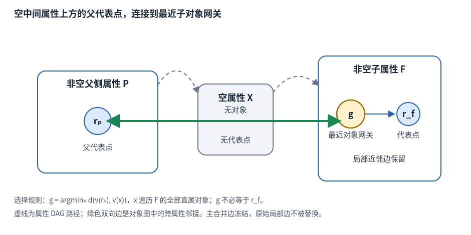
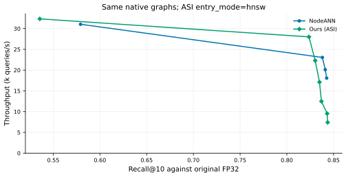
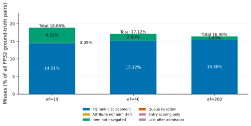
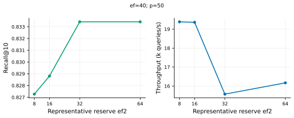
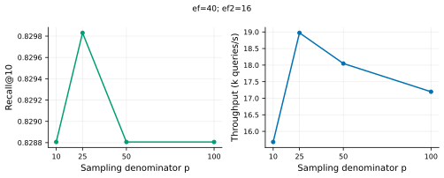

# ASI：面向层级属性 DAG 的属性骨架索引与 DQS 检索

本文说明 **ASI（Attribute-Skeleton Index，属性骨架索引）** 如何把属性内近邻图、跨属性网关和属性闭包组合起来，以及 **DQS（Dual-Queue Search，双队列检索）** 如何在一次查询中使用它们。实验图中的 `Ours (ASI)` 指当前 ASI+DQS；`NodeANN` 指每非空属性一张独立 HNSW 的对照基线。阅读不要求预先了解 HNSW；关键是分清两张图：属性之间的包含关系，以及对象之间用于搜索的近邻关系。

**实现依据**：[活跃源码 `attr_skeleton_bench.cpp`](../../codes/dag-ann-search/src/attr_skeleton_bench.cpp)。问题口径见 [problem_def.md](problem_def.md)，数据准备见 [prepare_pq.py](../../codes/dag-ann-search/scripts/prepare_pq.py) 与 [prepare_large.py](../../codes/dag-ann-search/scripts/prepare_large.py)。下文将当前实现与目标设计分开陈述，实验图使用 [2026-11-08 当日目录](2026-11-08-exps/)。历史实现与旧实验不能替代当前代码的证据。

§9.1 使用本轮同原生图、同计时协议的新对照，Ours 固定为 `--entry-mode hnsw`；源码默认仍为代表点入口，避免静默替换历史调用。§9.2–9.5 保留早期实测背景。`work-removal-*` 与 `navigation-*` 分别保存工作削减和入口控制结果，不与旧 NodeANN 点混接。

## 1. 查询究竟在找什么

### 1.1 属性图决定资格，向量距离决定名次

设属性集合为 $C$，属性 DAG 为 $G_C=(C,E_C)$。边 $a\to b$ 表示 $b$ 是 $a$ 的子属性。DAG 是有向无环图：允许一个属性有多个父属性，但不允许沿父子边绕回自身。

每个对象 $o\in O$ 有唯一直属属性 $own(o)\in C$，并有一个向量 $v(o)$。唯一直属属性不妨碍多祖先继承。例如对象直属 F，F 同时属于 A 与 B，则查询 A 或查询 B 都应包含该对象；不需要复制对象，也不应重复计数。

查询输入为向量 $q$、属性集合 $U$ 与返回条数 $k$。$U$ 使用 OR 语义，其资格范围为包含自身的后代闭包：

$$D=\operatorname{Desc}^{+}(U),\qquad E(U)=\{o\in O:own(o)\in D\}.$$

返回 $E(U)$ 中与 $q$ 的平方 L2 距离最小的 $k$ 个对象，若合格对象不足 $k$ 个则返回全部合格对象。平方 L2 为 $d(q,v)=\sum_j(q_j-v_j)^2$，排序时无需开方。

### 1.2 一个包含 12 个对象的例子



**图 1　属性包含关系与对象直属归属。** 箭头向下表示父属性包含子属性。六个属性各有两个示例对象，直属对象总数为 12。对象名称只用于讲解，不代表真实实验的对象 ID。

直属对象集为 $S_R=\{r_1,r_2\}$、$S_A=\{a_1,a_2\}$、$S_B=\{b_1,b_2\}$、$S_C=\{c_1,c_2\}$、$S_E=\{e_1,e_2\}$、$S_F=\{f_1,f_2\}$。

- $U=\{A\}$：$D=\{A,C,F\}$，合格对象为 $\{a_1,a_2,c_1,c_2,f_1,f_2\}$，共 6 个。
- $U=\{B\}$：$D=\{B,E,F\}$，合格对象为 $\{b_1,b_2,e_1,e_2,f_1,f_2\}$，共 6 个。
- $U=\{A,B\}$：合格对象为两集合的并集，共 10 个。共享属性 F 的两个对象只计一次；查询 R 的闭包才覆盖全部 12 个对象。

**为什么保留 DAG，而不直接用 trie？** trie 是按路径共享前缀的树，同一节点只有一个父。若把 F 只放在 A 下，B 的后代查询会漏掉 F；若在 A 与 B 下各放一份 F，则需要维护别名、对象去重与重复更新。当前实现直接保存多父关系，并在闭包位图中做集合并，避免把路径出现次数误当作不同属性或不同对象的数量。

### 1.3 CCS 结构与 SIFT 向量来自两个来源

当前工作负载将 CCS（ACM Computing Classification System）分类结构及 SciHTC 的直属标签，与 SIFT 128 维向量按对象序号绑定。CCS 是计算机文献的分类体系，SIFT 是图像局部描述子。**本实验没有把论文摘要编码为 SIFT，也没有证明 SIFT 的几何距离与 CCS 的语义层级相关。** 它检验真实层级形状、标签分布与多父闭包下的检索机制，不能据此声称已完成真实论文语义检索。

原始结构与标签出处可从 [CCS 官方页面](https://dl.acm.org/ccs)、[SciHTC 仓库](https://github.com/msadat3/SciHTC) 和 [本地数据背景记录](2026-10-27-ccs-background-and-data.md)追溯。活跃工作负载的本地元数据为 `work/dag-scope/workload-run1/meta.json`：1,929 个属性、2,040 条父边、103 个多父属性、168,937 个对象；每个保留下来的标签对象贡献一个直属终端属性。早期背景记录使用过不同的解析与清洗口径，不能把其中节点数、对象数直接拼入本轮实验。

数据准备有两条需要区分的操作：

1. [prepare_large.py](../../codes/dag-ann-search/scripts/prepare_large.py) 读取原标签列表和 SIFT 的 `train`/`test`。对象数不超过标签数时沿用标签前缀；扩展到更大规模时，使用固定种子 20261105 从原标签列表有放回抽样，保留经验频率分布。该扩展不引入向量与标签的语义相关性。
2. [prepare_pq.py](../../codes/dag-ann-search/scripts/prepare_pq.py) 在原始向量上训练 PQ，并从原始 FP32 向量生成 GT。默认 PQ 为 $m=16$ 个子空间、每个子空间 256 个码字，训练抽样上限 100,000、k-means 12 轮；抽样种子 7，各子空间种子为 $100+j$。实际调用参数仍以本轮运行记录为准。

PQ 码为每对象 16 字节，原始 128 维 FP32 为 512 字节，二者的**向量载荷**之比为 32。活跃 C++ 直接加载 PQ 还原后的 128 维 float32，并用普通平方 L2 建图和搜索，没有在 PQ 码上执行查表距离。因此 32 倍不能描述为该可执行程序的实际驻留内存压缩比，图边、位图、码本与还原缓冲区也不能省略。

向量文件为本地 `datasets/sift-128-euclidean.hdf5`；其公开格式与数据说明见 [ANN-Benchmarks 的 SIFT 数据条目](https://github.com/erikbern/ann-benchmarks#data-sets)。准备脚本将第 $i$ 个直属标签与 `train[i]` 绑定，查询向量取 `test[j]`；该序号配对仅构成实验工作负载，不表达语义对应。实际搜索用的 `orig.bin`、`recon.bin`、`queries.bin` 与标签文件哈希见当日协议，本文不把公开无过滤的近邻真值直接用于属性约束查询。

## 2. 为什么需要统一对象图

在属性范围内做近邻查询，有两条容易实现的参照路线。

**先筛选再扫描。** 枚举全部合格对象，计算其距离并取 top-k。它在所用搜索向量上没有图搜索损失，代价随 $|E(U)|$ 增长，是辨别“图搜索误差”与“向量表示误差”的参照。

**每属性单独建 HNSW，再合并结果（NodeANN）。** HNSW 是以近邻边导航的分层图索引，先在稀疏上层定位，再在较密的底层搜索。NodeANN 对 $D$ 中每个非空属性的直属对象图独立搜索，各出 top-N 后统一归并。每个属性有自己的搜索状态与预算；当查询包含多个属性时，要付出多次入口定位与队列维护成本。它作为基线保留，不是 ASI 的主查询路径。

ASI 把直属对象图接入一张统一对象图，一条查询共享搜索状态，不给每个属性单独建立结果堆。跨属性边提供导航路径；属性闭包位图限制可访问范围。当前采用全闭包多种子初始化，因而跨属性边的贡献还必须与“每属性已有入口”的贡献分开评估。



**图 2　当前 ASI 的构建与查询依赖。** 局部图和跨属性边连接对象；闭包位图连接的是资格判断逻辑，不是新增一层向量近邻图。

## 3. 阶段一：构造属性内局部图

### 3.1 底层供共享 DQS，高层可选定位入口

对每个非空直属集合 $S_a$，`build_attr_graph` 构建完整 HNSW，按对象 ID 递增插入。当前种子统一为 $100+concept\_id$，与 NodeANN 对齐；早期主曲线使用过 $100+i$（属性内部编号），不能将两版测量直接归因为入口变化。

layer 0 导出为共享对象图的局部边；高层按节点、层级导出为紧凑的行偏移和邻接数组，只用于 `--entry-mode hnsw` 入口定位，不保留 HNSW 的第二份向量。默认 `representative` 模式只使用最近代表点入口。两模式共享同一份底层、代表点、MST、跨属性边和查询内缓存。即使原生局部图完全相同，ASI 的全局 DQS 与 NodeANN 的逐属性底层搜索仍不等价。

近邻图的邻接表应按**有向出边**理解。HNSW 插入会尝试反向连接，但邻接表独立剪枝后，$u\to v$ 不必总伴随 $v\to u$。当前代码原样导出底层邻接，没有把它补成无向图。参数 $M$ 也不能直接当作最终 ASI 总出度上界：HNSW 底层有自身的邻接容量规则，后续 MST 和跨属性边还会继续增加边。

### 3.2 代表点如何选择，数量究竟是多少

代表点是直属对象中的若干真实对象，不是质心，也不是额外合成的向量。对非空属性 $a$，设 $n_a=|S_a|$，调用点计算：

$$K_a^{\mathrm{req}}=\max\!\left(1,\min\!\left(K_{\mathrm{cap}},\left\lfloor\frac{n_a}{p}\right\rfloor+1\right)\right),\qquad K_a=\min(n_a,K_a^{\mathrm{req}}).$$

源码中的 $p$ 至少为 1。空属性不生成代表点；单对象属性直接以该对象为代表。这个公式在 $n_a$ 恰好为 $p$ 的整数倍时，与 $\lceil n_a/p\rceil$ 不同。例如 $n_a=p$ 时请求 2 个代表点，而非 1 个；不能用向上取整替代原式。

选择策略为 farthest-first：第一个代表点取局部编号 0，以后每轮选择到已选集合最近距离最大的对象：

$$r_1=S_a[0],\qquad r_{t+1}\in\arg\max_{x\in S_a}\min_{1\le j\le t}d(v(x),v(r_j)).$$

这希望在几何上覆盖不同方向。当前实现没有显式排除已经选过的局部编号；若向量完全重合等导致最大最小距离为 0，代表点列表可能重复，公式给出的是列表长度，不能无条件解释成不同对象的数量。该策略也没有提供任意查询下的召回保证。

### 3.3 只在代表点上补一棵 MST

MST（minimum spanning tree，最小生成树）用尽量小的总边权连接代表点集合。当前代码在同一属性的代表点之间以平方 L2 为边权执行 Prim 式构造，将选中的每条树边双向加入局部邻接表。

**MST 连接的是代表点，不是该属性的全部对象。** 它能给不同代表点提供显式连接，但不能保证所有普通对象都能从代表点沿有向底层边到达。MST 边加入后没有重新剪枝，也没有统一去重；后文的邻接扫描成本必须考虑这一点。

旧文档描述的“孤立对象逐一补边、检查全部连通分量再互连”不在当前活跃执行路径中。当前不能宣称已完成通用的属性内连通性修复。

## 4. 阶段二：按逆拓扑序建立跨属性网关

### 4.1 网关是最近的子对象，不要求是子代表点

构造先对属性 DAG 拓扑排序，再反转顺序，使子属性先于其祖先处理。对于非空子属性 $c$，寻找可连接的非空父侧属性 $a$：直接父有对象时使用直接父；直接父为空时沿该分支继续向上，遇到非空祖先即停在该祖先。多父分支分别处理，当前上溯循环最多 8 轮。

对每个父侧代表点 $r\in R_a$，在**子属性的全部直属对象**中精确选取最近对象：

$$g(r,c)\in\arg\min_{x\in S_c}d(v(r),v(x)).$$

向独立跨属性邻接表加入 $r\to g(r,c)$ 与 $g(r,c)\to r$，并将子侧对象标为网关。网关可能已经是代表点，也可能是普通对象。DQS 的第二通道接收两者。



**图 3　最近对象网关与空祖先回退。** 虚线表示属性 DAG 关系或角色说明，粗双向线表示对象图中的冻结跨属性边。跨过空属性建立边并不删除空属性，资格闭包仍然经过它。

在 12 对象例中，父侧代表点 $a_1$ 可能连向 F 中的 $f_2$。即使 F 的起始入口是 $f_1$，$f_2$ 也能因为网关身份进入 $q_2$。F 同时为 A、B 的后代，因此分别处理两条父分支；$f_2$ 即使被多个父代表点选中，仍只有一个对象身份。

### 4.2 当前是冻结加边，未实现“只替换原始边”

“逆拓扑合并”在当前源码中的实际动作是上述网关加边。它没有将每个子代表点与每个父代表点全连接，也没有在每轮合并后重建双方的近邻表。

当前执行路径有两条明确规则：

- **新合并边冻结，不参与剪枝。** `gbr` 独立保留跨属性邻接。
- **原始局部边保留，MST 边也保留。** 当前没有用冻结边挤掉部分原始邻居，`n_intra_dropped` 固定为 0。

虽然源码还保留 `Rdeg=16`、`PPROT` 与 `rep_prune` 等声明，`rep_prune` 没有在该路径调用。日志中的 `degree cap 16` 不能被解读为最终度数保证。多父、大扇出或重复加边都可能增加实际出度与槽位扫描量。

**目标设计**可以考虑冻结必要合并边、只从原始边中选择替换对象，以约束总度数；这属于未实现设计，不能用于解释当前实验的速度或连通性。代表点之间的邻域更新与其正确性也需单独定义和验证。

### 4.3 兜底 repair 做了什么，没做什么

主合并后，代码计算一个代表点层面的入边计数：只统计“源是其他属性代表点、目标也是本属性代表点”的跨属性边。对该计数为 0 的非空属性，向上寻找最近的一个非空祖先，把双方代表点两两双向连接。

该检查不等同于“属性没有任何入口”：主合并可能已经连到了普通网关，但普通网关不被上述代表点入边计数识别。因此 repair 可能在已有网关的属性上继续加边。它也不检验范围内对象图的强连通性，不修复所有属性内有向分量；没有可用非空祖先时则不加边。

需要特别区分：当前 `--no-merge` 只跳过主合并循环，**repair 仍会执行**。该参数对应“去掉主网关合并、保留兜底修复”，不能直接命名为“无跨属性边”。

### 4.4 为什么不能声称任意范围都连通

祖先与子属性间存在边，只说明部分对象有直接连接。任意 $D$ 内从指定种子到所有合格对象的可达性，还取决于局部有向图、网关位置、空属性、查询范围以及导航预算。即使一张无预算 BFS 对某几条查询访问到了全部非空属性，也只能说明这些查询上的**属性级覆盖**，不能证明所有对象都可达，更不能证明有限预算时具有高召回。

源码 `--diag` 仅检查前至多 5 条查询：从查询输入属性的代表点出发，在范围内遍历后统计访问到的属性。若查询输入属性本身为空，它不会自动为该属性找后代种子。这一诊断与当前全 $D$ 种子检索不同，也不是通用连通性证明。

## 5. 阶段三：为全部属性构造闭包位图

对每个属性 $a\in C$ 存储一个 $|C|$ 位位图：

$$\mathrm{desc}[a]=\{a\}\cup\bigcup_{c\in children(a)}\mathrm{desc}[c].$$

当前通过 DFS 的后序合并计算，并缓存已完成属性的结果。查询时对 $U$ 中各属性位图按位 OR 得到 $D$。多父共享的 F 只占一个位，天然去重。

位图的属性全集来自 DAG 的全部边端点和对象直属属性，**不能只枚举非空属性**。否则空中间属性会从结构中消失，祖先到深层属性的闭包传播将错误。图 3 的空属性 X 不挂对象，但仍须参与闭包传播。

三种操作共用这个位图：枚举 $D$ 中的非空属性以建立种子；判断候选对象是否合格；阻止范围外对象进入后续搜索。`offer` 在计算向量距离之前就检查资格，范围外对象不算距离、不入队、不展开邻居。但是指向它的邻接槽位仍可能已被扫描，所以“未访问范围外对象”不能解释为“完全没有读到范围外边”。

若 $A=|C|$、$W=\lceil A/64\rceil$，闭包位图载荷为 $8AW$ 字节。$A=1,929$ 时 $W=31$，载荷为 478,392 字节，约 0.456 MiB；这不含容器与其他索引结构开销。并集计算约需 $|U|W$ 次字操作。

## 6. DQS：一个查询共享的双通道搜索

### 6.1 两条通道，各有 cand 与 keep

DQS 为**整条查询**维护两条通道，不为每个属性维护一套队列。

| 通道 | 准入对象 | `keep` 容量 | 作用 |
|---|---|---:|---|
| $q_1$ | 所有合格对象 | $ef$ | 一般近邻探索与结果保留 |
| $q_2$ | 合格的代表点或网关 | $ef_2$ | 给骨架对象独立的保留与探索通道 |

每条通道都包含两个不同用途的堆：

- `cand` 是待展开候选堆，优先弹出到查询最近的对象，决定下一次扫描谁的邻居。
- `keep` 是保留集，堆顶为当前最远对象。未满时直接接收；已满时，只接收比最远对象严格更近的对象，并淘汰原最远者。它既给出准入阈值，也参与最终结果输出。

**$ef$ 与 $ef_2$ 限制 keep，不是 cand 的硬容量，也不是距离调用次数。** 准入时同时写入相应 `cand` 和 `keep`。当前实现没有在 `keep` 淘汰对象时删除其 `cand` 条目，故候选堆可能保留已淘汰的陈旧项。当前循环也没有“cand 最近距离超过 keep 最差距离就停止”的标准 beam 终止条件，而是处理到两个 cand 都空。


**图 4　当前 DQS 的准入、展开与输出。** 两条通道共享本查询对象标记和属性范围；独立准入意味着对象可同时进入两个 cand。

### 6.2 种子来自全闭包，不只来自查询输入属性

**当前实现**枚举 $D$ 中每个非空直属属性，各选一个入口调用 `offer`。默认 `representative` 逐个比较代表点；`hnsw` 从原生最高层入口开始，逐层按严格距离下降定位到底层入口。高层经过的对象只参与评分，不因此打 first-touch 或全部入队。两种入口均共享双通道，不产生每属性结果堆。图 1 查询 A 仍为 A、C、F 各选一个种子。

**目标设计**是仅从查询输入属性 $U$ 的入口启动，然后沿结构边找到其后代。下文称“root-only”时，root 指本次查询指定的属性，不一定是整个 DAG 的根 R。当前可执行程序没有 root-only 模式；空输入属性如何找到合适后代入口也尚未实现，不能将历史单入口结果标为当前实现的模式。

全 $D$ 种子能直接接入更多属性，但初始化成本随 $D$ 中非空属性数量和代表点数增长。它可能掩盖骨架自身的导航不足。若主张“仅靠跨属性骨架就可到达所有后代”，需要另有 root-only 实现与相应测量，不能用当前多入口结果代替。

### 6.3 一次 offer 与一次展开分别做什么

以下伪代码对应活跃实现的顺序：

```text
D ← OR(desc[u] for u in U)
初始化本查询的 q1.cand/keep、q2.cand/keep 与访问代号

函数 offer(v):
    若 v 已带本查询代号：返回
    立即为 v 写入本查询代号
    若 own(v) 不在 D：返回
    获取 d(q,v)：已有本查询种子分数则复用，否则计算；记录属性为 touched
    独立尝试进入 q1；成功则写入 q1.cand 与 q1.keep
    若 v 是代表点或网关：独立尝试进入 q2
    任一通道准入成功，则记录所在属性为 entered

对 D 中每个非空属性：按 entry-mode 选代表点或高层入口，调用 offer
当任一 cand 非空：
    弹出两个 cand 中距离较近的堆头 v
    若 v 已在本查询展开：继续弹出下一项
    标记 v 已展开
    扫描 v 的局部邻接与跨属性邻接，对每个目标调用 offer
结果 ← 两个 keep 的并集，按对象 ID 去重，按距离取前 k
```

同一个对象仍可同时被两个通道准入，但当前在弹出后检查独立的展开代号，只扫描第一次展开的邻接。陈旧项不因已被 keep 淘汰而跳过；第二个 cand 中的重复对象仍会按原顺序弹出，只省去其无新增发现的邻接扫描。在 `offer` 层，对象首次接触即标记，即便两个通道都拒绝它也不会重试。一个对象至多各入两个 cand 一次；这与“cand 始终不超过 ef”是两回事。

$q_2$ 的尝试不是 $q_1$ 拒绝后的 fallback，而是对代表点或网关**独立执行**。最终结果也包含 $q_2.keep$，不是只用它做导航后丢弃。若 $ef$ 与 $ef_2$ 都小，合并去重后的结果可能不足 $k$，这本身会降低召回。

### 6.4 区分评分请求与实际距离调用

当前 `dists_per_q` 只计实际调用距离函数的次数，覆盖种子选择和 `offer`。种子比较仍保持默认入口、代表点遍历及严格更小才替换的原顺序，但同一对象的种子分数按查询代号缓存；后续 `offer` 可直接复用。缓存不会给未选中的代表点打 first-touch 标记，也不会改变其日后的队列准入。历史主曲线包含默认入口、重复代表点和 `offer` 的重复距离，新旧计数不能混读。

当前没有每属性 top-k 结果堆，也没有先各搜满预算再合并的 NodeANN 主路径。各查询新建候选/保留堆、输出和属性诊断集合；共享访问数组通过递增代号实现逻辑隔离，位图每条查询清零。复用索引、数组存储和运行内数据文件不等于复用前一条查询的结果；当前没有跨查询结果或距离复用。

## 7. 哪些是实现事实，哪些仍是设计目标

| 议题 | 当前活跃路径 | 不能据此声称的结论或未实现目标 |
|---|---|---|
| 属性关系 | 保留多父 DAG，闭包按属性位去重 | 单父 trie 与 DAG 语义等价 |
| 局部图 | HNSW 底层供 DQS，保留高层作可选入口；代表点 MST 加边 | 上层与属性层级是同一张图；所有局部对象互相可达 |
| 代表点数 | $\max(1,\min(K_{cap},\lfloor n/p\rfloor+1))$，再受 $n$ 限制 | 使用 $\lceil n/p\rceil$；列表必然无重复 |
| 跨属性合并 | 逆拓扑序，父代表点接最近子对象，双向冻结 | 父子代表点全连接后 RNG 重排；最终出度不超过 16 |
| 原始局部边 | 全保留 | 已实现只替换原始邻居的度控制 |
| repair | 代表点入边计数为 0 时连接一个非空祖先 | 修复了所有对象分量，或证明任意闭包内连通 |
| 查询入口 | 全 $D$ 每个非空直属属性选代表点或高层入口 | 当前已实现 root-only 导航 |
| 搜索预算 | 两条共享通道的 keep 分别受限 | 单候选堆；cand 硬容量；硬距离预算 |
| 向量与 GT | PQ 还原向量搜索，原始 FP32 GT | 某个实测 recall 是所有近似算法的硬上限 |

[problem_def.md](problem_def.md) 区分了查询语义、目标设计和本轮原型评测口径：目标为从查询子树根入口导航；当前实现采用全闭包多种子、双通道和严格 ID 命中计分。本轮结果只适用于后者，不能作为 root-only 设计完成的证据。

## 8. 实验如何定义，读数说明什么

### 8.1 公共输入与对齐条件

主规模为 168,937 个对象，SIFT 128 维，$k=10$，对齐查询前缀与属性 OR 闭包。1M 使用经验标签分布扩展，是另一个规模条件，不能把两者的选择率和 QPS 混为同一行。原 workload 文件含有比基准更多的查询，实际测量数量由 `--queries` 和向量查询文件共同确定。

所有比较必须同时对齐：对象与归属、属性 DAG、查询顺序与范围、搜索向量、原始 GT、$k$、距离实现、编译选项、线程与绑核条件。常用局部构造配置为 $M=16,efC=200,K_{cap}=8,p=50$；$ef$、$ef_2$、$p$ 的实际扫描值以图和当日记录为准。源码的默认 $ef_2=16$ 不代表实验必然使用 16。

ASI 取 $ef\in\{5,10,15,20,30,40,60,100,200,400\}$；NodeANN 扫描 $ef=N\in\{2,4,6,8,10,15,20,30\}$，以及固定 $ef=10$ 的 $N\in\{4,6,8,10,15,20,30,40,60\}$、固定 $N=10$ 的 $ef\in\{20,40,80\}$。完整配置以原始运行记录为准。

Pareto 图每方法只画一条曲线：该方法的全部实测配置按严格支配关系筛选后连接，未拟合、未外推。ASI 的两个 keep 去重后最多保留 $ef+ef_2$ 个对象；本轮最小上界为 21，不因该上界小于 $k$ 而必然少返回。NodeANN 的 $N$ 是每属性候选上限；$N<k$ 可能截断同一属性中的真近邻，但多个属性归并后仍可能返回 $k$ 个结果。数据中的 `capacity_limited` 标记表示这一预算限制，不证明最终输出不足 $k$。

NodeANN 的实际 HNSW 搜索宽度为 $\max(ef,N)$。固定 $ef=10$ 时，$N\le10$ 的配置距离调用同为 258.2 次/查询；当 $N>10$，增加 $N$ 也会抬高搜索宽度。因而同时记录 $ef$、$N$ 与 `effective_ef`，不能把所有 $N$ 扫描都解释为只改变返回数。

构建不进入查询 QPS。本轮 [协议元数据](2026-11-08-exps/data/scheme-protocol.json) 固定 CPU 2、单线程，编译为 `-O3 -fno-tree-vectorize -fno-tree-slp-vectorize -DNO_MANUAL_VECTORIZATION`，双方距离内核共用 `RawL2Space`。逐查询累计闭包求解、种子选择、搜索及结果排序去重的时间；GT 命中评估、oracle 全扫描与 trace 写盘在计时外。代码、可执行文件与输入数据的哈希保存在该协议文件中。绑核不等于独占 CPU；WSL 频率未锁定，吞吐仍受系统负载影响。

### 8.2 GT 文件与召回口径

`gt_10.txt` 为 8,000 字节，对应 $200\times10\times4$ 字节 int32。其中 17 条查询的合格对象少于 10（最少 5），故含 49 个 `-1` 填充，有效 GT 条目共 1,951。独立逐查询原始 FP32 全范围扫描得到的 oracle 与文件中内容**逐条一致**（200 条全部通过断言）；这是必查项：文件不是独立生成的查询结果，只有逐条断言才能证明其内容等于该查询的精确 top-10。

令 $T_i$ 为第 $i$ 条查询的非负 GT ID 集合、$R_i$ 为输出去重后的对象集合。当前可执行程序报告聚合 ID 命中率：

$$\mathrm{recall}_{\mathrm{ID}}=\frac{\sum_i |T_i\cap R_i|}{\sum_i\min(k,|T_i|)}.$$

它没有读取第 $k$ 名的原始距离阈值，也没有将边界同距的其他 ID 认作等价命中，故**不是一般意义的 ties-aware 计分**。查询合格数都至少为 $k$ 时，该聚合值等于每查询 recall 的平均；否则二者不能混称。空 GT 查询不增加召回分母；QPS 仍以查询数乘轮数为分子。

对 PQ 还原向量做范围内精确扫描，可得到一个可复核的**表示参照**：它反映还原距离排序相对于原始距离 GT 的重合度。有限预算图搜索还会叠加漏访与候选保留损失，但某些近似输出也可能偶然保留原始 GT 中的对象、超过还原向量精确 top-k 的 ID 重合度。因此该参照不构成所有近似算法的数学硬上限，更不应称为“物理上限”。

当日追踪固定 $ef_2=16,p=50,K_{cap}=8$，比较 $ef\in\{10,40,200\}$；完整命中数与 recall 保存在 [追踪汇总](2026-11-08-exps/data/miss-attribution.json)，并由图 7 展示。PQ 还原向量的 exact top-10 与 FP32 GT 有 1,645 个 ID 重合，$1,645/1,951=0.843157$。近似输出还找回过 PQ-exact top-10 之外的 FP32-GT ID，具体数量记录在 `pq_recovered`，因此该数值只作为 exact 排序重合参照。

### 8.3 成本指标

- **QPS**：计时区间内查询总数除以查询秒数，单位 queries/s。当前图 5 每点三组进程、每进程 100 轮×200 查询；历史 `scheme-*` 主曲线为每进程 3 轮，历史消融为一个进程三轮。跨进程采用等查询量的调和平均，不选 best-pass；这些重复不提供跨构建种子置信区间。
- **距离/查询**：运行期间实际查询距离调用数除以查询总数，不包含索引构建和诊断参考扫描。历史曲线包含种子重复评分；新对照同时报告 `distance_cache_hits_per_q`。
- **邻接槽位扫描数**：`adjacency_slots_per_q` 包含底层局部边、跨属性边，以及高层入口的全部行扫描；重复边、已标记或范围外目标仍计槽位。`upper_slots_per_q` 是总量的子集，相减才是底层扫描量；`expanded_per_q` 只数 DQS 的底层实际展开。工作削减组的前后版本采用同一计数代码；历史主曲线没有槽位字段，不能从距离数反推。
- **`attrs_in_D`**：合格闭包中非空直属属性数。空结构属性仍在位图中，但不增加此项。
- **`attrs_touched`**：至少有一个合格对象在 `offer` 中获取过距离的属性数，包含复用种子分数。
- **`attrs_entered`**：至少有一个对象被任一 keep/cand 准入的属性数。它不等于所有对象已访问，也不等于某对象已经弹出展开。

对象级阶段不合并称作“访问”：`first-touch` 表示目标首次进入 `offer` 并写入查询代号，随后仍可能因超出 $D$ 返回。`evaluated` 保留普通 `offer` 的评分请求顺序；`seed_evaluated` 保留代表点或高层定位的评分请求顺序，均含缓存命中，列表长度不等于实际距离调用数。`admitted` 表示曾进入任一通道；`expanded` 记录底层实际展开，每对象至多一次。`distance_calls`、`distance_cache_hits`、`adjacency_slots` 给出总实际计数，`upper_distance_calls`、`upper_adjacency_slots` 是高层子集。旧 trace 的请求列表格式保留，按来源解释调用数。

### 8.4 漏召回归因必须按追踪顺序解释

本轮图和 `data/miss-attribution.json` 使用六类**操作性互斥归因**，以未命中 FP32 GT 条目为对象，按优先级先归因 PQ exact 排序位移，再检查属性准入、距离计算、队列准入与最终输出。`data/miss-attribution-per-query.jsonl` 保存逐查询计数。令 PQ exact top-$k$ 为搜索表示上的参照集合；类别顺序与判定如下。

| 类别 | 判定 | 解释 |
|---|---|---|
| `quantization` | GT 条目不在同一范围内 PQ exact top-$k$ | 相对于 PQ exact 的排序位移类别；这里是优先级归因，不等于量化与导航因果可分 |
| `attribute_unentered` | 属于 PQ exact top-$k$，但所在属性没有对象被队列准入 | 按属性准入阶段计数 |
| `not_navigated` | 属性已有准入对象，GT 对象既不在 `evaluated` 也不在 `seed_evaluated` | 属性被接入不代表这个对象已被计算距离 |
| `rejected` | GT 对象在 `evaluated` 中，但不在 `admitted` 中 | 已通过 `offer` 算距离，却从未成功进入任一通道；不包括只算种子距离 |
| `entry_score_only` | GT 对象只参加入口/种子距离比较，未作为搜索队列中的对象被评估 | 单独区分 seed-only 距离，不能将其称作搜索导航已访问 |
| `lost_after_admission` | GT 对象曾准入，但未进入最终去重 top-k 输出 | 含 keep 被淘汰或结果并集排序后未入 top-k |

六类按优先顺序每个未命中 GT 只计一次。PQ exact top-$k$ 以外的 GT 即使也有导航问题，也先计入 `quantization`，故这是归因约定，不是因果实验。全 GT 分母上的比例存于 `all_gt_percent`；只在漏项分母上的比例存于 `missed_only_percent`。二者不能互换。`attrs_touched` 表示计算过距离的属性；`entered_attrs` 表示至少一个对象成功准入的属性，前者不蕴含后者。两项在逐查询 trace 中分别保存。

本轮三档 `rejected`、`entry_score_only`、`lost_after_admission` 均为 0；`attribute_unentered` 仅在 $ef=10$ 出现 1 条（0.051%）。未命中项因此集中在 PQ exact 排序位移与“属性已有准入但 GT 对象尚未计算距离”两类：$ef=10$ 为 283/1,951 与 84/1,951，$ef=40$ 为 295 与 39，$ef=200$ 为 300 与 20。全部计数与两套分母比例见 [汇总 JSON](2026-11-08-exps/data/miss-attribution.json)，逐查询轨迹见 [JSONL](2026-11-08-exps/data/miss-attribution-per-query.jsonl)。可按 `hits + 各类 misses = gt` 核对每档的分割。这些操作性归因不证明任意范围可达，也不代表其他参数或查询分布上的结果。

## 9. 当日图表与可复核的比较问题

§9.1 展示本轮同协议的两条新曲线，来源为 [navigation-measurements.jsonl](2026-11-08-exps/data/navigation-measurements.jsonl) 与 [点选择记录](2026-11-08-exps/data/navigation-pareto-selection.json)。后四张图为早期背景，来源仍为 `scheme-*`、`miss-attribution-*` 和相应消融，不与新 QPS 混算。图不能证明 root-only、度数硬界或任意范围连通。

### 9.1 Recall 与吞吐的 Pareto 比较



**图 5　同原生图的 Recall–throughput Pareto，$k=10$。** 图例仅有 NodeANN 与 Ours（ASI），Ours 全部使用高层入口和共享 DQS。NodeANN 扫描 $ef=N=5,10,15,20$，Ours 扫描 $ef=5,10,20,40,100,200,400$，分别连接各自实测非支配点。每点三组进程、每进程 100 轮，CPU 2、scalar 距离、同一批 200 查询；包含高层评分和扫描成本。图使用原始 recall 与 QPS，2% 容差只用于 §12.8 的逐对比较，不移动点、不改精确支配关系，也不由连线插值生成工作点。[旧主曲线](2026-11-08-exps/figures/pareto.svg) 作为历史记录保留。

低预算点单独解释：Ours $ef=5$ 有 51/200 条查询输出不足 $\min(k,|E|)$，NodeANN $N=5$ 有 125/200 条；它们展示预算不足的实际结果，不能当作满输出工作点。§12.8 的容差比较只使用无输出不足的配置。

### 9.2 指标概览：召回、吞吐与距离调用


**图 6　五个工作点的并排指标概览。** 各列各用独立尺度，蓝色标出该列最优值。ASI 从 $ef=10$ 到 200，距离调用从 222.2 增至 464.5，recall 从 0.811379 升至 0.835982，QPS 从 29,230.6 降至 9,956.0。NodeANN $N=40$ 的 recall 为 0.843157、距离调用 422.1、QPS 12,513.8；Pre-filter 的距离调用 1,140.2，QPS 约 11,019。距离更少不保证延迟同比例下降；这些历史测量未报告邻接槽位数，不能由距离数推断槽位扫描量。计数排除构建距离，并按全部查询批次归一化。

### 9.3 未命中项在什么阶段丢失



**图 7　GT 条目归因。** 六类互斥标签、优先级与分母见 §8.4 及 [机器可读汇总](2026-11-08-exps/data/miss-attribution.json)。图以全部 1,951 个 GT 条目为分母；零值类别在数据文件中仍显式记录。$ef=10$ 时 PQ 排序位移占 14.51%、属性内未导航到占 4.31%；$ef=200$ 时分别为 15.38% 与 1.03%。在漏项分母上，量化份额随 $ef$ 上升从 76.9% 到 93.8%，说明加大搜索宽度更快被表示误差吃掉。优先级量化类与导航损失可能重叠，不能将其解释为因果分解。

### 9.4 第二通道容量 $ef_2$



**图 8　$ef_2$ 消融。** 固定 $ef=40,p=50,M=16,efC=200,K_{cap}=8$，改变 $ef_2\in\{8,16,32,64\}$。recall 为 0.8273、0.8288、0.8334、0.8334，QPS 为 19,387.5、19,362.5、15,572.6、16,168.0；32 与 64 的召回相同，没有观察到继续增长。CLI 将 `--ef2` 截断至至少 1，故消融没有真正关闭 $q_2$。该套每点一个进程，不提供跨种子置信区间。

### 9.5 代表点密度参数 $p$



**图 9　$p$ 消融。** 固定 $ef=40,ef_2=16,M=16,efC=200,K_{cap}=8$，比较 $p\in\{10,25,50,100\}$。recall 分别为 0.8288、0.8298、0.8288、0.8288，已测范围相差不超过 0.001；QPS 为 15,679.5、18,972.6、18,047.8、17,195.9。这些点是一进程三遍，不能据此声称某个 $p$ 普遍更好。较小 $p$ 通常请求更多代表点，但受 $K_{cap}$ 截断；它同时改变种子比较、局部 MST、父侧网关与 repair 边。

## 10. 可证范围与研究边界

在输入确为 DAG、位图完整且对象归属有效的前提下，闭包 OR 与资格判断实现查询的 OR 后代语义。`offer` 在距离计算前拒绝不合格对象，因而所保留结果在范围内。这是范围正确性，不是近邻召回保证。

当前没有证明任意后代闭包中全部对象可从查询入口到达，没有证明有限 $ef/ef_2$ 时的召回下界，也没有总度数硬界。属性级 repair、代表点 MST、多入口初始化与有限查询 BFS 不能相互替代为这些证明。

本轮全部性能点都由全 $D$ 多种子与双通道 DQS 产生，故不能把召回或吞吐差异单独归因于跨属性网关，也不能当作 root-only 或单通道结果。$ef_2$ 消融只调整第二通道容量；它没有禁用 $q_2$，不能分离“骨架导航”与“额外结果保留”两种作用。

本轮数据是 CCS 结构与 SIFT 几何的绑定实验。多属性 OR 的逻辑由闭包支持，但查询属性数量、范围重叠、空属性入口和规模扩展应分别描述其实际覆盖，不能从单一工作负载推广到所有层级过滤查询。当前结果也不构成新颖性或发表状态的证据。

每个非空直属属性平均约有 220 个对象。当前最高召回的 NodeANN 点达到 PQ exact 的 ID 重合参照，ASI 的最高已测点召回较低、吞吐也较低。这些结果只适用于本工作负载，不能把属性平均规模当作性能差异的因果证明，也不能外推到更大属性基数的数据。

## 11. 复现与检查

下列是仓库根目录下的历史主曲线命令记录，ASI 使用工作削减前的源码（提交 `aba0491`，文件哈希见 `scheme-protocol.json`）。不要用当前源码覆盖其原始计时数据；本轮前后对照使用独立的 `work-removal-*` 文件，命令和原版本插桩补丁均见 `work-removal-protocol.json`。[top-10 真值文件](2026-11-08-exps/data/gt_10.txt) 随数据保留，不依赖其他 $k$ 的文件。

```bash
cp researches/nested-attr-vector-search/2026-11-08-exps/data/gt_10.txt work/dag-ann/gt_10.txt
g++ -std=c++17 -O3 -fno-tree-vectorize -fno-tree-slp-vectorize -DNO_MANUAL_VECTORIZATION \
  -I codes/directory-aware-vector-attr-search/src -I codes/dag-composition-methods/nodeann/hnswlib \
  codes/dag-ann-search/src/attr_skeleton_bench.cpp -o work/attr_skeleton
g++ -std=c++17 -O3 -fno-tree-vectorize -fno-tree-slp-vectorize -DNO_MANUAL_VECTORIZATION \
  -I codes/directory-aware-vector-attr-search/src -I codes/dag-composition-methods/nodeann/hnswlib \
  codes/dag-ann-search/src/nodeann_bench.cpp -o work/nodeann_measured
python3 codes/dag-ann-search/scripts/illustrate_asi.py measure --k 10 --out 2026-11-08-exps --runs 3
mkdir -p work/asi-evidence
taskset -c 2 ./work/attr_skeleton --dir work/dag-ann --work work/dag-scope/workload-run1 \
  --vec recon.bin --k 10 --M 16 --efC 200 --p 50 --ef2 16 --efs 10,40,200 --queries 200 \
  --repeat 1 --trace-file work/asi-evidence/trace-k10-ef-10-40-200.jsonl
python3 codes/dag-ann-search/scripts/illustrate_asi.py attribute --k 10 --out 2026-11-08-exps \
  --trace work/asi-evidence/trace-k10-ef-10-40-200.jsonl
python3 codes/dag-ann-search/scripts/illustrate_asi.py render --k 10 --out 2026-11-08-exps
```

`scheme-measurements.jsonl` 保存全部配置及命令，`scheme-summary.json` 保存聚合值，`pareto-selection.json` 保存支配筛选与 `capacity_limited` 标记。归因诊断单独执行，其 QPS 不纳入性能图。每档均校验 `hits + 六类 misses = 1951`，并核对原始 FP32 精确扫描与保存 GT 一致。图形导出为 SVG，结构示意不使用虚构实验距离。

全部图的可见文字均导出为字形路径，不依赖阅读器安装中文字体；四张结构图的 83 个文字节点保存在 `metadata#editable-svg-source`，可提取编辑。新入口对照图也遵守这一约定。检查记录见 [figure-validation.json](2026-11-08-exps/data/figure-validation.json)。可用下列命令提取结构图到标准输出：

```bash
python3 codes/dag-ann-search/scripts/svg_labels.py \
  researches/nested-attr-vector-search/2026-11-08-exps/figures/asi-build.svg --extract-source
```

## 12. 在当前框架内提高效率与召回

**当前证据不支持继续只加大 $ef$。** NodeANN 的 $ef=N=15$ 为 0.841107 / 20,448.8 QPS，严格支配 ASI 的 $ef=400$（0.839057 / 7,430.2 QPS）。目标应是在同等召回下减少导航工作，并区分漏访与排序偏差；参数名相同不代表两侧搜索预算相同。

### 12.1 已有候选覆盖说明了什么

对已有 600 条 trace（200 查询 × 三档 $ef$）重新做集合统计，不重跑索引或查询。令 $F_i$ 为 FP32 GT，$P_i$ 为同范围 PQ exact top-10，$V_i$ 为 `evaluated`，$S_i$ 为 `seed_evaluated`，候选集合 $C_i=V_i\cup S_i$。本轮没有只在种子比较中出现的 GT，故 $|F_i\cap C_i|=|F_i\cap V_i|$。

| $ef$ | 最终 FP32 GT 命中 / 1951 | 已计算的 FP32 GT / 1951 | 未计算的 FP32 GT | 已计算但未返回的 FP32 GT | PQ exact GT：已计算 / 已返回 |
|---:|---:|---:|---:|---:|---:|
| 10 | 1583（0.811379） | 1829（0.937468） | 122 | 246 | 1832 / 1832 |
| 40 | 1617（0.828806） | 1895（0.971297） | 56 | 278 | 1894 / 1894 |
| 200 | 1631（0.835982） | 1925（0.986674） | 26 | 294 | 1923 / 1923 |

汇总、集合定义与 trace SHA256 见 [candidate-coverage.json](2026-11-08-exps/data/candidate-coverage.json)，逐查询计数见 [candidate-coverage-per-query.jsonl](2026-11-08-exps/data/candidate-coverage-per-query.jsonl)。这与 §8.4 的优先级归因不同：这里直接检查全部 FP32 GT 是否曾被计算，不预先扣除 PQ 排序位移。

**第二列是实测返回命中，第三列是候选覆盖，不能互换。** 只有对全部候选按与 GT 一致的 FP32 距离和 tie 顺序重排，第三列才对应这个候选集合可达到的召回；本轮没有运行该重排，也没有其端到端时间。固定重构距离作最终排序时，提高 PQ 导航召回不保证 FP32-GT 召回单调上升。

三档已经计算到的 PQ exact top-10 均未在最终输出中丢失，故没有证据支持“扩大最终结果保留集就能救回这些对象”。$q_2$ 的后续研究应重点检验它是否提供了普通通道遗漏的导航路径。

### 12.2 先删除不产生新发现的工作

以下两项已在活跃源码实施。1000 条真实查询/配置记录逐项保持输出 ID、`evaluated`、`admitted`、种子请求顺序及资格状态；另用同距向量、重复代表点、多父 OR、空范围和重复轮次验证边界。证据与编译、数据哈希见 [work-removal-protocol.json](2026-11-08-exps/data/work-removal-protocol.json)，逐查询计数见 [work-removal-per-query.jsonl](2026-11-08-exps/data/work-removal-per-query.jsonl)。

- **同一对象只展开一次。** 保留两通道准入和弹出顺序，以独立代号跳过第二次展开。静态邻接表中的每个目标在第一次展开时已被首次接触标记，所以只删除无新增 `offer` 的扫描，不直接减少普通首次评分。若未来邻接、资格或展开副作用可变，须重新论证。
- **复用种子筛选距离。** 同一查询、同一对象、同一距离函数的分数无需因默认入口、代表点比较和 `offer` 再算。trace 中重复距离平均为 17.055、17.485、17.560 次/查询，对应三档总调用的约 7.7%、5.7%、3.8%；这是可删除工作的计数，不能当作 QPS 增益。

二者属于工作量清理，不作为新索引贡献。新 trace 的实际展开顺序恰为原序列的首次出现顺序，实际距离数恰为种子与 `offer` 请求并集中的不同对象数。**没有加入 stale 候选跳过或 `cand_min > keep_worst` 提前停止**：较远的桥接点仍可能通向近邻，这些操作会改变搜索路径。新增展开代号、种子评分代号与分数三个数组，每份查询 workspace 的额外元素载荷为 $12n$ 字节；当前 $n=168,937$ 时为 2,027,244 字节，约 1.93 MiB。数组每进程分配一次并复用，不是每查询重新分配；不含容器与 allocator 开销，也不是完整 RSS。

### 12.3 固定 PQ 排序时，研究导航而非继续堆容量

保留完整 DAG、多父闭包、唯一对象归属和一次查询的共享状态，不回退到每属性独立 top-k 归并。高层入口控制已完成，详见 §12.8；其余两项仍为待证伪假设 `[INFERENCE]`：

| 候选 | 在现框架中的具体变化 | 对准的问题 | 主要反例与限制 |
|---|---|---|---|
| 保留局部高层导航，作为控制组 | 已实现高层入口，底层仍由共享 DQS 展开 | 同原生图下分离入口差异，结果见 §12.8 | 已有 HNSW 组件，不保证有限预算下 recall 不降 |
| 按搜索路径覆盖选择网关 | 在相同跨边预算下，用独立训练探针选择能补充漏访路径的子对象，替代只按父代表点最近距离选网关 | 几何最近的跨边端点未必提供新的有向路径 | 训练过拟合、不同范围间冲突；必须冻结局部图、种子与 repair，单独控制网关身份带来的第二通道准入 |
| 为绕行网关保留展开机会 | 在共享调度中以固定频率考虑路径重叠较低的网关，不让两通道始终按同一距离尺度竞争 | 网关可能较远，却能打开普通近距离前沿没有触及的路径 | 调度可能浪费预算或只改变早期准入顺序；等距离调用与等槽位预算下无收益即否证 |

[HNSW 原始 arXiv 版本](https://arxiv.org/abs/1603.09320)已经使用多层、分距离尺度导航，所读版本状态为**预印本**，本轮未核正式期刊版本。因此恢复高层不能单独称为新机制。[RoarGraph，PVLDB 2024](https://www.vldb.org/pvldb/vol17/p2735-chen.pdf) §4.2.1–4.2.3 已用查询分布指导构图和路径选择，状态为**已发表**（DOI [10.14778/3681954.3681959](https://doi.org/10.14778/3681954.3681959)）。它研究 cross-modal ANN，不直接支持本任务的层级范围或 vector join；可迁移点是构图目标不能只看数据点间距离。范围条件化路径覆盖与固定绕行调度的完整最近邻仍未充分排查，不宣称 L1。

### 12.4 如果允许 FP32 最终重排，另立公平协议

这是可选的度量对齐路线 `[INFERENCE]`，不属于当前冻结的重构距离最终排序。两侧必须获得相同 FP32 访问条件、候选与重排预算，重新计入评分、筛选和物化的端到端时间；现有 NodeANN trace 没有对应候选记录，不能拿第三列覆盖率直接宣称超过 NodeANN。

可为对象保存重构误差 $e_i=\|x_i-\hat x_i\|_2$。对已计算重构平方距离 $\hat d_i=\|q-\hat x_i\|_2^2$ 的候选，三角不等式给出

$$\|q-x_i\|_2^2\ge L_i=\max(0,\sqrt{\hat d_i}-e_i)^2.$$

当已有十个 FP32 评分结果且其最差平方距离为 $\tau$ 时，$L_i>\tau$ 可排除该候选进入最终 top-10，因而省去其 FP32 评分。该界只能用于**结果重排**，不能据此取消桥接点的导航展开；它也不覆盖图上未发现对象。实现前须保守处理浮点下界与同距 ID，不能直接把实数不等式当作浮点精确性证明。

### 12.5 理论保证、立项门槛与最小验证

若候选集合包含基线返回集合，且双方最终使用与 GT 相同的距离和固定 tie 顺序，取候选 top-10 不会减少基线的 GT 命中。这是集合与排序性质。**当前 PQ 排序、FP32 计分并不满足同度量条件。** 反例取 $q=0,k=1$，原始对象 $a=0.1,b=2$，重构为 $\hat a=1,\hat b=0.5$：候选 $\{a\}$ 命中 GT，扩为 $\{a,b\}$ 后按重构距离返回 $b$，召回反降。有限预算 ANN 的连通性或候选增多本身不能保证不低于 NodeANN；若需覆盖基线搜索，其额外工作也必须计费。

| 门槛 | 当前判断 |
|---|---|
| 新颖性 | 高层导航与查询驱动构图已有直接前序；两项路径机制尚未充分查重 |
| 创新性 | 重复工作删除是实现清理；高层为已有组件；路径覆盖与绕行是否达到 L1 尚未确认 |
| 理论有效性 | 可论证静态条件下重复展开无新发现；尚无有限预算下匹配 NodeANN 的召回保证 |
| 长论文承载力 | 当前单数据、单属性查询证据不足，不能仅凭多一个调参项或一段更好曲线通过 |

输出保持组已完成实际程序验证；不把这两项工作削减包装成新研究机制。新导航或排序方法的性能实验仍须先补齐前序差异与可证条件，后续分组边界保持如下：

1. **输出保持组**：已删除重复展开、复用种子距离，逐查询输出及有效发现顺序保持，距离和槽位均用实际计数；吞吐采用独立交错对照，不覆盖历史曲线。
2. **固定 PQ 导航组**：先对齐两侧局部图插入顺序与随机种子，以保留高层为控制组，再分别改变网关选择或绕行调度。固定边数和工作预算，同时报告 PQ exact 导航召回与 FP32-GT 召回，避免把两种误差抵消当成普遍收益。
3. **可选 FP32 重排组**：双方采用相同预算，报告真实返回 recall 和包含重排的时间；全候选覆盖只作诊断。若不允许修改最终排序口径，本组不执行。

全部保持 top-10。性能比较以实测等召回工作点及非支配关系为依据，不使用连线插值制造等召回加速比。

### 12.6 输出保持组的实测结果

两侧使用相同的距离、展开和槽位计数代码，CPU 2 单线程，固定 $ef_2=16,p=50$，每点三个独立进程、每进程 100 轮 × 200 查询。运行顺序为 before/after、after/before、before/after；下表 QPS 以相同查询量的总查询时间聚合，不使用含建图成本的进程 `wall_s`。它衡量的是**相同插桩条件下的查询计时**，不是未插桩生产路径的加速。

| $ef$ | Recall@10（前后相同） | 原逻辑 QPS | 工作削减后 QPS | QPS 变化 | 实际距离减少 | 邻接槽位减少 |
|---:|---:|---:|---:|---:|---:|---:|
| 5 | 0.528447 | 34,174.1 | 37,071.2 | +8.48% | 8.68% | 15.29% |
| 10 | 0.811379 | 28,995.5 | 31,005.7 | +6.93% | 7.68% | 16.16% |
| 40 | 0.828806 | 18,067.2 | 18,382.6 | +1.75% | 5.67% | 13.43% |
| 200 | 0.835982 | 9,520.3 | 9,656.9 | +1.44% | 3.78% | 7.99% |
| 400 | 0.839057 | 7,216.3 | 7,143.7 | −1.01% | 3.12% | 6.06% |

原始命令与各进程输出见 [work-removal-measurements.jsonl](2026-11-08-exps/data/work-removal-measurements.jsonl)，实际计数、逐对变化与 QPS 范围见 [work-removal-summary.json](2026-11-08-exps/data/work-removal-summary.json)。$ef=5,10$ 三对均有吞吐提升；$ef=40,200,400$ 的配对变化方向不一致，不能把小幅聚合差异当作稳定增益。WSL 时钟、CPU 独占性与构建种子泛化未控制，没有“普遍加速”结论。

1000 条真实查询/配置对比覆盖 $ef<k$、$ef=k$ 及大 $ef$；另外 30 对同距 DAG fixture 覆盖重复代表点、多父与重复属性 OR、空范围及三轮执行。fixture 的两档 $ef_2$、输入生成规格、四次进程输出与哈希保存在协议中，60 条原始记录见 [work-removal-fixture-traces.jsonl](2026-11-08-exps/data/work-removal-fixture-traces.jsonl)。trace 只序列化首轮的非空范围查询；重复轮次按聚合召回核对，不声称已逐条记录后续轮次输出。

这一步完成了保输出的工作削减，**没有提升召回，也没有证明已匹配 NodeANN 的高召回工作点**。历史两条 Pareto 曲线保持原样，未将本次不同重复次数的 QPS 与旧 NodeANN 点混画。接下来应核验高层导航控制组及路径机制的可证条件，再决定新导航实验。

### 12.7 高层入口控制组：预先固定的设计

本组检验一个组件差异：在**相同原生局部 HNSW、代表点、MST、跨属性边与 DQS 规则**上，对比最近代表点入口与 HNSW 高层贪心下降所得入口。两种入口都为 $D$ 中每个非空直属属性选一个种子，最终仍只有共享 DQS 和一份全局结果；不执行逐属性底层 top-k 后归并。

| 审查项 | 决策与边界 |
|---|---|
| 前序与新颖性 | HNSW 已有上层贪心定位，原版实现见 `hnswalg.h:1423–1451`；本项是已有组件控制，不声称 L1 |
| 创新性与长论文 | 仅作为组件诊断证据，不单独立项或声称可支撑长论文 |
| 理论有效性 | 每个高层边均在同一直属属性内，入口不改变资格；严格距离下降在有限顶点集上终止。有限底层预算下不保证召回不降，更不保证匹配 NodeANN |
| 可证伪判据 | 纳入高层评分与扫描成本后，若未改善已测召回–工作量或召回–吞吐关系，则不把高层作为有效改进 |

实现选择如下，均与新机制研究分开：

- ASI 与 NodeANN 均用按对象 ID 递增的插入顺序、种子 `100 + concept_id`、同一距离实现及相同 $M,efC$。这是新对照口径；不能把与旧 ASI 的变化全部归因于入口。
- ASI 将原生高层邻接按节点、层级导出为紧凑数组；不保留 HNSW 内部的第二份向量。两入口模式使用同一份索引，代表点、MST 和跨边不随模式变化。
- 诊断模式逐属性导出原生图，覆盖层 0、上层、节点层高和 HNSW 入口，核对 NodeANN 缓存图与 ASI 构图是否一致。审计在查询计时之外。
- 高层评分复用已有查询内距离缓存，但不设置 first-touch；只将下降后的入口交给 `offer`。所有高层评分、邻接扫描和初始化均计入查询成本。默认仍为代表点入口，`--entry-mode hnsw` 仅作显式控制。
- 固定 top-10、200 查询、CPU 2、scalar 距离，三组交错进程、每点 100 轮；ASI 扫描 $ef=5,10,20,40,100,200,400$，NodeANN 使用每属性预算 $N=5,10,15,20$ 且 $ef=N$。诊断 trace 独立运行，记录 FP32-GT 与 PQ exact 两种召回。
- 不叠加新网关、绕行调度或 FP32 rerank，不根据闭包大小切换索引。原主曲线不覆盖；没有完整测量前不改正式 Pareto 点。

### 12.8 高层入口结果与 2% 实用容差

本批三组计时完整结束，共 18 个进程记录、54 个配置结果；每工作点 60,000 次计时查询。两侧 768 张**原生局部 HNSW**在加 MST/跨边前逐项相同，不代表最终索引完全相同。1400 条代表点记录精确复现仅改 seed 的 `f5bb5f5` 参照的共同字段；独立 scalar-float32 重放检查 200 条查询、839 个属性入口，验证完整评分请求顺序和高层实际计数。数据与可执行核验代码见 [navigation-protocol.json](2026-11-08-exps/data/navigation-protocol.json)、[核验输出](2026-11-08-exps/data/navigation-verification.json) 和 [逐查询记录](2026-11-08-exps/data/navigation-per-query.jsonl)。

**实用规则**：相对参照的 $\lvert x/x_{\mathrm{ref}}-1\rvert\le0.02$（含等号）不计为有效增益或退化，原值照常保留。以原始 NodeANN 工作点的 recall 固定目标 $r_\star$，**两侧都**从同一个 $[0.98r_\star,1.02r_\star]$ 窗口独立选最快配置；不能只调低 Ours 的预算，却让 NodeANN 固守较慢档。该约定不是严格等召回、统计等价或可传递关系；正确性检查和图 5 的精确 Pareto 不放宽。

下表对每个固定目标，在 NodeANN 和固定全局高层入口的 ASI 网格中分别选择无输出不足的最快点。目标来自原始 NodeANN $N=10,15,20$，但最优 NodeANN 配置可不同。Ours 不按查询或范围大小切换索引；这些仍是当前工作负载上的探索性选点，没有独立留出验证集。

| 目标 recall $r_\star$ | 最快 NodeANN $N$ | Ours $ef$ | NodeANN recall | Ours recall | NodeANN QPS | Ours QPS | QPS 变化 |
|---:|---:|---:|---:|---:|---:|---:|---:|
| 0.838032 | 10 | 10 | 0.838032 | 0.823680 | 23,049.1 | 28,002.4 | +21.49% |
| 0.841107 | 10 | 20 | 0.838032 | 0.830343 | 23,049.1 | 22,290.4 | −3.29% |
| 0.842645 | 10 | 20 | 0.838032 | 0.830343 | 23,049.1 | 22,290.4 | −3.29% |

只有首行支持本批容差内的吞吐优势：Ours 相对实际 NodeANN recall 低 1.71%，三对 QPS 均提高超过 2%。较高两个目标下，NodeANN $N=10$ 已满足同一窗口，Ours 没有优势；不能以较慢的 $N=15/20$ 制造加速比。固定同一 $ef$ 时，高层模式各档 recall 增幅都小于 2%，聚合 QPS 降低约 2.08%–12.84%，也不作正面增益。全部点、对称选点、逐对变化及未优化参照的描述性比值均保存在 [navigation-summary.json](2026-11-08-exps/data/navigation-summary.json)，不把三进程视为跨构建种子的置信区间。

高层新增数组元素载荷为 1,074,060 字节，两入口模式均持有；不含 capacity 闲置、容器/allocator、入口与层高标量，更不是总 RSS。`dists_per_q`、`adjacency_slots_per_q` 已包含高层成本，`upper_dists_per_q`、`upper_slots_per_q` 是其子集，不能再次相加。NodeANN 槽位未测，记录为 `null`，不能当 0。

边界检查有 72 条 ASI、7 条 NodeANN 首轮记录，覆盖同距向量、重复代表点、多父/重复属性 OR、空范围与单对象属性。资格、结果去重、缓存计数和单对象结果通过；**全零距离下 NodeANN 对重复 OR 可能返回不同的合法同距 ID 集合**，不宣称两方法 tie 处理等价。ASI 空范围不写 trace，后续轮次只核对聚合值。原始边界数据见 [navigation-fixture-traces.jsonl](2026-11-08-exps/data/navigation-fixture-traces.jsonl)。

复现入口如下，依赖现有工作数据与按协议编译的两个可执行程序。测量追加新批次，不覆盖原计时文件；绘图只选择同一完整三组批次：

```bash
python3 codes/dag-ann-search/scripts/illustrate_asi.py measure-entry --k 10 --out 2026-11-08-exps --runs 3
python3 codes/dag-ann-search/scripts/illustrate_asi.py render-entry --k 10 --out 2026-11-08-exps
python3 -c 'import json; exec(json.load(open("researches/nested-attr-vector-search/2026-11-08-exps/data/navigation-protocol.json"))["verification_code"])'
```

当前决定：保留显式高层入口，将 $ef=10$ 作为目标约 0.838 的容差对照点；较高目标暂不宣称胜过已调参 NodeANN。$ef=20$ 仅保留为高目标负结果对照，不按范围大小切换索引，不继续追逐低于 2% 的 recall 数字。跨数据、构建种子与多属性 OR 性能仍未验证。
