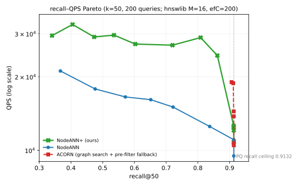

# 方案：CCS 概念 DAG 上的前缀树 + 局部图索引（PLG）

> 覆盖式维护。问题口径见 `problem_def.md`；当日数据与图见 `2026-11-05-exps/`。
> 本文按论文顺序写：数据 → 动机 → 索引的三层结构 → 建树 → 建图 → 合并 → 代表点与邻居调整 → 位图 → 查询 → 代价 → 结果 → 实现状态。

## 1. 数据集：CCS Concepts

**来源与形态**。实验数据取自 ACM **CCS（Computing Classification System）Concepts** 分类体系。它是一个 **DAG（有向无环图）**，不是树：一个概念可以同时挂在多个上位概念下（例如某个"方法"概念同时属于"机器学习"和"信息检索"）。

| 统计量 | 值 |
|---|---|
| 概念数（节点） | 1,929 |
| 父子边数 | 2,040 |
| **多父概念**（≥2 个父） | **103 个（5.3%）**，最多的一个概念有 **18 个父** |
| 深度 | 0–6 层 |
| 有直属对象的非空概念 | 768 |

**对象与向量**。每个对象（这里是一条 SIFT 描述子对应的图片/条目）标注**一个**直属概念（`own(o)`），向量为 128 维。实验规模 168,937 个对象。

**为什么要强调它是 DAG**。树的索引技巧（区间编码、前缀共享）在 DAG 上会失效：一个概念若有 3 个父，就无法用一个连续区间同时表示"从三个父都能到达它"。我们对全部 1,929 个概念做过穷举验证：只要存在 3 父节点，就不存在把后代集合映射成区间的线性序（实测这类反例在 n=4 时占 1.6%，n=6 时占 16.3%）。因此**不能**把 DAG 直接压成树来做精确路由——这是本方案必须先解决的结构性问题，也是 §4 中"前缀树只负责路由、闭包交给位图"的原因。

**量化**。向量用 PQ(m=16, k=256) 压缩 32×，搜索在还原向量上做。因此召回率的物理上限是 **0.9132**，不是 1.0；要 1.0 必须回原始 FP32 重排。

**查询**。给定 $(q, U, k=50)$：$U$ 是概念集合（OR 语义），合格集是 $U$ 的后代闭包内的全部对象，返回其中距 $q$ 最近的 50 个。200 条查询，平均合格集 1,140 个对象（选择率 0.675%）。

## 2. 动机：为什么现有两条路都不够

```svg
<svg viewBox="0 0 900 260" width="100%" font-family="sans-serif" font-size="12">
  <text x="16" y="20" fill="var(--muted)">同样是"只在小范围里找近邻"，三种索引的代价结构完全不同</text>

  <rect x="16" y="34" width="276" height="200" rx="8" fill="none" stroke="var(--border)"/>
  <text x="30" y="56" fill="var(--fg)">A. 全库一张图（ACORN 式）</text>
  <g stroke="var(--muted)" fill="none">
    <circle cx="60" cy="110" r="3"/><circle cx="100" cy="92" r="3"/><circle cx="140" cy="118" r="3"/>
    <circle cx="86" cy="146" r="3"/><circle cx="132" cy="162" r="3"/><circle cx="176" cy="136" r="3"/>
    <line x1="60" y1="110" x2="100" y2="92"/><line x1="100" y1="92" x2="140" y2="118"/>
    <line x1="86" y1="146" x2="132" y2="162"/><line x1="132" y1="162" x2="176" y2="136"/>
    <line x1="60" y1="110" x2="86" y2="146"/>
  </g>
  <text x="30" y="196" fill="var(--muted)">谓词把图切成互不相通的小块，</text>
  <text x="30" y="212" fill="var(--muted)">查询"游"不到目标概念附近：</text>
  <text x="30" y="228" fill="var(--danger)">实测 ef 从 50 加到 800 召回不动（0.159）</text>

  <rect x="308" y="34" width="276" height="200" rx="8" fill="none" stroke="var(--border)"/>
  <text x="322" y="56" fill="var(--fg)">B. 每概念一张图（NodeANN）</text>
  <g stroke="var(--muted)" fill="none">
    <circle cx="340" cy="104" r="3"/><circle cx="366" cy="92" r="3"/><circle cx="392" cy="112" r="3"/>
    <line x1="340" y1="104" x2="366" y2="92"/><line x1="366" y1="92" x2="392" y2="112"/>
    <circle cx="432" cy="104" r="3"/><circle cx="458" cy="92" r="3"/><circle cx="484" cy="112" r="3"/>
    <line x1="432" y1="104" x2="458" y2="92"/><line x1="458" y1="92" x2="484" y2="112"/>
    <circle cx="340" cy="160" r="3"/><circle cx="372" cy="172" r="3"/>
    <line x1="340" y1="160" x2="372" y2="172"/>
  </g>
  <text x="322" y="196" fill="var(--muted)">结构上跳过无关概念，召回能到上限；</text>
  <text x="322" y="212" fill="var(--muted)">但每个概念都从自己的入口重新爬，</text>
  <text x="322" y="228" fill="var(--muted)">跨概念查询要各查一遍再合并</text>

  <rect x="600" y="34" width="284" height="200" rx="8" fill="none" stroke="var(--accent)"/>
  <text x="614" y="56" fill="var(--fg)">C. 本方案：前缀树 + 每节点图</text>
  <g stroke="var(--accent)" fill="none">
    <line x1="700" y1="80" x2="660" y2="112"/><line x1="700" y1="80" x2="740" y2="112"/>
    <line x1="660" y1="112" x2="636" y2="150"/><line x1="660" y1="112" x2="690" y2="150"/>
    <line x1="740" y1="112" x2="770" y2="150"/>
  </g>
  <g fill="var(--accent)">
    <circle cx="700" cy="80" r="5"/><circle cx="660" cy="112" r="5"/><circle cx="740" cy="112" r="5"/>
    <circle cx="636" cy="150" r="5"/><circle cx="690" cy="150" r="5"/><circle cx="770" cy="150" r="5"/>
  </g>
  <text x="614" y="196" fill="var(--muted)">沿概念路径逐层下降，</text>
  <text x="614" y="212" fill="var(--muted)">每个树节点自带一张小图，</text>
  <text x="614" y="228" fill="var(--muted)">小图之间按规则合并、用桥跨父连接</text>
</svg>
```

三条动机，逐条对应设计：

1. **单张大图不可行**：谓词（这里是概念闭包）把图切碎，图搜索失去导航能力。→ 必须让"哪些概念参与"在**结构层**就确定，而不是靠图上的谓词过滤。
2. **每概念一张图有效但重复起步**：每个概念从自己的入口重新爬，跨概念时多次消耗距离预算。→ 需要**共享入口与共享预算**的机制。
3. **概念数很多、单概念很小**：768 个非空概念，中位 70 个对象、平均 220 个。为每个小概念单独维护一张图，索引开销与查询启动开销都不划算。→ 需要**把小概念合并成块**的规则。

## 3. 索引的三层结构

```svg
<svg viewBox="0 0 900 400" width="100%" font-family="sans-serif" font-size="12">
  <text x="16" y="20" fill="var(--muted)">L1 概念前缀树（路由层）　→　L2 每节点局部图（检索层）　→　L3 位图（判定层）</text>

  <!-- L1 trie -->
  <rect x="16" y="34" width="420" height="180" rx="8" fill="none" stroke="var(--border)"/>
  <text x="30" y="54" fill="var(--fg)">L1 前缀树：概念路径的共享前缀</text>
  <g stroke="var(--accent)" fill="none" stroke-width="1.4">
    <line x1="220" y1="80" x2="150" y2="118"/><line x1="220" y1="80" x2="290" y2="118"/>
    <line x1="150" y1="118" x2="110" y2="158"/><line x1="150" y1="118" x2="190" y2="158"/>
    <line x1="290" y1="118" x2="330" y2="158"/>
  </g>
  <g font-size="11" text-anchor="middle">
    <circle cx="220" cy="80" r="12" fill="var(--surface)" stroke="var(--accent)"/><text x="220" y="84" fill="var(--fg)">R</text>
    <circle cx="150" cy="118" r="12" fill="var(--surface)" stroke="var(--accent)"/><text x="150" y="122" fill="var(--fg)">A</text>
    <circle cx="290" cy="118" r="12" fill="var(--surface)" stroke="var(--accent)"/><text x="290" y="122" fill="var(--fg)">B</text>
    <circle cx="110" cy="158" r="12" fill="var(--surface)" stroke="var(--accent)"/><text x="110" y="162" fill="var(--fg)">C</text>
    <circle cx="190" cy="158" r="12" fill="var(--surface)" stroke="var(--accent)"/><text x="190" y="162" fill="var(--fg)">F</text>
    <circle cx="330" cy="158" r="12" fill="var(--surface)" stroke="var(--accent)"/><text x="330" y="162" fill="var(--fg)">E</text>
  </g>
  <text x="30" y="196" fill="var(--muted)">每个树节点对应"某条概念路径"；</text>
  <text x="30" y="212" fill="var(--muted)">多父概念只在**主路径**上出现一次，其余父用跨链（虚线）记录</text>

  <!-- L2 graphs -->
  <rect x="452" y="34" width="432" height="180" rx="8" fill="none" stroke="var(--border)"/>
  <text x="466" y="54" fill="var(--fg)">L2 每个树节点一张局部图（块）</text>
  <g stroke="var(--muted)" fill="none">
    <circle cx="500" cy="100" r="3"/><circle cx="530" cy="88" r="3"/><circle cx="558" cy="106" r="3"/>
    <line x1="500" y1="100" x2="530" y2="88"/><line x1="530" y1="88" x2="558" y2="106"/>
    <circle cx="600" cy="100" r="3"/><circle cx="628" cy="88" r="3"/><circle cx="656" cy="106" r="3"/>
    <line x1="600" y1="100" x2="628" y2="88"/><line x1="628" y1="88" x2="656" y2="106"/>
    <circle cx="700" cy="100" r="3"/><circle cx="730" cy="90" r="3"/>
    <line x1="700" y1="100" x2="730" y2="90"/>
  </g>
  <g fill="var(--accent)">
    <circle cx="500" cy="100" r="6"/><circle cx="600" cy="100" r="6"/><circle cx="700" cy="100" r="6"/>
  </g>
  <text x="480" y="140" fill="var(--muted)">小块（对象数 &lt; τ）向上合并进父块，块内保留各自的归属标签</text>
  <text x="480" y="158" fill="var(--muted)">大块保留独立图，块与块之间用"门户桥"连接</text>
  <g stroke="var(--accent)" stroke-dasharray="4 3" fill="none">
    <line x1="662" y1="104" x2="694" y2="102"/>
  </g>

  <!-- L3 bitmap -->
  <rect x="16" y="230" width="868" height="150" rx="8" fill="none" stroke="var(--border)"/>
  <text x="30" y="250" fill="var(--fg)">L3 概念位图：1,929 位 = 31 个 64 位字，每概念一张后代闭包位图</text>
  <g font-size="10" font-family="monospace">
    <rect x="30" y="262" width="360" height="26" fill="var(--surface)" stroke="var(--border)"/>
    <text x="36" y="279" fill="var(--fg)">R : 1111 1111 0000 0000 ...</text>
    <rect x="30" y="294" width="360" height="26" fill="var(--surface)" stroke="var(--border)"/>
    <text x="36" y="311" fill="var(--fg)">A : 0000 0110 0000 0000 ...</text>
    <rect x="30" y="326" width="360" height="26" fill="var(--surface)" stroke="var(--border)"/>
    <text x="36" y="343" fill="var(--fg)">C : 0000 0010 0000 0000 ...</text>
  </g>
  <text x="410" y="280" fill="var(--muted)">查询时：把 U 中每个概念的位图按位或，得到本次查询的"参与概念集合" D；</text>
  <text x="410" y="300" fill="var(--muted)">按置位枚举 D，得到要访问的块；对象是否可参与，只需查其 2 字节归属标签是否在 D 中。</text>
  <text x="410" y="322" fill="var(--muted)">总内存：1,929 × 31 × 8 B ≈ 0.5 MB；单查询开销：|U| × 31 次字或 + 置位枚举。</text>
</svg>
```

三层各司其职，缺一不可：

| 层 | 作用 | 不做什么 |
|---|---|---|
| L1 前缀树 | 把概念路径组织成可逐层下降的路由结构，共享前缀 | 不承载向量，不做近邻判断 |
| L2 局部图 | 在每个块内部做图搜索 | 不跨块导航（跨块靠门户桥） |
| L3 位图 | O(1) 判定"某概念/某对象是否参与本次查询" | 不做距离计算 |

## 4. 第一步：建立前缀树

**4.1 路径的确定。** 每个概念 $c$ 在 DAG 中可能有多个父。为了让树保持"一个节点一个位置"，我们为每个概念选定一条**主路径**（canonical path）：

1. 若 $c$ 只有一个父，主路径 = 父的主路径 + $c$；
2. 若有多个父，取"父的深度最大者"（最具体的父）作为主父；深度相同则取 id 最小者，保证确定性；
3. 其余父关系不丢弃，记录为**跨链**（cross-link），在 L2 中表现为门户桥，在 L3 中由位图完整表达。

> 为什么不把多父概念在树里复制多份：复制会让同一批对象出现在多个块中，查询时重复打分、索引体积膨胀。实测 103 个多父概念若按父数展开，平均膨胀 1.3 倍、最坏 18 倍。

**4.2 插入与编号。** 按主路径把每个概念插入 trie：从根开始逐字符（这里是逐概念 id）下降，缺失则建节点。插入完成后按**前序**给树节点编号，得到 `node_id`。每个 `node_id` 记录：对应概念 id、深度、父节点、子节点列表、块号（§6）。

**4.3 为什么要这棵树。** 树给出三样东西：

- **下降顺序**：查询从根开始，沿"命中的概念路径"下降，天然只访问相关分支（结构跳过）。
- **合并单元**：小块按树的后序（叶子优先）合并进父块，合并顺序由树的形状唯一确定，可复现。
- **入口层级**：每个树节点的入口，等于"该节点所有后代块的代表点集合"，上层入口可作为下层的种子。

## 5. 第二步：每个树节点建局部图

对树节点 $v$（对应概念 $c$），其直属对象集合 $\mathrm{mem}(c)$ 建一张**单层图**：

1. **插入**：按对象 id 顺序增量插入；每个新点从当前入口出发做构建期 beam（预算 $efC$）得到候选。
2. **选边（RNG 规则）**：候选按到新点的距离升序，保留 $u$ 当且仅当对所有已保留的 $w$ 有 $d(u,w) > d(u,q)$。含义是"只留彼此分得开的邻居"，避免所有边指向同一稠密角落。
3. **反向边收缩**：新点加入邻居 $w$ 的表后，若 $w$ 的表超过 $M$ 条，对 $w$ 的表重跑同一 RNG 规则（等价 hnswlib 的 `getNeighborsByHeuristic2`）。这一步保证度上界不被反向边破坏。
4. **连通修补**：孤立点连最近邻；强连通分量之间用各自代表点互连。
5. **扁平化**：邻接存成 `偏移数组 + 连续 id 数组`，查询期顺序扫描。

参数：$M=16$、$efC=200$。单层而非多层：概念内对象少（中位 70），多层结构的上层只有几个节点，实测召回无差别（0.9101 vs 0.9132）。

## 6. 第三步：小索引的合并

**6.1 什么时候合并。** 设阈值 $\tau$（如 64）。若某树节点的对象数 $n_v < \tau$，它不单独成图，而是并入父块。

**6.2 合并顺序。** 按树的后序（深度从大到小，同深度按 node_id 升序）自底向上处理：

```
for v in 后序(trie):
    if n_v < τ and v 有父:
        把 v 的块并入 parent(v) 的块
        n_parent += n_v
        记录 v 的块号 = parent 的块号
    else:
        v 自成一块
```

顺序必须固定，否则"哪个块吸收哪个块"会随遍历顺序变化，索引不可复现。

**6.3 合并做什么、不做什么。**

| 动作 | 做 | 理由 |
|---|---|---|
| 成员表 | 并集 | 块内所有对象都要能被搜到 |
| 块内原有边 | **一条不减** | 保边：合并不得降低任何子图的连通性 |
| 归属标签 | 每对象保留 2 字节 `concept_id` | 结构跳过仍成立：标签不在 D 中的对象不参与 |
| 块边界处的边 | 需要**新增**跨子块连接 | 否则合并后的块由互不相通的几坨组成 |
| 度上界 | **只对跨边界新增的边**做 RNG 收缩 | 块内边保持原样，避免合并破坏已建好的邻域结构 |

**6.4 跨边界连边怎么做。** 对每个被并入的子块 $s$ 与父块 $p$：取 $s$ 的入口 $e_s$ 与 $p$ 中"距 $e_s$ 最近"的代表点 $r_p$，连一条双向边；再取 $s$ 的其余代表点各连一条到 $r_p$。这样每个子块至少有 $K$ 条通道进入，且新增边数与被合并的子块数成线性关系，不随对象数增长。

```svg
<svg viewBox="0 0 900 300" width="100%" font-family="sans-serif" font-size="12">
  <text x="16" y="20" fill="var(--muted)">合并：叶子块（对象数 &lt; τ）自底向上并入父块，只在边界加边</text>

  <!-- 合并前 -->
  <text x="40" y="52" fill="var(--fg)">合并前</text>
  <rect x="30" y="62" width="200" height="150" rx="8" fill="none" stroke="var(--border)"/>
  <text x="44" y="82" fill="var(--muted)">父块 p（大）</text>
  <g stroke="var(--muted)" fill="none">
    <circle cx="70" cy="110" r="3"/><circle cx="100" cy="98" r="3"/><circle cx="130" cy="118" r="3"/>
    <line x1="70" y1="110" x2="100" y2="98"/><line x1="100" y1="98" x2="130" y2="118"/>
  </g>
  <circle cx="130" cy="118" r="6" fill="var(--accent)"/>
  <rect x="250" y="120" width="150" height="90" rx="8" fill="none" stroke="var(--border)" stroke-dasharray="5 3"/>
  <text x="262" y="140" fill="var(--muted)">子块 s（n&lt;τ）</text>
  <g stroke="var(--muted)" fill="none">
    <circle cx="285" cy="165" r="3"/><circle cx="315" cy="155" r="3"/><circle cx="345" cy="175" r="3"/>
    <line x1="285" y1="165" x2="315" y2="155"/><line x1="315" y1="155" x2="345" y2="175"/>
  </g>
  <circle cx="285" cy="165" r="6" fill="var(--accent)"/>
  <text x="270" y="230" fill="var(--muted)">两个块各自独立，无连接</text>

  <path d="M410 155 L450 155" stroke="var(--muted)" stroke-width="1.6" fill="none" marker-end="url(#mg)"/>
  <defs><marker id="mg" markerWidth="10" markerHeight="10" refX="8" refY="3" orient="auto">
    <path d="M0,0 L0,6 L9,3 z" fill="var(--muted)"/></marker></defs>

  <!-- 合并后 -->
  <text x="470" y="52" fill="var(--fg)">合并后（一个块，保边 + 边界桥）</text>
  <rect x="460" y="62" width="410" height="200" rx="8" fill="none" stroke="var(--accent)"/>
  <g stroke="var(--muted)" fill="none">
    <circle cx="500" cy="110" r="3"/><circle cx="530" cy="98" r="3"/><circle cx="560" cy="118" r="3"/>
    <line x1="500" y1="110" x2="530" y2="98"/><line x1="530" y1="98" x2="560" y2="118"/>
    <circle cx="640" cy="170" r="3"/><circle cx="670" cy="160" r="3"/><circle cx="700" cy="180" r="3"/>
    <line x1="640" y1="170" x2="670" y2="160"/><line x1="670" y1="160" x2="700" y2="180"/>
  </g>
  <g stroke="var(--accent)" stroke-width="1.6" fill="none">
    <line x1="560" y1="118" x2="640" y2="170"/>
    <line x1="560" y1="118" x2="700" y2="180"/>
  </g>
  <circle cx="560" cy="118" r="6" fill="var(--accent)"/>
  <circle cx="640" cy="170" r="6" fill="var(--accent)"/>
  <text x="478" y="230" fill="var(--muted)">块内原有边一条不减；只新增"父代表点 → 子入口/子代表点"的边界边，</text>
  <text x="478" y="248" fill="var(--muted)">并对新增边做 RNG 收缩以满足度上界。</text>
</svg>
```

## 7. 第四步：代表节点选择与邻居调整

**7.1 代表点（每个块）**。块 $B$ 的代表点用 **farthest-first** 选取，$K=8$：

1. 取块的入口 $e$ 作为 $r_1$；
2. 重复 $K-1$ 次：$r_{i+1} = \arg\max_{x\in B} \min_{j\le i} d(x, r_j)$。

含义是"每次都挑离已选代表最远的对象"，保证 8 个代表覆盖块的各个方向。查询时取距 $q$ 最近的代表作为进入该块的门口——这等价于 HNSW 用上层图找一个好的下降起点，但代价只有 $K$ 次距离。

**7.2 代表点之间建 MST**。在 $r_1..r_K$ 上按距离建最小生成树，把树的 $K-1$ 条边并入块内图。作用：从任意代表走到另一个代表只需沿树几跳，而不是绕整个块。

**7.3 邻居调整（什么时候动、动多少）**。

| 场景 | 动作 |
|---|---|
| 建图时的反向边 | 对目标节点的表跑 RNG 收缩，度上界 $M$ |
| 合并时的边界边 | 只对**新增的**边界边做 RNG 收缩，块内边不动 |
| 门户桥 | 存**独立邻接表**，不计入块内度，因此不需要收缩 |

原则：**"保边"优先于"省空间"**。块内边只在建图阶段被规则调整一次，之后任何合并、加桥都不再删边；否则每次合并都会破坏已建立的邻域结构，召回随合并次数下降。

## 8. 第五步：位图

**8.1 建什么。** 概念级位图：每个概念 $c$ 一张长度 $|C|=1{,}929$ 位的位图 $\mathrm{desc}(c)$，第 $i$ 位为 1 表示"概念 $i$ 是 $c$ 的后代（含自身）"。

**8.2 怎么建。** 按 DAG 的逆拓扑序（子先于父）自底向上求：

$$\mathrm{desc}(c) = \{c\} \cup \bigcup_{c'\in \mathrm{children}(c)} \mathrm{desc}(c')$$

实现为 31 个 64 位字的按位或。深度 0–6，一次遍历即可。

**8.3 用来干什么。**

| 用途 | 做法 | 收益 |
|---|---|---|
| 查询闭包 | $D=\bigvee_{u\in U}\mathrm{desc}(u)$ | 与 $|D|$ 无关，只与 $|U|$ 和字数有关；避免逐查询 DFS |
| 枚举参与概念 | 对 $D$ 逐字取最低置位（`ctz`） | 只访问真正相关的块 |
| 对象归属判定 | 对象带 2 字节 `concept_id`，测试其位是否置位 | O(1)，且合并后依然成立 |
| 门户桥目标判定 | 桥的目标概念查同一位图 | 避免跳进范围外的块 |

**8.4 代价。** 内存 $1{,}929\times31\times8\text{ B}\approx0.5$ MB；查询期 $|U|\times31$ 次字或 + 置位枚举。相对每查询数百次距离计算，这部分可忽略。

**8.5 一个实现陷阱（已踩过）**。位图必须建在**全部概念**上，包括没有直属对象的中间概念。若只给"有对象的 768 个概念"建位图，闭包传播会在中间概念处断链：实测覆盖概念数从 4.20 掉到 3.50，召回从 0.9127 掉到 0.8881。

## 9. 查询流程

```svg
<svg viewBox="0 0 900 250" width="100%" font-family="sans-serif" font-size="12">
  <defs><marker id="q1" markerWidth="10" markerHeight="10" refX="8" refY="3" orient="auto">
    <path d="M0,0 L0,6 L9,3 z" fill="var(--accent)"/></marker></defs>
  <rect x="14" y="30" width="200" height="96" rx="8" fill="none" stroke="var(--accent)"/>
  <text x="26" y="52" fill="var(--fg)">① 位图求闭包</text>
  <text x="26" y="72" fill="var(--muted)">U 的 desc 按位或 → D</text>
  <text x="26" y="90" fill="var(--muted)">枚举 D 得到参与块</text>
  <text x="26" y="108" fill="var(--muted)">范围外概念：不访问</text>

  <rect x="238" y="30" width="200" height="96" rx="8" fill="none" stroke="var(--accent)"/>
  <text x="250" y="52" fill="var(--fg)">② 树上下行</text>
  <text x="250" y="72" fill="var(--muted)">从根沿命中路径下降</text>
  <text x="250" y="90" fill="var(--muted)">每个块选最近代表点</text>
  <text x="250" y="108" fill="var(--muted)">作为该块入口</text>

  <rect x="462" y="30" width="200" height="96" rx="8" fill="none" stroke="var(--accent)"/>
  <text x="474" y="52" fill="var(--fg)">③ 块内图搜索</text>
  <text x="474" y="72" fill="var(--muted)">单队列；每块一份结果表</text>
  <text x="474" y="90" fill="var(--muted)">预算 ef_c=max(k, ef/|D|)</text>
  <text x="474" y="108" fill="var(--muted)">标签不在 D 的对象跳过</text>

  <rect x="686" y="30" width="200" height="96" rx="8" fill="none" stroke="var(--accent)"/>
  <text x="698" y="52" fill="var(--fg)">④ 合并输出</text>
  <text x="698" y="72" fill="var(--muted)">各块结果表合并</text>
  <text x="698" y="90" fill="var(--muted)">取全局 top-50</text>

  <g stroke="var(--accent)" stroke-width="1.6">
    <line x1="214" y1="78" x2="234" y2="78" marker-end="url(#q1)"/>
    <line x1="438" y1="78" x2="458" y2="78" marker-end="url(#q1)"/>
    <line x1="662" y1="78" x2="682" y2="78" marker-end="url(#q1)"/>
  </g>

  <text x="26" y="168" fill="var(--muted)">阶段 ③ 内部的两条规则：</text>
  <text x="26" y="188" fill="var(--muted)">· 每块独立预算 ef_c，防止"先填满的块把后面的块挤掉"（实测 +2 个百分点召回）</text>
  <text x="26" y="206" fill="var(--muted)">· ef_c 不小于 k，否则该块最多只能贡献 ef_c 条，全局凑不满 50 条（实测把右端从 0.9055 拉到 0.9131）</text>
  <text x="26" y="228" fill="var(--muted)">跨块：门户桥（父代表点 → 子入口），只在目标概念属于 D 时跳转；桥不计入块内度</text>
</svg>
```

## 10. 代价

| 项 | 数值 / 量级 |
|---|---|
| 索引内存 | 每块 $2M\cdot n_B$ 条边（32 位）+ 每块 8 个代表点 + 门户 + 位图 0.5 MB |
| 构建时间 | 168,937 对象、768 个非空概念：约 37–47 s（单线程） |
| 每查询距离调用 | $ef=50$：约 420 次（对照：NodeANN 约 756，精确扫描 1,140） |

## 11. 实验结果



同一配置（hnswlib，M=16，efC=200）、同一协议（`taskset -c 2`、3 轮、同一 `RawL2Space`、同一 GT）：

| recall@50 | NodeANN | **本方案** | ACORN（方法本体） |
|---|---:|---:|---:|
| 0.47 | 17,819 | **29,089** | — |
| 0.60 | — | **27,209** | — |
| 0.72 | 15,024 | **26,916** | — |
| 0.86 | — | **24,414** | — |
| 0.906 | — | — | 19,007 |
| 0.9132（上限） | 11,042 | **10,820–12,347** | 10,477 |

ACORN 只有两端：低阈值时几乎全部查询退回精确扫描（197–200/200），高阈值时图搜索召回只有 0.159。

## 12. 合并实验：负结果（已实现并测量）

§6 的合并流程已实现（`codes/dag-ann-search/src/merge_bench.cpp`），并在 $	au\in\{0,32,64,128,256\}$ 上测量。**结论：合并使召回与吞吐同时下降**，因此当前方案不启用合并（等价 $	au=0$）。

| $	au$ | 块数 | 每查询访问块数 | recall@50 | QPS | 距离/查询 |
|---:|---:|---:|---:|---:|---:|
| **0（不合并）** | 1,929 | 4.20 | **0.9127** | **12,058** | **410** |
| 32 | 591 | 3.58 | 0.9089 | 10,851 | 564 |
| 64 | 473 | 3.19 | 0.9067 | 9,067 | 625 |
| 128 | 333 | 2.55 | 0.8825 | 7,720 | 868 |
| 256 | 247 | 2.21 | 0.8671 | 6,034 | 1,145 |

**为什么失败（机制）**：块变大后，块内**不属于本次查询**的对象变多。结构跳过只在概念级成立——块内对象只能靠 2 字节归属标签过滤，但**它们仍要参与导航**（否则图断开）。于是距离调用从 410 涨到 1,145，已经超过精确扫描的 1,140；而合并省下的"每块启动开销"（每块至多 $K=8$ 次入口距离）远小于这部分损失。

**这条负结果本身是有信息的**：它说明"把小概念合并成大块"与本问题的主导成本相冲突——查询的选择率极低（0.675%），块内绝大多数对象是无效导航。除非块内对象能被**结构性地排除**（例如块内再分层、或按概念做子区间），否则合并无收益。这也解释了为什么 NodeANN 选择"每概念一张图"而不是"合并成大图"。

数据：`2026-11-05-exps/data/merge-tau-sweep.jsonl`。

## 13. 实现状态（务必区分）

| 组件 | 状态 |
|---|---|
| 概念 DAG 解析、owner 归组、PQ 编码 | **已实现** |
| 每概念单层图（RNG 选边 + 反向边收缩 + 连通修补 + 扁平化） | **已实现** |
| 代表点（farthest-first，K=8）、MST 并入图 | **已实现** |
| 门户桥（父代表点 → 子入口，独立邻接表） | **已实现** |
| 概念位图闭包（全概念覆盖，0.5 MB） | **已实现** |
| 单队列 + 每块预算 + 溢出地板 | **已实现** |
| 前缀树（§4）与按树合并（§6） | **已实现，但实测为负收益，默认关闭**（$	au=0$） |
| 块内 2 字节归属标签 | 已实现（合并版）；默认配置下用 `own` 查表 |

## 14. 已知限制

1. 部署配置召回带很窄（0.9127–0.9132）：$ef$ 主要换吞吐，不换召回。
2. 覆盖半径下界在本负载几乎不触发剪枝（范围内仅 4.2 个概念）。
3. 前缀树合并（§6）已实现，但实测为负收益（§12），当前默认关闭。
4. MST 目前只作块内捷径，跨块有序跳转未启用。
5. 只测 168,937 规模；1M 未测。
6. 绑核不等于独占 CPU；WSL 未暴露调频控制，频率未锁定。
