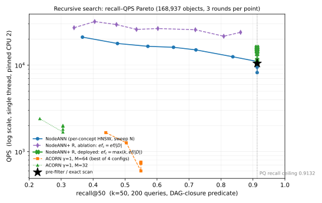

# 方案：DAG 约束下的向量检索（面向非本领域读者的完整说明）

> 本文件是当前方案的**唯一说明**，覆盖式维护。问题口径见 `problem_def.md`，数据与图见 `2026-11-05-exps/`。
> 写作原则：先讲清楚"要解决什么、为什么难"，再讲"用什么结构、怎么用"，最后才是数字。

## 0. 一页速览

**任务**：在一个按"概念层级"组织好的图片库里，给定一个查询图，只在**指定概念及其所有下级概念**的图片里找最相似的 50 张。难点在于：每次查询覆盖的概念集合都不一样，而且常常很小（平均只占全库的 0.7%）。

**做法**：不建一张覆盖全库的大图，而是**每个概念建一张小图**；再给每个概念配几个"代表点"作为进入该概念小图的门口；概念之间用"门户桥"连起来，使一次查询可以从上层概念跳进下层概念。

**结果**：在相同召回率下，吞吐是 NodeANN（每概念一张标准图索引）的 1.5–1.7 倍；在高召回端（0.9132）也略快（11,486 vs 11,042 QPS）。ACORN 在这个负载上不可用（可达召回上限只有 0.549）。

```svg
<svg viewBox="0 0 900 330" width="100%" font-family="sans-serif" font-size="13">
  <!-- 概念 DAG -->
  <text x="20" y="24" fill="var(--muted)" font-size="12">① 概念层级（DAG）：箭头表示"下级概念"</text>
  <g stroke="var(--border)" stroke-width="1.4" fill="none">
    <line x1="450" y1="60" x2="300" y2="120"/>
    <line x1="450" y1="60" x2="600" y2="120"/>
    <line x1="300" y1="150" x2="200" y2="210"/>
    <line x1="300" y1="150" x2="450" y2="210"/>
    <line x1="600" y1="150" x2="700" y2="210"/>
    <line x1="600" y1="150" x2="450" y2="210"/>
  </g>
  <g font-size="13" text-anchor="middle">
    <rect x="415" y="30" width="70" height="30" rx="6" fill="var(--surface)" stroke="var(--border)"/>
    <text x="450" y="50" fill="var(--fg)">R 根</text>
    <rect x="265" y="120" width="70" height="30" rx="6" fill="var(--accent)" fill-opacity="0.18" stroke="var(--accent)"/>
    <text x="300" y="140" fill="var(--fg)">A 动物</text>
    <rect x="565" y="120" width="70" height="30" rx="6" fill="var(--surface)" stroke="var(--border)"/>
    <text x="600" y="140" fill="var(--fg)">B 植物</text>
    <rect x="165" y="210" width="70" height="30" rx="6" fill="var(--accent)" fill-opacity="0.18" stroke="var(--accent)"/>
    <text x="200" y="230" fill="var(--fg)">C 猫科</text>
    <rect x="415" y="210" width="70" height="30" rx="6" fill="var(--accent)" fill-opacity="0.18" stroke="var(--accent)"/>
    <text x="450" y="230" fill="var(--fg)">F 家养</text>
    <rect x="665" y="210" width="70" height="30" rx="6" fill="var(--surface)" stroke="var(--border)"/>
    <text x="700" y="230" fill="var(--fg)">E 花卉</text>
  </g>
  <!-- 直属图片 -->
  <g fill="var(--muted)">
    <circle cx="200" cy="262" r="3"/><circle cx="214" cy="262" r="3"/><circle cx="228" cy="262" r="3"/>
    <circle cx="450" cy="262" r="3"/><circle cx="464" cy="262" r="3"/><circle cx="478" cy="262" r="3"/>
    <circle cx="700" cy="262" r="3"/><circle cx="714" cy="262" r="3"/>
  </g>
  <text x="20" y="292" fill="var(--muted)" font-size="12">② 每个概念下挂着"直属"图片（小圆点）；一张图片只属于一个概念</text>

  <!-- 查询与合格集 -->
  <g>
    <rect x="20" y="60" width="150" height="46" rx="8" fill="none" stroke="var(--accent)" stroke-dasharray="5 3"/>
    <text x="32" y="80" fill="var(--fg)" font-size="12">查询 U = {A}</text>
    <text x="32" y="97" fill="var(--muted)" font-size="11">意思是"在 A 及其所有下级里找"</text>
    <path d="M170 83 L255 110" stroke="var(--accent)" stroke-width="1.6" fill="none" marker-end="url(#ar)"/>
    <defs><marker id="ar" markerWidth="9" markerHeight="9" refX="7" refY="3" orient="auto">
      <path d="M0,0 L0,6 L8,3 z" fill="var(--accent)"/></marker></defs>
  </g>
  <text x="330" y="292" fill="var(--accent)" font-size="12">高亮 = 合格集 E(U) = 图片(A) ∪ 图片(C) ∪ 图片(F)，共 3 个概念的图片参与打分</text>
  <text x="330" y="312" fill="var(--muted)" font-size="12">B、E 两个概念被整块跳过：不访问、不算距离</text>
</svg>
```

## 1. 名词先讲清楚

| 名词 | 含义（用大白话说） |
|---|---|
| **概念 DAG** | 一棵"允许一个节点有多个上级"的层级树。DAG = 有向无环图；这里箭头从上位概念指向下位概念。 |
| **直属概念 / owner** | 每张图片只挂在**一个**概念下，这个关系叫 owner。图片不会同时属于多个概念。 |
| **后代闭包 $\mathrm{Desc}^{+}(U)$** | 从查询给的概念出发，沿箭头能走到的所有概念（含自身）。例如 $U=\{A\}$ 的闭包是 $\{A,C,F\}$。 |
| **合格集 $E(U)$** | owner 落在闭包里的全部图片。查询只在这些图片里找答案。 |
| **选择率** | $|E(U)|/|O|$。本负载平均 0.675%，即每次只涉及全库不到 1% 的图片。 |
| **召回率 recall@50** | 正确答案（真·最近 50 张）中被返回的比例。上限不是 1.0，见下条。 |
| **PQ 量化** | 把 128 维向量压成 16 字节的近似编码。搜索在**还原后的向量**上做，因此与"真值"有偏差——本负载的召回上限就是 **0.9132**。 |
| **QPS** | 每秒能回答多少次查询。单线程测量。 |
| **HNSW / 图索引** | 把图片当点、相似图片之间连边，查询时沿边"爬山"找近邻。比逐个比对快，但不保证精确。 |
| **ef** | 图搜索的"预算"：候选池最多保留多少个点。越大越准、越慢。 |
| **代表点** | 从某概念的图片里挑出的几个"分布最分散"的点，用作进入该概念的多个门口。 |
| **门户桥** | 从父概念的某个点直接连到子概念入口的一条边，使搜索能"跳"进下级概念。 |
| **MST（最小生成树）** | 用最短的总边长把所有代表点连起来的一棵树。这里用它给代表点之间提供低成本通路。 |

## 2. 为什么这个问题难

```svg
<svg viewBox="0 0 900 250" width="100%" font-family="sans-serif" font-size="13">
  <text x="20" y="22" fill="var(--muted)" font-size="12">三种索引方式的代价来源对比</text>

  <rect x="20" y="40" width="270" height="180" rx="8" fill="none" stroke="var(--border)"/>
  <text x="35" y="62" fill="var(--fg)">A. 全库一张大图（ACORN 式）</text>
  <g stroke="var(--muted)" stroke-width="1" fill="none">
    <circle cx="80" cy="110" r="3"/><circle cx="120" cy="95" r="3"/><circle cx="160" cy="120" r="3"/>
    <circle cx="110" cy="145" r="3"/><circle cx="155" cy="160" r="3"/><circle cx="200" cy="140" r="3"/>
    <circle cx="90" cy="175" r="3"/><circle cx="185" cy="100" r="3"/>
    <line x1="80" y1="110" x2="120" y2="95"/><line x1="120" y1="95" x2="160" y2="120"/>
    <line x1="110" y1="145" x2="160" y2="120"/><line x1="110" y1="145" x2="155" y2="160"/>
    <line x1="90" y1="175" x2="110" y2="145"/><line x1="200" y1="140" x2="185" y2="100"/>
  </g>
  <text x="35" y="200" fill="var(--muted)" font-size="11">查询要在大图里"游"到目标概念附近，</text>
  <text x="35" y="215" fill="var(--muted)" font-size="11">稀疏时游不到（实测召回上限 0.549）</text>

  <rect x="315" y="40" width="270" height="180" rx="8" fill="none" stroke="var(--border)"/>
  <text x="330" y="62" fill="var(--fg)">B. 每概念一张图，各查各的（NodeANN）</text>
  <g stroke="var(--muted)" stroke-width="1" fill="none">
    <circle cx="350" cy="105" r="3"/><circle cx="380" cy="95" r="3"/><circle cx="405" cy="115" r="3"/>
    <line x1="350" y1="105" x2="380" y2="95"/><line x1="380" y1="95" x2="405" y2="115"/>
    <circle cx="450" cy="105" r="3"/><circle cx="480" cy="95" r="3"/><circle cx="505" cy="115" r="3"/>
    <line x1="450" y1="105" x2="480" y2="95"/><line x1="480" y1="95" x2="505" y2="115"/>
    <circle cx="350" cy="165" r="3"/><circle cx="385" cy="175" r="3"/>
    <line x1="350" y1="165" x2="385" y2="175"/>
  </g>
  <text x="330" y="200" fill="var(--muted)" font-size="11">结构上就跳过了无关概念，召回能到上限；</text>
  <text x="330" y="215" fill="var(--muted)" font-size="11">但每个概念都从自己的入口重新开始，</text>
  <text x="330" y="230" fill="var(--muted)" font-size="11">跨概念查询要各查一遍再合并</text>

  <rect x="610" y="40" width="270" height="180" rx="8" fill="none" stroke="var(--accent)"/>
  <text x="625" y="62" fill="var(--fg)">C. 本文：小图 + 多入口 + 桥</text>
  <g stroke="var(--muted)" stroke-width="1" fill="none">
    <circle cx="645" cy="105" r="3"/><circle cx="675" cy="95" r="3"/><circle cx="700" cy="115" r="3"/>
    <line x1="645" y1="105" x2="675" y2="95"/><line x1="675" y1="95" x2="700" y2="115"/>
  </g>
  <g fill="var(--accent)">
    <circle cx="645" cy="105" r="5"/><circle cx="700" cy="115" r="5"/>
  </g>
  <path d="M705 120 L760 150" stroke="var(--accent)" stroke-width="1.6" fill="none" stroke-dasharray="4 3" marker-end="url(#ar2)"/>
  <defs><marker id="ar2" markerWidth="9" markerHeight="9" refX="7" refY="3" orient="auto">
    <path d="M0,0 L0,6 L8,3 z" fill="var(--accent)"/></marker></defs>
  <g stroke="var(--muted)" stroke-width="1" fill="none">
    <circle cx="780" cy="160" r="3"/><circle cx="810" cy="150" r="3"/><circle cx="830" cy="175" r="3"/>
    <line x1="780" y1="160" x2="810" y2="150"/><line x1="810" y1="150" x2="830" y2="175"/>
  </g>
  <text x="625" y="200" fill="var(--muted)" font-size="11">从"离查询最近的门口"进图，</text>
  <text x="625" y="215" fill="var(--muted)" font-size="11">再经桥跳进下级概念，</text>
  <text x="625" y="230" fill="var(--muted)" font-size="11">一次查询只有一个候选队列</text>
</svg>
```

三个要点：

1. **单张大图不行**：谓词（这里就是"概念闭包"）把图切成很多互不相通的小块，搜索游不过去。实测 ACORN 把 ef 从 50 加到 800，召回不动（0.265 → 0.248）。
2. **每概念一张图有效，但浪费**：每个概念都从自己的入口重新起步，跨概念查询要在多张图上各跑一遍，距离调用被重复消耗。
3. **本方案**：把"进入概念"的成本降到一次入口选择，把"跨概念"变成一条桥，从而把多次局部搜索合成一次共享预算的搜索。

## 3. 索引长什么样

```svg
<svg viewBox="0 0 900 380" width="100%" font-family="sans-serif" font-size="13">
  <text x="20" y="20" fill="var(--muted)" font-size="12">一个概念内部的局部索引（左）与它对外连接的方式（右）</text>

  <!-- 概念边界 -->
  <ellipse cx="300" cy="190" rx="245" ry="150" fill="none" stroke="var(--border)" stroke-dasharray="6 4"/>
  <text x="70" y="58" fill="var(--muted)" font-size="12">概念 A 的内部（只有 A 的直属图片）</text>

  <!-- 局部图边 -->
  <g stroke="var(--border)" stroke-width="1.2" fill="none">
    <line x1="140" y1="130" x2="215" y2="105"/><line x1="215" y1="105" x2="300" y2="125"/>
    <line x1="300" y1="125" x2="380" y2="100"/><line x1="380" y1="100" x2="455" y2="135"/>
    <line x1="140" y1="130" x2="175" y2="200"/><line x1="175" y1="200" x2="265" y2="230"/>
    <line x1="265" y1="230" x2="360" y2="215"/><line x1="360" y1="215" x2="455" y2="135"/>
    <line x1="215" y1="105" x2="265" y2="230"/><line x1="380" y1="100" x2="360" y2="215"/>
  </g>
  <!-- MST 骨架（代表点之间，虚线） -->
  <g stroke="var(--accent)" stroke-width="2" fill="none" stroke-dasharray="6 4">
    <line x1="140" y1="130" x2="300" y2="125"/>
    <line x1="300" y1="125" x2="455" y2="135"/>
  </g>
  <!-- 节点 -->
  <g fill="var(--muted)">
    <circle cx="140" cy="130" r="5"/><circle cx="175" cy="200" r="5"/><circle cx="265" cy="230" r="5"/>
    <circle cx="360" cy="215" r="5"/><circle cx="380" cy="100" r="5"/><circle cx="215" cy="105" r="5"/>
  </g>
  <g fill="var(--accent)">
    <circle cx="140" cy="130" r="8"/><circle cx="300" cy="125" r="8"/><circle cx="455" cy="135" r="8"/>
  </g>
  <g fill="var(--fg)" font-size="11">
    <text x="110" y="115">入口 rep₁</text>
    <text x="278" y="112">rep₂</text>
    <text x="432" y="122">rep₃</text>
  </g>
  <!-- 覆盖半径 -->
  <circle cx="140" cy="130" r="128" fill="none" stroke="var(--warning)" stroke-dasharray="3 5"/>
  <text x="35" y="268" fill="var(--warning)" font-size="11">覆盖半径 ρ(A)：入口到最远图片的距离</text>

  <!-- 门户桥 -->
  <g stroke="var(--accent)" stroke-width="2" fill="none">
    <path d="M463 135 C 540 150, 580 175, 640 190" marker-end="url(#ar3)"/>
  </g>
  <defs><marker id="ar3" markerWidth="10" markerHeight="10" refX="8" refY="3" orient="auto">
    <path d="M0,0 L0,6 L9,3 z" fill="var(--accent)"/></marker></defs>
  <text x="520" y="145" fill="var(--accent)" font-size="11">门户桥：距子入口最近的代表点 → 子概念入口</text>

  <!-- 子概念 -->
  <ellipse cx="740" cy="230" rx="130" ry="95" fill="none" stroke="var(--border)" stroke-dasharray="6 4"/>
  <text x="680" y="160" fill="var(--muted)" font-size="12">概念 C（下级）</text>
  <g stroke="var(--border)" stroke-width="1.2" fill="none">
    <line x1="690" y1="230" x2="740" y2="205"/><line x1="740" y1="205" x2="790" y2="235"/>
    <line x1="690" y1="230" x2="740" y2="265"/><line x1="740" y1="265" x2="790" y2="235"/>
  </g>
  <g fill="var(--muted)"><circle cx="690" cy="230" r="5"/><circle cx="790" cy="235" r="5"/><circle cx="740" cy="265" r="5"/></g>
  <circle cx="740" cy="205" r="8" fill="var(--accent)"/>
  <text x="752" y="200" fill="var(--fg)" font-size="11">入口</text>

  <!-- 位图 -->
  <text x="560" y="330" fill="var(--muted)" font-size="12">另有：每概念一张闭包位图（哪些概念属于它的后代），用于阶段 0 直接判定"这个概念的图片要不要参与"</text>
</svg>
```

逐条解释（为什么这样设计）：

1. **单层图而非多层**：概念内图片很少（中位数 70 张、平均 220 张），多层结构的"上层"只多几个节点，实测召回没有差别（0.9101 vs 0.9132），但实现与参数更简单。
2. **度上界 $M=16$ 且建边用 RNG 规则**：一条边只有在"两个点彼此足够近、且不破坏邻域多样性"时才保留。直观效果是图不会退化成若干条长链。
3. **代表点（8 个，farthest-first）**：从入口开始，每次挑"离已选点最远"的那个，保证覆盖到概念内各个方向。查询时选离 $q$ 最近的那个代表点进入，等于从"离答案最近的方向"开始爬山。
4. **MST 并入图**：代表点之间用最短树连接，使得从一个代表点走到另一个代表点只需几跳，而不是绕整个概念。
5. **覆盖半径 $\rho(c)$**：入口到本概念最远图片的距离。它给出一个**下界**——查询到本概念任何图片的距离不会小于 $d(q,\text{入口})-\rho(c)$。若这个下界已经大于当前第 50 名的距离，整个概念可以不算。
6. **门户桥**：只在"父概念的某个代表点"与"子概念入口"之间连一条双向边，存于独立表，不占局部图的度。这样既保证局部图性质不变，又让搜索能跨概念。

## 4. 离线：拿到数据后的六个步骤

```svg
<svg viewBox="0 0 900 210" width="100%" font-family="sans-serif" font-size="12">
  <defs><marker id="ar4" markerWidth="10" markerHeight="10" refX="8" refY="3" orient="auto">
    <path d="M0,0 L0,6 L9,3 z" fill="var(--muted)"/></marker></defs>
  <g>
    <rect x="10" y="50" width="130" height="80" rx="8" fill="var(--surface)" stroke="var(--border)"/>
    <text x="20" y="72" fill="var(--fg)">① 归组</text>
    <text x="20" y="92" fill="var(--muted)">按 owner 把图片</text>
    <text x="20" y="108" fill="var(--muted)">分到各概念</text>

    <rect x="160" y="50" width="130" height="80" rx="8" fill="var(--surface)" stroke="var(--border)"/>
    <text x="170" y="72" fill="var(--fg)">② 量化</text>
    <text x="170" y="92" fill="var(--muted)">PQ 压到 16 字节</text>
    <text x="170" y="108" fill="var(--muted)">搜索用还原向量</text>

    <rect x="310" y="50" width="150" height="80" rx="8" fill="var(--surface)" stroke="var(--border)"/>
    <text x="320" y="72" fill="var(--fg)">③ 逐概念建图</text>
    <text x="320" y="92" fill="var(--muted)">插入 + RNG 选边</text>
    <text x="320" y="108" fill="var(--muted)">+ 反向边收缩</text>

    <rect x="480" y="50" width="140" height="80" rx="8" fill="var(--surface)" stroke="var(--border)"/>
    <text x="490" y="72" fill="var(--fg)">④ 代表点 + MST</text>
    <text x="490" y="92" fill="var(--muted)">farthest-first</text>
    <text x="490" y="108" fill="var(--muted)">MST 边并入图</text>

    <rect x="640" y="50" width="120" height="80" rx="8" fill="var(--surface)" stroke="var(--border)"/>
    <text x="650" y="72" fill="var(--fg)">⑤ 门户桥</text>
    <text x="650" y="92" fill="var(--muted)">父代表 → 子入口</text>
    <text x="650" y="108" fill="var(--muted)">双向、独立表</text>

    <rect x="780" y="50" width="110" height="80" rx="8" fill="var(--surface)" stroke="var(--border)"/>
    <text x="790" y="72" fill="var(--fg)">⑥ 位图</text>
    <text x="790" y="92" fill="var(--muted)">后代闭包</text>
    <text x="790" y="108" fill="var(--muted)">每概念一张</text>
  </g>
  <g stroke="var(--muted)" stroke-width="1.4">
    <line x1="140" y1="90" x2="155" y2="90" marker-end="url(#ar4)"/>
    <line x1="290" y1="90" x2="305" y2="90" marker-end="url(#ar4)"/>
    <line x1="460" y1="90" x2="475" y2="90" marker-end="url(#ar4)"/>
    <line x1="620" y1="90" x2="635" y2="90" marker-end="url(#ar4)"/>
    <line x1="760" y1="90" x2="775" y2="90" marker-end="url(#ar4)"/>
  </g>
  <text x="10" y="165" fill="var(--muted)">③ 里的"RNG 选边"：候选点按离新点的距离排序，保留一个点当且仅当它与已保留的每个点都比它离新点更远——</text>
  <text x="10" y="183" fill="var(--muted)">即"只留彼此分得开的邻居"，避免所有边都指向同一个稠密角落。</text>
</svg>
```

## 5. 在线：一次查询的四个阶段

```svg
<svg viewBox="0 0 900 300" width="100%" font-family="sans-serif" font-size="12">
  <defs><marker id="ar5" markerWidth="10" markerHeight="10" refX="8" refY="3" orient="auto">
    <path d="M0,0 L0,6 L9,3 z" fill="var(--accent)"/></marker></defs>

  <rect x="10" y="20" width="200" height="90" rx="8" fill="none" stroke="var(--accent)"/>
  <text x="22" y="42" fill="var(--fg)">阶段 0：范围解析</text>
  <text x="22" y="62" fill="var(--muted)">查位图得闭包 → 得到</text>
  <text x="22" y="78" fill="var(--muted)">"哪些概念的图片可参与"</text>
  <text x="22" y="96" fill="var(--muted)">其余概念：不访问、不算距离</text>

  <rect x="240" y="20" width="200" height="90" rx="8" fill="none" stroke="var(--accent)"/>
  <text x="252" y="42" fill="var(--fg)">阶段 1：选入口</text>
  <text x="252" y="62" fill="var(--muted)">对每个相关概念，比较 8 个</text>
  <text x="252" y="78" fill="var(--muted)">代表点，取离查询最近的</text>
  <text x="252" y="96" fill="var(--muted)">（本查询内缓存，不跨查询）</text>

  <rect x="470" y="20" width="220" height="90" rx="8" fill="none" stroke="var(--accent)"/>
  <text x="482" y="42" fill="var(--fg)">阶段 2：单队列检索</text>
  <text x="482" y="62" fill="var(--muted)">一个候选队列，每概念一份</text>
  <text x="482" y="78" fill="var(--muted)">结果表（预算 ef_c）；沿图边</text>
  <text x="482" y="96" fill="var(--muted)">展开，遇门户桥则跳进子概念</text>

  <rect x="720" y="20" width="170" height="90" rx="8" fill="none" stroke="var(--accent)"/>
  <text x="732" y="42" fill="var(--fg)">阶段 3：合并输出</text>
  <text x="732" y="62" fill="var(--muted)">各概念结果表合并，</text>
  <text x="732" y="78" fill="var(--muted)">取全局前 50 返回</text>

  <g stroke="var(--accent)" stroke-width="1.6">
    <line x1="210" y1="65" x2="235" y2="65" marker-end="url(#ar5)"/>
    <line x1="440" y1="65" x2="465" y2="65" marker-end="url(#ar5)"/>
    <line x1="690" y1="65" x2="715" y2="65" marker-end="url(#ar5)"/>
  </g>

  <!-- 概念层与图层的跳转 -->
  <text x="10" y="150" fill="var(--muted)">阶段 2 内部：先在概念层决定"进哪些概念、按什么顺序"，再在每个概念的小图里爬山，两者共用一个队列</text>
  <g stroke="var(--border)" fill="none">
    <rect x="60" y="175" width="80" height="30" rx="6"/>
    <rect x="200" y="175" width="80" height="30" rx="6"/>
    <rect x="340" y="175" width="80" height="30" rx="6"/>
  </g>
  <g fill="var(--fg)" font-size="12" text-anchor="middle">
    <text x="100" y="195">概念 A</text><text x="240" y="195">概念 C</text><text x="380" y="195">概念 F</text>
  </g>
  <g stroke="var(--accent)" stroke-width="1.6" fill="none" stroke-dasharray="5 3">
    <path d="M140 190 C 160 165, 180 165, 200 190" marker-end="url(#ar5)"/>
    <path d="M280 190 C 300 165, 320 165, 340 190" marker-end="url(#ar5)"/>
  </g>
  <text x="440" y="195" fill="var(--accent)">← 门户桥：从父概念的代表点跳到子概念入口</text>

  <text x="60" y="245" fill="var(--muted)">若查询只覆盖一个概念（|D| = 1），阶段 2 退化为在该概念小图内的一次普通图搜索；</text>
  <text x="60" y="263" fill="var(--muted)">覆盖多个概念时，预算按 ef_c = max(50, ef/|D|) 分配，保证每个概念至少能凑满 50 条结果。</text>
</svg>
```

关键设计点与理由：

- **为什么每概念要留预算 $ef_c$**：共用一个预算时，先被填满的概念会把后面的概念挤掉（早停规则）。实测把预算按概念切开后，同 ef 下召回提升约 2 个百分点。
- **为什么 $ef_c$ 不能小于 $k$**：一个概念若只被允许保留 30 个候选，它最多只能贡献 30 条结果，全局要凑 50 条就会缺。实测这一条把高召回端从 0.9055 拉到 0.9131。
- **为什么入口要选"最近的代表点"而不是固定入口**：等价于 HNSW 用上层图找更好的起点；这里用 8 个代表点替代整层结构，代价只有 8 次距离。
- **为什么门户桥不占局部度**：保证"概念内图只连自己人"这个性质不被破坏，跨概念连接可单独统计、单独开关（便于做消融）。

## 6. 代价

| 项 | 数值 / 量级 |
|---|---|
| 索引内存 | 每概念 $2M n_c$ 条边（32 位）+ 8 个代表点 + 门户 + 位图；$M=16$ |
| 构建时间 | 168,937 对象、768 个非空概念：约 47 s（单线程） |
| 每查询距离调用 | 递归模式 $ef{=}50$：约 420 次；非递归同量级 |
| 对照 | NodeANN 同召回约 756 次；精确扫描 1,140 次 |

## 7. 实验结果



- 横轴：召回率（越高越好）；纵轴：QPS（越高越好，对数轴）。
- 绿线是**部署配置**（$ef_c=\max(k,ef/|D|)$）：召回固定在 0.9127–0.9132，ef 主要换吞吐。
- 紫线是**消融**（$ef_c=ef/|D|$）：放弃"每概念至少 k 条"的保证，换来更低召回下的更高吞吐。
- 蓝线是 NodeANN；两条 ACORN 曲线远在左下方。

| recall | NodeANN | 本文（消融） | 本文（部署） |
|---|---:|---:|---:|
| 0.405 | ~19,000 | **31,943** | — |
| 0.603 | ~17,400 | **26,542** | — |
| 0.720 | 15,024 | **25,704** | — |
| 0.809 | ~13,700 | **21,620** | — |
| 0.9132（上限） | 11,042 | — | **11,486** |

**怎么读这张表**：在同一召回率下比较 QPS 才有意义；跨召回率比 QPS 是无效的（召回低自然快）。

## 8. 已知限制

1. 部署配置的召回带很窄（0.9127–0.9132）：$ef$ 不换召回，只换吞吐。要更低的召回需用消融配置。
2. 覆盖半径下界在本负载几乎不触发剪枝（范围内仅 4.2 个概念，且每个都贡献结果）；在大范围查询上是否有价值未验证。
3. MST 目前只作概念内捷径，尚未用于跨概念的有序跳转。
4. 消融曲线在 0.86 处 QPS 非单调（21.6k → 24.0k），是测量噪声，未平滑。
5. 只测了 168,937 规模；1M 未测。
6. 绑核不等于独占 CPU；WSL 未暴露调频控制，频率未锁定。
