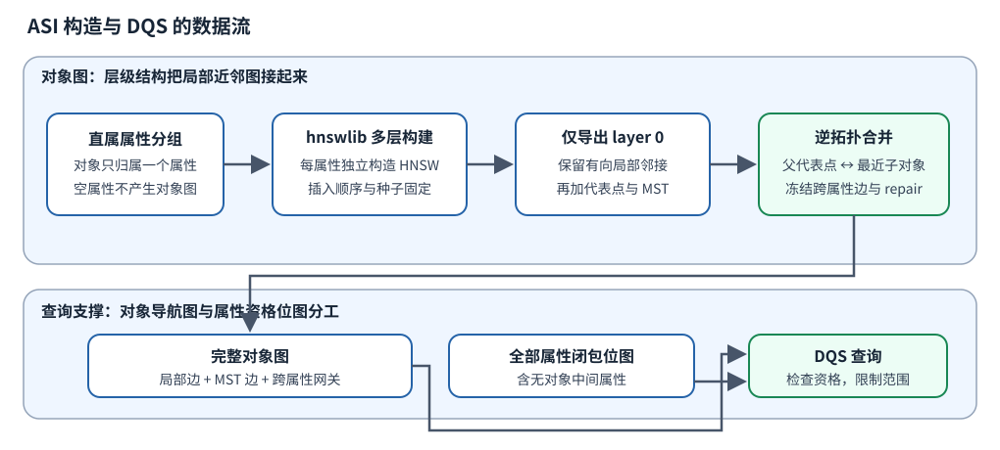
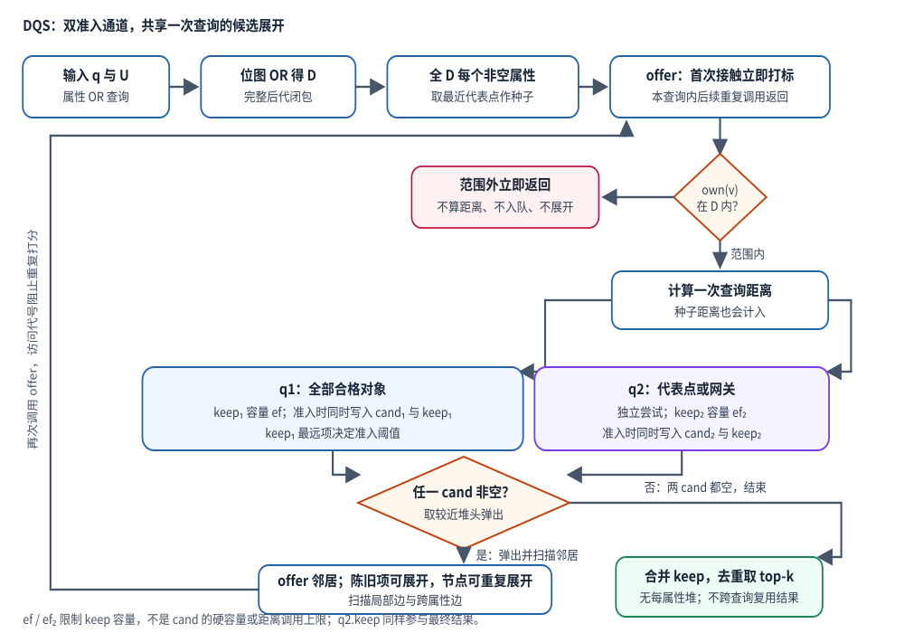
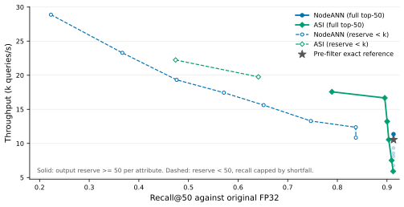
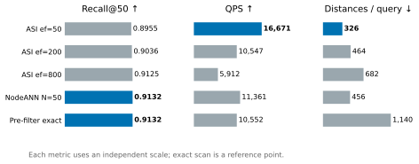
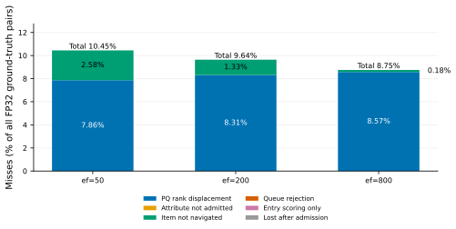
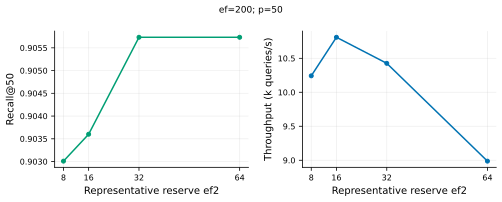
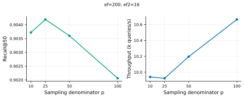
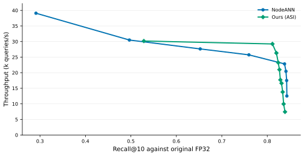

# ASI：面向层级属性 DAG 的属性骨架索引与 DQS 检索

本文说明 **ASI（Attribute-Skeleton Index，属性骨架索引）** 如何把属性内近邻图、跨属性网关和属性闭包组合起来，以及 **DQS（Dual-Queue Search，双队列检索）** 如何在一次查询中使用它们。实验图中的 `NodeANN+` 指当前 ASI+DQS，正文统一简称 ASI；`NodeANN` 指每非空属性一张独立 HNSW 的对照基线。阅读不要求预先了解 HNSW；关键是分清两张图：属性之间的包含关系，以及对象之间用于搜索的近邻关系。

**实现依据**：[活跃源码 `attr_skeleton_bench.cpp`](../../codes/dag-ann-search/src/attr_skeleton_bench.cpp)。ASI 加 DQS 是实验图中的 **ASI（NodeANN+）**。问题口径见 [problem_def.md](problem_def.md)，数据准备见 [prepare_pq.py](../../codes/dag-ann-search/scripts/prepare_pq.py) 与 [prepare_large.py](../../codes/dag-ann-search/scripts/prepare_large.py)。下文将当前实现与目标设计分开陈述，实验图使用 [2026-11-07 当日目录](2026-11-07-exps/)。历史实现与旧实验不能替代当前代码的证据。

## 1. 查询究竟在找什么

### 1.1 属性图决定资格，向量距离决定名次

设属性集合为 $C$，属性 DAG 为 $G_C=(C,E_C)$。边 $a\to b$ 表示 $b$ 是 $a$ 的子属性。DAG 是有向无环图：允许一个属性有多个父属性，但不允许沿父子边绕回自身。

每个对象 $o\in O$ 有唯一直属属性 $own(o)\in C$，并有一个向量 $v(o)$。唯一直属属性不妨碍多祖先继承。例如对象直属 F，F 同时属于 A 与 B，则查询 A 或查询 B 都应包含该对象；不需要复制对象，也不应重复计数。

查询输入为向量 $q$、属性集合 $U$ 与返回条数 $k$。$U$ 使用 OR 语义，其资格范围为包含自身的后代闭包：

$$D=\operatorname{Desc}^{+}(U),\qquad E(U)=\{o\in O:own(o)\in D\}.$$

返回 $E(U)$ 中与 $q$ 的平方 L2 距离最小的 $k$ 个对象，若合格对象不足 $k$ 个则返回全部合格对象。平方 L2 为 $d(q,v)=\sum_j(q_j-v_j)^2$，排序时无需开方。

### 1.2 一个包含 12 个对象的例子


**图 1　属性包含关系与对象直属归属。** 箭头向下表示父属性包含子属性。六个属性各有两个示例对象，直属对象总数为 12。对象名称只用于讲解，不代表真实实验的对象 ID。

直属对象集为 $S_R=\{r_1,r_2\}$、$S_A=\{a_1,a_2\}$、$S_B=\{b_1,b_2\}$、$S_C=\{c_1,c_2\}$、$S_E=\{e_1,e_2\}$、$S_F=\{f_1,f_2\}$。

- $U=\{A\}$：$D=\{A,C,F\}$，合格对象为 $\{a_1,a_2,c_1,c_2,f_1,f_2\}$，共 6 个。
- $U=\{B\}$：$D=\{B,E,F\}$，合格对象为 $\{b_1,b_2,e_1,e_2,f_1,f_2\}$，共 6 个。
- $U=\{A,B\}$：合格对象为两集合的并集，共 10 个。共享属性 F 的两个对象只计一次；查询 R 的闭包才覆盖全部 12 个对象。

**为什么保留 DAG，而不直接用 trie？** trie 是按路径共享前缀的树，同一节点只有一个父。若把 F 只放在 A 下，B 的后代查询会漏掉 F；若在 A 与 B 下各放一份 F，则需要维护别名、对象去重与重复更新。当前实现直接保存多父关系，并在闭包位图中做集合并，避免把路径出现次数误当作不同属性或不同对象的数量。

### 1.3 CCS 结构与 SIFT 向量来自两个来源

当前工作负载将 CCS（ACM Computing Classification System）分类结构及 SciHTC 的直属标签，与 SIFT 128 维向量按对象序号绑定。CCS 是计算机文献的分类体系，SIFT 是图像局部描述子。**本实验没有把论文摘要编码为 SIFT，也没有证明 SIFT 的几何距离与 CCS 的语义层级相关。** 它检验真实层级形状、标签分布与多父闭包下的检索机制，不能据此声称已完成真实论文语义检索。

原始结构与标签出处可从 [CCS 官方页面](https://dl.acm.org/ccs)、[SciHTC 仓库](https://github.com/msadat3/SciHTC) 和 [本地数据背景记录](2026-10-27-ccs-background-and-data.md)追溯。活跃工作负载的本地元数据为 `work/dag-scope/workload-run1/meta.json`：1,929 个属性、2,040 条父边、103 个多父属性、168,937 个对象；每个保留下来的标签对象贡献一个直属终端属性。早期背景记录使用过不同的解析与清洗口径，不能把其中节点数、对象数直接拼入本轮实验。

数据准备有两条需要区分的操作：

1. [prepare_large.py](../../codes/dag-ann-search/scripts/prepare_large.py) 读取原标签列表和 SIFT 的 `train`/`test`。对象数不超过标签数时沿用标签前缀；扩展到更大规模时，使用固定种子 20261105 从原标签列表有放回抽样，保留经验频率分布。该扩展不引入向量与标签的语义相关性。
2. [prepare_pq.py](../../codes/dag-ann-search/scripts/prepare_pq.py) 在原始向量上训练 PQ，并从原始 FP32 向量生成 GT。默认 PQ 为 $m=16$ 个子空间、每个子空间 256 个码字，训练抽样上限 100,000、k-means 12 轮；抽样种子 7，各子空间种子为 $100+j$。实际调用参数仍以本轮运行记录为准。

PQ 码为每对象 16 字节，原始 128 维 FP32 为 512 字节，二者的**向量载荷**之比为 32。活跃 C++ 直接加载 PQ 还原后的 128 维 float32，并用普通平方 L2 建图和搜索，没有在 PQ 码上执行查表距离。因此 32 倍不能描述为该可执行程序的实际驻留内存压缩比，图边、位图、码本与还原缓冲区也不能省略。

向量文件为本地 `datasets/sift-128-euclidean.hdf5`；其公开格式与数据说明见 [ANN-Benchmarks 的 SIFT 数据条目](https://github.com/erikbern/ann-benchmarks#data-sets)。准备脚本将第 $i$ 个直属标签与 `train[i]` 绑定，查询向量取 `test[j]`；该序号配对仅构成实验工作负载，不表达语义对应。实际搜索用的 `orig.bin`、`recon.bin`、`queries.bin` 与标签文件哈希见当日协议，本文不把公开无过滤的近邻真值直接用于属性约束查询。

## 2. 为什么需要统一对象图

在属性范围内做近邻查询，有两条容易实现的参照路线。

**先筛选再扫描。** 枚举全部合格对象，计算其距离并取 top-k。它在所用搜索向量上没有图搜索损失，代价随 $|E(U)|$ 增长，是辨别“图搜索误差”与“向量表示误差”的参照。

**每属性单独建 HNSW，再合并结果（NodeANN）。** HNSW 是以近邻边导航的分层图索引，先在稀疏上层定位，再在较密的底层搜索。NodeANN 对 $D$ 中每个非空属性的直属对象图独立搜索，各出 top-N 后统一归并。每个属性有自己的搜索状态与预算；当查询包含多个属性时，要付出多次入口定位与队列维护成本。它作为基线保留，不是 ASI 的主查询路径。

ASI 把直属对象图接入一张统一对象图，一条查询共享搜索状态，不给每个属性单独建立结果堆。跨属性边提供导航路径；属性闭包位图限制可访问范围。当前采用全闭包多种子初始化，因而跨属性边的贡献还必须与“每属性已有入口”的贡献分开评估。



**图 2　当前 ASI 的构建与查询依赖。** 局部图和跨属性边连接对象；闭包位图连接的是资格判断逻辑，不是新增一层向量近邻图。

## 3. 阶段一：构造属性内局部图

### 3.1 先构建多层 HNSW，再只导出 layer 0

对每个非空直属集合 $S_a$，当前 `build_attr_graph` 调用 hnswlib 构建完整的多层 HNSW，插入顺序为该属性成员列表顺序，种子为 $100+i$，其中 $i$ 为本次运行的属性内部编号。随后只导出每个对象的 **layer 0 邻接表**；高层边和高层导航结构不进入 ASI 查询。

因此“单层局部图”的准确含义是**查询时使用的图为单层**，不能写成“完全没有构建上层”。这也不能推出与 NodeANN 搜索等价：后者可以利用保留的 HNSW 上层定位，ASI 改用代表点选择入口。

近邻图的邻接表应按**有向出边**理解。HNSW 插入会尝试反向连接，但邻接表独立剪枝后，$u\to v$ 不必总伴随 $v\to u$。当前代码原样导出底层邻接，没有把它补成无向图。参数 $M$ 也不能直接当作最终 ASI 总出度上界：HNSW 底层有自身的邻接容量规则，后续 MST 和跨属性边还会继续增加边。

### 3.2 代表点如何选择，数量究竟是多少

代表点是直属对象中的若干真实对象，不是质心，也不是额外合成的向量。对非空属性 $a$，设 $n_a=|S_a|$，调用点计算：

$$K_a^{\mathrm{req}}=\max\!\left(1,\min\!\left(K_{\mathrm{cap}},\left\lfloor\frac{n_a}{p}\right\rfloor+1\right)\right),\qquad K_a=\min(n_a,K_a^{\mathrm{req}}).$$

源码中的 $p$ 至少为 1。空属性不生成代表点；单对象属性直接以该对象为代表。这个公式在 $n_a$ 恰好为 $p$ 的整数倍时，与 $\lceil n_a/p\rceil$ 不同。例如 $n_a=p$ 时请求 2 个代表点，而非 1 个；不能用向上取整替代原式。

选择策略为 farthest-first：第一个代表点取局部编号 0，以后每轮选择到已选集合最近距离最大的对象：

$$r_1=S_a[0],\qquad r_{t+1}\in\arg\max_{x\in S_a}\min_{1\le j\le t}d(v(x),v(r_j)).$$

这希望在几何上覆盖不同方向。当前实现没有显式排除已经选过的局部编号；若向量完全重合等导致最大最小距离为 0，代表点列表可能重复，公式给出的是列表长度，不能无条件解释成不同对象的数量。该策略也没有提供任意查询下的召回保证。

### 3.3 只在代表点上补一棵 MST

MST（minimum spanning tree，最小生成树）用尽量小的总边权连接代表点集合。当前代码在同一属性的代表点之间以平方 L2 为边权执行 Prim 式构造，将选中的每条树边双向加入局部邻接表。

**MST 连接的是代表点，不是该属性的全部对象。** 它能给不同代表点提供显式连接，但不能保证所有普通对象都能从代表点沿有向底层边到达。MST 边加入后没有重新剪枝，也没有统一去重；后文的邻接扫描成本必须考虑这一点。

旧文档描述的“孤立对象逐一补边、检查全部连通分量再互连”不在当前活跃执行路径中。当前不能宣称已完成通用的属性内连通性修复。

## 4. 阶段二：按逆拓扑序建立跨属性网关

### 4.1 网关是最近的子对象，不要求是子代表点

构造先对属性 DAG 拓扑排序，再反转顺序，使子属性先于其祖先处理。对于非空子属性 $c$，寻找可连接的非空父侧属性 $a$：直接父有对象时使用直接父；直接父为空时沿该分支继续向上，遇到非空祖先即停在该祖先。多父分支分别处理，当前上溯循环最多 8 轮。

对每个父侧代表点 $r\in R_a$，在**子属性的全部直属对象**中精确选取最近对象：

$$g(r,c)\in\arg\min_{x\in S_c}d(v(r),v(x)).$$

向独立跨属性邻接表加入 $r\to g(r,c)$ 与 $g(r,c)\to r$，并将子侧对象标为网关。网关可能已经是代表点，也可能是普通对象。DQS 的第二通道接收两者。


**图 3　最近对象网关与空祖先回退。** 虚线表示属性 DAG 关系或角色说明，粗双向线表示对象图中的冻结跨属性边。跨过空属性建立边并不删除空属性，资格闭包仍然经过它。

在 12 对象例中，父侧代表点 $a_1$ 可能连向 F 中的 $f_2$。即使 F 的起始入口是 $f_1$，$f_2$ 也能因为网关身份进入 $q_2$。F 同时为 A、B 的后代，因此分别处理两条父分支；$f_2$ 即使被多个父代表点选中，仍只有一个对象身份。

### 4.2 当前是冻结加边，未实现“只替换原始边”

“逆拓扑合并”在当前源码中的实际动作是上述网关加边。它没有将每个子代表点与每个父代表点全连接，也没有在每轮合并后重建双方的近邻表。

当前执行路径有两条明确规则：

- **新合并边冻结，不参与剪枝。** `gbr` 独立保留跨属性邻接。
- **原始局部边保留，MST 边也保留。** 当前没有用冻结边挤掉部分原始邻居，`n_intra_dropped` 固定为 0。

虽然源码还保留 `Rdeg=16`、`PPROT` 与 `rep_prune` 等声明，`rep_prune` 没有在该路径调用。日志中的 `degree cap 16` 不能被解读为最终度数保证。多父、大扇出或重复加边都可能增加实际出度与槽位扫描量。

**目标设计**可以考虑冻结必要合并边、只从原始边中选择替换对象，以约束总度数；这属于未实现设计，不能用于解释当前实验的速度或连通性。代表点之间的邻域更新与其正确性也需单独定义和验证。

### 4.3 兜底 repair 做了什么，没做什么

主合并后，代码计算一个代表点层面的入边计数：只统计“源是其他属性代表点、目标也是本属性代表点”的跨属性边。对该计数为 0 的非空属性，向上寻找最近的一个非空祖先，把双方代表点两两双向连接。

该检查不等同于“属性没有任何入口”：主合并可能已经连到了普通网关，但普通网关不被上述代表点入边计数识别。因此 repair 可能在已有网关的属性上继续加边。它也不检验范围内对象图的强连通性，不修复所有属性内有向分量；没有可用非空祖先时则不加边。

需要特别区分：当前 `--no-merge` 只跳过主合并循环，**repair 仍会执行**。该参数对应“去掉主网关合并、保留兜底修复”，不能直接命名为“无跨属性边”。

### 4.4 为什么不能声称任意范围都连通

祖先与子属性间存在边，只说明部分对象有直接连接。任意 $D$ 内从指定种子到所有合格对象的可达性，还取决于局部有向图、网关位置、空属性、查询范围以及导航预算。即使一张无预算 BFS 对某几条查询访问到了全部非空属性，也只能说明这些查询上的**属性级覆盖**，不能证明所有对象都可达，更不能证明有限预算时具有高召回。

源码 `--diag` 仅检查前至多 5 条查询：从查询输入属性的代表点出发，在范围内遍历后统计访问到的属性。若查询输入属性本身为空，它不会自动为该属性找后代种子。这一诊断与当前全 $D$ 种子检索不同，也不是通用连通性证明。

## 5. 阶段三：为全部属性构造闭包位图

对每个属性 $a\in C$ 存储一个 $|C|$ 位位图：

$$\mathrm{desc}[a]=\{a\}\cup\bigcup_{c\in children(a)}\mathrm{desc}[c].$$

当前通过 DFS 的后序合并计算，并缓存已完成属性的结果。查询时对 $U$ 中各属性位图按位 OR 得到 $D$。多父共享的 F 只占一个位，天然去重。

位图的属性全集来自 DAG 的全部边端点和对象直属属性，**不能只枚举非空属性**。否则空中间属性会从结构中消失，祖先到深层属性的闭包传播将错误。图 3 的空属性 X 不挂对象，但仍须参与闭包传播。

三种操作共用这个位图：枚举 $D$ 中的非空属性以建立种子；判断候选对象是否合格；阻止范围外对象进入后续搜索。`offer` 在计算向量距离之前就检查资格，范围外对象不算距离、不入队、不展开邻居。但是指向它的邻接槽位仍可能已被扫描，所以“未访问范围外对象”不能解释为“完全没有读到范围外边”。

若 $A=|C|$、$W=\lceil A/64\rceil$，闭包位图载荷为 $8AW$ 字节。$A=1,929$ 时 $W=31$，载荷为 478,392 字节，约 0.456 MiB；这不含容器与其他索引结构开销。并集计算约需 $|U|W$ 次字操作。

## 6. DQS：一个查询共享的双通道搜索

### 6.1 两条通道，各有 cand 与 keep

DQS 为**整条查询**维护两条通道，不为每个属性维护一套队列。

| 通道 | 准入对象 | `keep` 容量 | 作用 |
|---|---|---:|---|
| $q_1$ | 所有合格对象 | $ef$ | 一般近邻探索与结果保留 |
| $q_2$ | 合格的代表点或网关 | $ef_2$ | 给骨架对象独立的保留与探索通道 |

每条通道都包含两个不同用途的堆：

- `cand` 是待展开候选堆，优先弹出到查询最近的对象，决定下一次扫描谁的邻居。
- `keep` 是保留集，堆顶为当前最远对象。未满时直接接收；已满时，只接收比最远对象严格更近的对象，并淘汰原最远者。它既给出准入阈值，也参与最终结果输出。

**$ef$ 与 $ef_2$ 限制 keep，不是 cand 的硬容量，也不是距离调用次数。** 准入时同时写入相应 `cand` 和 `keep`。当前实现没有在 `keep` 淘汰对象时删除其 `cand` 条目，故候选堆可能保留已淘汰的陈旧项。当前循环也没有“cand 最近距离超过 keep 最差距离就停止”的标准 beam 终止条件，而是处理到两个 cand 都空。



**图 4　当前 DQS 的准入、展开与输出。** 两条通道共享本查询对象标记和属性范围；独立准入意味着对象可同时进入两个 cand。

### 6.2 种子来自全闭包，不只来自查询输入属性

**当前实现**枚举 $D$ 中每个非空属性，逐个比较其代表点与 $q$ 的距离，选最近代表点调用 `offer`。这些入口共享上述双通道，不产生每属性结果堆。图 1 中查询 A 会为 A、C、F 各建立一个种子；并非只在 A 进入后完全依靠骨架抵达 C 与 F。

**目标设计**是仅从查询输入属性 $U$ 的入口启动，然后沿结构边找到其后代。下文称“root-only”时，root 指本次查询指定的属性，不一定是整个 DAG 的根 R。当前可执行程序没有 root-only 模式；空输入属性如何找到合适后代入口也尚未实现，不能将历史单入口结果标为当前实现的模式。

全 $D$ 种子能直接接入更多属性，但初始化成本随 $D$ 中非空属性数量和代表点数增长。它可能掩盖骨架自身的导航不足。若主张“仅靠跨属性骨架就可到达所有后代”，需要另有 root-only 实现与相应测量，不能用当前多入口结果代替。

### 6.3 一次 offer 与一次展开分别做什么

以下伪代码对应活跃实现的顺序：

```text
D ← OR(desc[u] for u in U)
初始化本查询的 q1.cand/keep、q2.cand/keep 与访问代号

函数 offer(v):
    若 v 已带本查询代号：返回
    立即为 v 写入本查询代号
    若 own(v) 不在 D：返回
    计算 d(q,v)，记录所在属性为 touched
    独立尝试进入 q1；成功则写入 q1.cand 与 q1.keep
    若 v 是代表点或网关：独立尝试进入 q2
    任一通道准入成功，则记录所在属性为 entered

对 D 中每个非空属性：选最近代表点，调用 offer
当任一 cand 非空：
    弹出两个 cand 中距离较近的堆头 v
    扫描 v 的局部邻接与跨属性邻接，对每个目标调用 offer
结果 ← 两个 keep 的并集，按对象 ID 去重，按距离取前 k
```

同一个对象可以同时被两个通道准入，当前没有“已展开”位，也没有弹出时的陈旧检测，因此它可被**展开两次**。在 `offer` 层，对象首次接触即打标记，即便两个通道都拒绝它也不会重试。后续重复边或重复展开不会再次为同一对象计算 `offer` 距离，但会再次扫描邻接槽位、调用 `offer` 并检查标记。一个对象至多各入两个 cand 一次；这与“cand 始终不超过 ef”是两回事。

$q_2$ 的尝试不是 $q_1$ 拒绝后的 fallback，而是对代表点或网关**独立执行**。最终结果也包含 $q_2.keep$，不是只用它做导航后丢弃。若 $ef$ 与 $ef_2$ 都小，合并去重后的结果可能不足 $k$，这本身会降低召回。

### 6.4 距离计数不等于不同对象数

当前 `dists_per_q` 包括种子选择和 `offer` 的距离。选种子时先算一次默认入口，再遍历所有代表点；默认入口与第一个代表点都是局部对象 0，会被重复比较。选出的种子进入 `offer` 时又算一次距离。因此“共享访问标记”只保证 `offer` 对同一对象不重复算距离，不能说整条查询的每个对象最多只算一次距离。

当前没有每属性 top-k 结果堆，也没有先各搜满预算再合并的 NodeANN 主路径。各查询新建候选/保留堆、输出和属性诊断集合；共享访问数组通过递增代号实现逻辑隔离，位图每条查询清零。复用索引、数组存储和运行内数据文件不等于复用前一条查询的结果；当前没有跨查询结果或距离复用。

## 7. 哪些是实现事实，哪些仍是设计目标

| 议题 | 当前活跃路径 | 不能据此声称的结论或未实现目标 |
|---|---|---|
| 属性关系 | 保留多父 DAG，闭包按属性位去重 | 单父 trie 与 DAG 语义等价 |
| 局部图 | hnswlib 多层构建，导出 layer 0，代表点 MST 加边 | 从未构建上层；所有局部对象互相可达 |
| 代表点数 | $\max(1,\min(K_{cap},\lfloor n/p\rfloor+1))$，再受 $n$ 限制 | 使用 $\lceil n/p\rceil$；列表必然无重复 |
| 跨属性合并 | 逆拓扑序，父代表点接最近子对象，双向冻结 | 父子代表点全连接后 RNG 重排；最终出度不超过 16 |
| 原始局部边 | 全保留 | 已实现只替换原始邻居的度控制 |
| repair | 代表点入边计数为 0 时连接一个非空祖先 | 修复了所有对象分量，或证明任意闭包内连通 |
| 查询入口 | 全 $D$ 中每个非空属性选最近代表点 | 当前已实现 root-only 导航 |
| 搜索预算 | 两条共享通道的 keep 分别受限 | 单候选堆；cand 硬容量；硬距离预算 |
| 向量与 GT | PQ 还原向量搜索，原始 FP32 GT | 某个实测 recall 是所有近似算法的硬上限 |

[problem_def.md](problem_def.md) 区分了查询语义、目标设计和本轮原型评测口径：目标为从查询子树根入口导航；当前实现采用全闭包多种子、双通道和严格 ID 命中计分。本轮结果只适用于后者，不能作为 root-only 设计完成的证据。

## 8. 实验如何定义，读数说明什么

### 8.1 公共输入与对齐条件

主规模为 168,937 个对象，SIFT 128 维，主口径 $k=50$（§9.6 另有 $k=10$ 复核），对齐查询前缀与属性 OR 闭包。1M 使用经验标签分布扩展，是另一个规模条件，不能把两者的选择率和 QPS 混为同一行。原 workload 文件含有比基准更多的查询，实际测量数量由 `--queries` 和向量查询文件共同确定。

所有比较必须同时对齐：对象与归属、属性 DAG、查询顺序与范围、搜索向量、原始 GT、$k$、距离实现、编译选项、线程与绑核条件。常用局部构造配置为 $M=16,efC=200,K_{cap}=8,p=50$；$ef$、$ef_2$、$p$ 的实际扫描值以图和当日记录为准。源码的默认 $ef_2=16$ 不代表实验必然使用 16。

Pareto 图每方法只画一条曲线：该方法的全部实测配置按严格支配关系筛选后连接，未拟合、未外推。两条曲线的左段都含有输出容量小于 $k$ 的配置（ASI 为两个 keep 的并集 $ef+ef_2$，NodeANN 为每属性预算 $N$），这类点的召回被“返回条数不足 $k$”压低，因此不能与右端的满容量点等同解释；数据文件把这些点标为 `capacity_limited`。

NodeANN 的两个参数作用不同：$N$ 只决定每个属性返回多少候选，不改变 HNSW 搜索宽度；$ef$ 决定搜索宽度，代码取 $\max(ef,N)$。只扫 $N$ 时距离调用恒为 455.5 次/查询，吞吐几乎不动，而 $N\ge50$ 后召回已固定，故满容量区内只剩一个非支配点。要读出 NodeANN 的 trade-off，必须让 $ef$ 与 $N$ 一起下降（$ef=N=5,\dots,40$）。

构建不进入查询 QPS。本轮 [协议元数据](2026-11-07-exps/data/scheme-protocol.json) 固定 CPU 2、单线程，编译为 `-O3 -fno-tree-vectorize -fno-tree-slp-vectorize -DNO_MANUAL_VECTORIZATION`，双方距离内核共用 `RawL2Space`。逐查询累计闭包求解、种子选择、搜索及结果排序去重的时间；GT 命中评估、oracle 全扫描与 trace 写盘在计时外。代码、可执行文件与输入数据的哈希保存在该协议文件中。先前 HNSW 参照仅禁用编译器自动向量化，没有禁用 hnswlib 手写 SSE，不能直接与本轮标量结果比较。绑核不等于独占 CPU；WSL 频率未锁定，吞吐仍受系统负载影响。

### 8.2 GT 文件与召回口径

本轮 `gt_50.txt` 有 40,000 字节，对应 $200\times50\times4$ 字节 int32。独立逐查询原始 FP32 全范围扫描得到的 oracle 与文件中的 8,444 个 GT ID **全部一致**。本轮核对确认加载文件与 GT 语义、dtype 相符；文件生成规则与其他脚本可能不同，不能仅按路径或脚本推断已使用的数据。

令 $T_i$ 为第 $i$ 条查询的非负 GT ID 集合、$R_i$ 为输出去重后的对象集合。当前可执行程序报告聚合 ID 命中率：

$$\mathrm{recall}_{\mathrm{ID}}=\frac{\sum_i |T_i\cap R_i|}{\sum_i\min(k,|T_i|)}.$$

它没有读取第 $k$ 名的原始距离阈值，也没有将边界同距的其他 ID 认作等价命中，故**不是一般意义的 ties-aware 计分**。查询合格数都至少为 $k$ 时，该聚合值等于每查询 recall 的平均；否则二者不能混称。空 GT 查询不增加召回分母；QPS 仍以查询数乘轮数为分子。

对 PQ 还原向量做范围内精确扫描，可得到一个可复核的**表示参照**：它反映还原距离排序相对于原始距离 GT 的重合度。有限预算图搜索还会叠加漏访与候选保留损失，但某些近似输出也可能偶然保留原始 GT 中的对象、超过还原向量精确 top-k 的 ID 重合度。因此该参照不构成所有近似算法的数学硬上限，更不应称为“物理上限”。

当日追踪固定 $ef_2=16,p=50,K_{cap}=8$，比较 $ef\in\{50,200,800\}$；完整命中数与 recall 保存在 [追踪汇总](2026-11-07-exps/data/miss-attribution.json)，并由图 7 展示。PQ 还原向量的 exact top-50 与 FP32 GT 有 7,711 个 ID 重合，$7,711/8,444=0.913193$。近似输出还找回过 PQ-exact top-50 之外的 FP32-GT ID，具体数量记录在 `pq_recovered`，因此该数值只作为 exact 排序重合参照。

### 8.3 成本指标

- **QPS**：计时区间内的查询总数除以墙钟秒，单位 queries/s。本轮主曲线每点运行 3 个独立进程，每进程内重复 3 轮，每轮 200 查询；共 9 批。跨进程汇总使用总查询数除以总墙钟时间，等价于等查询量下三次进程 QPS 的调和平均。消融每点为 1 个进程、进程内 3 轮，不提供跨种子置信区间。
- **距离/查询**：运行期间累计的查询距离调用数除以查询总数；不包含索引构建距离。ASI 的种子筛选重复距离计入其中。
- **邻接槽位扫描数**：每展开一个对象，读取其局部及跨属性邻接表的每个目标槽位即计一次；重复边、重复展开、已访问或越界目标也计入。当前活跃文件的 JSON 没有输出该字段，不能从距离数反推出精确槽位数。
- **`attrs_in_D`**：合格闭包中非空直属属性数。空结构属性仍在位图中，但不增加此项。
- **`attrs_touched`**：至少有一个合格对象被 `offer` 计算过距离的属性数。
- **`attrs_entered`**：至少有一个对象被任一 keep/cand 准入的属性数。它不等于所有对象已访问，也不等于某对象已经弹出展开。

对象级阶段不合并称作“访问”：`first-touch` 表示邻接目标首次进入 `offer` 并写入本查询代号；它可以随后因超出 $D$ 而立刻返回。`evaluated` 表示范围内对象在普通 `offer` 中计算过距离；种子选择时的代表点比较另记为 `seed_evaluated`，可能与普通计算重复。`admitted` 表示对象至少成功进入一个通道的 keep/cand；`expanded` 表示对象从某个 cand 弹出并扫描邻接槽位。同一对象可在两通道各展开一次。范围外 first-touch、距离计算、队列准入与邻接展开是不同事件；`attrs_touched`、`attrs_entered` 只分别汇总到属性层级。

### 8.4 漏召回归因必须按追踪顺序解释

本轮图和 `data/miss-attribution.json` 使用六类**操作性互斥归因**，以未命中 FP32 GT 条目为对象，按优先级先归因 PQ exact 排序位移，再检查属性准入、距离计算、队列准入与最终输出。`data/miss-attribution-per-query.jsonl` 保存逐查询计数。令 PQ exact top-50 为搜索表示上的参照集合；类别顺序与判定如下。

| 类别 | 判定 | 解释 |
|---|---|---|
| `quantization` | GT 条目不在同一范围内 PQ exact top-50 | 相对于 PQ exact 的排序位移类别；这里是优先级归因，不等于量化与导航因果可分 |
| `attribute_unentered` | 属于 PQ exact top-50，但所在属性没有对象被队列准入 | 按属性准入阶段计数 |
| `not_navigated` | 属性已有准入对象，GT 对象既不在 `evaluated` 也不在 `seed_evaluated` | 属性被接入不代表这个对象已被计算距离 |
| `rejected` | GT 对象在 `evaluated` 中，但不在 `admitted` 中 | 已通过 `offer` 算距离，却从未成功进入任一通道；不包括只算种子距离 |
| `entry_score_only` | GT 对象只参加入口/种子距离比较，未作为搜索队列中的对象被评估 | 单独区分 seed-only 距离，不能将其称作搜索导航已访问 |
| `lost_after_admission` | GT 对象曾准入，但未进入最终去重 top-k 输出 | 含 keep 被淘汰或结果并集排序后未入 top-k |

六类按优先顺序每个未命中 GT 只计一次。PQ exact top-50 以外的 GT 即使也有导航问题，也先计入 `quantization`，故这是归因约定，不是因果实验。全 GT 分母上的比例存于 `all_gt_percent`；只在漏项分母上的比例存于 `missed_only_percent`。二者不能互换。`attrs_touched` 表示计算过距离的属性；`entered_attrs` 表示至少一个对象成功准入的属性，前者不蕴含后者。两项在逐查询 trace 中分别保存。

本轮三档均有 `attribute_unentered=0`、`rejected=0`、`entry_score_only=0`、`lost_after_admission=0`；未命中项因此落在 PQ exact 排序位移与“属性已有准入但 GT 对象尚未计算距离”两类。全部计数与两套分母比例见 [汇总 JSON](2026-11-07-exps/data/miss-attribution.json)，逐查询轨迹见 [JSONL](2026-11-07-exps/data/miss-attribution-per-query.jsonl)。可按 `hits + 各类 misses = gt` 核对每档的分割。这些操作性归因不证明任意范围可达，也不代表其他参数或查询分布上的结果。

## 9. 当日图表与可复核的比较问题

本节展示 [2026-11-07](2026-11-07-exps/) 的九张图与 [2026-11-08](2026-11-08-exps/) 的 top-10 复核图。[主曲线汇总](2026-11-07-exps/data/scheme-summary.json) 保存全部实测点；[原始运行记录](2026-11-07-exps/data/scheme-measurements.jsonl) 保存命令、输出与消融值；[Pareto 点选择](2026-11-07-exps/data/pareto-selection.json) 可复核哪些点被支配。图展示测量，前述算法说明以活跃源码为准。root-only、总度控制或完整连通性保证均不能由这些图推出。

### 9.1 Recall 与吞吐的 Pareto 比较



**图 5　Recall–throughput Pareto，$k=50$。** 每条线是一个方法在全部实测配置上的严格非支配点，无拟合与外推。两线在约 0.474 处相遇；更低的召回只有 NodeANN 有点（从 0.2229/28,883.3 开始），0.474 到约 0.90 之间 ASI 在上方，交叉点落在 ASI $ef=50$ 的 0.8955/16,670.5 与 $ef=200$ 的 0.9036/10,547.3 之间，之后 NodeANN 更高。交叉处两点的召回相差约 0.002：NodeANN $ef=N=15$ 为 0.4762/19,325.8 QPS，ASI $ef=20$ 为 0.4741/22,236.8。顶端 NodeANN $N=50$ 为 0.9132/11,361.3，ASI $ef=800$ 为 0.9125/5,911.8。曲线左段含容量不足 50 的配置：NodeANN $ef=N=5\ldots40$（如 0.2229/28,883.3）与 ASI $ef=20,30$（$ef+ef_2$ 分别为 36、46），其召回受返回条数限制，不能与右端满容量点混读。顶点处 NodeANN 领先的原因是本工作负载每属性平均约 220 个对象，$ef=50$ 已接近穷尽该属性；该交叉不推广到属性规模更大的数据。

### 9.2 指标概览：召回、吞吐与距离调用



**图 6　五个工作点的并排指标概览。** 各列各用独立尺度，蓝色标出该列最优值。ASI 从 $ef=50$ 到 800，距离调用从 326.0 增至 681.9，recall 从 0.895547 升至 0.912482，QPS 从 16,670.5 降至 5,911.8。NodeANN $N=50$ 的 recall 为 0.913193、距离调用 455.5、QPS 11,361.3；Pre-filter 的距离调用 1,140.2，QPS 约 10,551.8。距离更少不保证延迟同比例下降；当前未报告邻接槽位数，不能由距离数推断槽位扫描量。计数排除构建距离，并按全部查询批次归一化；旧的 1,448 次/查询不属于本轮对齐基线。

### 9.3 未命中项在什么阶段丢失



**图 7　GT 条目归因。** 六类互斥标签、优先级与分母见 §8.4 及 [机器可读汇总](2026-11-07-exps/data/miss-attribution.json)。图以全部 8,444 个 GT 条目为分母；零值类别在数据文件中仍显式记录。优先级量化类与导航损失可能重叠，不能将其解释为因果分解。

### 9.4 第二通道容量 $ef_2$



**图 8　$ef_2$ 消融。** 固定 $ef=200,p=50,M=16,efC=200,K_{cap}=8$，改变 $ef_2\in\{8,16,32,64\}$。recall 从 0.9030（8）升至 0.9057（32、64），QPS 则从 10.94k 降至 9.16k；在这四个单进程、三遍测量点中，32 到 64 没有观察到 recall 增长。CLI 将 `--ef2` 截断至至少 1，故消融没有真正关闭 $q_2$。该套每点一个进程，不提供跨种子置信区间。

### 9.5 代表点密度参数 $p$



**图 9　$p$ 消融。** 固定 $ef=200,ef_2=16,M=16,efC=200,K_{cap}=8$，比较 $p\in\{10,25,50,100\}$。recall 分别为 0.9037、0.9042、0.9036、0.9021，已测范围相差约 0.0021；QPS 在约 9.85k–10.64k 间非单调变化。这些点是一进程三遍，不能据此声称小 $p$ 普遍提高吞吐或召回。较小 $p$ 通常请求更多代表点，但受 $K_{cap}$ 截断；它同时改变种子比较、局部 MST、父侧网关与 repair 边。

### 9.6 top-10 口径复核

同一对象集、同一批查询、同一编译与距离内核，把 $k$ 改为 10 重跑，参数网格随之围绕 $k$ 重设（ASI $ef\in[5,400]$；NodeANN 耦合 $ef=N\in\{2,\dots,30\}$）。真值文件取 `gt_50.txt` 的每查询前 10 列，并由 FP32 全范围扫描逐查询断言与文件内容相等（200 条全部通过）；有效条目 1,951，17 条查询合格数不足 10。完整数据见 [当日记录](2026-11-08-exps/report.md)。

| 项 | $k=50$ | $k=10$ |
|---|---|---|
| PQ 还原向量精确 top-$k$ 与 FP32 真值的 ID 重合 | 7,711/8,444 = 0.913193 | 1,645/1,951 = 0.843157 |
| ASI 满容量曲线 | 0.7891–0.9125，17,567.9–5,911.8 QPS | 0.5284–0.8391，30,164.7–7,430.2 QPS |
| NodeANN 满容量前沿点数 | 1 | 4（0.8380–0.8432，22,822.5–12,513.8 QPS） |
| 顶端同召回附近吞吐 | NodeANN 11,361.3 vs ASI 5,911.8 | NodeANN 12,513.8 vs ASI 7,430.2 |

$k=10$ 下有两点变化。第一，表示上限从 0.913193 降到 0.843157：在漏项分母上 PQ 排序位移占 76.9%（$ef=10$）到 93.8%（$ef=200$），“属性内未导航到”从 22.8% 降到 6.2%。加大搜索宽度的边际收益因此更快被表示误差吃掉。第二，NodeANN 出现了四个满容量非支配点：$N=10$ 时召回 0.8380，尚未触及 0.843157 的天花板，继续增大 $N$ 仍能换取召回；只有到 $N\ge40$ 才饱和。这与 $k=50$ 时 $N=50$ 立刻饱和是同一机制的两种情况，取决于该 $k$ 下每属性搜索是否已经无损。



**图 10　Recall–throughput Pareto，$k=10$。** 与图 5 相同的一点一线规则，只是 $k$ 与真值前缀改为 10，参数网格围绕 $k$ 重设。NodeANN 覆盖 0.2911–0.8432，其中 $N<10$ 的左段容量不足、召回受返回条数限制；ASI 覆盖 0.5284–0.8391，$ef_2=16$ 使最小的 $ef=5$ 也有 21 的输出容量，故整条曲线均为满容量；交叉点移动到约 0.82：ASI $ef=15$ 的 0.8201/26,309.8 仍高于 NodeANN，而 $ef=20$ 的 0.8242/23,234.9 已被略超过。

两臂的适用区间未变但边界移动：召回约 0.81 时 ASI $ef=10$ 为 29,230.6 QPS，NodeANN 在同召回约 23k；召回 0.8390 以上 NodeANN 同时更快且更高（12,513.8 @ 0.8432，而 ASI 最高只到 0.8391/7,430.2）。交叉点位于 0.8201–0.8242 之间，仍由每属性平均约 220 个对象这一事实决定，不能外推到属性基数更大的数据。

## 10. 可证范围与研究边界

在输入确为 DAG、位图完整且对象归属有效的前提下，闭包 OR 与资格判断实现查询的 OR 后代语义。`offer` 在距离计算前拒绝不合格对象，因而所保留结果在范围内。这是范围正确性，不是近邻召回保证。

当前没有证明任意后代闭包中全部对象可从查询入口到达，没有证明有限 $ef/ef_2$ 时的召回下界，也没有总度数硬界。属性级 repair、代表点 MST、多入口初始化与有限查询 BFS 不能相互替代为这些证明。

本轮全部性能点都由全 $D$ 多种子与双通道 DQS 产生，故不能把召回或吞吐差异单独归因于跨属性网关，也不能当作 root-only 或单通道结果。$ef_2$ 消融只调整第二通道容量；它没有禁用 $q_2$，不能分离“骨架导航”与“额外结果保留”两种作用。

本轮数据是 CCS 结构与 SIFT 几何的绑定实验。多属性 OR 的逻辑由闭包支持，但查询属性数量、范围重叠、空属性入口和规模扩展应分别描述其实际覆盖，不能从单一工作负载推广到所有层级过滤查询。当前结果也不构成新颖性或发表状态的证据。

本工作负载每属性平均约 220 个对象，NodeANN 的 $ef=50$ 已接近穷尽单个属性，因此它在表示上限 0.913193 处只需 11,361.3 QPS，而 ASI 到 0.912482 已降到 5,911.8。该交叉只说明在这份数据的对象规模与标签粒度下，顶端由 per-attribute 小图胜出；不能据此认为 ASI 在高召回端普遍更慢，也不能反过来声称它在中段普遍更快。要检验这一点必须换更大基数或更细粒度的工作负载。

## 11. 复现与检查

下列命令从仓库根目录执行，输入沿用现有工作负载；不重新生成向量、标签或真值。

```bash
g++ -std=c++17 -O3 -fno-tree-vectorize -fno-tree-slp-vectorize -DNO_MANUAL_VECTORIZATION \
  -I codes/directory-aware-vector-attr-search/src -I codes/dag-composition-methods/nodeann/hnswlib \
  codes/dag-ann-search/src/attr_skeleton_bench.cpp -o work/attr_skeleton
g++ -std=c++17 -O3 -fno-tree-vectorize -fno-tree-slp-vectorize -DNO_MANUAL_VECTORIZATION \
  -I codes/directory-aware-vector-attr-search/src -I codes/dag-composition-methods/nodeann/hnswlib \
  codes/dag-ann-search/src/nodeann_bench.cpp -o work/nodeann_measured
python3 codes/dag-ann-search/scripts/illustrate_asi.py measure --runs 3
mkdir -p work/asi-evidence
taskset -c 2 ./work/attr_skeleton --dir work/dag-ann --work work/dag-scope/workload-run1 \
  --vec recon.bin --M 16 --efC 200 --p 50 --ef2 16 --efs 50,200,800 --queries 200 \
  --repeat 1 --trace-file work/asi-evidence/trace-ef-50-200-800.jsonl
python3 codes/dag-ann-search/scripts/illustrate_asi.py attribute \
  --trace work/asi-evidence/trace-ef-50-200-800.jsonl
python3 codes/dag-ann-search/scripts/illustrate_asi.py render
```

`scheme-measurements.jsonl` 保存全部配置及命令，`scheme-summary.json` 保存聚合值，`pareto-selection.json` 保存容量排除与支配筛选。归因诊断单独执行，其 QPS 不纳入性能图。每档均校验 `hits + 六类 misses = 8444`，并核对原始 FP32 精确扫描与保存 GT 一致。图形导出为 SVG，结构示意不使用虚构实验距离。
