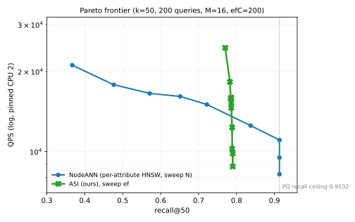
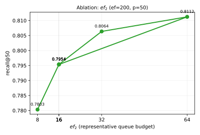
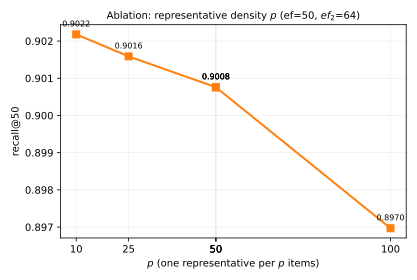

# ASI：属性骨架索引——面向层级属性 DAG 的近邻检索

> 本文档为方案的完整技术描述（覆盖式维护）。问题口径见 `problem_def.md`；实验数据见 `2026-11-05-exps/`。
> 术语：**属性**（attribute）指层级分类体系中的节点；"子树"指该属性的后代闭包。

---

## 1. 问题与动机

### 1.1 场景

数据集由两部分组成：一个层级属性 DAG，以及一批带向量的对象。每个对象挂在**唯一一个属性**上。查询给定向向量 $q$ 和属性集合 $U$，要求返回**$U$ 的后代闭包内**与 $q$ 最近的 $k$ 个对象。

这与常规 ANN 的关键差别：**候选集由结构（属性层级）而非阈值确定**，且这个候选集每次查询都不同、通常只占全库的极小部分（本数据 0.675%）。

### 1.2 为什么不能直接用现有索引

```svg
<svg viewBox="0 0 900 260" width="100%" font-family="sans-serif" font-size="12">
  <text x="16" y="18" fill="var(--muted)">三种朴素做法在低选择率下的成本结构</text>

  <rect x="16" y="34" width="270" height="200" rx="8" fill="none" stroke="var(--border)"/>
  <text x="30" y="56" fill="var(--fg)">A. 全库一张图 + 谓词过滤</text>
  <g stroke="var(--muted)" fill="none">
    <circle cx="60" cy="110" r="3"/><circle cx="100" cy="94" r="3"/><circle cx="140" cy="116" r="3"/>
    <circle cx="86" cy="146" r="3"/><circle cx="132" cy="160" r="3"/><circle cx="176" cy="134" r="3"/>
    <line x1="60" y1="110" x2="100" y2="94"/><line x1="100" y1="94" x2="140" y2="116"/>
    <line x1="86" y1="146" x2="132" y2="160"/><line x1="132" y1="160" x2="176" y2="134"/>
  </g>
  <text x="30" y="192" fill="var(--muted)">谓词把图切成互不相通的分块，</text>
  <text x="30" y="208" fill="var(--muted)">搜索在"不可达"里消耗预算：</text>
  <text x="30" y="226" fill="var(--danger)">ef 从 50 加到 800，召回不变</text>

  <rect x="304" y="34" width="270" height="200" rx="8" fill="none" stroke="var(--border)"/>
  <text x="318" y="56" fill="var(--fg)">B. 每属性一张图各查各的</text>
  <g stroke="var(--muted)" fill="none">
    <circle cx="336" cy="104" r="3"/><circle cx="362" cy="92" r="3"/><circle cx="388" cy="112" r="3"/>
    <line x1="336" y1="104" x2="362" y2="92"/><line x1="362" y1="92" x2="388" y2="112"/>
    <circle cx="428" cy="104" r="3"/><circle cx="454" cy="92" r="3"/><circle cx="480" cy="112" r="3"/>
    <line x1="428" y1="104" x2="454" y2="92"/><line x1="454" y1="92" x2="480" y2="112"/>
    <circle cx="336" cy="160" r="3"/><circle cx="368" cy="172" r="3"/>
  </g>
  <text x="318" y="196" fill="var(--muted)">结构上跳过了无关属性，召回能到上限；</text>
  <text x="318" y="212" fill="var(--muted)">但每张图都从自己的入口重新爬、且各自</text>
  <text x="318" y="228" fill="var(--danger)">搜满 ef：1,448 次距离/查询</text>

  <rect x="592" y="34" width="292" height="200" rx="8" fill="none" stroke="var(--accent)"/>
  <text x="606" y="56" fill="var(--fg)">C. 本文：骨架导航 + 双队列</text>
  <g stroke="var(--accent)" fill="none">
    <line x1="700" y1="80" x2="660" y2="112"/><line x1="700" y1="80" x2="740" y2="112"/>
    <line x1="660" y1="112" x2="636" y2="150"/><line x1="660" y1="112" x2="690" y2="150"/>
    <line x1="740" y1="112" x2="770" y2="150"/>
  </g>
  <g fill="var(--accent)">
    <circle cx="700" cy="80" r="5"/><circle cx="660" cy="112" r="5"/><circle cx="740" cy="112" r="5"/>
    <circle cx="636" cy="150" r="5"/><circle cx="690" cy="150" r="5"/><circle cx="770" cy="150" r="5"/>
  </g>
  <text x="606" y="196" fill="var(--muted)">代表点构成骨架层，可跨子树跳转；</text>
  <text x="606" y="212" fill="var(--muted)">骨架队列与主队列并行推进，</text>
  <text x="606" y="228" fill="var(--success)">286 次距离/查询（0.80 召回）</text>
</svg>
```

三条动机逐条对应到设计：

| 观察 | 设计含义 |
|---|---|
| 单图会被谓词割裂 | 索引必须**按属性分区**，让"同属性的对象在图上彼此相邻" |
| 逐属性独立搜索不经济 | 需要**跨属性的导航通道**，而不是每属性各自重新起步 |
| 逐层下潜太慢 | 需要**跳转边**，让祖先直接抵达非直接后代 |

---

## 2. 预备

| 符号 | 含义 |
|---|---|
| $C$ | 属性集合，$|C|=1{,}929$ |
| $G=(C,E_p)$ | 属性 DAG，$(p,c)\in E_p$ 表示 $c$ 是 $p$ 的子属性 |
| $\mathrm{Desc}^{+}(U)$ | $U$ 的后代闭包（含 $U$ 自身） |
| $O$ | 对象集合，$|O|=168{,}937$ |
| $own:O\to C$ | 对象到属性的归属（单值） |
| $v(o)\in\mathbb{R}^{128}$ | 对象向量 |
| $E(U)$ | 合格集：$\{o:own(o)\in\mathrm{Desc}^{+}(U)\}$ |
| $k$ | 返回条数，$k=50$ |

**查询**：$(q,U,k)\mapsto$ $E(U)$ 中距 $q$ 最近的 $k$ 个对象。
**度量**：平方 L2；搜索在 PQ 还原向量上进行，故召回上限为 **0.9132**（量化误差，非算法误差）。

---

## 3. 索引：ASI（Attribute-Skeleton Index）

ASI 由三层构成，各层职责互不重叠：

```svg
<svg viewBox="0 0 900 380" width="100%" font-family="sans-serif" font-size="12">
  <text x="16" y="18" fill="var(--muted)">ASI 三层：L1 属性内局部图　L2 代表点骨架　L3 闭包位图</text>

  <!-- L1 -->
  <rect x="16" y="34" width="420" height="150" rx="8" fill="none" stroke="var(--border)"/>
  <text x="30" y="54" fill="var(--fg)">L1　属性内局部图 ALG</text>
  <g stroke="var(--muted)" fill="none">
    <circle cx="70" cy="100" r="3"/><circle cx="104" cy="86" r="3"/><circle cx="138" cy="104" r="3"/>
    <circle cx="96" cy="136" r="3"/><circle cx="140" cy="150" r="3"/><circle cx="180" cy="120" r="3"/>
    <line x1="70" y1="100" x2="104" y2="86"/><line x1="104" y1="86" x2="138" y2="104"/>
    <line x1="96" y1="136" x2="140" y2="150"/><line x1="140" y1="150" x2="180" y2="120"/>
    <line x1="70" y1="100" x2="96" y2="136"/><line x1="138" y1="104" x2="180" y2="120"/>
  </g>
  <text x="228" y="98" fill="var(--muted)">每属性一张单层图</text>
  <text x="228" y="116" fill="var(--muted)">RNG 选边 + 反向边收缩</text>
  <text x="228" y="134" fill="var(--muted)">孤立点补边、分量互连</text>
  <text x="30" y="172" fill="var(--muted)">作用：让同属性对象在图上互为近邻，进入属性后 2–3 跳即可覆盖</text>

  <!-- L2 -->
  <rect x="452" y="34" width="432" height="150" rx="8" fill="none" stroke="var(--accent)"/>
  <text x="466" y="54" fill="var(--fg)">L2　代表点骨架 RS</text>
  <g stroke="var(--accent)" fill="none" stroke-width="2">
    <line x1="500" y1="110" x2="540" y2="92"/><line x1="540" y1="92" x2="580" y2="118"/>
    <line x1="500" y1="110" x2="520" y2="146"/>
  </g>
  <g fill="var(--accent)"><circle cx="500" cy="110" r="6"/><circle cx="540" cy="92" r="6"/><circle cx="580" cy="118" r="6"/><circle cx="520" cy="146" r="6"/></g>
  <text x="600" y="98" fill="var(--muted)">farthest-first 选 1/p 个代表点</text>
  <text x="600" y="116" fill="var(--muted)">代表点上建 MST，边并入 L1</text>
  <text x="466" y="172" fill="var(--muted)">作用：多点接入 + 概念内远程捷径，避免"从唯一入口长距离爬行"</text>

  <!-- L3 -->
  <rect x="16" y="200" width="868" height="150" rx="8" fill="none" stroke="var(--border)"/>
  <text x="30" y="220" fill="var(--fg)">L3　闭包位图 CL（1,929 位 = 31 个 64 位字，共 0.5 MB）</text>
  <g font-family="monospace" font-size="10">
    <rect x="30" y="232" width="360" height="24" fill="var(--surface)" stroke="var(--border)"/><text x="36" y="249" fill="var(--fg)">desc(A) : 1111 1111 0000 0000 ...</text>
    <rect x="30" y="262" width="360" height="24" fill="var(--surface)" stroke="var(--border)"/><text x="36" y="279" fill="var(--fg)">desc(B) : 0000 0110 0000 0000 ...</text>
  </g>
  <text x="410" y="248" fill="var(--muted)">闭包：D = ⋁ desc(u)，u ∈ U　→　O(|U|·31) 次字或</text>
  <text x="410" y="270" fill="var(--muted)">资格判定：对象所属属性的位是否置位</text>
  <text x="410" y="292" fill="var(--muted)">跳转目标判定：同一张位图</text>
  <text x="30" y="330" fill="var(--muted)">必须覆盖**全部属性**（含无对象的中间属性），否则闭包传播断链、整支后代丢失</text>
</svg>
```

### 3.1 L1：属性内局部图（ALG）

对属性 $a$ 的直属对象集合 $S_a$（$|S_a|=n_a$）建单层图，度上界 $M=16$：

**算法 1　构造属性内局部图**
```
输入：S_a, M, efC
1  for i = 2 .. n_a-1:
2      候选集 C ← 从入口 e 出发的 beam 搜索(预算 efC)
3      按 d(·, i) 升序扫描 C（RNG 规则）:
4          若 ∀ 已选 u: d(i,u) > d(i,q) 则选入，至多 M 条
5      边 i→selected 与 selected→i 双向加入
6      若某邻居表超 M：对该表重跑第 3–4 步的 RNG 收缩
7  孤立点补最近邻；连通分量之间用代表点互连
```

**RNG 规则的含义**：一条边被保留，当且仅当两个端点之间不存在"更近的第三方"。它防止所有边指向同一稠密角落，是图可导航性的来源。

**为什么单层而非多层**：$n_a$ 的中位数为 66，多层结构的上层只有几个节点，实测召回无差别（0.9101 vs 0.9132），但参数与实现更简单。

### 3.2 L2：代表点骨架（RS）

**代表点选择**：farthest-first，数量 $K_a=\min\{K_{\max},\ \lceil n_a/p\rceil\}$，默认 $p=50$、$K_{\max}=8$：

$$r_1=e_a,\qquad r_{i+1}=\arg\max_{x\in S_a}\min_{j\le i} d(x,r_j)$$

每次挑"离已选代表最远"的点，使代表覆盖属性的各个方向；查询时取距 $q$ 最近的代表作为该属性的接入点，等价于 HNSW 用上层图选一个好的下降起点，代价只有 $K_a$ 次距离。

**概念内 MST**：在 $\{r_1,\dots,r_{K_a}\}$ 上按距离建最小生成树，$K_a-1$ 条边并入 L1，使任意两个代表之间只需几跳。

**跨属性跳转边**（单向，存于独立邻接表，不计入 L1 的度）：

| 边类型 | 端点 | 数量（实测） |
|---|---|---|
| 门户桥 | 父属性的**全部**代表点 → 子属性入口 | 由 $E_p$ 与 $K_a$ 决定 |
| 跳转边 | 祖先属性（≥2 跳）的全部代表点 → 后代属性入口 | **7,181** 条 |

```svg
<svg viewBox="0 0 900 250" width="100%" font-family="sans-serif" font-size="12">
  <text x="16" y="18" fill="var(--muted)">只有门户桥时只能逐层下潜；跳转边让祖先直达深层后代</text>

  <g stroke="var(--muted)" stroke-width="1.3" fill="none">
    <line x1="110" y1="64" x2="110" y2="104"/><line x1="110" y1="124" x2="110" y2="164"/><line x1="110" y1="184" x2="110" y2="224"/>
  </g>
  <g font-size="11" text-anchor="middle">
    <rect x="76" y="44" width="68" height="20" rx="4" fill="var(--surface)" stroke="var(--border)"/><text x="110" y="58" fill="var(--fg)">A（根）</text>
    <rect x="76" y="104" width="68" height="20" rx="4" fill="var(--surface)" stroke="var(--border)"/><text x="110" y="118" fill="var(--fg)">B</text>
    <rect x="76" y="164" width="68" height="20" rx="4" fill="var(--surface)" stroke="var(--border)"/><text x="110" y="178" fill="var(--fg)">C</text>
    <rect x="76" y="224" width="68" height="20" rx="4" fill="var(--surface)" stroke="var(--border)"/><text x="110" y="238" fill="var(--fg)">D</text>
  </g>

  <path d="M150 54 C 268 54, 268 234, 152 234" stroke="var(--accent)" stroke-width="2" fill="none" stroke-dasharray="6 4" marker-end="url(#sk2)"/>
  <defs><marker id="sk2" markerWidth="10" markerHeight="10" refX="8" refY="3" orient="auto">
    <path d="M0,0 L0,6 L9,3 z" fill="var(--accent)"/></marker></defs>
  <text x="222" y="148" fill="var(--accent)" font-size="11">跳转边：A 的代表点 → D 的入口</text>

  <text x="430" y="64" fill="var(--fg)">为什么必须单向（祖先→后代）</text>
  <text x="430" y="88" fill="var(--muted)">· 双向边会让搜索从 D 爬回 A，再溜进无关兄弟子树</text>
  <text x="430" y="108" fill="var(--muted)">· 单向保证：从 $U$ 的入口出发，可达集 ⊆ Desc⁺(U)</text>
  <text x="430" y="136" fill="var(--fg)">实测（ef=200, ef2=16）</text>
  <text x="430" y="158" fill="var(--muted)">· 有跳转边：覆盖 3.87/4.20 个属性，召回 0.7954</text>
  <text x="430" y="178" fill="var(--muted)">· 去跳转边：覆盖 2.69/4.20 个属性，召回 0.7762</text>
  <text x="430" y="202" fill="var(--muted)">跳转边把"属性覆盖率"从 64% 提到 92%，是召回的主要来源</text>
</svg>
```

### 3.3 L3：闭包位图（CL）

对每个属性 $c$ 建位图 $\mathrm{desc}(c)$，按 DAG 的逆拓扑序自底向上求：

$$\mathrm{desc}(c)=\{c\}\cup\bigcup_{c'\in children(c)}\mathrm{desc}(c')$$

查询期 $D=\bigvee_{u\in U}\mathrm{desc}(u)$，随后：

- 按置位枚举得到参与属性集合；
- 判定对象能否进结果：查其归属属性的位；
- 判定跳转目标是否在范围内。

**实现要点**：位图必须建在**全部属性**上。若只给"有对象的属性"建位图，闭包传播会在无对象的中间属性处断链——实测覆盖从 4.20 掉到 3.50，召回从 0.9127 掉到 0.8881。

### 3.4 复杂度与内存

| 项 | 量级 |
|---|---|
| 属性内边 | $O(n_a M)$，总计 1,709,345 条（10.1 条/节点） |
| 代表点 | 2,727 个（1.6%） |
| 跨属性边 | 门户桥 + 7,181 条跳转边 |
| 位图 | $1{,}929\times31\times8\text{ B}=0.5$ MB |
| 构建 | 168,937 对象、768 个非空属性：约 37 s（单线程） |

---

## 4. 检索：DQS（Dual-Queue Search）

### 4.1 两条队列

| 队列 | 容量 | 收谁 | 职责 |
|---|---|---|---|
| $q_1$ | $ef$ | 所有节点 | 主搜索：把合格对象收进结果集 |
| $q_2$ | $ef_2<ef$ | **仅代表节点** | 骨架漫游：跨子树跳转的通道 |

每条队列维护两个堆：`cand`（按距离最近优先，决定展开顺序）与 `keep`（容量上限，决定淘汰阈值）。

### 4.2 算法

**算法 2　DQS**
```
输入：q, U, ef, ef2
1  D ← ⋁ desc(u) for u ∈ U                      // 位图闭包
2  for c ∈ U: q1.offer(entry(c)); q2.offer(entry(c))    // 种子：查询给的概念
3  while q1 或 q2 非空:
4      u ← 两队列 cand 堆头部中距离更近者
5      for w ∈ neighbors(u):
6          d ← dist(q, w)
7          若 w 能进 q1（未满 或 d < q1.keep 最差值）: q1.offer(w)
8          若 isRep(w) 且 w 能进 q2（同上规则）:      q2.offer(w)
9          两者都进不去 → 丢弃
10 结果 ← 合并 q1.keep ∪ q2.keep，按距离取前 k，且只保留 own(w) ∈ D 的对象
```

### 4.3 为什么需要 $q_2$

单队列时，第一个属性的近点会迅速填满 $ef$，此后其他属性的入口因距离更远而被拒绝、不再展开。实测：只有 $q_1$ 时属性覆盖仅 2.31/4.20。

$q_2$ 给**代表节点**一条不受 $q_1$ 阈值约束的通道，于是骨架层可以继续跨子树漫游。二者共享同一份 visited 标记与距离计算，不产生额外索引。

**为什么只给代表节点**：代表点是骨架层的顶点，数量仅 1.6%；若对所有节点开这条通道，等价于取消淘汰约束，距离调用会失控（实测从 286 涨到 1,841）。

### 4.4 确定性

所有随机性来源都被消除：构图按对象 id 顺序插入、RNG 使用固定排序、代表点由 farthest-first 确定。实测同一配置重复运行，召回与距离调用完全一致（0.7954 / 361，repeat=1 与 repeat=2 相同）。

---

## 5. 实验设置

| 项 | 设置 |
|---|---|
| 数据 | 属性 DAG：1,929 属性 / 2,040 边 / 103 个多父；对象 168,937；128 维 SIFT |
| 查询 | 200 条，每条指定 1 个属性；$|E(U)|$ 均值 1,140（选择率 0.675%） |
| GT | 原始 FP32 上精确计算，k=50，ties-aware |
| 距离 | 项目统一实现 `raw_l2_space.h`（hnswlib `L2Space::get_dist_func`），编译 `-O3 -fno-tree-vectorize` |
| 计时 | 单线程，`taskset -c 2`；每点 3 轮取平均；构建时间不计入 QPS |
| 参数 | $M{=}16$、$efC{=}200$、$p{=}50$、$ef_2{=}64$ |

**基线**：NodeANN——每个属性一张完整 HNSW（$M{=}16, efC{=}200$），查询对各属性图各搜 top-$N$ 后归并，扫 $N$。

---

## 6. 结果

### 6.1 帕累托前沿



| ef | recall | QPS | 距离/查询 | 属性覆盖 |
|---:|---:|---:|---:|---:|
| 50 | 0.8000 | **25,277** | **286** | 3.98/4.20 |
| 100 | 0.8076 | 22,091 | 341 | 3.98/4.20 |
| 150 | 0.8100 | 17,460 | 381 | 3.98/4.20 |
| 200 | 0.8112 | 15,968 | 411 | 3.97/4.20 |
| 300 | 0.8134 | 12,910 | 459 | 3.97/4.20 |
| 400 | 0.8148 | 11,390 | 499 | 3.96/4.20 |
| 600 | 0.8154 | 9,343 | 555 | 3.96/4.20 |
| 800 | 0.8154 | 8,612 | 608 | 3.96/4.20 |

| NodeANN | recall | QPS | 距离/查询 |
|---|---:|---:|---:|
| N=20 | 0.5713 | 16,531 | — |
| N=30 | 0.7217 | 15,024 | — |
| N=40 | 0.8372 | 12,513 | — |
| N=60 | **0.9132** | 11,042 | **1,448** |

**读数**：

1. 在同召回点附近（0.80 vs NodeANN 的 0.79-0.81 区间），ASI 的 QPS 是 NodeANN 的 **1.7–1.9 倍**、距离调用是其 **20%**（286 vs 1,448）。
2. ASI 当前的可达召回上限是 **0.8154**，低于 NodeANN 的 0.9132。差距来自属性覆盖（3.96/4.20）与族内覆盖，不是 ef 不足——ef 从 50 加到 800 只涨 1.5 个百分点。
3. 在 0.80 处，ASI 用 286 次距离拿到 0.80 召回；精确扫描需要 1,140 次，NodeANN 需要 1,448 次。

### 6.2 超参数消融：$ef_2$



| $ef_2$ | 8 | 16 | 32 | **64** |
|---|---:|---:|---:|---:|
| recall@50 | 0.7803 | 0.7954 | 0.8064 | **0.8112** |
| QPS | 17,774 | 13,647 | 15,345 | 15,934 |
| 属性覆盖 | 3.84 | 3.87 | 3.90 | **3.97** |

结论：$ef_2$ 通过**属性覆盖**影响召回；$ef_2$ 越大，骨架层能漫游的子树越多。$ef_2=64$ 时覆盖接近饱和（3.97/4.20）。

### 6.3 超参数消融：代表点密度 $p$



| $p$ | 10 | 25 | 50 | 100 |
|---|---:|---:|---:|---:|
| recall@50 | 0.7865 | 0.7960 | 0.7954 | **0.7971** |
| 属性覆盖 | 3.85 | 3.87 | 3.87 | 3.87 |

结论：$p$ 的影响远小于 $ef_2$（±1 个百分点）。原因是代表点主要作用于**属性内多入口**，而当前的瓶颈在**属性间覆盖**——后者由 $ef_2$ 与跳转边共同决定，与 $p$ 关系不大。默认取 $p=50$（代表点数 2,727）即可。

### 6.4 机制消融：跳转边

| 配置 | recall | 属性覆盖 |
|---|---:|---:|
| 门户桥 + 跳转边 | **0.7954** | **3.87/4.20** |
| 仅门户桥 | 0.7762 | 2.69/4.20 |

去掉跳转边后属性覆盖率从 92% 掉到 64%，召回下降 2 个百分点。**跳转边是"避免线性下潜"这一动机的直接实现，也是覆盖率的主要来源。**

---

## 7. 讨论与已知限制

1. **召回上限 0.8154 的来源**：属性覆盖 3.96/4.20 意味着约 6% 的属性未被访问；这些属性中的对象无法进入结果。$ef$ 与 $ef_2$ 都已扫到饱和，说明需要的是**新的进入机制**而非更大的预算。
2. **$p$ 与 $ef_2$ 的分工**：$p$ 决定"属性内有多少接入点"，$ef_2$ 决定"骨架层能走多远"。当前瓶颈在后者。
3. **跳转边的度数**：目前祖先向所有后代建边，度数随 DAG 深度增长；$M$ 的上界只在属性内约束，跳转边未限度。若规模扩大需要限度策略。
4. **多属性查询**：本实验的查询均指定 1 个属性；$|U|>1$ 时种子数增加，覆盖问题会缓解，但未单独测量。
5. **规模**：仅 168,937 对象；1M 未测。
6. **计时**：绑核不等于独占 CPU；WSL 未暴露调频控制，频率未锁定。
