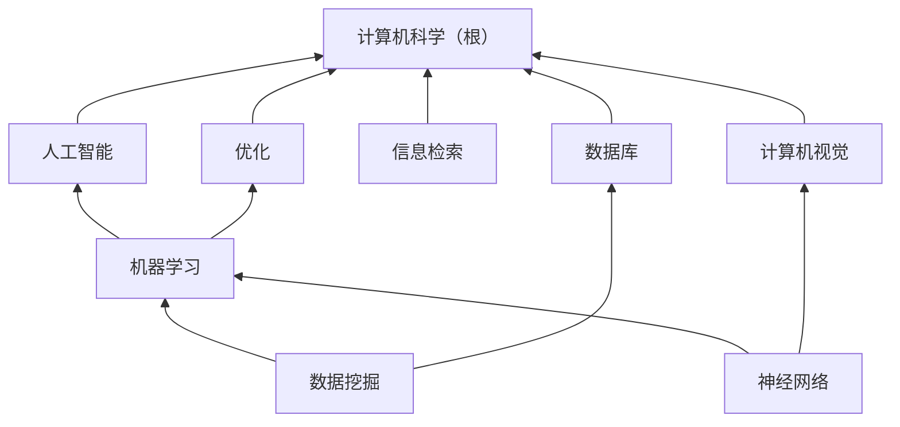
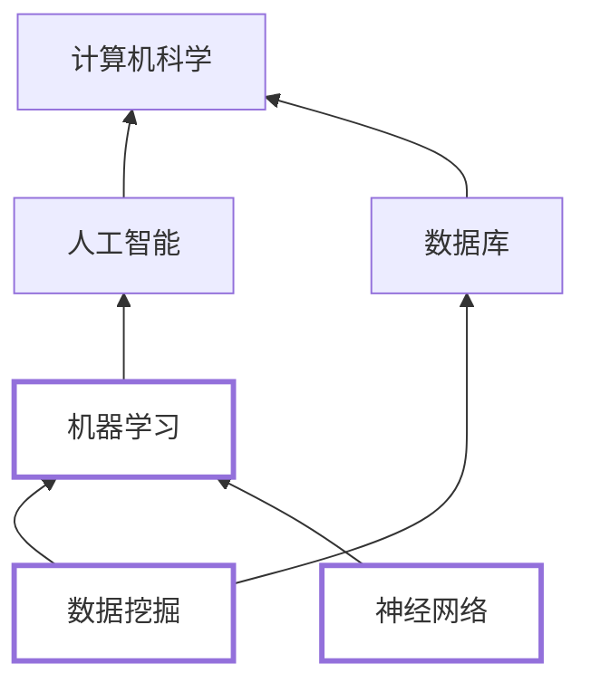
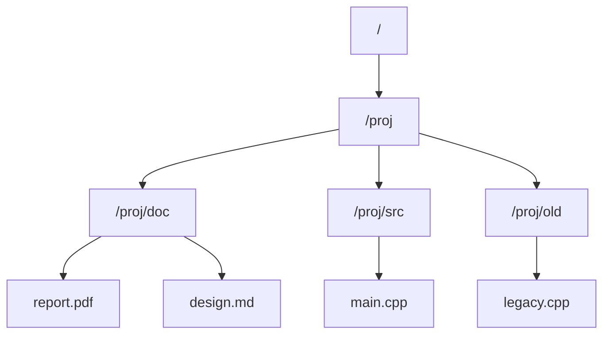
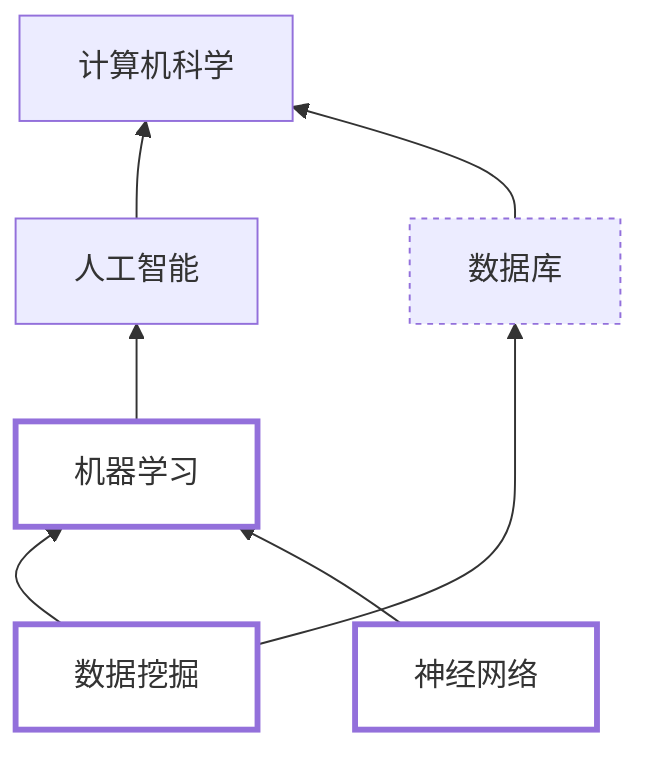
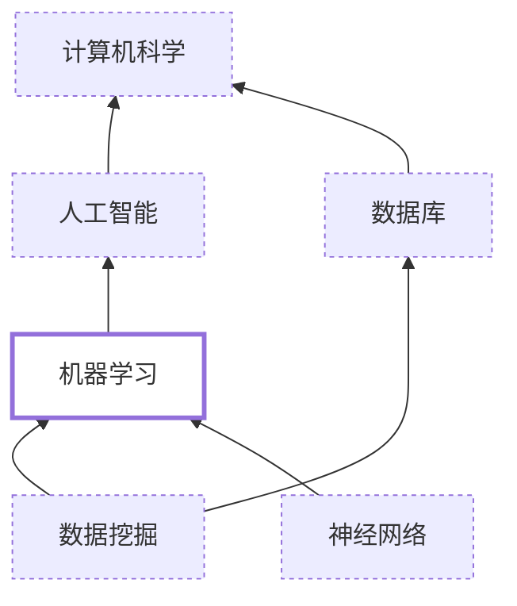
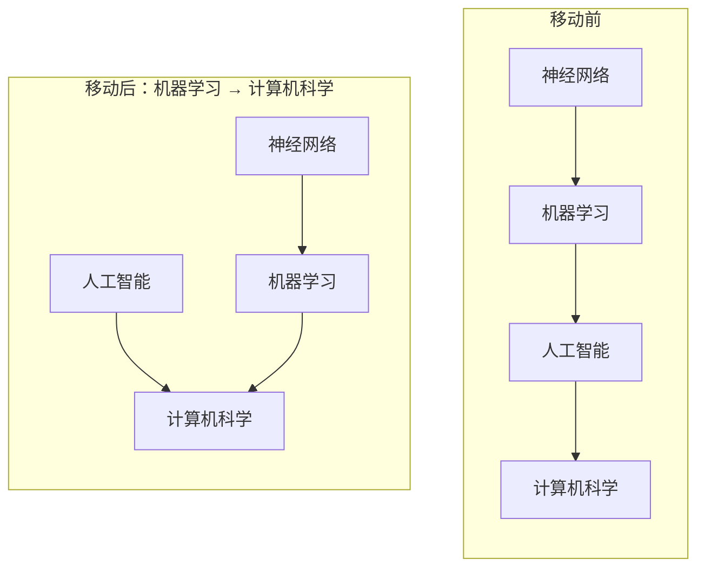
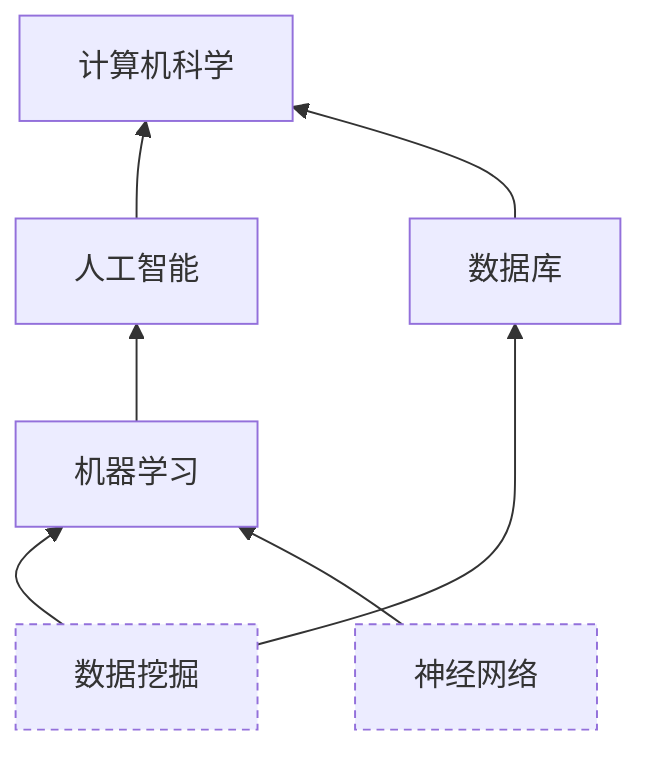
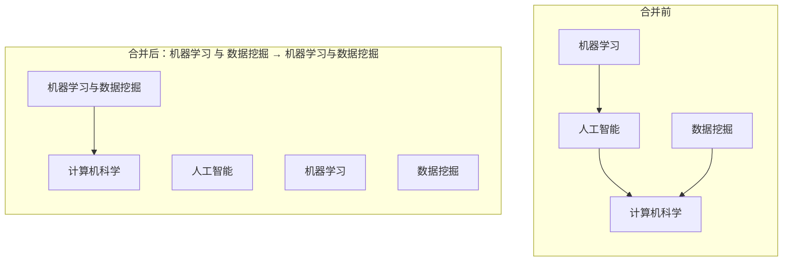

# 层级归属约束下的向量检索：背景与问题定义

本文只回答两个问题：**这是什么场景**，以及**要解决的检索问题是什么**。不涉及任何索引结构或算法方案。

---

## 1. 背景之一：学术文献库与 CCS 分类体系

### 1.1 CCS Concepts 是一棵多父层级（DAG）

计算机领域的学术文献几乎都带 ACM 的 **CCS Concepts**（Computing Classification System）标注。CCS 不是一个扁平的关键词表，而是一个**层级分类体系**：每个概念是一个节点，节点之间有「子概念 → 父概念」的归属关系。

CCS 的关键性质是**允许多父**。例如「机器学习」既隶属于「人工智能」，也隶属于「计算方法论」；一篇论文标注了某个下位概念，它在分类体系里同时属于若干条上位路径。这类结构在文献计量学里称为 **polyhierarchy**，在数据结构上就是一个**有向无环图（DAG）**，而不是树。

图中 `机器学习` 有两条上位路径（经 `人工智能` 与经 `优化`），`数据挖掘` 同时挂在 `机器学习` 与 `数据库` 下。这就是 DAG 与树的分界：**树里每个节点只有一条到根的路径，DAG 里可以有多条**。

### 1.2 数据集形态

本文使用的数据集由三部分组成。

| 组成 | 含义 | 本实例规模 |
|---|---|---|
| 向量 | 每个条目一条 $\mathbb{R}^d$ 向量 | $N=10^6$，$d=128$（SIFT1M） |
| 归属 | 每个条目**恰好一个**直属概念节点 | $N$ 条归属记录 |
| 层级 | 概念节点之间的父子边，构成 DAG | 1,929 节点、2,040 条边、1,516 个叶子、最长 6 层、单根 |

三条必须同时成立才构成这个问题：

1. **条目只有唯一一个直属节点**。一篇论文可以标多个概念，建模时拆成多条条目或取一个主概念；在本文的数据模型里，一个向量的直属归属是唯一的。
2. **层级节点之间有递归关系**。一个概念的所有后代概念，在业务上被视为「属于这个概念」。
3. **向量是检索对象，层级是合法性边界**。层级本身不参与打分，只决定哪些条目**允许**被返回。

### 1.3 用户的搜索任务

学术场景里，用户的请求几乎总是「**在这个概念及其全部子概念里，找和我这段内容最像的若干篇**」。三个典型请求：

- 综述写作：在「机器学习」子树里找与我的草稿最接近的 20 篇；
- 审稿回避：在「信息检索」子树里找与稿件最像的 50 篇，用于推荐审稿人；
- 文献去重：在某个下位概念里找与给定摘要最像的 10 条记录。

注意这些请求的**作用域是一个子树，而不是一个节点**。「机器学习」这个作用域既包含直接标注为「机器学习」的论文，也包含标注为「神经网络」「数据挖掘」等下位概念的论文。

图中粗框的三个节点共同构成作用域「机器学习」：检索在它们的并集上做，边界之外（`数据库` 的直属条目）即使距离更近也不允许返回。

---

## 2. 背景之二：操作系统的目录层级

### 2.1 目录树与文件归属

第二个场景是文件系统。目录构成一棵树，每个文件**恰好**属于一个目录；「某个目录下的文件」在语义上默认包含其所有子目录中的文件。

| 组成 | 含义 |
|---|---|
| 文件内容向量 | 每个文件一条嵌入向量（用于语义检索） |
| 归属 | 每个文件恰好在一个目录下 |
| 层级 | 目录的父子关系，构成树 |

目录树是 DAG 的特例（每个目录一个父）。第 1 节的模型不需要为它做任何修改：把「目录」当作层级节点、把「文件」当作条目即可。

### 2.2 需要搜什么

文件系统上的语义检索有两个与学术库不同的点：

- **作用域来自用户当前所在的路径**，而不是来自一个概念名。用户在 `/proj/doc` 下按语义搜索，默认想搜这个目录及其子目录。
- **作用域随文件系统操作变化**。目录会被移动、删除、合并，而检索必须始终反映操作之后的层级状态。

---

## 3. 两个场景的共同抽象

去掉业务外衣，两者是同一个问题：

| 要素 | 学术文献库 | 文件系统 |
|---|---|---|
| 条目 | 一篇论文 | 一个文件 |
| 条目向量 | 摘要/标题的嵌入 | 文件内容的嵌入 |
| 层级节点 | CCS 概念 | 目录 |
| 归属 | 论文的主概念 | 文件所在目录 |
| 层级形状 | DAG（多父） | 树（单父） |
| 作用域 | 「概念及其后代」 | 「目录及其子目录」 |
| 检索 | 作用域内按向量找最近 $k$ 条 | 同上 |

两个场景共享三条性质，它们正是问题难点的来源：

1. **作用域是递归的**：一次请求对应层级里的一棵子树，而不是一个点。
2. **作用是排他的**：作用域之外的条目无论如何接近都不得返回。
3. **层级是动态的**：节点会被移动、删除、合并。

---

## 4. 场景中的操作

下面把四类操作讲清楚。它们的共同点是：**用户看到的是层级的变化，而检索系统要处理的是「哪些条目属于当前作用域」的变化**。

### 4.1 递归搜索（recursive search）

用户在节点 $S$ 上发起递归搜索，作用域是 $S$ 的**全部后代**（含 $S$ 自身）。

对应到文件系统，`find /proj -type f` 的语义就是递归的：它遍历 `/proj` 及其所有子目录。

递归搜索的合法集合可以写成

$$E_{\text{rec}}(S)=\{\,i:\ \mathrm{own}(i)\in \mathrm{Desc}^{+}(S)\,\},$$

其中 $\mathrm{Desc}^{+}(S)$ 是 $S$ 的全部后代（含 $S$ 自身）。

### 4.2 非递归搜索（non-recursive search）

用户在节点 $S$ 上发起非递归搜索，作用域只有 $S$ 自身，**不含任何后代**。

对应到文件系统，`find /proj -maxdepth 1 -type f` 就是非递归的：只看 `/proj` 这一层。

合法集合为

$$E_{\text{non}}(S)=\{\,i:\ \mathrm{own}(i)=S\,\}.$$

两种搜索的差别只有一个字——**是否沿层级向下闭包**——但它决定了合法集合的规模可能相差几个数量级：一个概念的直属条目可能只有几百条，而它子树内的条目可能有几十万条。

| | 递归 | 非递归 |
|---|---|---|
| 合法集合 | $\mathrm{Desc}^{+}(S)$ 的条目 | 仅 $S$ 的直属条目 |
| 文件系统对应 | `find DIR` | `find DIR -maxdepth 1` |
| 典型规模 | 可达 $10^5$ 量级 | $10^2$ 量级 |

### 4.3 属性移动（move）

把一个子树从旧父节点搬到新父节点。

文件系统里的对应操作是 `mv /proj/doc /archive/doc`。

移动有两个必须区分的性质：

- **子树内部的归属不变**：`神经网络` 仍然在 `机器学习` 下，它自己的条目没有任何变化。
- **子树外部的可见性变了**：移动之后，`机器学习` 及其后代不再属于「人工智能」的作用域，而属于「计算机科学」的作用域。

因此移动**不改变任何条目的直属节点**，只改变祖先链。这是一个强约束：如果检索系统把「作用域」物化到了每条条目上，移动就要重写这些条目。

### 4.4 删除（delete）

删除一个子树，或删除其中一部分。

文件系统的对应操作是 `rm -rf /proj/old`。

删除与移动在语义上不同：

| | 移动 | 删除 |
|---|---|---|
| 直属节点 | 不变 | 被删子树的条目不再属于任何有效作用域 |
| 合法集合 | 换个作用域 | 条目从所有作用域中消失 |
| 是否可逆 | 可逆 | 通常不可逆（软删除除外） |

### 4.5 合并（merge）

把两个子树并到一个新父节点下，或把一个子树的内容并入另一个节点。

文件系统里对应 `mv a/* b/`（把 a 的内容并入 b）或新建一个目录把两者收进去。

合并的本质是**引入一个新的祖先**，因此它同时改变了两侧子树的祖先链。如果合并采取「把两个子树的内容物化到新节点」的做法，就会产生一批条目归属的重写；如果只是加一条父子边，则条目完全不动。

---

## 5. 问题定义

本节只定义问题，不谈任何实现方式。

### 5.1 记号

| 记号 | 含义 |
|---|---|
| $V$ | 层级节点集合，$\lvert V\rvert = 1{,}929$ |
| $E \subseteq V\times V$ | 父子边集合，$(c,p)$ 表示 $c$ 是 $p$ 的子节点 |
| $\mathrm{Desc}^{+}(S)$ | $S$ 的后代闭包（含 $S$ 自身） |
| $\mathrm{Anc}^{+}(S)$ | $S$ 的祖先闭包（含 $S$ 自身） |
| $I$ | 条目集合，$\lvert I\rvert = N$ |
| $x_i\in\mathbb{R}^d$ | 条目的向量 |
| $\mathrm{own}(i)\in V$ | 条目的**唯一**直属节点 |
| $q\in\mathbb{R}^d$ | 查询向量 |
| $k$ | 返回条数 |

层级 $G=(V,E)$ 是一个 DAG：允许一个节点有多个父。$G$ 有唯一根，且无环。

### 5.2 作用域与合法集合

一次检索请求给出**作用域节点集合** $S\subseteq V$ 与**递归与否**的标记 $r\in\{\text{rec},\text{non}\}$，对应的合法集合为

$$
E(S,r)=
\begin{cases}
\{\,i\in I:\ \mathrm{own}(i)\in \mathrm{Desc}^{+}(S)\,\}, & r=\text{rec},\\[2pt]
\{\,i\in I:\ \mathrm{own}(i)\in S\,\}, & r=\text{non}.
\end{cases}
$$

「作用域」在这里是**合法性边界**：它不参与打分，只决定谁有资格被返回。

### 5.3 检索目标

给定查询向量 $q$、作用域 $(S,r)$ 与条数 $k$，检索返回

$$
\mathrm{top}_k\big(q,S,r\big)\;=\;\operatorname*{arg\,min}_{i\in E(S,r)}^{\,k}\ \lVert q-x_i\rVert_2^2 ,
$$

即合法集合中距离 $q$ 最近的 $k$ 条，按距离升序排列。当 $\lvert E(S,r)\rvert<k$ 时返回全部合法条目。

这个定义与经典的 $k$ 近邻问题只差一处：**近邻的搜索空间被限制在 $E(S,r)$ 内**，而不是全库 $I$。因此它既不是「先找全局 top-$k$ 再按属性过滤」（后者可能一条都不剩），也不是「先过滤再暴力扫描」（后者丢掉索引的意义）——它是一个独立的检索问题。

### 5.4 质量度量

记 $\mathrm{top}_k^\star(q,S,r)$ 为暴力精确解，则一次查询的召回为

$$
\mathrm{recall}@k=\frac{\bigl\lvert \mathrm{top}_k(q,S,r)\cap \mathrm{top}_k^\star(q,S,r)\bigr\rvert}{k}.
$$

在 $m$ 次查询上的平均召回为

$$
\overline{\mathrm{recall}}@k=\frac{1}{m}\sum_{j=1}^{m}\mathrm{recall}@k(q_j,S_j,r_j).
$$

该定义的两个必要约定：

1. **分母固定为 $k$**。若 $\lvert E(S,r)\rvert<k$，按 $\min(k,\lvert E(S,r)\rvert)$ 归一，并在报告中注明。
2. **只统计返回结果**。允许返回少于 $k$ 条，此时缺失的位置按未命中计。

### 5.5 维护操作的语义

四类操作定义为对层级图的变换，**条目的直属节点不因移动与合并而改变**。

| 操作 | 定义 | 对 $\mathrm{own}$ 的影响 |
|---|---|---|
| $\mathrm{move}(S,P)$ | 把子树 $S$ 挂到新父 $P$ 下 | 无 |
| $\mathrm{delete}(S)$ | 删除子树 $S$ | $S$ 内条目的归属失效 |
| $\mathrm{merge}(S_1,S_2,P)$ | 新建父 $P$，令 $S_1,S_2$ 成为 $P$ 的子节点 | 无 |
| $\mathrm{split}(T,P)$ | 把 $T$ 从其父下提出、挂到 $P$ 下 | 无 |

由此得到一条必须成立的不变量：

> **移动、合并、分裂不改变任何条目的直属节点，只改变祖先链。** 只有删除会改变「条目是否属于某个作用域」。

这条不变量是后续所有讨论的前提：任何把作用域物化到条目上、或在层级变化时重写条目的做法，都在承担本可以不承担的成本。

### 5.6 问题陈述

> **问题**：维护一个条目集合 $I$（每个条目带向量 $x_i$ 与唯一直属节点 $\mathrm{own}(i)$）与一个层级 DAG $G$，使得对任意查询 $(q,S,r,k)$ 都能返回 $\mathrm{top}_k(q,S,r)$ 的高召回近似结果；同时，层级上的移动、删除、合并操作发生后，检索语义立即反映新的层级状态，且这些操作不应要求重写条目的向量或直属节点。

这个问题包含三个互相牵制的目标：

1. **检索质量**：在 $\overline{\mathrm{recall}}@k$ 上接近精确解；
2. **检索成本**：单次查询的向量距离计算次数应显著小于 $\lvert E(S,r)\rvert$；
3. **维护成本**：$\mathrm{move}$ / $\mathrm{merge}$ / $\mathrm{split}$ 不应触发条目级的重写。

三者的张力正是问题的核心：作用域越大、越要求高召回，计算量越接近暴力扫描；而要让维护便宜，层级信息就不能物化到条目上，这又限制了检索期能利用多少结构信息。

---

## 6. 两个场景的参数范围

| 参数 | 学术文献库 | 文件系统 | 本文数据 |
|---|---|---|---|
| 条目数 $N$ | $10^5$–$10^7$ | $10^4$–$10^8$ | $10^6$ |
| 向量维数 $d$ | 128–1024 | 128–1024 | 128 |
| 层级节点数 $\lvert V\rvert$ | $10^3$–$10^4$ | $10^2$–$10^6$ | 1,929 |
| 层级深度 | 4–8 | 5–20 | ≤ 6 |
| 层级形状 | DAG（多父） | 树（单父） | 1,929 节点 / 2,040 边 / 1,516 叶 |
| 递归作用域规模 $\lvert E_{\text{rec}}\rvert$ | $10^2$–$10^6$ | $1$–$10^6$ | 中位 $7.2\times10^3$，均值 $4.5\times10^4$ |
| 非递归作用域规模 | $10^1$–$10^3$ | $1$–$10^3$ | 中位 $3.0\times10^2$ |
| 查询数 | $10^2$–$10^5$ | $10^2$–$10^4$ | 200 |

作用域规模跨越四个数量级这一点很关键：任何在「作用域很大」或「作用域很小」一端成立的直觉，都不能直接推到另一端。
