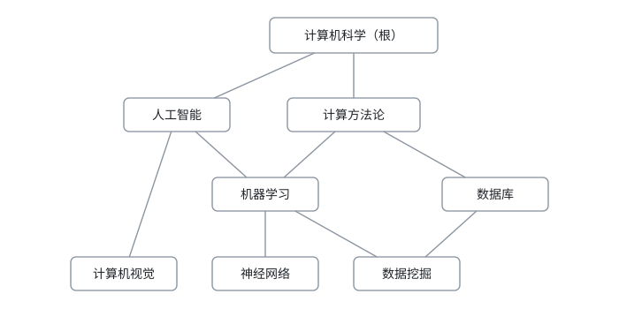
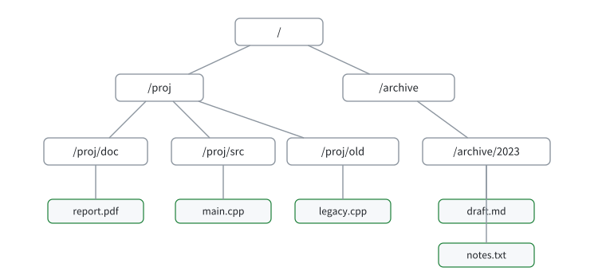
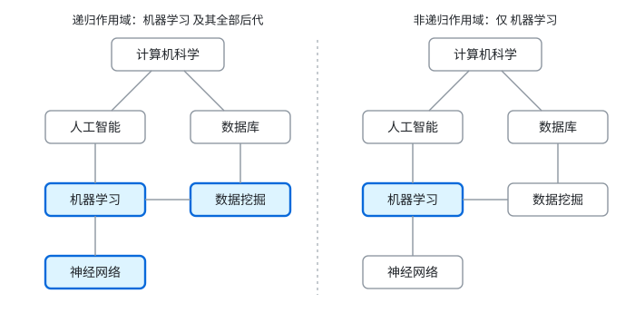
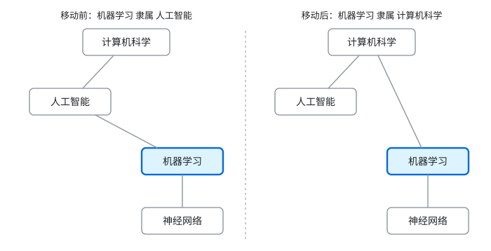
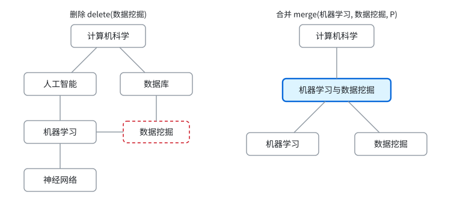

# 1 引言

稠密向量检索通常被表述为「在全库中返回最相似的 $k$ 条」。但真实请求很少是这个形式：在科学文献库中，用户要的是「在某个学科分类之内」的近邻；在企业知识库与文件系统中，要的是「在某个目录之内」的近邻。这些范围的共同点是，它们由层级结构中的一个**子树**给出，而不是由若干等值条件构成的扁平谓词给出。

科学文献一侧有明确的经验基础。Sadat 与 Caragea [1] 基于 ACM 计算分类体系（CCS）[2] 构建了 SciHTC，包含 186,160 篇论文与 1,233 个类别，并遵循层级多标签分类的约定：论文的标签集合沿祖先闭合，标注某个类别即同时属于其全部祖先。该约定决定了检索范围是递归的——在类别 $S$ 上检索应覆盖 $S$ 及其全部后代。CCS 本身不是树：一个类别可以同时隶属多个上位类别（「机器学习」既属「人工智能」也属「计算方法论」），因此范围的自然语义是 DAG 上的后代闭包。

**图 1**：基于 CCS 的层级片段。「机器学习」具有两条上位路径，「数据挖掘」同时隶属「机器学习」与「数据库」，因此范围的自然语义是 DAG 上的后代闭包而非单一路径上的前缀匹配。

文件系统一侧更为直接：目录构成层级，文件构成条目，每个文件唯一属于一个目录，「某目录下的文件」默认包含全部子目录中的文件。

**图 2**：目录层级。目录为层级节点，文件为条目，每个文件唯一属于一个目录。

两类实例中，用户对同一节点都有两种访问方式：递归访问在整棵子树内检索（`find /proj`），非递归访问只在直属条目内检索（`find /proj -maxdepth 1`）。二者的差别仅在于是否取闭包，但合法集合的规模可以相差数个数量级：一个类别的直属论文约为 $10^2$，其子树内论文可达 $10^5$，单条目作用域则退化为 $1$。

**图 3**：递归作用域与非递归作用域。左：递归访问，合法集合为「机器学习」及其后代（粗框节点）下的全部条目。右：非递归访问，合法集合仅包含直属「机器学习」的条目。

**现有方法为何不能直接利用。** 属性过滤式向量检索已相当成熟，但它处理的是逐条目的属性谓词，而层级范围是集合级的拓扑约束，直接套用会在三处失效。其一，递归范围无法用等值或包含谓词表达，只能展开成对全部后代类别的析取，其项数等于子树内的节点数；标签划分式索引随之把查询扇出扩散到子树内的每个类别组，恰好制造出我们希望消除的量级。其二，标签增强式索引优化的是标签集合之间的相似度，而子树范围要求的是闭包成员关系；在祖先闭合的标注下任意两篇论文都共享大量祖先，集合相似度对「是否同属某闭包」的区分力被系统性削弱。其三，存在一条看似可行的捷径：对树做深度优先后序编号后每个子树对应一个连续区间，于是范围可降维为数值区间并交给区间过滤索引 [7]。该捷径在树上成立，在 DAG 上不成立——多父节点使后代闭包无法同时表示为定序区间，编号只能给出闭包的超集，候选需二次校验。

**层级是动态的。** 分类体系会改版，组织会重组，目录会被整理，其表现是节点的移动、新增父节点与合并。这三类操作只改变节点的祖先关系，不改变任何条目的直属节点：子树内的条目在操作前后仍属于原来的节点。因此层级变化应当只作用于元数据，而不应迫使系统重写条目本身。在树上这只是一个局部问题；在 DAG 上一次重挂会改变上游所有节点的后代闭包，按子树物化闭包的做法随之失效。

**图 4**：移动操作。子树「机器学习」自「人工智能」迁移到「计算机科学」之下；子树内部归属不变（「神经网络」仍隶属「机器学习」），变化仅在祖先闭包。

**图 5**：删除与合并。左：删除子树后，其条目不再属于任何有效作用域。右：合并通过引入新的祖先节点改变两侧子树的祖先闭包，条目的直属节点不变。

**本文的工作。** 本文在 DAG 上形式化带层级范围的向量检索与层级维护（§2），给出问题陈述与代价口径；相关工作（§6）说明属性过滤、集合过滤与区间过滤三类方法为何不能覆盖该问题。本文的重点是把这个问题的语义、边界与维护要求定义清楚，为后续索引设计提供统一的讨论框架。

---

# 2 问题形式化

## 2.1 层级与归属

**定义 1（层级）** 层级是一个有向无环图 $G=(V,E)$，$(c,p)\in E$ 表示 $c$ 是 $p$ 的子节点。记 $\mathrm{par}(v)$ 与 $\mathrm{ch}(v)$ 分别为 $v$ 的父节点与子节点集合。$G$ 存在唯一根 $\rho$，$\rho$ 可达任意节点，且 $G$ 不含环。允许 $\lvert \mathrm{par}(v)\rvert\ge 1$，即一个节点可以有多个父节点。

**定义 2（闭包）** 记 $u\rightsquigarrow v$ 表示自 $u$ 沿父边方向经一条或多条边到达 $v$。对任意 $S\subseteq V$，

$$\mathrm{Desc}^{+}(S)=\{\,v:\ v\in S\ \lor\ \exists s\in S,\ v\rightsquigarrow s\,\},\qquad
\mathrm{Anc}^{+}(S)=\{\,v:\ v\in S\ \lor\ \exists s\in S,\ s\rightsquigarrow v\,\}.$$

即 $\mathrm{Desc}^{+}(S)$ 为 $S$ 与所有能到达 $S$ 中某节点的节点，$\mathrm{Anc}^{+}(S)$ 为 $S$ 与所有可由 $S$ 中某节点到达的节点。由唯一根性，$\mathrm{Desc}^{+}(\{\rho\})=V$。

**定义 3（条目与归属）** 条目集合 $I$ 中每个条目 $i$ 携带向量 $x_{i}\in\mathbb{R}^{d}$ 与唯一的直属节点 $\mathrm{own}(i)\in V$，记 $N=\lvert I\rvert$，$\mathrm{Loc}(v)=\{i:\mathrm{own}(i)=v\}$。

归属唯一性把「集合归属」与「向量归属」分离：条目属于哪个范围由层级决定，不由条目字段决定。多标签并不与之冲突——在祖先闭合的标注下，一篇论文的标签集由其最细标注唯一确定；当最细标注不止一个时，本文取其一个作为主标注，其余标注不参与范围解析。

## 2.2 作用域与合法集合

**定义 4（作用域）** 一次检索请求给出作用域节点集合 $S\subseteq V$（$S\neq\varnothing$）与访问模式 $r\in\{\textsc{rec},\textsc{non}\}$。

**定义 5（合法集合与选择性）** 作用域 $(S,r)$ 对应的合法集合与选择性为

$$
E(S,r)=
\begin{cases}
\{\,i\in I:\ \mathrm{own}(i)\in \mathrm{Desc}^{+}(S)\,\}, & r=\textsc{rec},\\[3pt]
\{\,i\in I:\ \mathrm{own}(i)\in S\,\}, & r=\textsc{non},
\end{cases}
\qquad
\sigma(S,r)=\frac{\lvert E(S,r)\rvert}{N}.
$$

范围是合法性边界而非打分项，这一点体现为定义 5 的集合硬约束。$\sigma$ 把「范围大小」变为可比较的量，并给出两个退化端：$\sigma=1$（$S=\{\rho\}$ 且 $r=\textsc{rec}$）即无过滤的近邻检索，$\sigma\to0$ 即线性扫描即可解决的极小范围。本文关心 $\sigma\in[10^{-4},10^{-1}]$ 的中间区间，在该区间内后过滤的召回与先过滤的代价同时不可接受。

## 2.3 检索目标

**定义 6（检索目标）** 给定查询向量 $q$、作用域 $(S,r)$ 与返回条数 $k$，

$$\mathrm{top}_{k}(q,S,r)=\operatorname*{arg\,min}_{i\in E(S,r)}{}^{k}\;\lVert q-x_{i}\rVert_{2}^{2},$$

即 $E(S,r)$ 中距 $q$ 最近的 $k$ 个条目，按距离升序；当 $\lvert E(S,r)\rvert<k$ 时返回全部合法条目。向量已归一化，故该式与余弦序一致。

定义 6 与经典 $k$ 近邻的唯一差别在于搜索空间。该差别排除了两种常见但不正确的替代：先取全局近邻再按范围过滤，其返回条数可能为零；先按范围过滤再线性扫描，其计算量为 $\Theta(\lvert E(S,r)\rvert)$。因此它描述的是一个独立问题，而非二者的组合。

## 2.4 层级维护

**定义 7（维护原语）**

| 原语 | 前置条件 | 语义 | 对 $\mathrm{own}$ 的影响 |
|---|---|---|---|
| $\mathrm{move}(S,P)$ | $P\notin\mathrm{Desc}^{+}(S)$ | $\mathrm{par}(S)\leftarrow\{P\}$ | 无 |
| $\mathrm{attach}(S,P)$ | $P\notin\mathrm{Desc}^{+}(S)$ | $\mathrm{par}(S)\leftarrow\mathrm{par}(S)\cup\{P\}$ | 无 |
| $\mathrm{merge}(S_{1},S_{2},P)$ | $P$ 新建，$S_{1}\cap S_{2}=\varnothing$ | $\mathrm{par}(S_{j})\leftarrow\mathrm{par}(S_{j})\cup\{P\}$ | 无 |
| $\mathrm{delete}(S)$ | — | 删除 $S$ 及其条目 | $S$ 内条目移出 $I$ |

前置条件 $P\notin\mathrm{Desc}^{+}(S)$ 保证不引入环。$\mathrm{move}$ 替换父节点集合，即重挂子树；$\mathrm{attach}$ 新增一个父节点，是唯一能生成多父结构的原语；$\mathrm{merge}$ 是 $\mathrm{attach}$ 的批量形式。$\mathrm{split}$ 与单点上的 $\mathrm{move}$ 等价，故不单列。

**性质 1（归属不变量）** 对 $\mathrm{move}$、$\mathrm{attach}$ 与 $\mathrm{merge}$，任意条目 $i$ 的直属节点 $\mathrm{own}(i)$ 保持不变，变化的只是其祖先闭包 $\mathrm{Anc}^{+}(\mathrm{own}(i))$。

性质 1 界定了问题边界：层级变化是元数据变化，作用对象是图的边；条目本身不需要也不应当被重写。任何把范围物化到条目上的表示，都会在 $\mathrm{move}$ 与 $\mathrm{merge}$ 上产生与子树规模成正比的写入。$\mathrm{delete}$ 是唯一改变 $I$ 的原语，其代价必然与受影响条目数相关，因此被排除在本性质之外。

## 2.5 问题陈述

**问题 1** 维护条目集合 $I$ 与层级 $G$，使得对任意查询 $(q,S,r,k)$ 返回定义 6 所述的高召回结果，同时满足：

1. **边界精确**：返回集是 $E(S,r)$ 的子集，不出现越界返回；
2. **成本可省**：单次查询的距离计算次数显著低于 $\lvert E(S,r)\rvert$，且该优势不随 $\sigma$ 下降而消失；
3. **维护不重写条目**：$\mathrm{move}$、$\mathrm{attach}$、$\mathrm{merge}$ 满足性质 1，其代价以受影响的键或祖先聚合数计，不以受影响条目数计；
4. **语义新鲜**：维护操作提交后发出的查询必须在新层级上求值，即结构层面提供读后写一致性。

上述目标相互牵制。范围越大、召回要求越高，计算量越接近线性扫描；而要让维护代价与子树规模无关，范围信息就不能物化到条目上，这又限制了查询期可用的结构线索。DAG 使这一张力更强，因为后代闭包既不能分解为子树内直属条目之和，也不能降维为一维区间（§6）。本文不提出具体索引，后续工作在这一张力下讨论实现方案与度量口径。

---

# 6 相关工作

**过滤式向量检索。** 将结构约束与向量相似度结合的方法可分三类。后过滤取全局超量近邻再按谓词裁剪，低选择性下召回崩塌；前过滤先解析合法集再检索，代价随合法集线性增长；耦合式方法把谓词信息编码进索引，使遍历只在合法区域内推进。ACORN [3] 属第三类且谓词无关，通过在邻近图上做谓词感知的扩展并补两跳连接维持连通性；NaviX [4] 把同样的谓词无关性下推到图数据库原生索引。这类方法把谓词视为逐条目的判决，框架上可以接受子树范围，但既不降低范围的解析代价，也不区分越界返回与漏检。

**标签与集合谓词过滤。** 与本文形态最接近的一支。划分式方法把标签集相同或相近的向量聚成子索引，如 CAPS、ELI、UniFilter 与 Curator [6]；增强式方法在图上增加跨标签边以恢复连通性，LSSG [5] 以标签集合的 Jaccard 距离分层构边，同时支持相等、包含与相交三种语义，是当前该语义族上最强的索引之一。这一支不能直接复用的原因有两层。其一是扇出：递归范围对应子树内全部类别，划分式索引需要对每个类别组各发起一次检索，扇出恰等于本文要消除的量级。其二是语义错配：增强式方法优化的是标签集的相似度，而子树范围要求的是闭包成员关系；在祖先闭合的标注下任意两篇论文都共享大量祖先，集合相似度对「是否同属某闭包」的区分力被系统性削弱。

**区间与窗口谓词过滤。** 另一支处理数值谓词，窗口过滤 [7] 与后续的区间索引从不同角度处理区间查询与区间端点移动。这一支与本文关系最微妙，因为它提供了一条降维捷径：对树做深度优先后序编号，每个子树即一个连续区间，递归范围随之成为一维区间查询。该捷径在树上正确，在 DAG 上不成立——多父节点使后代闭包无法同时表示为定序区间，编号只能给出闭包的超集，候选需二次校验，边界精确性无法在过滤阶段保证。此外，区间索引的增量维护依赖区间端点的局部移动，而层级上的一次重挂会把一整段编号搬到别处。

**层级语义的原生支持。** 把层级当作一等公民的工作很少。Wang 等人 [8] 将目录语义形式化为递归/非递归查询与 move/merge 维护两个原语，并在工业引擎中比较了查询期路径展开、写入期路径展开与基于前缀树的设计，结论是前两者在结构变更上产生与子树规模成正比的写放大，前缀树则把维护降为树局部操作。该工作与本文最接近，两点差异是本质的：它把层级限定为树，遇到 DAG 时显式规范化（每个条目只保留一条类别路径），因而无法表达一个条目同属多个并列分支的情形，也无法生成多父结构；它的动机限于目录，未讨论祖先闭合标注下非递归语义的退化。

**层级多标签分类。** 本文的范围语义来自该方向的标注约定 [1]，[9] 系统梳理了其方法谱系。但该方向的下游工作止于输出标签集，不关心检索期如何解析范围；检索系统若直接消费这些标签集，就必须回答「在类别 $S$ 上检索是否覆盖其后代」。工业规模的文献分类面对的类别数在数千量级且持续变动，这也说明层级并非静态。

**索引维护与结构变更。** 向量索引的动态性已有积累，包括对动态数据集上近邻方法的系统考察 [10]，但这些工作讨论的动态几乎都是条目级的：向量插入、删除与更新。本文关心的是结构级动态：条目归属不变，变化只发生在层级边上。二者代价口径不同——条目级按条目计，结构级按受影响的键或祖先聚合计——因此现有结论不能直接迁移。工程系统常以命名空间或多租户分区替代层级访问，但它只提供一层互不相交的扁平划分，不支持递归闭包、嵌套与重挂。

**小结。** 现有工作或把层级压平为标量谓词（丢失拓扑），或在树上原生支持层级（无法表达多父归属），或依赖欧拉序把范围降维为区间（在 DAG 上退化为超集候选）。下表按三项能力比较最接近的工作：

| 工作 | 递归子树范围 | 多父归属 | 结构级维护 |
|---|---|---|---|
| ACORN [3]、NaviX [4] | 需自行解析 | 非索引语义 | 无 |
| LSSG [5] 等集合过滤 | 扇出等于子树节点数 | 非索引语义 | 无 |
| 欧拉序 + 区间过滤 [7] | 树精确，DAG 仅超集 | 不保证 | 端点局部移动假设被破坏 |
| 目录语义索引 [8] | 精确 | 不支持 | 支持，树局部 |
| 本文 | 精确 | 支持 | 支持，代价与多父边数相关 |

除本文外，没有工作同时具备三项能力，这也是本文形式化的动机。

---

# 参考文献

[1] Mobashir Sadat, Cornelia Caragea. Hierarchical Multi-Label Classification of Scientific Documents. EMNLP 2022. arXiv:2211.02810.

[2] ACM. The ACM Computing Classification System (CCS). https://dl.acm.org/ccs, 2012.

[3] Liana Patel, Peter Kraft, Carlos Guestrin, Matei Zaharia. ACORN: Performant and Predicate-Agnostic Search Over Vector Embeddings and Structured Data. *Proceedings of the ACM on Management of Data* 2(3), Article 120, 2024. arXiv:2403.04871.

[4] Sehgal, Salihoğlu. NaviX. VLDB 2025.（正式出处未核实，编号按作者提供）

[5] Ziqi Wang, Jingzhe Zhang, Shuo Shen, Wei Hu. Fast Label-Filtering Approximate Nearest Neighbor Search via Progressive Label Set Stratification. arXiv:2609.15058, 2026.

[6] Yicheng Jin, Yongji Wu, Wenjun Hu, Bruce M. Maggs, Jun Yang, Xiao Zhang, Danyang Zhuo. Curator: Efficient Vector Search with Low-Selectivity Filters. *Proceedings of the ACM on Management of Data* 4(1), SIGMOD 2026. arXiv:2601.01291.

[7] Approximate Nearest Neighbor Search with Window Filters. arXiv:2402.00943, 2024.

[8] Mengzhao Wang, Zheng Gong, Jingpei Hu, Jiajie Fu, Maojia Sheng, Junwen Chen, Yifan Zhu. Directory-Aware Query and Maintenance in Vector Databases. arXiv:2606.16903, 2026.

[9] Rundong Liu, Wenhan Liang, Weijun Luo, Yuxiang Song, He Zhang, Ruohua Xu, Yunfeng Li, Ming Liu. Recent Advances in Hierarchical Multi-label Text Classification: A Survey. arXiv:2307.16265, 2023.

[10] Ben Harwood, Amir Dezfouli, Iadine Chades, Conrad Sanderson. Approximate Nearest Neighbour Search on Dynamic Datasets: An Investigation. arXiv:2404.19284, 2024.
