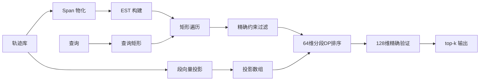

# 方法：Episode Span Index（ESI）

更新日期：2026-10-25。本文给出方法的完整设计：输入输出、一般方案及其失效原因、索引构建的每一步、查询算法、正确性、复杂度与参数。实现对应 `production/semantic-mobility-search/src/bench_est.cpp`。

问题定义见 [problem-definition.md](problem-definition.md)（v4）；基线见 [baseline.md](baseline.md)；前序差异见 [novelty-audit.md](novelty-audit.md)。

## 1. 输入、输出与记号

**输入**

- 轨迹库 $\mathcal D=\{T_1,\ldots,T_N\}$，$T=(X,\tau,E,\beta)$：坐标序列、时间戳、段向量集、点→段映射；
- 查询 $Q=(\mathbf q_{1..m};\tau_{1..m};W;R;\delta_\Delta;k)$：语义序列、相对时间偏移、绝对时间窗、空间范围、时长容差、返回数；
- 构建参数：时长上限 $\Delta_{\max}$、叶大小 $L$、投影维度 $d_p$、验证预算 $C$、slack 上限 $G$。

**输出**

- 至多 $k$ 条不同轨迹，每条给出：轨迹 id、精确分数 $s_Q(T)$、最佳 episode 的段区间 $[u,v]$ 与绝对时间区间 $[t^s_u,t^e_v]$；
- 按 $(s_Q,\operatorname{id})$ 字典序；无可行结果时返回空集。

**记号**

| 符号 | 含义 |
|---|---|
| $s$ | 一条轨迹的段数 |
| $E_{u:v}$ | 连续段区间 $u..v$ |
| $n=v-u+1$ | episode 的段数 |
| $g=n-m$ | slack（多出的段数） |
| $X(E)$ | episode 覆盖的原始坐标集合 |
| $M$ | 全库物化 span 总数 |

## 2. 为什么不能直接用现成索引

### 2.1 一般方案

面对“时间 + 空间 + 向量 + 序列”的检索，常见做法有三类：

**A. 逐维索引后求交。** 时间建 B-tree/倒排、空间建 R-tree/网格、向量建 HNSW/IVF；查询时分别取候选再求交，最后验证。
**B. 物化 + 线性扫描。** 把所有可能的片段物化成记录，查询时按属性过滤，再逐条计算距离。
**C. 度量索引 / 下界剪枝。** 对轨迹或片段建 VP-tree、iDistance 等，用三角不等式下界跳过候选。

### 2.2 它们各自为什么不够

| 方案 | 在本问题上的失效点 | 实测证据 |
|---|---|---|
| A | 谓词作用在 **span** 上，不在单个段/对象上：时间窗约束 episode 的起止，时长约束端点差，空间约束整段并集，段数约束区间长度。逐维索引只能给出“段级”候选，无法判断一个区间是否可行，只能后过滤 | 全局 ANN 后过滤 Recall 0.23–0.31；时间桶 ANN 到 0.90 时已 49.7 ms，慢于精确扫描 |
| B | 候选枚举是**线性**的：桶切片取出 54,597 条，真正可行 11,673 条，访问代价与桶大小成正比，而不是与输出成正比 | 平坦 catalog 10.5 ms，其中大部分花在无谓的切片检查 |
| C | 高维下界很松且**计算下界本身就要算距离**：band-restricted 下界能剪 97.7% 的可行 span，但其成本是完整 DTW 的 53.2%，而带宽精确 DTW 是 53.9%，净收益≈0 | NY、90,743 个可行 episode 的实测 |

### 2.3 设计目标

由此确定三条硬性要求：

1. **硬约束必须精确**：不允许“先 ANN 再过滤”的召回损失；
2. **访问必须输出敏感**：候选枚举代价随命中数增长，而不是随桶大小；
3. **分数必须精确**：近似只允许发生在排序阶段，最终分数由原始向量计算。

对应设计：**物化 span 使约束可精确索引**；**用静态 k-d 树把枚举变为矩形遍历**；**用低维投影排序、原始维度验证**。

## 3. 总体架构



两个结构分工明确：

- **Span Catalog**：把“哪些区间存在”变成数据，span 是索引键；
- **EST**：把“哪些区间落在查询矩形内”变成树遍历，避免线性切片。

## 4. 索引构建

### 4.1 段向量投影

**为什么需要。** 排序阶段要对大量 span 做打分；直接用 128 维向量代价高。随机投影在保持距离的同时把单次点积降到 $d_p$ 维，且投影矩阵固定后可在建库时一次性算好。

**怎么做。**

1. 取 $d_p=64$，用固定种子 `20261024` 的 `std::mt19937` 生成

$$
P\in\mathbb R^{128\times d_p},\qquad P_{ij}\sim\mathcal N\!\left(0,\frac{1}{\sqrt{d_p}}\right).
$$

2. 对每个段向量 $\mathbf e\in\mathbb R^{128}$ 计算 $\pi(\mathbf e)=P^\top\mathbf e\in\mathbb R^{d_p}$；
3. 按点的全局下标存入连续数组 `proj_pts`（`float[N][d_p]`），供查询时按 `(traj,u)` 定位。

**存储与成本。** $1{,}838{,}793\times64\times4\approx470$ MB；构建是一次矩阵乘法，约 1 s。

**注意。** 投影只用于排序；最终分数用 128 维原始向量，因此投影误差不会进入结果。

### 4.2 Span 物化

**为什么需要。** 时间窗、时长、空间范围、段数都是 span 的属性；只有把它们预先算出来，查询才能做精确范围过滤，而不是拿到候选再逐点检查。

**定义。** 对轨迹 $T$ 的段序列，物化所有满足

$$
1\le u\le v\le s,\qquad t^{e}_v-t^{s}_u\le\Delta_{\max}
$$

的区间，记为 span，并预计算

$$
\bigl(\operatorname{traj},u,v,n,\ \Delta=t^{e}_v-t^{s}_u,\ t^{s}=t^{s}_u,\ \operatorname{bbox}=\operatorname{bbox}(X_{u:v}),\ \max\!\lVert\mathbf e_k\rVert\bigr).
$$

**算法（逐轨迹，双指针/增量）。**

```text
for each trajectory t:
    for u = 0 .. s-1:
        bbox ← empty; maxnorm ← 0
        for v = u .. s-1:
            if t[v].time - t[u].time > Δ_max: break
            bbox.expand(t[v].coord)
            maxnorm ← max(maxnorm, ||e_v||)
            emit Span(t, u, v, v-u+1, t[v].time-t[u].time,
                      t[u].time, bbox, maxnorm)
```

- 内层 `v` 只需前进，不回头；时长单调，越界即 `break`；
- `bbox` 与 `maxnorm` 增量更新，每个 span $O(1)$；
- 总时间 $O\bigl(\sum_t\sum_u L_u\bigr)=O(M)$，$L_u$ 是起点 $u$ 在时长窗内的终点数。

**存储布局。** `Span` 是 48 B 的 POD：

| 字段 | 类型 | 字节 |
|---|---|---:|
| `traj,u,v,n` | int32 ×4 | 16 |
| `ts` | int64 | 8 |
| `dur` | float | 4 |
| `bbox[4]` | float ×4 | 16 |
| `maxnorm` | float | 4 |

6 城实测 $M=6{,}213{,}067$，$298.2$ MB，构建 $0.77$–$0.83$ s。

**为什么不用“每条轨迹一个前缀摘要”代替物化。** 前缀摘要能 $O(1)$ 算区间 bbox，但无法回答“哪些区间落在时长区间内”；物化把“区间存在性”变成可排序、可分区的数据，才能建树。

### 4.3 EST：静态 k-d 树

**为什么是 k-d 树而不是哈希桶。** 哈希桶要求先枚举所有桶键再取并集，代价与桶内元素总数成正比；k-d 树对矩形查询做空间划分，只访问与矩形相交的节点。数据是静态的（建库后不改），不需要动态平衡，k-d 树实现简单、内存紧凑。

**节点结构。**

```cpp
struct KNode {
    int64_t ts_min, ts_max;      // 子树起始时间范围
    float   dur_min, dur_max;    // 子树时长范围
    float   bbox[4];             // 子树空间并集（min_lat,max_lat,min_lon,max_lon）
    uint32_t begin, end;         // 叶节点的 span 区间 [begin,end)
    uint32_t count;              // 子树 span 数
    int32_t left, right;         // 内部节点的子节点下标，-1 表示叶
};
```

**构建算法。**

```text
build(ids[lo..hi)):
    node ← new KNode
    scan ids[lo..hi) once:
        node.ts_min/max, dur_min/max, bbox ← 聚合值
        node.count ← hi - lo
    if hi - lo ≤ L:                       # L = 叶大小
        node.begin ← next_pos
        copy spans in ids[lo..hi) to spans[next_pos..]
        node.end ← next_pos; return
    # 选择分裂维：比较两维的“相对跨度”
    split_ts ← (ts_max-ts_min)/global_ts_range ≥ (dur_max-dur_min)/global_dur_range
    mid ← lo + (hi-lo)/2
    nth_element(ids[lo..hi), by split dimension)   # 中位数划分，O(width) 平均
    node.left  ← build(ids[lo..mid))
    node.right ← build(ids[mid..hi))
    return node
```

**三个实现细节及理由。**

1. **按相对跨度选分裂维**：时间戳是 epoch 秒（量级 $10^9$），时长是小时（量级 $10^1$）。若直接比较绝对跨度，时间维永远胜出，树会退化成按时间排序的列表。代码用全局范围归一化：

$$
\text{spread}_{ts}=\frac{t_{\max}-t_{\min}}{t_{\max}^{g}-t_{\min}^{g}},\qquad
\text{spread}_{\Delta}=\frac{\Delta_{\max}-\Delta_{\min}}{\Delta_{\max}^{g}-\Delta_{\min}^{g}},
$$

取较大者分裂。这样时长维也参与划分，查询矩形在时长方向的收缩才能生效。

2. **中位数划分 + `nth_element`**：每次只保证左右两半大小相等，不要求完全排序；`nth_element` 平均 $O(w)$，总构建 $O(M\log(M/L))$。

3. **叶内连续拷贝**：构建时把 span 重新排列，使每个叶拥有连续区间 `[begin,end)`。好处是查询时叶内顺序访问、缓存友好；代价是构建期需要一份额外 span 数组，峰值内存约 $2\times298$ MB。

**不变量。**

- **I1（覆盖）**：每个 span 恰属于一个叶；内部节点的范围是其子树所有 span 的聚合超集。
- **I2（可分）**：若节点矩形与查询矩形不相交，则子树内不存在满足查询矩形约束的 span。

**规模。** 按 $L=64$ 实测：叶 131,072 个、节点 262,144 个，节点数组 $16.8$ MB（每节点 64 B），树构建 $2.8$ s。叶大小减半时节点数约翻倍；本报告主表用 $L=16$，构建仍在 3 s 量级，端到端延迟与 $L=64$ 相差 <5%（§9）。

**参数。** $\Delta_{\max}=48$ h（查询最大时长 24 h + 25% 容差）、$L=16$（代码默认 64；8–128 实测延迟差异 <5%，见 §9）、$d_p=64$。

### 4.4 建库后保留什么

| 数组 | 内容 | 大小 |
|---|---|---:|
| `spans` | 按叶重排后的 span | 298 MB |
| `nodes` | k-d 树节点 | 17 MB |
| `proj_pts` | 段向量 64 维投影 | 470 MB |
| 原始 `points` | 128 维向量、时间、坐标 | 940 MB |

原始 `points` 必须保留：精确验证阶段要算 128 维距离。

## 5. 查询算法

### 5.1 查询矩形

由可行性条件直接推出（放宽一个容差，保证不漏）：

$$
t^{s}\in\bigl[w_s,\ w_e-\Delta_Q+\delta_\Delta\bigr],
\qquad
\Delta\in\bigl[\Delta_Q-\delta_\Delta,\ \Delta_Q+\delta_\Delta\bigr],
\qquad
\operatorname{bbox}(E)\cap R\ne\varnothing .
$$

前两个条件构成平面上的矩形 $\mathcal R_Q$；空间条件在节点层用 `bbox_union` 的相交性做粗剪，在叶层用“span bbox ⊆ R”做精确判断。

**为什么起始时间上界是 $w_e-\Delta_Q+\delta_\Delta$ 而不是 $w_e-\Delta_Q$。** 真实时长可以是 $\Delta_Q-\delta_\Delta$，此时允许的起始时间更晚。用较大的上界是**超集**，保证不漏；精确判断留到叶层。

### 5.2 矩形遍历

```text
stack ← [root]
while stack not empty:
    node ← stack.pop()
    if node.count == 0: continue
    if node.ts_max < ts_lo or node.ts_min > ts_hi: continue
    if node.dur_max < dur_lo or node.dur_min > dur_hi: continue
    if node.bbox ∩ R = ∅: continue
    if node is leaf:
        append spans[node.begin .. node.end) to candidates
    else:
        push node.left, node.right
```

**剪枝顺序**与成本有关：`count==0` 最便宜，其次时间/时长范围（整数/浮点比较），最后 bbox 相交（4 次比较）。实测每查询访问 9,633 个节点（树的 3.7%）、4,471 个叶（3.4%），收集 211,968 条 span。

**为什么叶会过取。** 叶内至多 $L$ 条 span 共享同一节点矩形，只有部分满足精确约束；$L=64$ 时实测收集 211,968 条，精确过滤后 11,673 条（5.5%）。但叶内过滤是连续内存的顺序检查，比“先按桶取 54,597 条再逐条查”便宜。

### 5.3 精确约束过滤

对每条候选 span 依次检查：

```text
if s.n < m: reject
if G ≥ 0 and s.n > m + G: reject          # 有界 slack（可选）
if s.dur < Δ-δ or s.dur > Δ+δ: reject
if s.ts < w_s or s.ts + s.dur > w_e: reject
if s.bbox ⊄ R: reject
```

全部通过才进入排序。这一步是**精确**的：矩形是超集，过滤条件与定义逐条对应，因此不会漏掉任何可行 span，也不会放过不可行 span。

### 5.4 排序：64 维分段 DP

**为什么需要排序。** 可行 span 有 11,673 条，全部做 128 维精确 DTW 需要约 10 ms；先按近似分数排序，只验证前 $C$ 条（$C=300$），可把验证量降到 2.6%。

**为什么用分段 DP 而不是 DTW。** 定义禁止 $(1,0)$ 步，每个查询单元匹配的段构成连续块，因此对齐等价于把 span 切成 $m$ 个连续块。用 DP 计算最优划分：

$$
f_1(j)=\sum_{k=0}^{j}\bigl\lVert \mathbf q_1-\pi(\mathbf e_{u+k})\bigr\rVert,\qquad
f_i(j)=\bigl\lVert \mathbf q_i-\pi(\mathbf e_{u+j})\bigr\rVert+\min\bigl(f_{i-1}(j-1),f_i(j-1)\bigr),
$$

$$
\text{approx}(Q,E_{u:v})=\frac{f_m(n-1)}{m},
$$

其中 $j$ 是相对偏移量，$0\le j<n$。带宽为

$$
j\in[i-1,\ g+i-1],\qquad g=n-m,
$$

因此每个 span 只算 $m(g+1)$ 个单元，而不是 $mn$。

**实现要点。**

- 用两行滚动数组 `prev/cur`，`cur[j]` 依赖 `prev[j-1]` 与 `cur[j-1]`，顺序扫描；
- 距离在 64 维投影上算，单次 64 次乘加；
- 对 11,673 条 span 打分后，用 `nth_element` 取分数最小的 $C$ 条，$O(F)$ 平均。

### 5.5 精确验证与 top-k

对排序后的前 $C$ 条，用原始 128 维、同样的分段 DP 计算精确分数（$\lambda$ 项按需加入）：

$$
D(Q,E)=\min_{\pi}\sum_{(i,j)\in\pi}
\Bigl(\lVert\mathbf q_i-\mathbf e_j\rVert_2+\lambda\bigl\lvert\tau_i-(t^s_j-t^s_u)\bigr\rvert\Bigr),
\qquad
s_Q(E)=D/m.
$$

然后：

1. 按 $(s_Q,\operatorname{id})$ 排序验证结果；
2. 同一轨迹只保留分数最小的 episode；
3. 跳过查询来源用户；
4. 取前 $k$ 条，输出段区间与时间区间。

**这一步决定结果精度。** 排序是近似的，但所有返回分数的精确值来自这里；硬约束在 §5.3 已保证，不会出现“返回了不可行 episode”。

### 5.6 复杂度

| 阶段 | 时间 | 空间 |
|---|---|---|
| 投影 | $O(N\cdot128\cdot d_p)$ | $O(N d_p)$ |
| span 物化 | $O(M)$ | $O(M)$ |
| EST 构建 | $O(M\log(M/L))$ | $O(M+2M/L)$ |
| 矩形遍历 | $O(\text{visited nodes}+\text{collected})$ | 栈 $O(\log M)$ |
| 精确过滤 | $O(\text{collected})$ | — |
| 排序 | $O(F\cdot m(g+1)\cdot d_p)$ | $O(F)$ |
| 验证 | $O(C\cdot m(g+1)\cdot128)$ | $O(C)$ |

$F$ 为可行 span 数，$C$ 为验证预算。注意排序与验证都只作用于“已满足硬约束”的 span，因此复杂度与查询选择性直接相关。

## 6. 正确性

**引理 1（矩形超集）** 任一满足定义的 episode 的 $(t^s,\Delta)$ 必落在 $\mathcal R_Q$ 内。

*证明*：由 $w_s\le t^s$、$t^e\le w_e$、$\Delta=t^e-t^s$ 与 $\lvert\Delta-\Delta_Q\rvert\le\delta_\Delta$ 直接得到 $t^s\le w_e-\Delta\le w_e-\Delta_Q+\delta_\Delta$，且 $\Delta\in[\Delta_Q-\delta_\Delta,\Delta_Q+\delta_\Delta]$。$\square$

**引理 2（剪枝安全）** 若节点矩形与 $\mathcal R_Q$ 不相交，或 `bbox_union` 与 $R$ 不相交，则子树内不存在可行 episode。

*证明*：由不变量 I1，子树内每个 span 的 $(t^s,\Delta)$ 都在节点矩形内；由 I2，bbox 并集覆盖子树所有 span 的 bbox。$\square$

**引理 3（DP 等价）** 在禁止 $(1,0)$、端点固定的前提下，分段 DP 的最优值与定义中的对齐距离相等。

*证明*：对齐路径的每次 $(1,1)$ 切换查询单元，$(0,1)$ 在同一单元内前进；因此每个单元对应一段连续的段，且这些段按顺序划分 $[u,v]$。反之任一连续划分都可构造一条合法路径。两者一一对应，代价相同。$\square$

**定理（硬约束精确）** EST 枚举 + §5.3 过滤得到的候选集，与全量扫描的可行集完全相同。

*证明*：由引理 1、2，可行 span 不会被树剪掉；由 §5.3 的逐条检查，不可行 span 不会进入候选。$\square$

**近似性说明**：排序只决定“验证哪 $C$ 条”，因此返回结果相对精确 top-k 是近似的；实测 Recall@10 = 0.989（$C=300$）。若令 $C=F$，则结果精确，但代价回到全验证。

## 7. 与一般方案的对照

| 维度 | 逐维索引求交 | 物化 + 线性扫描 | 度量索引/下界 | 本方法 |
|---|---|---|---|---|
| 硬约束 | 段级，需后过滤 | 精确，但线性枚举 | 依赖下界，紧致度差 | **精确，矩形遍历** |
| 序列距离 | 不处理 | 逐条精确计算 | 下界计算本身昂贵 | 低维排序 + 原始维度验证 |
| 访问代价 | 与候选并集成正比 | 与桶大小成正比 | 与下界成本成正比 | **与命中节点/输出成正比** |
| 召回 | 受 ANN 影响（0.23–0.31） | 1.0（硬约束） | 1.0（若下界有效） | 0.989（$C=300$） |
| 分数 | 近似 | 精确 | 精确 | **精确** |

## 8. 有界 slack

定义允许 $n-m=g$ 任意大。把

$$
n\le m+G
$$

作为显式构建/查询参数（$G=\infty$ 为原定义）。它同时影响三处：

1. §5.3 多一条过滤；
2. 排序/验证的带宽上界变为 $G+1$；
3. 候选集随 $G$ 收缩。

实测（potion、1 年/50 km、EST、$C=300$）：

| $G$ | Recall@10 | mean ms | p95 ms |
|---:|---:|---:|---:|
| $\infty$ | 0.9894 | 5.80 | 15.1 |
| 4 | 0.9894 | 4.73 | 12.0 |
| 2 | 0.9894 | 4.68 | 11.4 |
| 0 | 0.9840 | 3.57 | 9.0 |

$G=2$ 与无界召回相同，说明最优 episode 绝大多数 $n=m$；$G=0$ 仍保留 98.4% 召回。该结论目前只在单一 workload 上验证。

## 9. 实测汇总

| 方法 | Recall@10 | mean ms | p95 ms | 说明 |
|---|---:|---:|---:|---|
| 精确空间先行 | 1.000 | 15.3 | 37.5 | 11,612 次精确 DTW |
| 平坦桶 catalog | 0.989 | 10.50 | 23.6 | 切片 54,597 |
| **EST（$G=\infty$）** | 0.989 | **5.66** | 15.0 | 访问 9,633 节点 |
| **EST（$G=2$）** | 0.989 | **4.68** | 11.4 | 推荐配置 |
| EST + PQ（平坦版参考） | 0.997 | 7.73 | 16.9 | PQ 未与 EST 合并 |

选择性：

| workload | 精确 | 空间先行 | 平坦 catalog |
|---|---:|---:|---:|
| 90 天 + 50 km | 16.3 | 9.0 | 5.7 (0.994) |
| 1 年 + 10 km | 28.6 | 15.7 | 5.4 (0.995) |
| 1 年 + 无空间 | 83.6 | 192.6 | 45.8 (0.991) |

EST 目前只在 1 年/50 km 上测过；其余档位待补。

## 10. 局限

1. **近似排序**：$C=300$ 时召回 0.989，不是 1.0；若要求严格 top-k，需要 $C=F$，收益消失。
2. **EST 的收益是常数级**：精确排序仍要覆盖 11.6k 个可行 span，树只消除桶切片的线性开销。
3. **下界不可用**：band-restricted 下界虽紧，但计算成本与验证相当，不能作为剪枝杠杆。
4. **k-d 树是静态结构**：不支持增量更新；更新需重建或叠加 delta 索引（未实现）。
5. **参数依赖**：$\Delta_{\max}=48$ h 决定目录大小；$L$ 影响很小；$G$ 需在更多 workload 上复核。
6. **单一数据集**：6 城签到数据，轨迹稀疏（平均 29 段）；稠密 GPS 轨迹上 $L_u$ 更大，带宽收益会更明显，但未验证。
