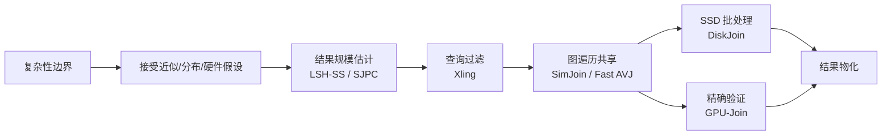
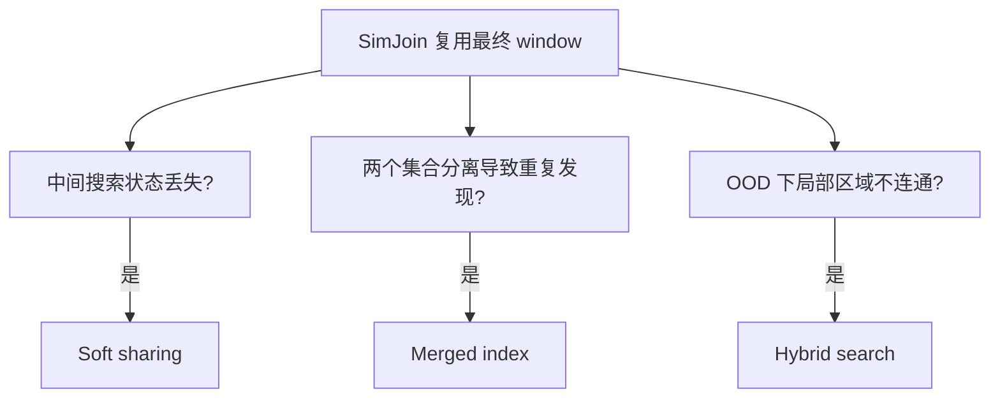
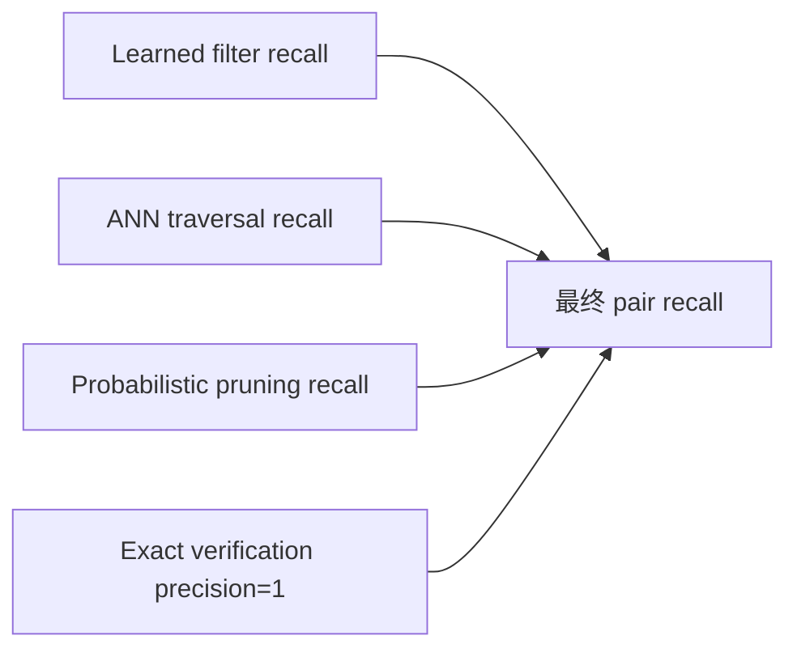

# Vector Join 八篇论文深度综合：方案来源、演化、展望与缺陷

## 1. 先给结论

这八篇工作并不在解决同一个局部瓶颈。把 vector threshold join 的端到端成本写成

$$
T=T_{build}+T_{plan}+T_{traverse}+T_{verify}+T_{I/O}+T_{materialize},
$$

就能看清它们的分工：复杂性论文解释为何不能期待一个无条件强次二次算法；LSH-SS/SJPC 估计输出规模；Xling 决定哪些 query 值得执行；SimJoin/Fast AVJ 减少跨 query 的重复图遍历；DiskJoin 减少 SSD 数据搬运；GPU-Join 加速 exact candidate verification。它们是可组合模块，不是彼此完全替代的算法。

图 1：研究演化不是单线替换，而是逐项压缩成本函数。

当前最有价值的研究缺口，是一个带不确定性的 cost-based vector join optimizer：同时预测输出、候选、图距离计算、SSD 读量与物化量，再根据 recall SLA 组合上述模块。

## 2. 八篇论文的方案与思想来源

| 论文 | 作者先看到的矛盾/现象 | 由此推出的方案 | 作者明确展望/讨论 | 关键缺陷（本报告判断） |
|---|---|---|---|---|
| IPS Complexity (2015) | 高维内积 join 与 Orthogonal Vectors 等细粒度难题可归约 | 给条件下界；用非对称嵌入与 LSH 给近似上界 | 改进近似参数区间与算法/下界间隙 | 理论阈值模型不含 build、I/O、输出和真实分布；下界不等于工程上无优化空间 |
| LSH-SS (2011) | 高阈值 true pair 是稀有事件，uniform sampling 抽不到；LSH 桶已富集相似 pair | 同桶/异桶分层采样，对两层使用不同 estimator | 多 LSH 表、non-self join、optimal-$k$ | 依赖已有 LSH；保证受桶纯度条件约束；旧式稀疏文本向量，未验证 dense embedding |
| SJPC (2018) | 至少匹配 $s$ 个字段可拆为属性投影上的 equality joins；但 pair 会多次计数 | projection $F_2$ sketches + 组合递推消重 | 属性分组扩高维、分布假设下紧界、与 join 执行融合 | 对 $d$ 组合爆炸；字段 equality 与 dense 向量距离不是同一问题 |
| GPU-Join (2018) | 全维网格邻接指数爆炸；无索引又接近全比较 | 少量高方差维建无损网格过滤，GPU 在全维精确验证并流水化 | multi-GPU、distributed-memory | 维度仅 16–90；GP100 时代；大阈值时候选与输出仍爆炸 |
| Xling (2024) | 大量 query 的结果为零或很少，却仍付完整 range-search 成本 | 学习邻居数/产出，低收益 query 直接跳过 | 可插入更多 loop-based joins；迁移与更强模型 | 用 recall 换速度；OOD 校准和确定性保证不足；跳过 query 会直接丢 pair |
| SimJoin (2025) | 相邻 query 的 threshold result windows 重叠；独立执行 range search 重复劳动 | query graph 上用 MST 排序，以父 query 的最终 window 多起点滑向子 window | distributed join；更广索引/更新场景 | 只共享最终 window；图连通性决定漏召回；单机内存；公开代码可得性不足 |
| DiskJoin (2025) | 逐 query 的 disk ANN 导致随机读、读放大和桶重复加载 | SSD buckets + bucket graph + dependency-aware schedule + cache + probabilistic pruning | 动态/跨集合/并发服务是自然延伸，但主文聚焦静态 self-join | 依赖静态批处理与专用资源；更新、cross-join、在线共存未解决；概率剪枝质量需端到端合成 |
| Fast AVJ (2026) | SimJoin 只共享最终结果；分离索引重复发现跨集合关系；OOD query 使阈值区域断裂 | merged encoder-centric index + soft state sharing + OOD hybrid search | disk、distributed、parallel execution | 合并索引收益依赖共享几何空间；内存实验为主；复杂维护和并发成本不足 |

## 3. “作者怎么想到方案”的推理链

### 3.1 SimJoin：从结果集合重叠到 MST 顺序

1. threshold join 等价于为每个 query 找一个 join window。
2. 几何上相近的 query 往往有重叠 window。
3. 若先处理父 query，就能把父 window 当作子 query 的多起点，而非回到固定入口。
4. 于是总成本依赖 query 访问顺序；把 query 间预计转换成本作为边权后，问题自然变成低成本 spanning structure，论文选择 MST/WindowOrder。

真正的创新不是“用了 MST”，而是把 join 从一批独立 range queries 重写为“窗口间状态转换”。缺陷也来自同一抽象：最终 window 丢掉了到达 window 之前的大量中间遍历状态。

### 3.2 Fast AVJ：逐一攻击 SimJoin 的三个信息损失

Fast AVJ 的设计几乎可视为对 SimJoin 的系统性误差分析：

- 最终结果之外的中间 frontier 被丢弃 → soft work sharing；
- query/data 各自建图，跨集合几何关系在线重复发现 → merged index；
- ID query 下成立的局部连通性在 OOD 下破坏 → 只对预测 OOD query 加桥接搜索。

图 2：Fast AVJ 的方案不是凭空堆模块，而是由三个失效模式导出。

### 3.3 DiskJoin：把算法中心从“距离比较”移到“数据移动”

当数据不进内存时，最佳内存 ANN 算法并不自动产生最佳 join：逐 query search 会重复读取同一 SSD 区域。DiskJoin 因而把调度单位提升为 bucket，先建立 bucket dependency，再共同安排加载、复用、淘汰与剪枝。其本质类似数据库中的 block nested-loop / join ordering，而非单查询 ANN 的简单外存化。

### 3.4 Xling：先问“这次搜索值不值得”

如果 query 的真邻居数为零，即使底层 range search 已很快，执行它仍是纯浪费。Xling 用学习模型近似一个难以便宜计算的 query selectivity，再以阈值把搜索预算集中给高产出 query。方案来源直接、插件化强，但质量损失也是结构性的：false negative 不是候选漏检，而是整个 query 的全部 pair 被跳过。

### 3.5 两类估计器：通过可观测 proxy 解决稀有事件

LSH-SS 用“同桶”作为近邻富集 proxy；SJPC 用“属性投影频率矩”作为至少 $s$ 字段相同的可分解 proxy。二者共同说明：直接估 $J$ 太难时，应寻找既与目标强相关、又能廉价统计的中间量。但 proxy 的适用假设决定了迁移边界。

### 3.6 GPU-Join 与复杂性结果：工程常数和理论指数必须分开

GPU-Join 通过方差维过滤和并行验证降低常数；复杂性论文说明一般高维实例中强次二次改进受条件下界约束。两者不冲突：硬件和数据结构可以在真实分布上大幅提速，却没有消除 worst-case 候选与输出的二次性。

## 4. 作者展望与分析者推断必须分开

| 类型 | 可直接归于作者 | 由跨论文证据推断，不能冒充作者结论 |
|---|---|---|
| 扩展 | SimJoin 的 distributed；Fast AVJ 的 disk/distributed/parallel；GPU-Join 的 multi-GPU/distributed | 建 CPU+GPU+SSD 统一优化器 |
| 高维估计 | SJPC 的属性分组与更紧分布界 | PQ 子空间、HNSW/IVF strata 的 dense-vector estimator |
| 索引扩展 | LSH-SS 的多表、virtual bucket、non-self join | 用 ANN graph 层级替代 LSH buckets |
| 系统融合 | SJPC 提议把统计结构放入 join 算法 | 统一 cardinality、candidate、I/O、materialization cost model |
| 质量 | 各现代论文分别报告 recall/概率剪枝/过滤效果 | 合成 end-to-end pair recall 置信下界 |

## 5. 共同缺陷与尚未被回答的问题

### 5.1 输出规模仍是“一等公民”不足

大量论文强调搜索或 I/O 加速，但结果物化本身可能为 $\Theta(n^2)$。只报告 count-only、忽略 host transfer 或把输出写盘排除在计时外，会把 dense-output workload 的主成本藏掉。后续实验必须同时提供 count-only 与 materialized-output 两种口径。

### 5.2 近似质量没有被端到端组合

图 3：多级系统的质量预算。解读：每级 recall 都高，不代表组合后的 pair recall 自动满足 SLA；误差还可能相关。

需要报告 per-query recall 分布、macro/micro pair recall、置信区间及最坏分位数，不能只给平均值。

### 5.3 build、更新与摊销口径不统一

merged index、LSH table、bucket graph、learned model 都有构建和维护成本。一次性 join 与周期性重复 join 的结论可能相反。统一 benchmark 应按 workload 生命周期报告 build、update、plan、execute、verify、materialize。

### 5.4 数据分布与任务定义不统一

早期论文覆盖稀疏文本、少字段记录或 90 维以内点；现代论文覆盖 dense embeddings，但 ID/OOD、self/cross、共享/不同 encoder 的设定不同。不能仅按“vector join”标题横向排 speedup。

## 6. 建议的研究主线

### 6.1 首选问题

> 面向 CPU–GPU–SSD 分层存储的自适应 approximate threshold join：在线估计输出、候选、距离计算和 I/O 的联合分布，在给定 pair-recall SLA 下选择 learned filtering、graph sharing、bucket scheduling 与 exact verification 计划。

### 6.2 最小可行实验

1. 先做静态 self-join，支持 cosine 与 L2，数据覆盖 128/384/768/1536 维。
2. baseline 至少含 independent range search、SimJoin、Fast AVJ、GPU blocked brute force；超内存组加入 DiskJoin。
3. estimator 比较 uniform、LSH/IVF-stratified、graph-stratified 和轻量 learned estimator。
4. 指标拆为 build/update、planning、distance computations、SSD bytes/random reads、verification、materialization、macro/micro recall。
5. 训练/验证按 dataset 和 encoder 留出，专门测 OOD 与阈值漂移。

### 6.3 可证伪的研究假设

- H1：联合预测候选与 I/O 比只预测 $|J|$ 更能降低端到端延迟。
- H2：soft sharing 在 query 局部相关但结果 window 不重叠时显著优于 hard sharing。
- H3：graph/IVF-induced stratified sampling 在固定预算下比 uniform 更准确，但在 OOD 下需校准。
- H4：输出较密时，GPU verification 或直接 blocked GEMM 优于复杂图遍历。
- H5：将各级误差显式分配为 recall budget，可在相同 SLA 下优于统一激进参数。

## 7. 阅读顺序与本地报告

建议按以下顺序建立认识：

1. [复杂性边界](../../papers/vector-join/1510.02824-inner-product-similarity-join-complexity/paper.report.md)
2. [SimJoin 核心基线](../../papers/vector-join/10.1145-3725403-simjoin/paper.report.md)
3. [Fast AVJ 对 SimJoin 的系统扩展](../../papers/vector-join/2603.16360-fast-approximate-vector-joins/paper.report.md)
4. [DiskJoin 外存执行](../../papers/vector-join/2508.18494-diskjoin/paper.report.md)
5. [Xling 学习型过滤](../../papers/vector-join/2402.13397-xling/paper.report.md)
6. [GPU-Join exact baseline](../../papers/vector-join/1809.09930-gpu-similarity-self-join/paper.report.md)
7. [LSH-SS 基数估计](../../papers/vector-join/1104.3212-lsh-join-size-estimation/paper.report.md)
8. [SJPC 流式基数估计](../../papers/vector-join/1806.03313-streaming-join-size-estimation/paper.report.md)

每份报告均区分作者明确陈述、实验支持程度和分析者推断，并包含形式化定义、伪代码、复杂度、实验可信度、失败条件与后续实验建议。
